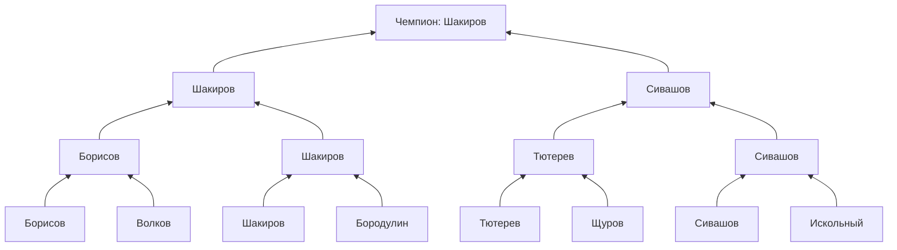
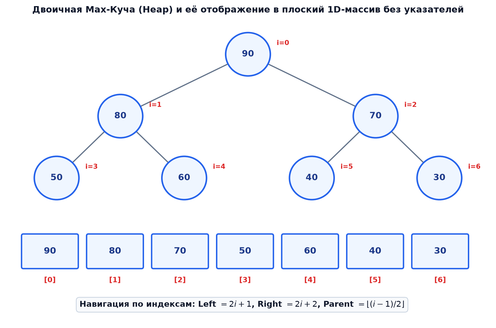
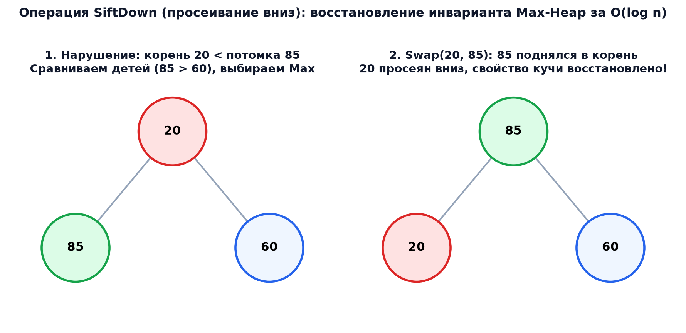

# 📌 Лекция 4: Сортировка выбором, пирамида (двоичная куча), пирамидальная сортировка и очередь с приоритетом

> [!abstract] О лекции
> - **Дисциплина:** [[Алгоритмы и структуры данных]] (1 семестр)
> - **Дата проведения:** 3 октября 2026 г. (суббота, `09:50 — 11:20`, ауд. 2342)
> - **Источники:** слайды «Сортировка выбором. Пирамидальная сортировка. Пирамида» (118 слайдов, в нумерации курса — «Лекция 8») и «Пирамида» (104 слайда, разбор на примере Евро-2024) из папки материалов курса на Google Drive, загружены 07.10.2026. Дополнения по CLRS (гл. 6) помечены значком 📎.
> - **Ключевые концепции:** сортировка выбором и её $O(n^2)$; идея ускорения — выбор не линейным поиском, а **в дереве** (кубковая система против чемпионата); турнирное дерево и его недостаток ($2N-1$ памяти); **пирамида** (двоичная куча) Флойда: форма и свойство, хранение в массиве; `siftUp`, `insert`, `siftDown`, `extractMax`; **пирамидальная сортировка** (Уильямс, 1964; Флойд); построение пирамиды за $O(n \log n)$ последовательными `insert` и **за $O(n)$** просеиванием снизу вверх; неустойчивость; **очередь с приоритетом** на списке, массиве и куче.

> [!note] Этот конспект заменяет предварительный
> Раньше здесь лежала реконструкция по программе курса. Теперь конспект написан по слайдам лекции.

---

## 📌 Краткое резюме (TL;DR)

1. **Сортировка выбором:** на каждом шаге найти максимум (минимум) неотсортированной части и поставить его на место. Поиск — линейный: $n + (n-1) + \dots + 1 \Rightarrow O(n^2)$ всегда.
2. **Идея ускорения:** перейти от линейного выбора за $O(n)$ к **выбору в дереве** за $O(\log n)$, сохраняя информацию об уже сделанных сравнениях. Аналогия: **чемпионат** (каждый с каждым) против **кубка** (игра на вылет).
3. **Турнирное дерево** находит победителя за $n-1$ матч, а второго — всего за $\approx \log_2 n$ дополнительных матчей. Но оно хранит $2N - 1$ узлов, т. е. дублирует элементы.
4. **Пирамида (max-куча)** Флойда хранит дерево **прямо в массиве**: почти полное двоичное дерево, в котором **каждый узел не меньше своих детей**. Дети $a[i]$ — $a[2i+1]$ и $a[2i+2]$ (0-индексация) или $x[2k]$ и $x[2k+1]$ (1-индексация). Максимум — в корне.
5. **Операции:** `siftUp` и `insert` — $O(\log n)$; `siftDown` и `extractMax` (обмен корня с последним листом, удаление листа, просеивание корня вниз) — $O(\log n)$; `getMax` — $O(1)$.
6. **Пирамидальная сортировка:** построить кучу, затем $n-1$ раз менять корень с последним элементом неотсортированной части и просеивать корень вниз. Время $O(n \log n)$ **в худшем случае**, память $O(1)$, **неустойчива**. На малых массивах проигрывает вставкам.
7. **Построение кучи:** через $n$ вызовов `insert` — $O(n \log n)$; **просеиванием вниз от $\lfloor n/2 \rfloor$ до корня** — $O(n)$, поскольку большинство узлов низко и спускается недалеко.
8. **Очередь с приоритетом** на куче: вставка и извлечение за $O(\log n)$. На упорядоченном списке вставка $O(n)$, на неупорядоченном массиве извлечение $O(n)$.

---

## 1. Сортировка выбором (Selection Sort)

### 1.1. Идея

1. В **неотсортированном** подмассиве ищется локальный максимум (минимум).
2. Найденный максимум (минимум) меняется местами с **последним (первым)** элементом этого подмассива.
3. Если неотсортированная часть ещё есть — вернуться к шагу 1.

### 1.2. Псевдокод (вариант с минимумом, нотация CLRS)

```text
SELECTION-SORT(A)
1  n ← A.length
2  for i ← 0 to n − 2
3      minIndex ← i
4      for j ← i + 1 to n − 1
5          if A[j] < A[minIndex]
6              minIndex ← j
7      exchange A[i] with A[minIndex]
```

### 1.3. Трассировка на массиве `[5, 2, 4, 6, 1, 3]`

| Шаг $i$ | Просматриваемая часть | Минимум (индекс) | Массив после обмена |
|:---:|:---|:---:|:---|
| 0 | `5 2 4 6 1 3` | 1 (4) | `1 │ 2 4 6 5 3` |
| 1 | `2 4 6 5 3` | 2 (1) | `1 2 │ 4 6 5 3` |
| 2 | `4 6 5 3` | 3 (5) | `1 2 3 │ 6 5 4` |
| 3 | `6 5 4` | 4 (5) | `1 2 3 4 │ 5 6` |
| 4 | `5 6` | 5 (4) | `1 2 3 4 5 │ 6` |

### 1.4. Анализ

Поиск минимума каждый раз требует **полного просмотра** неотсортированной части, как линейный поиск:

$$
T(n) = (n-1) + (n-2) + \dots + 1 = \frac{n(n-1)}{2} = \Theta(n^2)
$$

**независимо от входа** — даже на отсортированном массиве. Обменов не более $n - 1$; это достоинство, когда запись в память дорогая.

### 1.5. C++20

```cpp
#include <algorithm>
#include <concepts>
#include <cstddef>
#include <span>
#include <utility>

template <std::totally_ordered T>
void SelectionSort(std::span<T> a) {
    for (std::size_t i = 0; i + 1 < a.size(); ++i) {
        // инвариант: a[0..i) отсортирован и содержит i наименьших элементов
        std::size_t min_index = i;
        for (std::size_t j = i + 1; j < a.size(); ++j) {
            if (a[j] < a[min_index]) {   // строгое < : берём ПЕРВЫЙ минимум
                min_index = j;
            }
        }
        std::swap(a[i], a[min_index]);
    }
}
```

> [!warning] Сортировка выбором неустойчива 📎
> Обмен на дальнее расстояние перепрыгивает равные элементы. На `[2ₐ, 2ᵦ, 1]` первый шаг меняет `2ₐ` и `1`: получаем `[1, 2ᵦ, 2ₐ]`, порядок равных ключей нарушен.

---

## 2. Как ускорить выбор: чемпионат против кубка

### 2.1. Две системы соревнований

| Система | Как определить сильнейшего | Сравнений | Что даёт |
|:---|:---|:---:|:---|
| **Чемпионат** (РПЛ: каждый с каждым) | по сумме очков | $O(n^2)$ | распределяет **все** места |
| **Кубок** (игра на вылет, Евро-2024) | победитель пары проходит дальше | $n - 1$ матч, $\log_2 n$ раундов | быстро даёт **чемпиона** |

Кубковая система «сравнивает попарно, потом снова попарно»: вместо $n$ последовательных сравнений с текущим лидером — турнир глубины $\log_2 n$.

> [!info] Допущение лекции
> Будем считать, что результаты **транзитивны**: если Германия обыграла Данию, а Испания — Германию, то Испания сильнее Дании. Для чисел это верно автоматически.

### 2.2. Кто второй?

Недостаток кубка: трудно определить **второго, третьего** и т. д. Финалист (Сивашов на слайде), проигравший чемпиону (Шакирову), **не обязательно** второй по силе. Сильнее него может быть любой, кто проиграл чемпиону **раньше** (Борисов, Щуров).

**Решение:** пройти по дереву вниз, собрать **соперников чемпиона** и сыграть матчи только между ними. Для второго места хватает **$\lceil \log_2 n \rceil - 1$ дополнительных матчей** (на слайде — два). Это возможно, потому что дерево **хранит результаты прошлых сравнений**.



> [!note] Схема упрощена
> На слайде у Шакирова соперники Бородулин, Борисов и Сивашов; Щуров тоже выбывает рано. Дерево выше показывает принцип: кандидаты на второе место — **только** те, кто играл с чемпионом.

### 2.3. Турнирное дерево и его цена

Если после выбора лидера **перестраивать** дерево (заменять лидера «пустым» и переигрывать его путь), следующего лидера можно выбирать быстро. Так устроена **турнирная сортировка** с $O(n \log n)$.

Но в турнирном дереве **одни и те же элементы дублируются на разных уровнях**: вместо $N$ элементов хранится $2N - 1$, т. е. нужен вспомогательный массив.

> [!tip] Пирамида решает эту проблему
> **Пирамидальная сортировка** — улучшение сортировки прямым выбором. Её предложил **Джон Уильямс в 1964 г.**, улучшил **Роберт Флойд**. Пирамида хранит «дерево сравнений» **в самом сортируемом массиве**, без дублирования.

---

## 3. Пирамида (двоичная куча)

### 3.1. Определение

> [!info] Пирамида (heap)
> **Пирамида** — двоичное дерево высоты $k$, для которого:
> 1. **узлами** дерева являются элементы массива;
> 2. дерево **сбалансировано** (почти полное): все листья имеют глубину $k$ или $k - 1$, уровень $k - 1$ заполнен полностью, а уровень $k$ — **слева направо**;
> 3. выполнено **свойство пирамиды**: каждый элемент **меньше или равен** родителю. Следовательно, **корень — максимум** массива.

- Это **max-куча**. Для сортировки по **убыванию** используют **min-кучу**: ключ любого узла **не больше** ключей детей.
- В отличие от дерева поиска, дети **не упорядочены** между собой: левый может быть как больше, так и меньше правого.
- Новые узлы добавляются **строго слева направо** и только после полного заполнения предыдущего уровня. **Заполненным** считается уровень с максимально возможным числом узлов; частично заполненным может быть только **нижний**.

> [!warning] Терминология «полное дерево»
> В разных книгах «полным» называют разные вещи: либо такое **завершённое** (почти полное) дерево, либо дерево, где у каждого узла 0 или 2 ребёнка. Пирамида — именно **завершённое** дерево.

### 3.2. Хранение в массиве

Форма дерева фиксирована, поэтому его можно положить в массив **без пропусков** — по уровням, слева направо, сверху вниз.

| | 0-индексация (массив `a[0..n−1]`) | 1-индексация (узлы `x[1..N]`) |
|:---|:---:|:---:|
| Корень | `a[0]` | `x[1]` |
| Левый ребёнок | `2i + 1` | `2k` |
| Правый ребёнок | `2i + 2` | `2k + 1` |
| Родитель | `⌊(i − 1) / 2⌋` | `⌊m / 2⌋`, $m \ne 1$ |
| Свойство | `a[i] ≥ a[2i+1]` и `a[i] ≥ a[2i+2]` | $x[k] \ge x[2k] \wedge x[k] \ge x[2k+1]$, $k = 1, \dots, \lfloor N/2 \rfloor$ |
| Листья | `⌊n/2⌋ … n−1` | `⌊N/2⌋ + 1 … N` (их $N - \lfloor N/2 \rfloor$) |

**Пример со слайда:** массив `94, 67, 18, 44, 55, 12, 06, 42` — пирамида: `94 ≥ 67, 18`; `67 ≥ 44, 55`; `18 ≥ 12, 06`; `44 ≥ 42`.



**Зачем массив, а не узлы с указателями:**
- **экономия памяти** — не нужно $O(n)$ указателей на детей и родителя;
- **простота** — переходы по формулам за $O(1)$, это эффективная адресная арифметика;
- **кэш** — элементы лежат подряд, соседние уровни близко в памяти.

> [!tip] Высота
> В почти полном дереве из $n$ узлов высота $h = \lfloor \log_2 n \rfloor$. Все операции ниже проходят **один путь** от корня к листу или обратно, отсюда $O(\log n)$.

---

## 4. Операции над пирамидой

### 4.1. `siftUp` — просеивание вверх

Если элемент **больше родителя**, меняем их местами и продолжаем с позиции родителя. Если он не больше родителя — свойство восстановлено для всего дерева. Иначе говоря, **слишком большой** элемент всплывает вверх. Время — $O(\log n)$: подъёмов не больше высоты дерева.

```text
SIFT-UP(a, i)          ▷ 0-индексация, max-куча
1  while i > 0 and a[i] > a[⌊(i − 1)/2⌋]
2      exchange a[i] with a[⌊(i − 1)/2⌋]
3      i ← ⌊(i − 1)/2⌋
```

> [!warning] Неточность на слайдах
> На слайдах `siftUp` записан как `while a[i] < a[(i − 1)/2]` с комментарием «слишком **маленький** элемент всплывает наверх». Это версия для **min-кучи**. Для max-кучи, о которой лекция, условие обратное: `a[i] > a[parent]`.

### 4.2. `insert` — вставка за $O(\log n)$

Новый элемент кладётся на **последнее место** (`heapSize`), затем вызывается `siftUp`:

```text
INSERT(a, key)
1  a.heapSize ← a.heapSize + 1
2  a[a.heapSize − 1] ← key
3  SIFT-UP(a, a.heapSize − 1)
```

### 4.3. `siftDown` — просеивание вниз

Пусть свойство нарушено **только в узле $i$**, а оба его поддерева — уже пирамиды (**частично упорядоченное** пирамидальное дерево). Тогда: **поменять узел с бо́льшим из детей** и повторить в том поддереве, куда он ушёл. Остановиться, когда узел не меньше обоих детей или стал листом.

**Итеративная версия со слайдов (0-индексация):**

```text
SIFT-DOWN(a, i)
1  while 2i + 1 < a.heapSize               ▷ есть хотя бы левый ребёнок
2      left ← 2i + 1;  right ← 2i + 2
3      j ← left
4      if right < a.heapSize and a[right] > a[left]
5          j ← right                       ▷ j — БОЛЬШИЙ ребёнок
6      if a[i] ≥ a[j]
7          break                           ▷ свойство выполнено
8      exchange a[i] with a[j]
9      i ← j
```



Время — $O(h) = O(\log n)$.

### 4.4. `extractMax` — извлечение максимума

1. Удалить корень сразу нельзя — **дерево развалится**.
2. Чтобы сохранить форму, **меняем корень с последним листом**.
3. Теперь лист (бывший максимум) удаляется безболезненно: `heapSize ← heapSize − 1`.
4. Новый корень, вероятно, слишком мал — **просеиваем его вниз**.

```text
EXTRACT-MAX(a)
1  max ← a[0]
2  exchange a[0] with a[a.heapSize − 1]
3  a.heapSize ← a.heapSize − 1
4  SIFT-DOWN(a, 0)
5  return max
```

Удаление **произвольного** элемента и изменение ключа разобраны в [[05. Лекция - Удаление произвольного элемента из пирамиды и изменение ключа (2026-10-10)|лекции 5]].

---

## 5. Пирамидальная сортировка (Heap Sort)

### 5.1. Идея

Максимум кучи лежит в `a[0]`, а в отсортированном по возрастанию массиве он должен стоять **в конце**. Значит:

1. Преобразовать массив в пирамиду: на первое место попадёт $\max$ всего массива.
2. Выполнить $N - 1$ шагов. На $i$-м шаге:
   - поменять корень с последним элементом неотсортированной части `x[N − i + 1]`; этот элемент присоединяется к **отсортированной** части в конце;
   - уменьшить `heapSize` — остаток массива становится **частично упорядоченной** пирамидой (нарушение только в корне);
   - `siftDown(0)` — восстановить пирамиду; максимум оставшихся снова в начале.

Отсортированная часть растёт **справа налево**, куча — слева.

### 5.2. Трассировка (пример со слайдов)

Из массива `{45, 28, 54, 43, 70, 60, 65}` построена пирамида `[70, 65, 60, 28, 45, 54, 43]` (на слайде — «некоторым образом»; при построении Флойдом, см. §6, получится другая корректная пирамида `[70, 45, 65, 43, 28, 60, 54]`).

| Шаг | Обмен | После обмена (`│` — граница сортированной части) | После `siftDown(0)` |
|:---:|:---|:---|:---|
| 1 | `70 ↔ 43` | `43 65 60 28 45 54 │ 70` | `65 45 60 28 43 54 │ 70` |
| 2 | `65 ↔ 54` | `54 45 60 28 43 │ 65 70` | `60 45 54 28 43 │ 65 70` |
| 3 | `60 ↔ 43` | `43 45 54 28 │ 60 65 70` | `54 45 43 28 │ 60 65 70` |
| 4 | `54 ↔ 28` | `28 45 43 │ 54 60 65 70` | `45 28 43 │ 54 60 65 70` |
| 5 | `45 ↔ 43` | `43 28 │ 45 54 60 65 70` | `43 28 │ 45 54 60 65 70` |
| 6 | `43 ↔ 28` | `28 │ 43 45 54 60 65 70` | — |

Результат: `28 43 45 54 60 65 70`.

Как работает `siftDown` на шаге 1: `43` сравнивается с детьми `65` и `60`, больший — `65`, обмен; затем `43` на позиции 1 сравнивается с `28` и `45`, обмен с `45`; позиция 4 — лист, стоп.

### 5.3. Псевдокод и реализация

```text
HEAP-SORT(A)
1  BUILD-HEAP(A)
2  A.heapSize ← n
3  for i ← n − 1 downto 1
4      exchange A[0] with A[i]
5      A.heapSize ← A.heapSize − 1
6      SIFT-DOWN(A, 0)
```

> [!note] О границах цикла
> На слайде цикл записан как `for i = 0 to n − 1` с обменом `A[0] ↔ A[n − 1 − i]` — это $n$ итераций, последняя меняет `A[0]` сам с собой. Достаточно $n - 1$ шагов, как в тексте слайдов («выполнить $N - 1$ шаг»).

```cpp
#include <concepts>
#include <cstddef>
#include <span>
#include <utility>

template <std::totally_ordered T>
void SiftDown(std::span<T> a, std::size_t i, std::size_t heap_size) {
    while (2 * i + 1 < heap_size) {
        const std::size_t left = 2 * i + 1;
        const std::size_t right = left + 1;
        std::size_t j = left;
        if (right < heap_size && a[right] > a[left]) {
            j = right;                       // спускаемся к БОЛЬШЕМУ ребёнку
        }
        if (!(a[i] < a[j])) {
            break;                           // a[i] >= a[j]: свойство кучи выполнено
        }
        std::swap(a[i], a[j]);
        i = j;
    }
}

template <std::totally_ordered T>
void BuildHeap(std::span<T> a) {             // Флойд: O(n)
    for (std::size_t i = a.size() / 2; i-- > 0;) {
        SiftDown(a, i, a.size());            // от последнего внутреннего узла к корню
    }
}

template <std::totally_ordered T>
void HeapSort(std::span<T> a) {
    BuildHeap(a);
    for (std::size_t end = a.size(); end > 1; --end) {
        // инвариант: a[0..end) — max-куча, a[end..n) отсортирован и все его элементы >= a[0..end)
        std::swap(a[0], a[end - 1]);
        SiftDown(a, 0, end - 1);
    }
}
```

### 5.4. Анализ

- `BuildHeap` — $O(n)$ (§6.3), $n - 1$ вызовов `siftDown` по $O(\log n)$:
$$
T(n) = O(n) + (n - 1) \cdot O(\log n) = O(n \log n)
$$
и это **в худшем случае**, в отличие от быстрой сортировки.
- Память — $O(1)$: сортировка **на месте** (in-place).
- **Неустойчива** 📎: на `[5ₐ, 5ᵦ, 3]` (это уже куча) первый обмен даёт `[3, 5ᵦ │ 5ₐ]`, после `siftDown` — `[5ᵦ, 3 │ 5ₐ]`, затем `[3 │ 5ᵦ, 5ₐ]`. Равные ключи поменялись местами. «Когда разбираете новую сортировку, всегда задумывайтесь об устойчивости.»

> [!warning] Не для маленьких массивов
> Пирамидальную сортировку, как и другие «улучшенные» сортировки, **не рекомендуется** применять к небольшим массивам: при $N = 1000$ даже **прямые вставки** работают примерно **вдвое быстрее**. 📎 Причина — большая константа и плохая локальность: прыжки `i → 2i + 1` по массиву плохо ложатся в кэш. Поэтому `std::sort` (introsort) использует Heap Sort только как страховку от $O(n^2)$ быстрой сортировки.

---

## 6. Построение пирамиды

### 6.1. Способ 1: последовательные `insert` — $O(n \log n)$

Пустой массив можно считать **пустой кучей**. Делаем `a[0]` корнем, затем по очереди «добавляем» в кучу `a[1], a[2], …`, запуская `siftUp` от каждого:

$$
T(n) = \sum_{i=1}^{n} O(\log i) = O(\log n!) = O(n \log n).
$$

### 6.2. Способ 2 (Флойд): просеивание вниз снизу вверх — $O(n)$

**Наблюдения:**
- Массив сам по себе уже двоичное дерево общего вида, просто ещё **не пирамида**.
- **Листья** — уже пирамиды из одного элемента. Их $N - \lfloor N/2 \rfloor$, и они занимают **последние** позиции массива.
- Если оба поддерева узла — пирамиды, то после `siftDown` от узла пирамидой станет и всё его поддерево.

**Алгоритм:** запустить `siftDown` для узлов от $\lfloor N/2 \rfloor$ (последнего внутреннего) **до корня** — в обратном порядке.

```text
BUILD-HEAP(A)
1  A.heapSize ← A.length
2  for i ← ⌊A.length / 2⌋ − 1 downto 0
3      SIFT-DOWN(A, i)
```

### 6.3. Трассировка: `{4, 1, 3, 2, 16, 9, 10, 14, 8, 7}` (пример со слайдов)

Индексы узлов 1-based, $N = 10$, внутренние узлы — $5, 4, 3, 2, 1$.

| Узел $k$ | Ключ | Дети | Действие | Массив (1-based) после шага |
|:---:|:---:|:---|:---|:---|
| — | — | — | исходный | `4 1 3 2 16 9 10 14 8 7` |
| 5 | 16 | `7` | единственный ребёнок меньше — уже пирамида | `4 1 3 2 16 9 10 14 8 7` |
| 4 | 2 | `14, 8` | обмен с большим `14` | `4 1 3 14 16 9 10 2 8 7` |
| 3 | 3 | `9, 10` | обмен с большим `10` | `4 1 10 14 16 9 3 2 8 7` |
| 2 | 1 | `14, 16` | обмен с `16`; затем `1` на узле 5 меньше ребёнка `7` → обмен | `4 16 10 14 7 9 3 2 8 1` |
| 1 | 4 | `16, 10` | обмен с `16`; на узле 2 обмен с `14`; на узле 4 обмен с `8` (узел 9) | `16 14 10 8 7 9 3 2 4 1` |

Итог: пирамида `{16, 14, 10, 8, 7, 9, 3, 2, 4, 1}` — она существенно отличается от исходного массива.

> [!warning] Обмен может испортить поддерево ниже
> На узле 2 после обмена `1 ↔ 16` элемент `1` оказался в узле 5 и нарушил пирамидальность там. Поэтому `siftDown` **продолжает** спуск, пока элемент не встанет на место.

### 6.4. Почему $O(n)$, а не $O(n \log n)$

Наивная оценка: $\frac{n}{2}$ вызовов `siftDown` по $O(\log n)$ даёт $O(n \log n)$. Но она **груба**: большинство узлов находятся **низко**, и спуск от них короткий.

Пусть $H = \lfloor \log_2 n \rfloor$ — высота, а уровни отсчитываются **от основания**: $h = 0$ — листья, $h = H$ — корень. На высоте $h$ не более $\left\lceil \frac{n}{2^{h+1}} \right\rceil$ узлов, и `siftDown` от каждого делает не более $h$ спусков (с $O(1)$ сравнений на спуск: узел сравнивается с двумя детьми):

$$
T(n) \le \sum_{h=0}^{H} \left\lceil \frac{n}{2^{h+1}} \right\rceil \cdot O(h)
= O\!\left(n \sum_{h=0}^{\infty} \frac{h}{2^h}\right).
$$

Ряд сходится: дифференцируя $\sum_{h \ge 0} x^h = \frac{1}{1-x}$ и умножая на $x$, получаем $\sum_{h \ge 0} h x^h = \frac{x}{(1-x)^2}$, при $x = \frac{1}{2}$:

$$
\sum_{h=0}^{\infty} \frac{h}{2^h} = \frac{1/2}{(1/2)^2} = 2 \implies T(n) = O(2n) = O(n). \qquad \blacksquare
$$

| Уровень от основания $h$ | Узлов (не более) | Спусков от узла | Вклад |
|:---:|:---:|:---:|:---:|
| 0 (листья) | $n/2$ | 0 | 0 |
| 1 | $n/4$ | 1 | $n/4$ |
| 2 | $n/8$ | 2 | $2n/8$ |
| 3 | $n/16$ | 3 | $3n/16$ |
| $h$ | $n/2^{h+1}$ | $h$ | $h n / 2^{h+1}$ |
| **Итого** | $\le n$ узлов | $\le H$ | $\le n$ |

> [!tip] Зачем $O(n)$, если сортировка всё равно $O(n \log n)$?
> «Хороший вопрос!» — пирамида нужна **не только** для сортировки: очереди с приоритетом, алгоритмы **Дейкстры**, **Прима**, **Хаффмана**, слияние $k$ потоков, обработка событий и потоков в реальном времени, вычислительная геометрия. Там часто нужно **построить** кучу из готового набора, и $O(n)$ лучше $O(n \log n)$.

---

## 7. Очередь с приоритетом

> [!info] Определение
> **Очередь с приоритетом** — абстрактная структура данных наподобие стека или очереди, где у каждого элемента есть **приоритет**. Элемент с более высоким приоритетом идёт **раньше**. При равных приоритетах — по порядку в очереди. Элементы извлекаются не в порядке добавления, а **по приоритету**.

**Операции:**
- `findMax` / `findMin` — найти элемент с наивысшим приоритетом;
- `insert` / `push` — вставить элемент;
- `extractMax` / `extractMin` — извлечь элемент с наивысшим приоритетом;
- `deleteMax` / `deleteMin` — удалить его;
- `increaseKey` / `decreaseKey` — изменить приоритет элемента.

### 7.1. Сравнение реализаций

| Реализация | `insert` | `extractMax` | `findMax` | Недостаток |
|:---|:---:|:---:|:---:|:---|
| Упорядоченный **список** | $O(n)$ | $O(1)$ | $O(1)$ | для вставки нужно пройти по списку и найти место |
| Неупорядоченный **массив** | $O(1)$ | $O(n)$ | $O(n)$ | максимум каждый раз ищется за $O(n)$; нужен непрерывный участок памяти |
| **Двоичная куча** | $O(\log n)$ | $O(\log n)$ | $O(1)$ | — |

### 7.2. В C++ 📎

```cpp
#include <functional>
#include <queue>
#include <vector>

std::priority_queue<int> max_pq;                                        // max-куча по умолчанию
std::priority_queue<int, std::vector<int>, std::greater<int>> min_pq;   // min-куча
max_pq.push(5);
max_pq.push(42);
int top = max_pq.top();   // 42 за O(1)
max_pq.pop();             // O(log n)
```

`std::priority_queue` не умеет `increaseKey` и удаление из середины. Для этого пишут **индексированную кучу** ([[05. Лекция - Удаление произвольного элемента из пирамиды и изменение ключа (2026-10-10)|лекция 5]]).

---

## 8. Сводная таблица

### 8.1. Операции пирамиды

| Операция | Время | Идея |
|:---|:---:|:---|
| `getMax` | $O(1)$ | корень `a[0]` |
| `siftUp` | $O(\log n)$ | обмен с родителем, пока больше родителя |
| `insert` | $O(\log n)$ | в конец + `siftUp` |
| `siftDown` | $O(\log n)$ | обмен с большим ребёнком, пока меньше его |
| `extractMax` | $O(\log n)$ | корень ↔ последний, `heapSize−−`, `siftDown(0)` |
| `buildHeap` через `insert` | $O(n \log n)$ | $n$ раз `siftUp` |
| `buildHeap` Флойда | $O(n)$ | `siftDown` от $\lfloor n/2 \rfloor - 1$ до 0 |

### 8.2. Сортировка выбором против пирамидальной

| | Selection Sort | Heap Sort |
|:---|:---:|:---:|
| Выбор максимума | линейный поиск $O(n)$ | из кучи $O(\log n)$ |
| Лучший / средний / худший | $\Theta(n^2)$ / $\Theta(n^2)$ / $\Theta(n^2)$ | $O(n \log n)$ во всех случаях |
| Доп. память | $O(1)$ | $O(1)$ |
| Устойчивость | ❌ | ❌ |
| Число обменов | $\le n - 1$ | $O(n \log n)$ |

---

## 9. Чек-лист и типичные ошибки

> [!warning] Ошибки
> 1. В `siftDown` менять с **левым**, а не с **большим** ребёнком.
> 2. Путать формулы для 0- и 1-индексации (`2i+1` против `2k`).
> 3. Запускать `buildHeap` **сверху вниз** (от корня к листьям) — так куча не строится: `siftDown` требует, чтобы поддеревья **уже** были пирамидами.
> 4. Забывать уменьшать `heapSize` в Heap Sort: тогда `siftDown` «вытащит» уже отсортированный хвост обратно.
> 5. Считать Heap Sort устойчивой.
> 6. Оценивать `buildHeap` как $O(n \log n)$: это верная, но **не точная** верхняя граница.

---

## ❓ Вопросы для самопроверки к коллоквиуму / экзамену

- [ ] Опишите сортировку выбором и докажите, что она работает за $\Theta(n^2)$ на любом входе.
- [ ] Покажите, что сортировка выбором неустойчива.
- [ ] Чем кубковая система отличается от чемпионата? Почему финалист не обязательно второй по силе?
- [ ] Почему турнирное дерево требует $2N - 1$ памяти и как пирамида избавляется от этого?
- [ ] Дайте определение пирамиды: форма и свойство. Чем пирамида отличается от дерева поиска?
- [ ] Выпишите формулы родителя и детей для 0- и 1-индексации.
- [ ] Опишите `siftUp`, `insert`, `siftDown`, `extractMax` и оцените их время.
- [ ] Почему при `extractMax` нельзя просто удалить корень?
- [ ] Выполните Heap Sort для пирамиды `[70, 65, 60, 28, 45, 54, 43]`.
- [ ] Постройте пирамиду из `{4, 1, 3, 2, 16, 9, 10, 14, 8, 7}` методом Флойда.
- [ ] Докажите, что `buildHeap` Флойда работает за $O(n)$.
- [ ] Почему построение через $n$ вставок даёт $O(n \log n)$?
- [ ] Почему Heap Sort неустойчива? Приведите пример.
- [ ] Почему на малых массивах Heap Sort проигрывает сортировке вставками?
- [ ] Сравните реализации очереди с приоритетом на списке, массиве и куче.

---

## 🔗 Связанные материалы

- [[Алгоритмы и структуры данных]] — главный хаб дисциплины
- [[01. Лекция - Сложность алгоритмов, O-символика и сортировка вставками (2026-09-12)]] — сортировка вставками и асимптотика
- [[03. Лекция - Сортировка слиянием (Merge Sort), Быстрая сортировка (Quick Sort) (2026-09-26)]] — другие $O(n \log n)$ сортировки
- [[05. Лекция - Удаление произвольного элемента из пирамиды и изменение ключа (2026-10-10)]] — следующая лекция: удаление и изменение ключа
- [[04. Практика - Шпаргалка по асимптотике, 26 типовых примеров и задачи на оценку циклов (2026-10-03)]] — оценка $\log(n!) = \Theta(n \log n)$
- [[Теорминимум и банк вопросов коллоквиума I семестра]]
