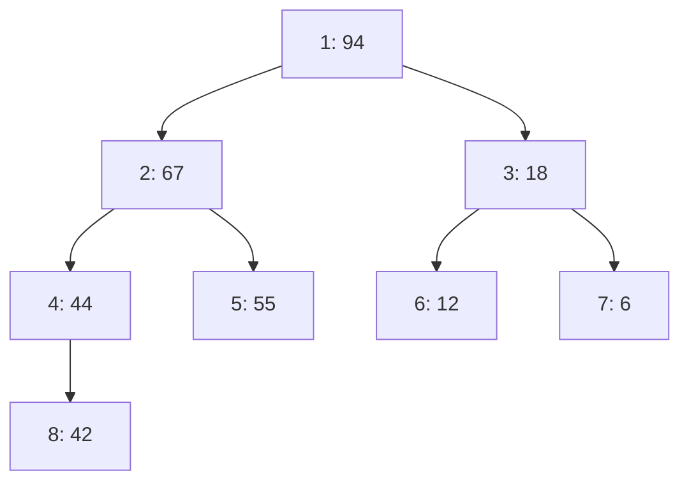
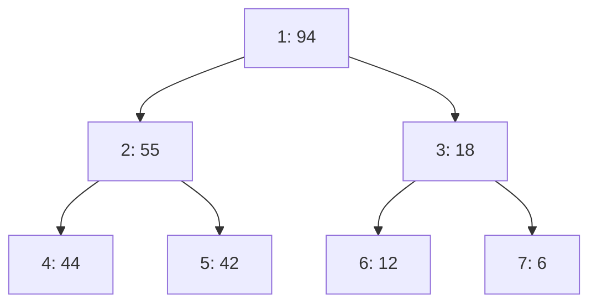

# 📌 Лекция 5: Удаление произвольного элемента из пирамиды и изменение ключа

> [!abstract] О лекции
> - **Дисциплина:** [[Алгоритмы и структуры данных]] (1 семестр)
> - **Дата проведения:** 10 октября 2026 г. (суббота, `09:50 — 11:20`, ауд. 2342)
> - **Источник:** слайды «Удаление из пирамиды» из папки материалов курса на Google Drive (10 слайдов, загружены 12.10.2026). Слайды короткие, поэтому трассировки, псевдокод, код на C++20 и анализ дописаны по CLRS (гл. 6) и помечены значком 📎.
> - **Ключевые концепции:** удаление элемента из **середины** двоичной кучи; два «наивных» способа через изменение ключа и почему они хуже; основной способ — обмен с последним элементом и восстановление свойства кучи **либо** просеиванием вниз, **либо** вверх; операции `increaseKey` / `decreaseKey`; зачем хранить позицию элемента в куче.

> [!info] Связь с предыдущей лекцией
> Определение кучи, индексация в массиве и операции `siftUp` / `siftDown` разобраны в [[04. Лекция - Двоичная куча (Binary Heap), пирамидальная сортировка (Heap Sort) (2026-10-03)|лекции 4]]. Здесь, как на слайдах, используется **1-индексация**: корень — `A[1]`, родитель `i` — `⌊i/2⌋`, дети — `2i` и `2i+1`.

---

## 📌 Краткое резюме (TL;DR)

1. **Задача:** удалить из max-кучи элемент, стоящий **не в корне**, например `A[2] = 67`.
2. **Наивные способы (слайд 2) — долгие:**
   - уменьшить ключ до минимума и «утопить» его — но минимум кучи ещё нужно **найти** ($O(n)$);
   - увеличить ключ до `A[1] + 1`, поднять его в корень (`siftUp`), а затем выполнить обычное удаление максимума — два прохода по высоте дерева.
3. **Основной способ (слайды 3–10):**
   1. поменять удаляемый элемент с **последним** `A[n]` (`swap`);
   2. уменьшить размер кучи: `n ← n − 1`;
   3. новый элемент на позиции `i` нарушает свойство кучи **либо** сверху, **либо** снизу → выполнить **либо** `siftUp`, **либо** `siftDown`.
4. **Сложность:** $O(\log n)$ — один обмен и одно просеивание по высоте $h = \lfloor \log_2 n \rfloor$.
5. **Важно (красная строка слайда 2):** чтобы удалить элемент по **значению ключа**, нужно знать, **где** он лежит. В куче нет быстрого поиска ($O(n)$), поэтому на практике вместе с элементами хранят их **позиции** (индексы) — так устроены очереди с приоритетом в алгоритмах Дейкстры и Прима.

---

## 1. Постановка задачи

Дана max-куча из 8 элементов (слайд 2):



| Индекс | 1 | 2 | 3 | 4 | 5 | 6 | 7 | 8 |
|:---|:---:|:---:|:---:|:---:|:---:|:---:|:---:|:---:|
| `A[i]` | 94 | 67 | 18 | 44 | 55 | 12 | 6 | 42 |

Требуется удалить элемент **67** (индекс 2). Удаление максимума `extractMax` уже известно, а здесь удаляется элемент из **середины** дерева.

> [!warning] Почему нельзя просто «вырезать» элемент
> Куча — это **почти полное** дерево, которое хранится в массиве без дыр. Если удалить `A[2]` и сдвинуть хвост массива влево, связи «родитель–дети» перемешаются, и свойство кучи нарушится сразу в многих местах. Нужен способ, который меняет **один** путь в дереве.

---

## 2. Наивные способы через изменение ключа (слайд 2)

### 2.1. Уменьшить ключ до минимума

Идея: присвоить `A[i]` значение меньше всех в куче, утопить его `siftDown` до листа, а затем удалить лист.

**Проблема:** чтобы знать «значение меньше всех», нужно найти **минимум** max-кучи. Минимум лежит где-то среди листьев (их $\approx n/2$), поэтому поиск занимает $O(n)$, а это **долго**. 📎 Можно взять $-\infty$, но тогда утопленный элемент окажется в каком-то листе, а не обязательно в последнем, и удалить его без дыры всё равно не получится.

### 2.2. Увеличить ключ до максимума

Идея (слайд 2): присвоить `A[i] ← A[1] + 1` — больше текущего максимума, поднять элемент `siftUp` в корень, а затем выполнить обычное **удаление максимума** (обмен корня с `A[n]` и `siftDown`).

**Проблема:** два прохода по высоте — сначала вверх до корня, потом от корня вниз. Асимптотически это тоже $O(\log n)$, но работы примерно вдвое больше, чем нужно, а `A[1] + 1` может переполнить тип ключа.

> [!tip] Вывод слайда
> Оба способа корректны, но **«это долго»**. Нужен приём, который трогает только один путь в дереве.

---

## 3. Основной способ: обмен с последним элементом (слайды 3–10)

### 3.1. Идея

Последний элемент `A[n]` — самый правый лист нижнего уровня. Его можно убрать, **не нарушив форму** дерева. Значит:

1. переносим `A[n]` на место удаляемого элемента: `swap(A[i], A[n])`;
2. уменьшаем размер: `n ← n − 1` — удаляемый элемент теперь «за границей» кучи;
3. на позиции `i` оказался **чужой** элемент `x`. Форма дерева правильная, а свойство кучи может быть нарушено **только в одной точке** — в позиции `i`. Возможны три случая:

| Случай | Условие | Действие |
|:---|:---|:---|
| `x` больше родителя | `i > 1` и `A[i] > A[⌊i/2⌋]` | **`siftUp(i)`** |
| `x` меньше хотя бы одного ребёнка | `A[i] < max(A[2i], A[2i+1])` | **`siftDown(i)`** |
| ни то, ни другое | — | ничего не делать |

> [!important] Почему нужно ровно одно из двух просеиваний (слайд 5: «Либо: 1) просеять вниз, 2) просеять вверх»)
> До удаления куча была корректной: родитель `p = ⌊i/2⌋` больше **всех** элементов своего поддерева, в том числе детей `i`. Если `x > A[p]`, то `x` больше и детей позиции `i`, значит, вниз его опускать не нужно — только вверх. Если же `x ≤ A[p]`, вверх его не поднять, а нарушение возможно только снизу. Поэтому **оба** условия одновременно не выполняются никогда.

### 3.2. Трассировка 1: удаление 67 → нужен `siftDown` (слайды 3–10)

**Шаг 1. Обмен с последним** (слайды 4, 6): `swap(A[2], A[8])`, затем `n ← 7`.

| Индекс | 1 | 2 | 3 | 4 | 5 | 6 | 7 | ~~8~~ |
|:---|:---:|:---:|:---:|:---:|:---:|:---:|:---:|:---:|
| `A[i]` | 94 | **42** | 18 | 44 | 55 | 12 | 6 | ~~67~~ |

**Шаг 2. Куда просеивать?** (слайд 7: «shift-up? sift-down?»)
- Родитель: `A[1] = 94 > 42` → вверх **не нужно**.
- Дети: `A[4] = 44`, `A[5] = 55`, оба больше 42 → нужно **вниз** (слайд 8: «shift-down»).

**Шаг 3. `siftDown(2)`** (слайд 9): больший из детей — `A[5] = 55`; меняем `A[2] ↔ A[5]`.

| Индекс | 1 | 2 | 3 | 4 | 5 | 6 | 7 |
|:---|:---:|:---:|:---:|:---:|:---:|:---:|:---:|
| `A[i]` | 94 | **55** | 18 | 44 | **42** | 12 | 6 |

Позиция 5 — лист (детей `10, 11` нет при `n = 7`) → **готово** (слайд 10: «Done!»).



> [!warning] Опускаем к **большему** из детей
> Если обменять 42 с 44 (левым ребёнком), то на позиции 2 окажется 44, а её ребёнком станет 55 > 44 — свойство нарушено. Меняют всегда с **максимальным** ребёнком.

### 3.3. Трассировка 2: удаление 12 → нужен `siftUp` 📎

Чтобы увидеть второй случай, удалим из исходной кучи элемент **12** (индекс 6).

**Шаг 1.** `swap(A[6], A[8])`, `n ← 7`:

| Индекс | 1 | 2 | 3 | 4 | 5 | 6 | 7 |
|:---|:---:|:---:|:---:|:---:|:---:|:---:|:---:|
| `A[i]` | 94 | 67 | 18 | 44 | 55 | **42** | 6 |

**Шаг 2.** Родитель позиции 6 — `A[3] = 18 < 42` → свойство нарушено **сверху**, нужен `siftUp`.

**Шаг 3. `siftUp(6)`:** меняем `A[6] ↔ A[3]` → на позиции 3 стоит 42; её родитель `A[1] = 94 > 42` → стоп.

| Индекс | 1 | 2 | 3 | 4 | 5 | 6 | 7 |
|:---|:---:|:---:|:---:|:---:|:---:|:---:|:---:|
| `A[i]` | 94 | 67 | **42** | 44 | 55 | **18** | 6 |

> [!example] Почему так бывает
> Последний элемент 42 лежал в **левом** поддереве (под 44), а удаляемый 12 — в **правом**, под меньшим родителем 18. Элемент «переехал» в поддерево, где все значения меньше, и оказался больше нового родителя.

### 3.4. Частные случаи

- **Удаляется последний элемент** (`i = n`): обмен сам с собой, `n ← n − 1`, просеивать нечего.
- **Удаляется корень** (`i = 1`): это обычный `extractMax` — родителя нет, всегда `siftDown`.

---

## 4. Псевдокод (нотация CLRS)

```text
HEAP-DELETE(A, i)
1  exchange A[i] with A[A.heap-size]
2  A.heap-size ← A.heap-size − 1
3  if i ≤ A.heap-size
4      if i > 1 and A[i] > A[PARENT(i)]
5          SIFT-UP(A, i)
6      else
7          SIFT-DOWN(A, i)

SIFT-UP(A, i)
1  while i > 1 and A[PARENT(i)] < A[i]
2      exchange A[i] with A[PARENT(i)]
3      i ← PARENT(i)

SIFT-DOWN(A, i)
1  l ← LEFT(i);  r ← RIGHT(i);  largest ← i
2  if l ≤ A.heap-size and A[l] > A[largest]
3      largest ← l
4  if r ≤ A.heap-size and A[r] > A[largest]
5      largest ← r
6  if largest ≠ i
7      exchange A[i] with A[largest]
8      SIFT-DOWN(A, largest)
```

Строка 3 в `HEAP-DELETE` обрабатывает случай удаления последнего элемента. Если условие строки 4 ложно, `SIFT-DOWN` сам проверит, есть ли нарушение снизу.

---

## 5. Реализация на C++20 📎

В коде принята **0-индексация**: родитель `(i − 1) / 2`, дети `2i + 1` и `2i + 2`.

```cpp
#include <cstddef>
#include <functional>
#include <utility>
#include <vector>

template <typename T, typename Compare = std::less<T>>
class BinaryHeap {
public:
    void Push(T value) {
        data_.push_back(std::move(value));
        SiftUp(data_.size() - 1);
    }

    [[nodiscard]] const T& Top() const { return data_.front(); }
    [[nodiscard]] std::size_t Size() const noexcept { return data_.size(); }
    [[nodiscard]] bool Empty() const noexcept { return data_.empty(); }

    // Удаление элемента по позиции i за O(log n)
    void Erase(std::size_t i) {
        const std::size_t last = data_.size() - 1;
        std::swap(data_[i], data_[last]);       // 1. обмен с последним
        data_.pop_back();                       // 2. n ← n − 1
        if (i == last) {
            return;                             // удаляли последний — просеивать нечего
        }
        // 3. ровно одно из двух просеиваний
        if (i > 0 && cmp_(data_[Parent(i)], data_[i])) {
            SiftUp(i);
        } else {
            SiftDown(i);
        }
    }

    void Pop() { Erase(0); }                    // extractMax — частный случай Erase

private:
    static constexpr std::size_t Parent(std::size_t i) noexcept { return (i - 1) / 2; }
    static constexpr std::size_t Left(std::size_t i) noexcept { return 2 * i + 1; }

    void SiftUp(std::size_t i) {
        // инвариант: свойство кучи нарушено разве что между i и его родителем
        while (i > 0 && cmp_(data_[Parent(i)], data_[i])) {
            std::swap(data_[i], data_[Parent(i)]);
            i = Parent(i);
        }
    }

    void SiftDown(std::size_t i) {
        const std::size_t n = data_.size();
        while (true) {
            std::size_t largest = i;
            const std::size_t l = Left(i);
            const std::size_t r = l + 1;
            if (l < n && cmp_(data_[largest], data_[l])) largest = l;
            if (r < n && cmp_(data_[largest], data_[r])) largest = r;   // к БОЛЬШЕМУ ребёнку
            if (largest == i) return;
            std::swap(data_[i], data_[largest]);
            i = largest;
        }
    }

    std::vector<T> data_;
    [[no_unique_address]] Compare cmp_{};
};
```

> [!tip] Проверка на примере лекции
> Пусть куча построена из `{94, 67, 18, 44, 55, 12, 6, 42}` в том же порядке, что на слайде (0-индексы на единицу меньше). Тогда `Erase(1)` удалит 67 и даст `{94, 55, 18, 44, 42, 12, 6}`, как в трассировке 1, а `Erase(5)` на исходной куче удалит 12 и даст `{94, 67, 42, 44, 55, 18, 6}` — трассировка 2.

---

## 6. Изменение ключа: `increaseKey` и `decreaseKey` 📎

Удаление тесно связано с **изменением приоритета** элемента — следующей стандартной операцией очереди с приоритетом:

| Операция (max-куча) | Что нарушается | Как чинить | Время |
|:---|:---|:---|:---:|
| `increaseKey(i, k)`, $k \ge A[i]$ | элемент может стать больше родителя | `siftUp(i)` | $O(\log n)$ |
| `decreaseKey(i, k)`, $k \le A[i]$ | элемент может стать меньше ребёнка | `siftDown(i)` | $O(\log n)$ |
| `changeKey(i, k)` (любое) | одно из двух | как в `Erase`: сравнить с родителем | $O(\log n)$ |

Способ 2.2 со слайда — это `increaseKey(i, +∞)` + `extractMax`: удаление, выраженное через изменение ключа. Так оно определено в CLRS (упражнение 6.5-8).

---

## 7. Где взять индекс `i`: дескрипторы элементов

> [!important] «В целом мы сохранить элемент со значением ключа!» (слайд 2)
> Все операции выше принимают **позицию** `i`. Но обычно задача звучит иначе: «удали задачу с id = 17» или «уменьши расстояние до вершины `v`». Куча упорядочена только по вертикали, поэтому **поиск по значению занимает $O(n)$** — и вся выгода $O(\log n)$ теряется.

**Решение 📎:** хранить рядом с кучей массив **позиций** `pos[id]` — где сейчас лежит элемент с идентификатором `id`. При **каждом** обмене в `siftUp`/`siftDown` обновлять `pos` у обоих элементов. Такая структура называется **индексированной кучей** (indexed priority queue) и используется в алгоритмах:
- **Дейкстры** — `decreaseKey` расстояния до вершины;
- **Прима** — `decreaseKey` веса ребра до вершины;
- в планировщиках задач — удаление отменённой задачи.

> [!tip] Альтернатива — «ленивое удаление»
> `std::priority_queue` не умеет удалять из середины. Часто элемент просто **помечают** удалённым, а когда он оказывается в корне, выбрасывают без обработки. Это проще, но куча разрастается за счёт «мёртвых» элементов.

---

## 8. Сводная таблица операций двоичной кучи

| Операция | Идея | Время |
|:---|:---|:---:|
| `getMax` | вернуть `A[1]` | $O(1)$ |
| `insert` | добавить в конец + `siftUp` | $O(\log n)$ |
| `extractMax` | `A[1] ↔ A[n]`, `n−−`, `siftDown(1)` | $O(\log n)$ |
| **`delete(i)`** | **`A[i] ↔ A[n]`, `n−−`, `siftUp` или `siftDown`** | $O(\log n)$ |
| `increaseKey(i)` | `siftUp(i)` | $O(\log n)$ |
| `decreaseKey(i)` | `siftDown(i)` | $O(\log n)$ |
| `find(key)` | перебор массива | $O(n)$ |
| `buildHeap` | `siftDown` от $\lfloor n/2 \rfloor$ до 1 | $O(n)$ |

---

## 9. Чек-лист и типичные ошибки

> [!warning] Ошибки
> 1. **Забыть одно из просеиваний.** Писать только `siftDown` после обмена неверно: трассировка 2 показывает, что иногда нужен `siftUp`.
> 2. **Опускать к левому, а не к большему ребёнку** в `siftDown`.
> 3. **Не учесть удаление последнего элемента:** после `pop_back` индекс `i` указывает за границу массива.
> 4. **Искать элемент линейным поиском** при каждом удалении — получится $O(n)$. Храните позиции.
> 5. **Путать 0- и 1-индексацию** при переходе от слайдов к коду: у корня `0` родителя нет, и `(0 − 1) / 2` для `size_t` даёт огромное число.

---

## ❓ Вопросы для самопроверки к коллоквиуму / экзамену

- [ ] Почему нельзя удалить элемент из кучи, просто сдвинув хвост массива?
- [ ] Опишите два «наивных» способа удаления через изменение ключа. Почему они медленнее?
- [ ] Опишите алгоритм удаления через обмен с последним элементом.
- [ ] Докажите, что после обмена нужно **не более одного** просеивания — вверх **или** вниз.
- [ ] Выполните удаление 67 из кучи `[94, 67, 18, 44, 55, 12, 6, 42]` и покажите состояние массива на каждом шаге.
- [ ] Приведите пример удаления, после которого нужен `siftUp`.
- [ ] Чем `increaseKey` отличается от `decreaseKey` в max-куче? Какое просеивание нужно каждой?
- [ ] Зачем в индексированной куче хранить массив позиций? В каких алгоритмах это используется?
- [ ] Какова сложность `delete(i)`, `find(key)` и `buildHeap`?

---

## 🔗 Связанные материалы

- [[Алгоритмы и структуры данных]] — главный хаб дисциплины
- [[04. Лекция - Двоичная куча (Binary Heap), пирамидальная сортировка (Heap Sort) (2026-10-03)]] — двоичная куча, `siftUp`, `siftDown`, Heap Sort
- [[02. Практика - Мастер-теорема, стабильность сортировок и псевдокод (2026-09-19)]] — стандарты псевдокода CLRS
