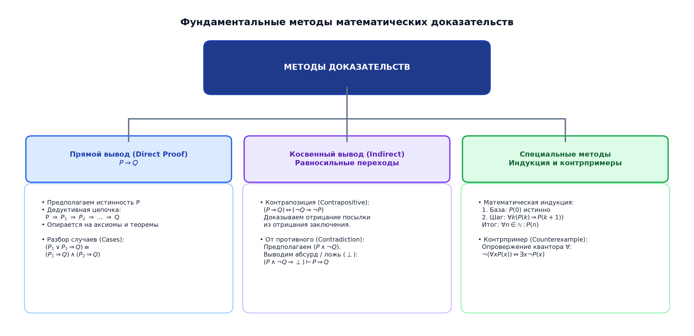
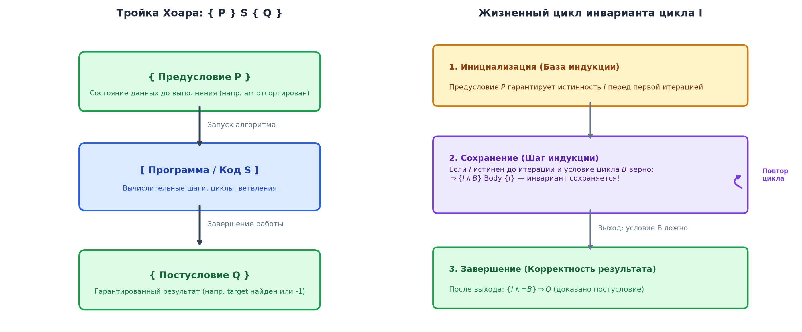

# 📝 Лекция 2: Предикаты и доказательства

> [!info] Сверка со слайдами
> Конспект сверен с презентацией `s1-lec02-predicates.typ` из репозитория Lipen/discrete-math-course (редакция от 13 октября 2026, неделя 15–16 сентября). Тройки Хоара и инвариант бинарного поиска, а также пример с непрерывностью — дополнения вне слайдов.

> [!abstract] О занятии
> - **Дисциплина:** [[Дискретная математика]] (1 семестр, 2026/27 уч. год)
> - **Дата:** 16 сентября 2026 года (2-я неделя)
> - **Лектор:** Константин Чухарев ([@Lipen](https://github.com/Lipen), Университет ИТМО)
> - **Модуль 1:** Множества и методы доказательств
> - **Источники:** слайды `s1-lec02-predicates.typ`; главы книги `m03` («Предикаты», «Кванторы», «Отрицание кванторов», «Ограниченные кванторы»), `m01` («Методы доказательств»).
> - **Ключевые темы:** предикаты и домен, кванторы, свободные и связанные переменные, отрицание кванторов, порядок кванторов, ограниченные кванторы, перевод на язык предикатов, «только», $\exists!$, кванторы в коде, прямое доказательство, контрапозиция, от противного, разбор случаев, контрпример, эквивалентность, логические ошибки, индукция (обычная и сильная), принцип полной упорядоченности, инварианты циклов.

## 📌 Краткое резюме (TL;DR)

- **Предикат** $P(x)$ — шаблон высказывания; $\forall$ и $\exists$ превращают его в высказывание.
- $\neg\forall\equiv\exists\neg$, $\neg\exists\equiv\forall\neg$; **порядок разноимённых кванторов существен**.
- $\forall x\in A.\,P\equiv\forall x\,(x\in A\to P)$, $\exists x\in A.\,P\equiv\exists x\,(x\in A\wedge P)$; при $A=\varnothing$ «все» истинно, «существует» ложно.
- «Только $A$ …» ставит $A$ в консеквент.
- Методы: прямое, контрапозиция, от противного, разбор случаев, контрпример; ошибки — утверждение консеквента и отрицание антецедента.
- **Индукция** — база + шаг; сильная индукция равносильна обычной; основание — принцип полной упорядоченности; инвариант цикла — индукция по итерациям.

---

## 1. Предикаты и кванторы

> [!quote] Эпиграф
> «Математику можно определить как предмет, в котором мы никогда не знаем ни того, о чём говорим, ни того, истинно ли то, что мы говорим.» — Бертран Рассел

### 1.1. Зачем нужны кванторы?

«Квадрат любого числа неотрицателен» — бесконечный перечень фактов $0^2\ge0,\ 1^2\ge0,\ 2^2\ge0,\dots$; выписать его целиком нельзя. Квантор сжимает его в одну строку: $\forall x.\,x^2\ge0$. Квантор превращает утверждение с переменной в высказывание: у результата есть истинностное значение, которого сам предикат не имеет.

### 1.2. Предикаты

Логика высказываний видит «Сократ смертен» как атом $p$: внутри буквы не видно ни объекта, ни свойства.

> [!info] Определение
> **Предикат** $P(x)$ — утверждение, истинность которого зависит от значения переменной $x$. **Домен** (*domain of discourse*) — множество допустимых значений $x$.

Предикат — функция из домена в истинностные значения. Предикат с $k$ переменными задаёт $k$-арное отношение на домене: множество кортежей значений, на которых он истинен.

> [!example] Подстановка значения
> $P(x)$: «$x$ — чётное число», домен $\mathbb{Z}$. Тогда $P(2)$ истинно, $P(3)$ ложно — обычные высказывания. Сам предикат $P(x)$ не истинен и не ложен: подстановка превращает шаблон в высказывание.

### 1.3. Кванторы

> [!info] Квантор всеобщности
> $\forall x.\,P(x)$ — «для всех $x$ истинно $P(x)$».

«Все студенты сдали экзамен» — $\forall x.\,S(x)$ ($S(x)$: «$x$ сдал экзамен», домен — студенты); для любого натурального $x$ верно $x^2\ge0$. «Все сдали экзамен» ложно лишь тогда, когда кто-то не сдал; в пустой аудитории лгать не о ком — утверждение истинно.

> [!info] Квантор существования
> $\exists x.\,P(x)$ — «существует $x$, для которого истинно $P(x)$».

«Некоторый студент опоздал»: $\exists x.\,L(x)$. **Свидетель:** $\exists x.\,(x^2=9)$ над $\mathbb{Z}$ истинно, свидетели $x=3$ и $x=-3$; достаточно одного — квантор обещает хотя бы один объект, а не перечисляет все.

### 1.4. Свободные и связанные переменные

Переменная под знаком квантора — *связанная*, вне кванторов — *свободная*; область действия квантора — формула, к которой он применяется. В $\exists x.\,(P(x)\wedge Q(y))$ переменная $x$ связана, $y$ свободна; формула со свободной переменной остаётся предикатом, зависящим от $y$. Связанная переменная работает как переменная цикла (переименование $x\to z$ смысл не меняет), свободная — как параметр функции.

### 1.5. Отрицание кванторов

> [!note] Теорема
> $\neg(\forall x.\,P(x))\equiv\exists x.\,\neg P(x)$, $\quad\neg(\exists x.\,P(x))\equiv\forall x.\,\neg P(x)$.

*Чтение формул.* Первый закон: $\neg\forall x.\,P(x)$ истинно ровно тогда, когда не все $x$ обладают $P$, то есть найдётся $x$ с ложным $P(x)$ — это $\exists x.\,\neg P(x)$. Второй закон: $\neg\exists x.\,P(x)$ означает, что свидетеля нет: ни один $x$ не обладает $P$ — это $\forall x.\,\neg P(x)$. $\blacksquare$

Отрицание проносится сквозь квантор: квантор меняется, предикат отрицается.

> [!example] «Не все» и «все не»
> «Не все студенты сдали экзамен» — $\exists x.\,\neg S(x)$: хотя бы один не сдал. Это не «все не сдали»: $\forall x.\,\neg S(x)$ — не сдал никто. Разговорное «не все» намекает, что кто-то всё же сдал, — формула этого не обещает.

> [!example] Три профессора и кофе
> Официант спрашивает трёх профессоров: «Все хотят кофе?» Первый и второй отвечают «не знаю», третий — «нет, не все». Ответ «не знаю» возможен только у того, кто сам кофе хочет: не хотящий уже знает, что $\forall x.\,C(x)$ ложно, и отвечает «нет». Значит, первый и второй кофе хотят, а «нет» третий обосновывает только собой. Отрицание $\neg\forall$ дало знание о говорящем, а не о компании.

### 1.6. Порядок кванторов

Порядок одноимённых кванторов менять можно ($\forall x\forall y\equiv\forall y\forall x$, $\exists x\exists y\equiv\exists y\exists x$), разноимённых — нельзя; верна лишь $\exists y\forall x\,P\Rightarrow\forall x\exists y\,P$. Вопрос в том, кто и когда выбирает свидетеля.

> [!example] Матери
> $M(y,x)$: «$y$ — мать $x$». (1) «Для каждого человека существует мать»: $\forall x\exists y.\,M(y,x)$ — истинно: выбор $y$ повторяется для каждого $x$. (2) «Существует человек, который мать для всех»: $\exists y\forall x.\,M(y,x)$ — ложно: выбор сделан один раз и обязан подходить всем.

> [!example] Над натуральными
> $\forall x\exists y.\,y>x$ — истинно (для каждого $x$ годится свой $y=x+1$). $\exists y\forall x.\,y>x$ — ложно (числа, большего всех натуральных, нет).

> [!tip] Пример из анализа (вне слайдов)
> Непрерывность в каждой точке: $\forall x\,\forall\varepsilon>0\,\exists\delta>0\,\forall x'\,(\vert x-x'\vert<\delta\to\vert f(x)-f(x')\vert<\varepsilon)$ — $\delta$ зависит от $\varepsilon$ и от точки $x$. Равномерная: $\forall\varepsilon>0\,\exists\delta>0\,\forall x\,\forall x'\dots$ — $\delta$ выбирается один раз сразу для всех $x$.

### 1.7. Ограниченные кванторы

Часто домен ясен из контекста («для всех студентов», «для каждого элемента массива»).

> [!info] Определение
> $\forall x\in A.\,P(x)$ — «для всех $x$ из $A$ истинно $P(x)$»; $\exists x\in A.\,P(x)$ — «существует $x$ из $A$ с $P(x)$».

> [!example] $A=\{1,2,3\}$
> $\forall x\in A.\,x<5$ — истинно. $\exists x\in A.\,x>2$ — истинно ($x=3$). $\exists x\in A.\,x>3$ — ложно.

Ограниченный квантор сводится к обычному — сокращение записи:
$$\forall x\in A.\,P(x)\equiv\forall x.\,(x\in A)\to P(x),\qquad\exists x\in A.\,P(x)\equiv\exists x.\,(x\in A)\wedge P(x).$$
Вне $A$ от «всех из $A$» ничего не требуется — это импликация; свидетель обязан лежать в $A$ и обладать свойством — это конъюнкция.

> [!warning] Из «все» не следует «существует»
> При $A=\varnothing$ утверждение $\forall x\in A.\,P(x)$ истинно при любом предикате, а $\exists x\in A.\,P(x)$ ложно. «Каждый единорог белый» не даёт права заключить, что белый единорог существует.

**Отрицание ограниченного квантора** сохраняет ограничение: $\neg(\forall x\in A.\,P(x))\equiv\exists x\in A.\,\neg P(x)$. Для $A=\{1,2,3\}$, $P$: «чётно»: отрицание — «в $A$ есть нечётное» (истинно, $x=1$); ошибочное «все числа нечётны» ложно ($2$ чётно) — отрицание выскользнуло за пределы $A$. Искомый $x$ остаётся элементом $A$.

### 1.8. Перевод на язык предикатов

Перевод с естественного языка — выбор домена, предикатов и кванторов.

> [!example] «Каждый студент знает хотя бы один язык программирования»
> $X$ — студенты, $Y$ — языки, $Z(x,y)$: «$x$ знает $y$»: $\forall x\in X\,\exists y\in Y.\,Z(x,y)$. Без ограниченных кванторов ограничения уходят в предикаты: $\forall x.\,(S(x)\to\exists y.\,(L(y)\wedge Z(x,y)))$.

Формализация снимает двусмысленность естественного языка.

> [!example] Отсортированный массив
> «Массив $a$ отсортирован по возрастанию»: $\forall i\in\{1,\dots,n-1\}.\,a_i\le a_{i+1}$; без ограниченного квантора: $\forall i.\,(1\le i\le n-1)\to a_i\le a_{i+1}$. Сравнение идёт со следующим элементом, у последнего $a_n$ следующего нет, поэтому граница — $n-1$; вне диапазона посылка ложна, и импликация ничего не требует.

> [!warning] Слово «только»
> «Только» меняет направление импликации. $O(x)$: «$x$ — отличник», $S(x)$: «$x$ получает стипендию».
> - «Все отличники получают стипендию»: $\forall x.\,(O(x)\to S(x))$.
> - «Только отличники получают стипендию»: $\forall x.\,(S(x)\to O(x))$ — никто, кроме отличников, стипендию не получает; не обещает, что каждый отличник её получает.
>
> «Только $A$ …» ставит $A$ в консеквент.

> [!info] Единственность
> $\exists!x.\,P(x)\equiv\exists x.\,(P(x)\wedge\forall y.\,(P(y)\to y=x))$.

«Существует единственное чётное простое число» — истинно, свидетель $2$; единственность: всякое чётное $n>2$ делится на $2$, поэтому не простое. Первый конъюнкт доставляет свидетеля, внутренний $\forall$ сводит всех носителей свойства к одному объекту.

### 1.9. Кванторы и код

Проверка $\forall i.\,a_i>0$: `a.iter().all(|&v| v > 0)`; отрицание меняет `all` на `any` и переворачивает условие: `a.iter().any(|&v| v <= 0)` — тот же цикл с ранним выходом на первом нарушителе. Кванторы — это циклы: $\forall$ проходит все элементы, $\exists$ останавливается на первом подходящем. В SQL: `WHERE EXISTS (...)` и `WHERE NOT EXISTS (...)` — кванторы над строками таблицы; ошибки с ними ровно кванторные: перепутал «все» с «существует» — получил другой ответ.

---

## 2. Методы доказательств

> [!quote] Эпиграф
> «Начиная с предметов наиболее простых и легко познаваемых, восходить мало-помалу до познания наиболее сложных.» — Рене Декарт

### 2.1. Что такое доказательство?

Квантор всеобщности обещает свойство для всех элементов домена — перебором это не проверить, а домен бывает бесконечен. Доказательство заменяет перебор рассуждением: цепочка логических шагов, каждый из которых опирается на определения, аксиомы или ранее доказанные факты; цель — показать, что из посылок логически следует заключение. Доказательство проверяемо — в этом его отличие от «очевидно» и «по интуиции».



### 2.2. Прямое доказательство

> [!info] Определение
> **Прямое доказательство** $P\to Q$: предполагаем $P$ и выводим $Q$ цепочкой шагов.

> [!note] Чётность квадрата
> Если целое $n$ чётно, то $n^2$ чётно.

*Доказательство.* Пусть $n=2k$. Тогда $n^2=4k^2=2(2k^2)$ — делится на 2. $\blacksquare$

> [!note] Квадрат нечётного числа
> Если $n$ нечётно, то $n^2$ нечётно.

*Доказательство.* $n=2k+1$, $n^2=4k^2+4k+1=2(2k^2+2k)+1$. $\blacksquare$ Каждое целое либо чётно, либо нечётно — третьего не дано; поэтому чётный квадрат бывает только у чётных чисел.

### 2.3. Контрапозиция

> [!info] Определение
> $P\to Q\equiv\neg Q\to\neg P$ (*контрапозиция*).

Иногда из $\neg Q$ исходить легче: отрицание заключения — конкретная отправная точка.

> [!note] Нечётные квадраты
> Если $n^2$ нечётно, то $n$ нечётно.

*Контрапозицией.* Если $n$ чётно, то $n^2$ чётно — это теорема о чётности квадрата; целое либо чётно, либо нечётно, поэтому нечётный квадрат бывает только у нечётных $n$. $\blacksquare$

### 2.4. Доказательство от противного

Предполагаем отрицание утверждения и выводим противоречие.

> [!warning]
> Контрапозиция и доказательство от противного — разные методы: там — прямое доказательство $\neg Q\to\neg P$, здесь — поиск *любого* противоречия из отрицания цели. Метод гибче: противоречие может не иметь прямого отношения к исходной гипотезе.

> [!note] Иррациональность $\sqrt2$
> Число $\sqrt2$ иррационально.

*Доказательство.* Предположим противное: $\sqrt2=a/b$ — несократимая дробь. $a^2=2b^2$, значит, $a^2$ чётно, тогда и $a$ чётно (нечётное $a$ дало бы нечётный квадрат). Пусть $a=2k$: $4k^2=2b^2$, то есть $b^2=2k^2$, и тем же рассуждением $b$ чётно. Оба числа чётны — дробь сокращается на 2. Противоречие с несократимостью: дроби не существует. $\blacksquare$ Противоречие возникло из свойства «несократимость», о котором в утверждении речи не было.

### 2.5. Разбор случаев

Рассуждение разбивается на полный набор случаев — вместе они покрывают все возможности.

> [!note] Мультипликативность модуля
> Для любых целых $x,y$: $\vert x\vert\cdot\vert y\vert=\vert xy\vert$.

*Разбором случаев по знакам.* **Нулевой:** $x=0$ или $y=0$ — обе части равны нулю. **Одинаковые знаки:** $xy\ge0$ и $\vert x\vert\vert y\vert=xy=\vert xy\vert$. **Разные знаки:** $xy<0$ и $\vert x\vert\vert y\vert=-xy=\vert xy\vert$. Все возможности покрыты. $\blacksquare$

### 2.6. Контрпример

**Контрпример** — один объект, на котором утверждение ложно; чтобы опровергнуть $\forall x.\,P(x)$, достаточно одного $x$ с $\neg P(x)$. «Все простые числа нечётны» ложно: контрпример $2$. Контрпример — это тест, который ломает программу; доказать утверждение для всех $x$ — значит показать, что контрпримеров нет.

### 2.7. Эквивалентность и логические ошибки

Чтобы доказать $P\leftrightarrow Q$, доказывают обе импликации ($P\to Q$ и $Q\to P$) либо цепочку эквивалентностей. Пример: $x$ чётно $\iff$ $x^2$ чётно. Прямое — теорема о чётности квадрата; обратное — контрапозицией: если $x$ нечётно, то $x^2$ нечётно. Две импликации одной эквивалентности удобно доказывать разными методами.

Корректные схемы: *modus ponens* ($P\to Q,\ P\models Q$) и *modus tollens* ($P\to Q,\ \neg Q\models\neg P$). Две зеркальные ошибки:

> [!warning] Утверждение консеквента (*affirming the consequent*)
> Из $P\to Q$ и $Q$ вывести $P$ — ошибка.

> [!warning] Отрицание антецедента (*denying the antecedent*)
> Из $P\to Q$ и $\neg P$ вывести $\neg Q$ — ошибка.

> [!example]
> «Если дождь, то земля мокрая». Вывод «земля мокрая, значит был дождь» ошибочен (землю могли полить из шланга); вывод «дождя нет, значит земля сухая» тоже ошибочен. Импликация работает в одну сторону.

---

## 3. Индукция

> [!quote] Эпиграф
> «Хотя у этого предложения бесконечное число случаев, я дам для него весьма короткое доказательство.» — Блез Паскаль

### 3.1. Принцип математической индукции

Домино: если упала первая кость и каждая роняет следующую, упадут все.

> [!info] Определение
> Индукция доказывает $\forall n\ge n_0.\,P(n)$ в два шага: (1) **база** — проверить $P(n_0)$; (2) **шаг** — для произвольного $k\ge n_0$ из $P(k)$ вывести $P(k+1)$.

Индукция — бесконечная цепочка прямых доказательств, записанная компактно.

> [!note] Сумма первых $n$ чисел
> $1+2+\dots+n=\dfrac{n(n+1)}2$ для всех $n\ge1$.

*Доказательство.* База: $n=1$ — слева $1$, справа $1$. Шаг: пусть верно для $k$; прибавим $k+1$: $\dfrac{k(k+1)}2+(k+1)=\dfrac{(k+1)(k+2)}2$ — та же формула при $n=k+1$. $\blacksquare$

> [!note] Сумма кубов
> $1^3+\dots+n^3=(1+\dots+n)^2$ для всех $n\ge1$.

*Доказательство.* База: обе части равны $1$. Шаг: $1^3+\dots+k^3+(k+1)^3=(1+\dots+k)^2+(k+1)^3=\dfrac{(k+1)^2(k+2)^2}4=(1+\dots+k+(k+1))^2$. $\blacksquare$ Для $n=3$: $1+8+27=36=(1+2+3)^2$.

### 3.2. Сильная индукция

> [!info] Определение
> **Сильная индукция:** база $P(n_0)$; шаг — из истинности $P(i)$ для всех $n_0\le i<k$ вывести $P(k)$.

Обычная индукция использует в шаге только $P(k)$; сильная нужна, когда одного $P(k)$ не хватает. Обычная — частный случай сильной.

> [!note] Существование разложения
> Каждое целое $n>1$ разлагается в произведение простых.

*Доказательство.* База: $n=2$ — простое. Шаг: пусть верно для всех $i$, $2\le i<k$. Если $k$ простое — всё доказано; иначе $k=ab$, $1<a,b<k$; оба множителя попадают в диапазон предположения, поэтому оба разлагаются — произведение даёт разложение $k$. $\blacksquare$ Обычной индукции не хватило бы: о сомножителях известно лишь то, что они меньше $k$.

> [!note] Достаточность обычной индукции
> Всё, что доказывается сильной индукцией, доказывается и обычной.

*Сведение.* Положим $Q(n)=P(n_0)\wedge\dots\wedge P(n)$. База: $Q(n_0)$ — это $P(n_0)$. Шаг: пусть верно $Q(k-1)$ (все $P(i)$ при $i<k$); сильный шаг даёт $P(k)$, значит, верно $Q(k)$. Обычная индукция доказывает $Q(n)$, а из $Q(n)$ следует $P(n)$. $\blacksquare$ «Сильная» — про удобство предположения в шаге, а не про то, что она доказывает больше.

### 3.3. Почему индукция работает

> [!info] Принцип полной упорядоченности (*well-ordering principle*)
> Каждое непустое подмножество $\mathbb{N}$ имеет наименьший элемент.

Он равносилен математической индукции. Пусть $P(n)$ верно не для всех $n$: множество контрпримеров $S=\{n\in\mathbb{N}\mid\neg P(n)\}$ непусто, и в нём есть наименьший элемент $m$ — первый контрпример. *Обычная:* $m>n_0$, значит, $m-1$ — не контрпример, и шаг из $P(m-1)$ даёт $P(m)$. *Сильная:* все $i<m$ — не контрпримеры, и сильный шаг даёт $P(m)$. В обоих случаях первый контрпример опровергает сам себя — наименьшего контрпримера не существует, значит, контрпримеров нет вовсе.

> [!note] Существование простого делителя
> Каждое $n\ge2$ имеет простой делитель.

*От противного.* Пусть $m$ — наименьшее число без простых делителей. $m$ не простое (иначе делит само себя), значит, $m=ab$ при $1<a<m$. По минимальности у $a$ есть простой делитель $p$ — он делит и $m$. Противоречие с выбором $m$. $\blacksquare$ Приём «возьмём наименьший контрпример» — принцип полной упорядоченности в действии.

### 3.4. Ошибки в индукции

Индукция ломается, если база неверна или шаг не работает при всех $k$.

> [!example] Все лошади одного цвета
> Индукцией по $n$ «докажем»: любые $n$ лошадей одного цвета. База $n=1$ верна. Шаг: возьмём $k+1$ лошадь и разделим на две группы по $k$ — в первую не входит последняя, во вторую — первая. Каждая группа одноцветна по предположению, и при $k\ge2$ группы пересекаются, так что цвет переносится на всех. При $k=1$ пересечение пусто: две лошади не обязаны совпадать по цвету.

Шаг обязан работать при *всех* $k$ — ошибки индукции живут на границах шага.

### 3.5. Индукция и код; тройки Хоара

Индукция и рекурсия — одно и то же с разных сторон: корректность рекурсивной функции доказывается индукцией по размеру аргумента, инвариант цикла — индукция по числу итераций (инвариант — это `assert`, обязанный оставаться истинным на каждой итерации). Инвариант линейного поиска: после $i$ итераций элемент не найден среди первых $i$ позиций; база $i=0$ тривиальна, шаг — индукция по $i$; при выходе из цикла инвариант вместе с условием выхода даёт ответ.

> [!info] Тройка Хоара (вне слайдов)
> $\{P\}\,S\,\{Q\}$: если перед выполнением $S$ истинно предусловие $P$ и $S$ завершается, то после неё истинно постусловие $Q$.

**Инвариант цикла** — предикат $I$, который (1) истинен перед входом в цикл (*инициализация*); (2) сохраняется телом цикла, если условие цикла выполнено (*сохранение*, шаг индукции); (3) вместе с условием выхода даёт постусловие (*завершение*).



```python
def binary_search(arr, target):
    # Предусловие: arr отсортирован по возрастанию
    left, right = 0, len(arr) - 1
    # ИНВАРИАНТ I: если target есть в arr, то он лежит в arr[left..right]
    while left <= right:
        mid = (left + right) // 2
        if arr[mid] == target:
            return mid
        elif arr[mid] < target:
            left = mid + 1      # target точно правее mid
        else:
            right = mid - 1     # target точно левее mid
    # Завершение: left > right (диапазон пуст) и I ⇒ target отсутствует
    return -1
```

---

## 4. Что мы поняли?

Два слоя: язык кванторов для точных утверждений и методы доказательств для их проверки. Ограниченные кванторы доводят язык до перевода с естественного: от «все студенты сдали экзамен» до «массив отсортирован». Чётность квадрата стала опорой контрапозиции, а индукция получила обоснование через принцип полной упорядоченности.

- Предикат — шаблон высказывания; $\forall$ и $\exists$ превращают его в высказывание.
- Отрицание проносится сквозь квантор, меняя его; порядок кванторов меняет смысл.
- Доказательство — проверяемая цепочка шагов: прямо, контрапозиция, от противного, разбор случаев.
- Контрпример опровергает общее утверждение одним объектом.
- Индукция: база и шаг дают утверждение сразу для всех $n$.

## ❓ Вопросы для самопроверки к коллоквиуму / экзамену

- [ ] Запишите кванторами: «в любом классе есть отличник».
  > [!note] Решение
  > $\forall c\in\text{Классы}\ \exists s\in c.\,O(s)$.
- [ ] Запишите и прочитайте по-русски отрицание $\neg(\exists x\in A.\,P(x))$.
  > [!note] Решение
  > $\forall x\in A.\,\neg P(x)$ — «никакой элемент $A$ не обладает $P$».
- [ ] Докажите: если $n^2$ делится на 3, то $n$ делится на 3.
  > [!note] Решение
  > Контрапозицией: если $n=3k\pm1$, то $n^2=9k^2\pm6k+1$ даёт остаток 1, не делится на 3.
- [ ] Найдите контрпример: «все нечётные числа простые».
  > [!note] Решение
  > $9=3\cdot3$.
- [ ] Докажите индукцией: $1+3+5+\dots+(2n-1)=n^2$.
  > [!note] Решение
  > База $n=1$: $1=1$. Шаг: $n^2+(2n+1)=(n+1)^2$.
- [ ] Чем $\forall x\exists y.\,P(x,y)$ отличается от $\exists y\forall x.\,P(x,y)$?
- [ ] Запишите формулой «только отличники получают стипендию» и её отрицание.
  > [!note] Решение
  > $\forall x.\,(S(x)\to O(x))$; отрицание: $\exists x.\,(S(x)\wedge\neg O(x))$ — стипендию получает не-отличник.
- [ ] Постройте строгое отрицание $\forall x\,(P(x)\to\exists y\,Q(x,y))$.
  > [!note] Решение
  > $\exists x\,(P(x)\wedge\forall y\,\neg Q(x,y))$.
- [ ] Докажите от противного, что сумма рационального и иррационального чисел иррациональна.
- [ ] Докажите индукцией $1^2+\dots+n^2=\dfrac{n(n+1)(2n+1)}6$.
- [ ] Сформулируйте инвариант цикла для поиска максимума в массиве.
  > [!note] Решение
  > После $i$ итераций `m` равно максимуму среди первых $i$ элементов.

## 📚 Что почитать (книга курса)

- `m03` — «Предикаты», «Кванторы», «Отрицание кванторов», «Ограниченные кванторы».
- `m01` — «Методы доказательств» (индукция, от противного).

## 🔗 Связанные материалы

- [[Дискретная математика]] — главная страница дисциплины
- [[01. Лекция - Высказывания, связки, таблицы истинности, законы логики и следствие (2026-09-09)]]
- [[03. Лекция - Множества, операции, булеан, декартово произведение, парадокс Рассела и ZFC (2026-09-23)]]
- [[11. Лекция - Логика первого порядка FOL, сигнатуры, термы, модели и силлогистика (2026-11-18)]]
