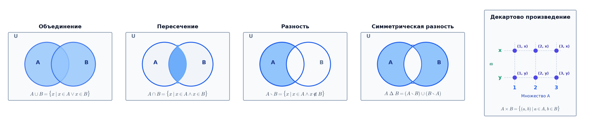
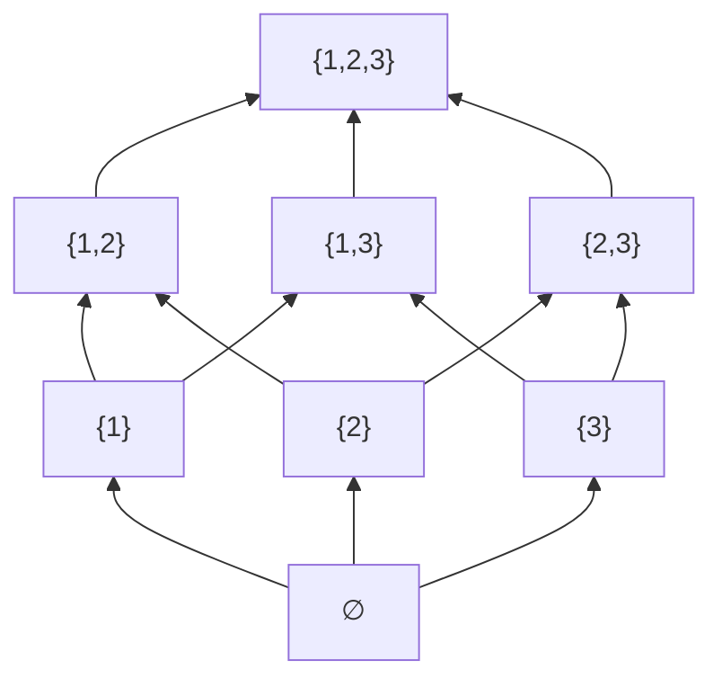

# 📝 Лекция 3: Множества

> [!info] Сверка со слайдами
> Конспект сверен с презентацией `s1-lec03-sets.typ` из репозитория Lipen/discrete-math-course (редакция от 13 октября 2026, неделя 22–23 сентября). Разделы со звёздочкой (\*) — материал для углубления («Множества в коде»).

> [!abstract] О занятии
> - **Дисциплина:** [[Дискретная математика]] (1 семестр, 2026/27 уч. год)
> - **Дата:** 23 сентября 2026 года (3-я неделя)
> - **Лектор:** Константин Чухарев ([@Lipen](https://github.com/Lipen), Университет ИТМО)
> - **Модуль 1:** Множества и методы доказательств
> - **Источники:** слайды `s1-lec03-sets.typ`; главы книги `m04` («Множество и его элементы», «Равенство и подмножества», «Операции над множествами», «Булеан», «Декартово произведение», «Семейства и разбиения», «Парадокс Рассела и аксиоматическая теория множеств»).
> - **Ключевые темы:** множество и принадлежность, урэлементы и чистая теория множеств, способы задания, парадокс Рассела и аксиома выделения, рекурсивное задание, подмножество, экстенсиональность, операции и законы, три метода доказательства тождеств, симметрическая разность, булеан, декартово произведение, разбиение, множества в коде.

## 📌 Краткое резюме (TL;DR)

- Множество помнит ровно один бит об объекте — «внутри или снаружи»: порядок и повторы не важны.
- Наивная свёртка $\{x\mid P(x)\}$ рождает парадокс Рассела; **аксиома выделения** разрешает только $\{x\in A\mid P(x)\}$ внутри готового множества.
- $A=B\iff A\subseteq B\wedge B\subseteq A$ (экстенсиональность).
- Операции — логические связки: $\cup\leftrightarrow\vee$, $\cap\leftrightarrow\wedge$, дополнение $\leftrightarrow\neg$, $\triangle\leftrightarrow\oplus$.
- Тождества доказывают: двумя включениями, цепочкой эквивалентностей, цепочкой законов, разбором случаев.
- $\vert\mathcal P(A)\vert=2^n$; $\vert A\times B\vert=\vert A\vert\cdot\vert B\vert$; в коде множество — битовая маска.

---

## 1. Множество и принадлежность

> [!quote] Эпиграф
> «Множество — это многое, мыслимое как единое.» — Георг Кантор

> [!info] Определение
> **Множество** — неупорядоченный набор различных объектов, входящих в него *элементов*.

> [!example]
> $\{2,3\}=\{3,2\}$ (порядок не влияет) и $\{2,2,3\}=\{2,3\}$ (повторы не влияют). Множество помнит ровно одно: список своих элементов.

**Примеры.** Простые числа $P=\{2,3,5,7,11,13\}$; фрукты $F=\{🍎,🍌,🍇\}$, $\vert F\vert=3$; константы $C=\{\pi,e,\sqrt2\}$. Особые множества: $\varnothing=\{\}$; синглетон $\{\varnothing\}$ (один элемент); множества как элементы $N=\{\{1,2\},\{3,4\}\}$, $\vert N\vert=2$.

> [!info] Принадлежность
> $a\in A$ — «$a$ принадлежит $A$»; $a\notin A$ — «не принадлежит». Запись $x\in A$ — предикат: на каждом объекте он истинен или ложен.

### 1.1. Вложенные множества

$B=\{a,\{b\}\}$ содержит два элемента: $a$ и $\{b\}$. Элемент $b$ лежит внутри $\{b\}$, поэтому $b\notin B$, а $\{b\}\in B$. Включение тоже работает: $\{a\}\subseteq B$, но $\{b\}\not\subseteq B$, так как включение требует $b\in B$.

> [!warning] Элемент и подмножество путаются первыми
> Принадлежность проверяет только *прямых* элементов. Из таких вложений собирают пары, отношения и деревья.

### 1.2. Урэлементы и чистая теория множеств

> [!info] Урэлементы
> **Урэлементы** (нем. *ur-* — «первичный») — объекты, которые сами множествами не являются: числа, люди, предметы, символы. Они способны только лежать внутри множеств.

Множество $\{1,2\}$ — не урэлемент (это контейнер), а его элементы $1$ и $2$ — урэлементы. В **чистой теории множеств** урэлементов нет: всё есть множество, числа, функции и отношения построены из множеств.

| С урэлементами | Только множества |
|:--|:--|
| $A=\{1,2,🐱\}$ — привычно и наглядно | $0=\varnothing$; $1=\{\varnothing\}=\{0\}$; $2=\{\varnothing,\{\varnothing\}\}=\{0,1\}$; $n=\{0,\dots,n-1\}$, $n+1=n\cup\{n\}$ |

Урэлементы удобны для наглядности, а на чистой версии (построение фон Неймана) стоит вся арифметика.

### 1.3. Способы задания

- **Перечислением** — небольшие конечные множества: $\{1,2,3\}$, $\{\alpha,\beta,\gamma\}$.
- **Универсум** $U$ — множество всех объектов задачи ($\mathbb{R}$ для школьной алгебры, строки таблицы для базы данных).
- **Порождающим свойством** выделяют элементы из универсума: $\{x\in U\mid P(x)\}$.

> [!example] Две записи одного множества
> $\{0,2,4,6,\dots\}$ — перечисление; $\{x\in\mathbb{N}\mid x=2k\}$ — порождающее свойство. Обе дают одно множество: у каждого объекта совпадают ответы на вопрос о принадлежности.

**Важные множества:** $\mathbb{N}=\{0,1,2,\dots\}$; $\mathbb{Z}$; $\mathbb{Q}=\{a/b\mid a\in\mathbb{Z},b\in\mathbb{N},b\ne0\}$; $\mathbb{R}$; $\mathbb{B}=\{\text{False},\text{True}\}$. Башня: $\mathbb{N}\subset\mathbb{Z}\subset\mathbb{Q}\subset\mathbb{R}$ — число $5$ лежит во всех четырёх, $-3$ — начиная с $\mathbb{Z}$, $\sqrt2$ — только в $\mathbb{R}$. Включение $\mathbb{N}\subset\mathbb{Z}$ строгое.

---

## 2. Парадоксы и аксиома выделения

### 2.1. Парадокс брадобрея

Деревенский указ: брадобрей бреет тех и только тех жителей, кто не бреется сам.

- Бреет себя: тогда он бреет жителя, который бреется сам, — указ нарушен.
- Не бреет: тогда он житель, который сам не бреется, — и по указу обязан себя брить.

Обе ветви противоречивы: такого брадобрея не существует. Описание бывает грамматически безупречным и при этом не описывать никого; из противоречия следует несуществование объекта, а не странность мира.

### 2.2. Парадокс Рассела

Наивный принцип свёртки: для любого свойства $P(x)$ множество $\{x\mid P(x)\}$ существует, и свойство «$A$ не содержит себя» порождает кандидата $R=\{A\mid A\notin A\}$.

> [!note] Теорема
> Множество Рассела не существует: ни $R\in R$, ни $R\notin R$ невозможно.

*Доказательство разбором случаев.* По закону исключённого третьего $R\in R$ или $R\notin R$.

- **Случай $R\in R$.** По определению $R$ из $R\in R$ следует $R\notin R$ — противоречие.
- **Случай $R\notin R$.** Тогда $R$ удовлетворяет свойству и обязано лежать в $R$: $R\in R$ — противоречие. $\blacksquare$

Рассел сообщил о противоречии Фреге, и тот признал во втором томе, что основания его арифметики пошатнулись. Позднее Гильберт дал эпохе девиз: «Никто не изгонит нас из рая, созданного Кантором».

### 2.3. Аксиома выделения

> [!info] Аксиома выделения (Цермело, 1908)
> Для множества $A$ и свойства $P$ существует множество $\{x\in A\mid P(x)\}$.

Ограничение $x\in U$ в задании множества свойством — и есть эта аксиома: $\{x\in\mathbb{Z}\mid x>0\}$ выделяет положительные числа из готового $\mathbb{Z}$. В программировании то же правило: `Set<int>` выделяет элементы только из `int`.

| Вопрос | Наивная | Аксиоматическая |
|:--|:--|:--|
| Из чего собирается | любая коллекция объектов | из готовых множеств по аксиомам |
| Свёртка по свойству | $\{x\mid P(x)\}$ без ограничений | $\{x\in A\mid P(x)\}$ внутри готового $A$ |
| Итог | парадокс Рассела | аксиоматика ZFC |

Цермело дал первую аксиоматику через семь лет после парадокса, Френкель дополнил её к 1922 году. Дополнительно в ZFC действует аксиома регулярности: $\forall x\,(x\ne\varnothing\to\exists y\in x\,(y\cap x=\varnothing))$ — она запрещает $x\in x$ и бесконечные цепи $\dots\in x_2\in x_1\in x_0$; подробнее см. [[08. Лекция - Трансфинитные числа, ординалы, вполне упорядоченные множества и трансфинитная индукция (2026-10-28)]].

### 2.4. Рекурсивное задание

> [!info] Определение
> Множество задано **рекурсивно**, если указаны базовые элементы и правила, порождающие из построенных элементов новые.

База $0\in E$, шаг: если $n\in E$, то $n+2\in E$ — так порождаются чётные числа. Строки над $A=\{0,1\}$: база — пустая строка $\varepsilon$, шаг — приписать $0$ или $1$; получаем $A^*=\{\varepsilon,0,1,00,01,10,11,\dots\}$. Тем же шаблоном в чистой теории множеств устроены натуральные числа: $0=\varnothing$, $n+1=n\cup\{n\}$.

---

## 3. Пустое множество, мощность, подмножество

> [!info] Пустое множество
> Множество без элементов — **пустое**, $\varnothing$.

$\varnothing\ne\{\varnothing\}$: слева нет элементов, справа один — само $\varnothing$. Верны оба: $\varnothing\in\{\varnothing\}$ (элемент контейнера) и $\varnothing\subseteq\{\varnothing\}$ (подмножество).

> [!info] Мощность
> Мощность конечного множества — число его элементов, $\vert A\vert$.

$\vert\{2,2,3\}\vert=2$; $\vert\varnothing\vert=0$, $\vert\{\varnothing\}\vert=1$; $\vert\{\{1,2\},\{3,4,5\}\}\vert=2$ (внутренности элементов не считаются); $\vert\mathbb{N}\vert=\infty$. Мощность — первое, что спрашивают о коллекции в коде: `len(users)`; отличие $\vert\{\varnothing\}\vert=1$ от $\vert\varnothing\vert=0$ — отличие «список из одной пустой роли» от «ролей нет».

> [!info] Подмножество
> $A\subseteq B$, если $\forall x\,(x\in A\to x\in B)$. **Строгое:** $A\subset B$, если $A\subseteq B$ и $A\ne B$.

Импликация с ложной посылкой истинна, поэтому $\varnothing\subseteq A$ для любого $A$ — вакуумная истинность.

> [!example]
> $\{3,1\}\subseteq\{1,2,3\}$ — истинно. $\{4,2\}\subseteq\{4,2\}$ — истинно (каждое множество — подмножество себя), а строгое $\{4,2\}\subset\{4,2\}$ — ложно. Цепочка $\mathbb{N}\subset\mathbb{Z}\subset\mathbb{Q}\subset\mathbb{R}$ строгая.

Контрпример экономен: достаточно одного элемента слева, которого нет справа, — и $A\not\subseteq B$. Работает и перенос со свойств: из $P\to Q$ следует $\{x\in U\mid P(x)\}\subseteq\{x\in U\mid Q(x)\}$; так $\{x\in\mathbb{Z}\mid x>3\}\subseteq\{x\in\mathbb{Z}\mid x>0\}$.

### 3.1. Экстенсиональность

Объекты сравниваются *интенсионально* (по описанию: как заданы) и *экстенсионально* (по содержанию: что охватывают). Описания «чётные числа» и «числа, делящиеся на два» различны, но экстенсионально совпадают: оба задают $\{0,2,4,6,\dots\}$. В Python списки хранят порядок и повторы (`[2,3] != [3,2]`), а множества сравниваются по содержимому (`{2,3} == {3,2}`, `{2,2,3} == {2,3}`).

> [!info] Аксиома экстенсиональности
> $A=B\iff\forall x\,(x\in A\iff x\in B)$.

Это частный случай принципа тождества неразличимых Лейбница (1686): совпали все значимые свойства — объекты тождественны. У множества значимое свойство одно — принадлежность, тот самый один бит.

> [!note] Теорема
> $A=B\iff A\subseteq B$ и $B\subseteq A$.

*Доказательство в обе стороны.* Пусть $A=B$: по аксиоме для каждого $x$ верно $x\in A\iff x\in B$, и обе импликации по отдельности дают оба включения. Обратно: из двух включений для каждого $x$ верны обе импликации сразу, то есть $x\in A\iff x\in B$, и по аксиоме $A=B$. $\blacksquare$

> [!example] Два текста об одном множестве
> $A=\{1,2,3\}$ и $B=\{x\in\mathbb{N}\mid x>0,\,x<4\}$. $A\subseteq B$: каждое из $1,2,3$ натурально и удовлетворяет $0<x<4$. $B\subseteq A$: натуральное $x$ с $0<x<4$ — это $1$, $2$ или $3$. Значит, $A=B$.

> [!warning] Знаки работают на разных уровнях
> $1\in\{1,2\}$ и $\{1\}\subseteq\{1,2\}$ — истинны; $1\subseteq\{1,2\}$ не имеет смысла (слева ожидается множество). Для $A=\{1,\{2\}\}$: $1\in A$ и $\{2\}\in A$ истинны, $\{1\}\subseteq A$ истинно, а $\{2\}\not\subseteq A$ (включение требует $2\in A$).

---

## 4. Операции над множествами

Дополнение определено только относительно зафиксированного универсума $U$.

| Операция | Определение | Связка |
|:--|:--|:-:|
| Объединение | $A\cup B=\{x\mid x\in A\vee x\in B\}$ | $\vee$ |
| Пересечение | $A\cap B=\{x\mid x\in A\wedge x\in B\}$ | $\wedge$ |
| Разность | $A\setminus B=\{x\mid x\in A\wedge x\notin B\}$ | $\wedge\neg$ |
| Симметрическая разность | $A\triangle B=(A\setminus B)\cup(B\setminus A)$ | $\oplus$ |
| Дополнение | $\overline A=U\setminus A=\{x\mid x\notin A\}$ | $\neg$ |
| Включение | $A\subseteq B$ | $\to$ |
| Равенство | $A=B$ | $\leftrightarrow$ |

Правый столбец — та же строка глазами логики. Базовых операций три — $\cup$, $\cap$ и дополнение; $A\setminus B$ — сокращение для $A\cap\overline B$.

> [!example] Одна пара — вся таблица
> $A=\{1,2,3\}$, $B=\{2,3,4\}$, $U=\{1,2,3,4,5\}$. $A\cup B=\{1,2,3,4\}$; $A\cap B=\{2,3\}$; $A\setminus B=\{1\}$; $A\triangle B=\{1\}\cup\{4\}=\{1,4\}$; $\overline A=\{4,5\}$.

Крайние случаи: $\overline\varnothing=U$, $\overline U=\varnothing$.

**Диаграммы Венна** — инструмент размышления, а не техника доказательства: картинка убеждает, но корректное доказательство требует алгебры. Диаграмма Венна отрисовывает все $2^2=4$ комбинации принадлежности, даже пустые — на ней удобно рассуждать о любом раскладе; круги Эйлера рисуют только реально существующие комбинации — на них удобно показывать конкретную ситуацию.



### 4.1. Законы алгебры множеств

> [!note] Коммутативность
> $A\cup B=B\cup A$, $A\cap B=B\cap A$.

*Цепочка эквивалентностей.* Для произвольного $x$: $x\in A\cup B\equiv x\in A\vee x\in B\equiv x\in B\vee x\in A\equiv x\in B\cup A$; для пересечения та же цепочка с $\wedge$. $\blacksquare$

> [!warning] Далеко не всё коммутативно
> $A\setminus B$ несимметрична: при $A=\{1,2\}$, $B=\{2,3\}$ будет $A\setminus B=\{1\}$, а $B\setminus A=\{3\}$. Произведение жёстче: $(1,x)\in A\times B$, но $(1,x)\notin B\times A$ при $A=\{1\}$, $B=\{x\}$.

> [!note] Ассоциативность
> $(A\cup B)\cup C=A\cup(B\cup C)$ и $(A\cap B)\cap C=A\cap(B\cap C)$ (цепочка эквивалентностей с ассоциативностью $\vee$/$\wedge$).

> [!warning] Разность скобки не переживает
> $A=\{1,2,3\}$, $B=\{2\}$, $C=\{3\}$: $(A\setminus B)\setminus C=\{1\}$, а $A\setminus(B\setminus C)=\{1,3\}$. Цепочки разностей пишут только со скобками.

> [!note] Дистрибутивность
> $A\cap(B\cup C)=(A\cap B)\cup(A\cap C)$ (и $A\cup(B\cap C)=(A\cup B)\cap(A\cup C)$).

*Взаимным включением.* Пусть $x\in A\cap(B\cup C)$: $x\in A$ и $x$ лежит в $B$ или в $C$; при $x\in B$ получаем $x\in A\cap B$, при $x\in C$ — $x\in A\cap C$. Обратно: пусть $x$ лежит в $A\cap B$ или в $A\cap C$; тогда $x\in A$, а из $x\in B$ или $x\in C$ следует $x\in B\cup C$. $\blacksquare$

> [!example] На числах
> $A=\{1,2\}$, $B=\{2,4\}$, $C=\{3\}$. Слева: $B\cup C=\{2,3,4\}$, $A\cap(B\cup C)=\{2\}$. Справа: $(A\cap B)\cup(A\cap C)=\{2\}\cup\varnothing=\{2\}$ — совпало; $A$ и $C$ не пересекаются, но закон работает: пустое пересечение просто не добавляет слагаемых. Вторая форма верна так же, хотя в арифметике $2+3\cdot4\ne(2+3)(2+4)$.

> [!note] Законы де Моргана
> $\overline{A\cap B}=\overline A\cup\overline B$, $\ \overline{A\cup B}=\overline A\cap\overline B$.

*Цепочка эквивалентностей.* $x\in\overline{A\cap B}\equiv x\notin A\cap B\equiv\neg(x\in A\wedge x\in B)\equiv(x\notin A)\vee(x\notin B)\equiv x\in\overline A\cup\overline B$. Третий переход — де Морган из логики. $\blacksquare$

> [!example] Де Морган на числах
> $U=\{1,\dots,5\}$, $A=\{1,2,3\}$, $B=\{2,3,4\}$. $\overline{A\cup B}=\{5\}$; $\overline A\cap\overline B=\{4,5\}\cap\{1,5\}=\{5\}$. $\overline{A\cap B}=\{1,4,5\}$; $\overline A\cup\overline B=\{1,4,5\}$. Пример проверяет закон на одном наборе, но не доказывает его.

> [!note] Законы дополнения
> $A\cup\overline A=U$, $A\cap\overline A=\varnothing$, $\overline{\overline A}=A$.

*Доказательство.* Пересечение пусто: элемент $A\cap\overline A$ лежал бы в $A$ и в $\overline A$ сразу. Объединение — весь $U$: каждый $x\in U$ по исключённому третьему лежит в $A$ или в $\overline A$. Двойное дополнение: $x\in\overline{\overline A}\equiv x\notin\overline A\equiv\neg\neg(x\in A)\equiv x\in A$. $\blacksquare$

> [!warning] Без универсума дополнения нет
> Для $A=\{1,2\}$ при $U=\{1,2,3\}$ это $\{3\}$, при $U=\mathbb{N}$ — $\{0,3,4,\dots\}$.

> [!note] Поглощение
> $A\cup(A\cap B)=A$ и $A\cap(A\cup B)=A$.

*Взаимным включением.* Если $x\in A\cup(A\cap B)$, то $x\in A$ либо $x\in A\cap B$ (и тогда тоже $x\in A$). Обратно: всякий $x\in A$ попадает в $A\cup(A\cap B)$ по определению объединения. Второй закон — зеркальной заменой $\cup\leftrightarrow\cap$. $\blacksquare$ На числах: $A=\{1,2\}$, $B=\{2,3\}$: $A\cup(A\cap B)=\{1,2\}\cup\{2\}=A$; $A\cap(A\cup B)=\{1,2\}\cap\{1,2,3\}=A$.

**Алгебраический метод.** Не ходить по элементам, а переплавлять выражение готовыми законами:
$$\begin{aligned}A\cup(A\cap B)&=(A\cap U)\cup(A\cap B)&&\text{тождество }A=A\cap U\\&=A\cap(U\cup B)&&\text{дистрибутивность}\\&=A\cap U&&U\cup B=U\\&=A&&\text{тождество}\end{aligned}$$

> [!example] Упрощение выражения
> $(A\cup B)\cap\overline{\overline A\cap B}=(A\cup B)\cap(A\cup\overline B)$ (де Морган) $=A\cup(B\cap\overline B)$ (дистрибутивность) $=A\cup\varnothing$ (дополнение) $=A$.

> [!warning] Сокращение не работает
> В арифметике $a+c=b+c\Rightarrow a=b$. Для объединения вывод ломается: $A=\{1\}$, $B=\{2\}$, $C=\{1,2\}$ — обе стороны равны $\{1,2\}$ при $A\ne B$.

### 4.2. Как доказывать тождества?

Выбор метода — часть решения; подсказывает форма тождества.

- **Два включения** — универсальный метод, работает для любого равенства.
- **Цепочка эквивалентностей** — когда обе части суть предикаты об одном $x$.
- **Цепочка готовых законов** — когда тождество собирается из уже доказанного.
- **Разбор случаев** по положению $x$.

Каждый шаг опирается на определение или доказанный закон, и все случаи перебираются.

> [!note] Тождество с разностью
> $A\setminus(B\cup C)=(A\setminus B)\cap(A\setminus C)$.

*Цепочка эквивалентностей.* $x\in A\setminus(B\cup C)\equiv x\in A\wedge x\notin(B\cup C)\equiv x\in A\wedge x\notin B\wedge x\notin C\equiv(x\in A\wedge x\notin B)\wedge(x\in A\wedge x\notin C)\equiv x\in(A\setminus B)\cap(A\setminus C)$. $\blacksquare$

> [!warning] Границы аналогии с арифметикой
> Вариант с объединением ($A\setminus(B\cup C)$ как $(A\setminus B)\cup(A\setminus C)$) при $A=\{1,2,3\}$, $B=\{2\}$, $C=\{3\}$ даёт $\{1,2,3\}$ вместо $\{1\}$. Зеркальная ошибка с пересечением: слева $A\setminus(B\cap C)=A$, справа $(A\setminus B)\cap(A\setminus C)=\{1\}$. Разность меняет операцию на двойственную.

> [!note] Разбор случаев
> $A\cup(\overline A\cap B)=A\cup B$.

*Доказательство.* При $x\in A$ элемент лежит по обе стороны. При $x\notin A$ обе стороны принимают элемент ровно при $x\in B$. $\blacksquare$ Это знакомое $a\vee(\neg a\wedge b)\equiv a\vee b$ — так булевы условия сокращают компиляторы.

> [!question] Методы
> 1. Каким из методов удобнее доказывать $A\setminus(B\cap C)=(A\setminus B)\cup(A\setminus C)$ и почему?
> 2. Почему цепочка эквивалентностей для произвольного $x$ доказывает равенство множеств?

### 4.3. Симметрическая разность

$x\in A\triangle B\equiv(x\in A)\oplus(x\in B)$: элемент лежит ровно в одной из частей.

> [!example] Двумя путями
> $A=\{1,2,3\}$, $B=\{2,3,4\}$: по определению $A\setminus B=\{1\}$, $B\setminus A=\{4\}$, $A\triangle B=\{1,4\}$. Через объединение и пересечение: $(A\cup B)\setminus(A\cap B)=\{1,2,3,4\}\setminus\{2,3\}=\{1,4\}$.

Операция ведёт себя как сложение по модулю два: элемент либо переключается, либо нет.

| Тождество | Смысл |
|:--|:--|
| $A\triangle B=(A\cup B)\setminus(A\cap B)$ | различие частей |
| $A\triangle A=\varnothing$ | элемент не отличается от себя |
| $A\triangle(A\triangle B)=B$ | двойное переключение возвращает исходное |
| $A\triangle\overline A=U$ | ровно одна из двух частей |
| $A\triangle U=\overline A$ | дополнение |

> [!info] Характеристическая функция
> $\chi_A:U\to\{0,1\}$ равна 1 на элементах $A$ и 0 вне их.

> [!note] Теорема (xor на индикаторах)
> $\chi_{A\triangle B}(x)=\chi_A(x)\oplus\chi_B(x)$.

*Набросок.* Оба множества: $1\oplus1=0$ — элемент из пересечения в разность не входит. Ровно одно: $1\oplus0=0\oplus1=1$. Ни одного: $0\oplus0=0$. $\blacksquare$

> [!note] Теорема (чётность вхождений)
> $x\in A\triangle B\triangle C$ $\iff$ $x$ лежит в нечётном числе из множеств $A,B,C$.

*Набросок.* Индикатор результата равен $\chi_A\oplus\chi_B\oplus\chi_C$; xor даёт 1 ровно при нечётном числе единиц. $\blacksquare$

> [!example] Каскад xor
> $A=\{1,2,3\}$, $B=\{2,3,4\}$, $C=\{3,4,5\}$. Числа $1$ и $5$ лежат в одном множестве, $2$ и $4$ — в двух, $3$ — во всех трёх. Нечётное число вхождений: $A\triangle B\triangle C=\{1,3,5\}$.

$\triangle$ ассоциативно, поэтому запись без скобок однозначна; в битовых масках каждый xor переключает присутствие элемента — счётчик по модулю два.

---

## 5. Булеан

> [!info] Определение
> **Булеан** (*power set*) множества $A$ — множество всех его подмножеств: $\mathcal P(A)=\{S\mid S\subseteq A\}$.

> [!example] Лестница мощностей
> $\mathcal P(\varnothing)=\{\varnothing\}$ — один элемент, $2^0=1$. $\mathcal P(\{a\})=\{\varnothing,\{a\}\}$ — $2^1=2$. $\mathcal P(\{a,b\})=\{\varnothing,\{a\},\{b\},\{a,b\}\}$ — $2^2=4$. Каждый новый элемент удваивает булеан: старые подмножества остаются, и к каждому добавляется вариант с этим элементом.

> [!note] Теорема
> Для конечного множества из $n$ элементов $\vert\mathcal P(A)\vert=2^n$.

*Кодировка битовыми строками.* Занумеруем элементы $a_1,\dots,a_n$ и закодируем $S\subseteq A$ строкой длины $n$: $i$-я позиция равна 1 при $a_i\in S$ и 0 иначе. Разные подмножества дают разные строки, а строк длины $n$ над $\{0,1\}$ ровно $2^n$. $\blacksquare$

Рост взрывной: $2^{10}=1024$, $2^{20}>10^6$, $2^{30}>10^9$ — перебрать все подмножества нельзя, их кодируют масками.

**Решётка подмножеств.** $\mathcal P(\{1,2,3\})$, упорядоченное включением: соседние отличаются одним элементом. Биты из доказательства читаются прямо на решётке: движение вниз — ноль в очередной позиции (отказ от элемента), движение вверх — единица.



> [!note] Слои булеана
> Множество из $n$ элементов имеет ровно $\binom nk$ подмножеств размера $k$.

> [!example] Слой $k=2$ при $n=4$
> $\{1,2\},\{1,3\},\{1,4\},\{2,3\},\{2,4\},\{3,4\}$ — $\binom42=6$.
>
> | Размер $k$ | 0 | 1 | 2 | 3 | 4 |
> |:-:|:-:|:-:|:-:|:-:|:-:|
> | Слой $\binom4k$ | 1 | 4 | 6 | 4 | 1 |
>
> Сумма слоёв $1+4+6+4+1=16=2^4$.

---

## 6. Декартово произведение

> [!info] Определение
> $A\times B=\{(a,b)\mid a\in A\wedge b\in B\}$.

> [!example] Перебор пар
> $A=\{1,2\}$, $B=\{x,y\}$. Пары с первой компонентой $1$: $(1,x),(1,y)$; с $2$: $(2,x),(2,y)$. Итого четыре; $(x,1)$ в $A\times B$ нет, ведь $x\notin A$.

Произведение — сетка точек: каждая точка — пара с первой компонентой из $A$ и второй из $B$; строка сетки — все пары с фиксированной первой компонентой (для $A=\{1,2,3\}$, $B=\{1,2\}$ — сетка $3\times2$ из шести пар).

> [!note] Мощность произведения
> Для конечных $A,B$: $\vert A\times B\vert=\vert A\vert\cdot\vert B\vert$.

*Разбиение по первой компоненте.* $A\times B=\bigcup_{a\in A}(\{a\}\times B)$ — объединение попарно непересекающихся блоков; в каждом ровно $\vert B\vert$ пар. $\blacksquare$ Суть — правило произведения: независимые выборы перемножаются; слов длины $n$ над $q$ буквами ровно $q^n$.

**Пары и кортежи.** Строго $(A\times B)\times C\ne A\times(B\times C)$, но есть естественное отождествление, поэтому скобки опускают. Элементы $A_1\times\dots\times A_n$ — *кортежи* длины $n$. $(a,a)$, $a$ и $\{a\}$ — три разных объекта (в Python: `(a, a)`, `a`, `{a}`).

> [!note] Определение Куратовского
> $(a,b)=\{\{a\},\{a,b\}\}$. При $a=b$ двойка схлопывается в $\{\{a\}\}$. Отсюда $(a,b)=(c,d)\iff a=c\wedge b=d$ — порядок держится одними множествами.

*Набросок.* Элемент $\{a\}$ левой пары совпадает с $\{c\}$ или с $\{c,d\}$: оба случая дают $a=c$; после подстановки остаётся $\{a,b\}=\{a,d\}$ и $b=d$. Обратно очевидно. $\blacksquare$

> [!warning] $A\times B$ и $B\times A$ различны
> При $A=\{1\}$, $B=\{x\}$: $(1,x)\in A\times B$, но $(1,x)\notin B\times A$; равенство — только при $A=B$.

> [!example] Степени и кортежи
> $\{0,1\}^3$ — восемь троек, $2^3$. $\{0,1\}^8$ — все байты, $2^8=256$ значений `uint8`. $\mathbb{R}\times\mathbb{R}=\mathbb{R}^2$ — координатная плоскость. Пустая степень $A^0$ содержит единственный кортеж длины 0, $\vert A^0\vert=1$. Порядок компонент фиксирован: дата — кортеж из года, месяца и дня.

---

## 7. Разбиение

> [!info] Определение
> **Разбиение** (*partition*) множества $X$ — набор непустых попарно непересекающихся подмножеств, покрывающих $X$.

> [!example] Целые числа по остатку от деления на 3
> Классы по остаткам $0,1,2$: $\{\dots,-3,0,3,\dots\}$, $\{\dots,-2,1,4,\dots\}$, $\{\dots,-1,2,5,\dots\}$. Классы непусты, не пересекаются, объединение — весь $\mathbb{Z}$; блоки — заготовка классов эквивалентности (см. [[04. Лекция - Отношения и эквивалентность (2026-09-30)]]).

> [!warning] Три способа нарушить разбиение $\{1,2,3\}$
> - Блоки $\{1,2\}$ и $\{2,3\}$ пересекаются на двойке.
> - $\{\{1\},\{2\}\}$ не покрывает тройку.
> - $\{\{1,2\},\{3\},\varnothing\}$ содержит пустое множество.

---

## 8. Множества в коде (\*)

> [!quote] Эпиграф
> «Абстракция нужна не для тумана, а для нового семантического уровня, на котором можно быть абсолютно точным.» — Эдсгер Дейкстра

### 8.1. Типы как множества

**Тип** — множество допустимых значений, прикладная форма универсума: значения выделяются всегда внутри готового типа. $\text{bool}=\{\text{False},\text{True}\}$; $\text{uint8}=\{0,\dots,255\}$; *тип-произведение* (`struct`) — декартово произведение; *тип-сумма* (`enum`) — дизъюнктное объединение.

> [!example] Арифметика типов
> Тип-сумма складывает мощности: `Option<bool>` даёт $1+2=3$ значения (`None`, `Some(false)`, `Some(true)`). Тип-произведение перемножает: пара булевых — $2\cdot2=4$. Проверка на `uint8`: $\vert\{0,1\}^8\vert=2^8=256$. Для `struct { a: u8, b: bool }`: $256\cdot2=512$.

### 8.2. HashSet и TreeSet

Честное математическое множество в коде не живёт: элементы бывают любыми, а множество — бесконечным. `HashSet<T>` хранит подмножество в хеш-таблице; `TreeSet<T>` держит элементы упорядоченными на сбалансированном дереве.

| Операция | HashSet | TreeSet |
|:--|:-:|:-:|
| вставка, поиск | в среднем $O(1)$ | $O(\log n)$ |
| обход элементов | в произвольном порядке | по возрастанию |

Математическое множество — спецификация, `HashSet` и `TreeSet` — два представления с разной ценой операций.

### 8.3. Множества в Python

```python
A = {1, 2, 3}
B = {3, 4}
A | B   # {1, 2, 3, 4}
A & B   # {3}
A - B   # {1, 2}
A ^ B   # {1, 2, 4}
len({1, 1, 2})             # 2: повторы схлопнулись
{n * n for n in range(4)}  # {0, 1, 4, 9}
```

> [!warning] Пустые фигурные скобки дают словарь
> `t = {}` создаёт пустой `dict`; пустое множество пишется только как `set()`.

### 8.4. Произведение на плоскости

Пара $(a,b)$ — точка плоскости; $\mathbb{R}\times\mathbb{R}$ — вся координатная плоскость; произведение интервалов — прямоугольник $[1,4)\times(2,4]$ (заполненная точка — конец включён, пустая — исключён). $(2,3)$ лежит в прямоугольнике: $1\le2<4$ и $2<3\le4$. $(4,3)$ не лежит: правая граница $4$ в $[1,4)$ не включена. $(A\times B)\setminus(C\times D)$ — внешний прямоугольник с вырезанной серединой.

### 8.5. Таблицы SQL как множества кортежей

Таблица — подмножество декартова произведения: строка — кортеж, колонка — компонент.

| `student.id` | `student.name` |
|:-:|:-:|
| 1 | Аня |
| 2 | Борис |
| 3 | Вера |

| `knows.student` | `knows.lang` |
|:-:|:-:|
| 1 | `python` |
| 1 | `rust` |
| 2 | `python` |
| 3 | `haskell` |

```sql
SELECT student.name, knows.lang
FROM student JOIN knows ON student.id = knows.student;
```

Результат JOIN: (Аня, python), (Аня, rust), (Борис, python), (Вера, haskell). JOIN — декартово произведение с условием: пар было $3\cdot4=12$, предикат оставил 4.

```sql
SELECT lang FROM knows WHERE student = 1
INTERSECT SELECT lang FROM knows WHERE student = 2;
```

Языки Ани — `{'python','rust'}`, Бориса — `{'python'}`. INTERSECT — пересечение `{'python'}`; EXCEPT — разность `{'rust'}`; UNION — объединение без повторов `{'python','rust'}`; UNION ALL оставляет повторы — это уже мультимножество (таблицы SQL — мультимножества).

### 8.6. Битовые маски

Множество $S\subseteq\{1,\dots,n\}$ кодируется битовой строкой: $i$-й бит равен 1, если $i\in S$. $\cup$ — побитовое OR, $\cap$ — AND, $\overline S$ — NOT, $\triangle$ — XOR (маска переключает присутствие), $X\subseteq Y$ проверяется как `x & y == x`. Маска — элемент булеана: множество кодируется числом от $0$ до $2^n-1$.

> [!example] Права доступа rwx
> read = 4, write = 2, execute = 1. Чтение и запись — маска $4\mid2=6=110_2$. Проверка исполнения: $6\,\&\,1=0$ — бита execute нет.

```python
FULL = 0b1111   # U = {1, 2, 3, 4}
A = 0b0101      # {1, 3}
B = 0b1011      # {1, 2, 4}

bin(A | B)      # '0b1111' -> {1, 2, 3, 4}
bin(A & B)      # '0b1'    -> {1}
bin(A ^ B)      # '0b1110' -> {2, 3, 4}
bin(FULL & ~A)  # '0b1010' -> {2, 4}
```

> [!warning] Тильда — не дополнение
> `~A` переворачивает биты всех мыслимых разрядов: `~5` равно `-6`. Дополнение — только относительно универсума: `FULL & ~A`.

### 8.7. Принцип Дирихле и коллизии

> [!note] Принцип Дирихле
> Если $n+1$ объект разложить по $n$ ящикам, найдётся ящик хотя бы с двумя объектами.

*От противного.* Пусть в каждом ящике не более одного объекта; тогда всего объектов не больше $n$ — противоречие. $\blacksquare$ Ключей больше, чем корзин, — коллизия неизбежна при любой хеш-функции; вопрос не в том, будут ли столкновения, а в том, как с ними жить.

**Коллизия** хеш-функции — пара разных ключей с общим значением: $h(k_1)=h(k_2)$ при $k_1\ne k_2$. Тринадцать человек и двенадцать месяцев: по Дирихле двое родились в одном месяце. Неудачная функция: $h(k)=k\bmod5$ на ключах $\{2,7,12,17\}$ — все остатки равны $2$ (виновата функция, а не принцип).

---

## 9. Что мы поняли?

Материал идёт от принадлежности через операции и законы к булеану и произведению. Наивная свёртка упёрлась в парадокс Рассела и уступила аксиоме выделения. Финал перевёл объекты в код: типы, таблицы SQL, битовые маски и принцип Дирихле.

- **Вырастает:** $n$ — множество всех предыдущих, пара — множество $\{\{a\},\{a,b\}\}$, операции — связки логики.
- **Проверяется:** $A=B$ — два включения, тождество — цепочка эквивалентностей или законы.
- **Ломается:** свойство без универсума порождает $R=\{A\mid A\notin A\}$ — не множество.
- **Чинится:** аксиома выделения, а в коде — тип: `Set<int>` выделяет из готового `int`.
- Пары из $A\times B$ держат отношения и функции, разбиение готовит классы эквивалентности, булеан — $2^n$, маска — его элемент.

## ❓ Вопросы для самопроверки к коллоквиуму / экзамену

- [ ] Почему $\{2,2,3\}=\{2,3\}$?
- [ ] Чем интенсиональное сравнение отличается от экстенсионального у множеств?
- [ ] Верно ли, что $\varnothing\in\varnothing$? А $\varnothing\subseteq\varnothing$ и булеан $\{\varnothing\}$?
  > [!note] Решение
  > $\varnothing\in\varnothing$ — ложно (элементов нет); $\varnothing\subseteq\varnothing$ — истинно; $\mathcal P(\varnothing)=\{\varnothing\}$ (один элемент), $\mathcal P(\{\varnothing\})=\{\varnothing,\{\varnothing\}\}$ — два.
- [ ] Почему $R=\{A\mid A\notin A\}$ не является множеством? Как это блокирует аксиома выделения?
- [ ] Какой метод выбрать для доказательства поглощения и почему оба работают?
- [ ] Чему равно $A\triangle(A\triangle B)$? Какая побитовая операция соответствует $\triangle$ и что она делает с чётностью?
  > [!note] Решение
  > $A\triangle(A\triangle B)=B$; $\triangle$ — XOR, он считает чётность числа вхождений.
- [ ] Сколько подмножеств из ровно двух элементов у множества из пяти? Сколько разбиений у $\{1,2,3\}$?
  > [!note] Решение
  > $\binom52=10$; разбиений пять: $\{\{1,2,3\}\}$, $\{\{1\},\{2,3\}\}$, $\{\{2\},\{1,3\}\}$, $\{\{3\},\{1,2\}\}$, $\{\{1\},\{2\},\{3\}\}$.
- [ ] Как выразить $A\cap B$ одной операцией разности и какой формулой задаётся область «в $A$ и в $B$, но не в $C$»?
  > [!note] Решение
  > $A\cap B=A\setminus(A\setminus B)$; область: $(A\cap B)\setminus C$.
- [ ] Докажите $\overline{A\cup B}=\overline A\cap\overline B$ цепочкой эквивалентностей, а дистрибутивность — двумя включениями.
- [ ] Пусть $\vert A\vert=4$, $\vert B\vert=3$. Сколько элементов в $\mathcal P(A\times B)$?
  > [!note] Решение
  > $\vert A\times B\vert=12$, $\vert\mathcal P(A\times B)\vert=2^{12}=4096$.
- [ ] Запишите симметрическую разность масок $A$ и $B$ побитовой операцией.
  > [!note] Решение
  > `A ^ B`.

## 📚 Что почитать (книга курса)

- `m04` — «Множество и его элементы», «Равенство и подмножества», «Операции над множествами», «Булеан».
- `m04` — «Декартово произведение», «Семейства и разбиения», «Парадокс Рассела и аксиоматическая теория множеств».

## 🔗 Связанные материалы

- [[Дискретная математика]] — главная страница дисциплины
- [[01. Лекция - Высказывания, связки, таблицы истинности, законы логики и следствие (2026-09-09)]]
- [[02. Лекция - Предикаты, кванторы, методы доказательств, индукция и инварианты программ (2026-09-16)]]
- [[04. Лекция - Отношения и эквивалентность (2026-09-30)]]
