# 📌 Лекция 5: Отношение порядка, диаграммы Хассе, цепи, антицепи и решетки

> [!abstract] О занятии
> - **Дисциплина:** [[Дискретная математика]] (1 семестр, Поток 2)
> - **Преподаватель (лектор):** Константин Чухарев ([@Lipen](https://github.com/Lipen), Университет ИТМО)
> - **Дата проведения:** 7 октября 2026 года (среда, 09:50 — 11:20, ауд. 2342)
> - **Материалы курса:** Репозиторий [Lipen/discrete-math-course](https://github.com/Lipen/discrete-math-course), лекционная презентация `s1-lec05-order.typ` (*«Отношение порядка»*, финальная редакция от 7 октября 2026), глава книги `m08` (*«Частичный порядок»*, *«Диаграммы Хассе»*, *«Экстремальные элементы»*, *«Грани, супремум, инфимум»*, *«Решётки»*, *«Неподвижные точки в решётках»*, *«Фундированные порядки и завершимость»*, *«Топологическая сортировка»*, *«Лексикографический порядок»*, *«Ширина порядка и теорема Дилуорса»*).
> - **Эпиграфы занятия:**
>   - *«Порядок есть расположение равных и неравных вещей, дающее каждой своё место.»* — Августин Блаженный
>   - *«Один взгляд стоит тысячи слов.»* — Фредерик Барнард
>   - *«Порядок — первый закон небес.»* — Александр Поуп
>   - *«Вместо „точки, прямой, плоскости“ всегда должно быть можно сказать „стол, стул, пивная кружка“.»* — Давид Гильберт
>   - *«Распределённая система — это система, в которой отказ компьютера, о существовании которого вы и не знали, может вывести из строя ваш собственный.»* — Лесли Лампорт
> - **Ключевые темы:** частичный, строгий и линейный порядок; индуцированный строгий порядок; лексикографический порядок и shortlex; `PartialOrd`/`Ord` в Rust; предпорядок; диаграммы Хассе и отношение покрытия; цепи, антицепи, ширина; минимальные/максимальные и наименьший/наибольший элементы; лемма о спуске; двойственность; верхние/нижние грани, супремум и инфимум; решётки (дистрибутивные, модулярные, $M_3$, $N_5$, теорема Дедекинда — Биркгофа); булева алгебра; решётки прав доступа, разбиений и знаков; полные решётки и теорема Кнастера — Тарского; абстрактная интерпретация; топологическая сортировка и алгоритм Кана; иерархии типов и семантическое версионирование; отношение «произошло-до» Лампорта и векторные часы; теоремы Дилуорса, Мирского, Эрдёша — Секереша; плотные и фундированные порядки, нётерова индукция, ранжирующие функции.

> [!info] Сверка с источником
> Конспект полностью сверен с финальной редакцией слайдов лекции в репозитории курса (переработка 5–7 октября 2026: новые разделы о гранях, решётках, неподвижных точках, Лампорте, Дилуорсе/Мирском и фундированных порядках). Вполне упорядоченные множества и трансфинитная индукция вынесены лектором в [[08. Лекция - Трансфинитные числа, ординалы, вполне упорядоченные множества и трансфинитная индукция (2026-10-28)]].

---

## 📌 Краткое резюме (TL;DR)

1. **Частичный порядок** $\preceq$ — рефлексивное, антисимметричное и транзитивное отношение. Пара $(A, \preceq)$ — **ЧУМ** (poset). В отличие от эквивалентности, порядок не группирует, а **выстраивает**; два элемента могут быть **несравнимы** (делимость: $2 \nmid 3$, $3 \nmid 2$).
2. **Строгий порядок** $\prec$ — иррефлексивный, асимметричный, транзитивный. Асимметричность **выводится** из иррефлексивности и транзитивности. Между $\preceq$ и $\prec$ есть мост: $a \prec b \iff a \preceq b \land a \ne b$.
3. **Линейный порядок** — любая пара сравнима. **Лексикографический** порядок линеен $\iff$ линейны оба исходных. **Shortlex** (сначала длина, потом словарно) даёт наименьшую строку в любом непустом множестве строк.
4. **Предпорядок** — рефлексивность + транзитивность (без антисимметричности): совместимость версий, $x^2 \le y^2$ на $\mathbb{Z}$.
5. **Диаграмма Хассе** = транзитивное сокращение порядка: без петель, без транзитивных рёбер, большее — выше. Рёбра — пары **покрытия** ($b \prec a$ без промежуточного элемента).
6. **Цепь** — попарно сравнимые элементы, **антицепь** — попарно несравнимые; **ширина** — максимальный размер антицепи. В $B_n$ ровно $n!$ максимальных цепей.
7. **Минимальный $\ne$ наименьший:** наименьший сравним со всеми и единственен; минимальных может быть много. **Лемма о спуске:** конечный непустой ЧУМ имеет минимальный и максимальный элементы.
8. **Супремум** — наименьшая верхняя грань, **инфимум** — наибольшая нижняя; единственны, если существуют, но могут не существовать. Супремум $\ne$ максимум ($\inf\{1/n\} = 0 \notin$ множеству).
9. **Решётка** — у каждой пары есть join $\lor$ и meet $\land$. Дистрибутивная $\Rightarrow$ модулярная. **Теорема Дедекинда — Биркгофа:** модулярна $\iff$ нет $N_5$; дистрибутивна $\iff$ нет ни $M_3$, ни $N_5$. **Булева алгебра** — дистрибутивная решётка с $0$, $1$ и дополнением.
10. **Кнастер — Тарский:** монотонная функция на **полной** решётке имеет наименьшую $\mathrm{lfp}(f) = \inf\{x \mid f(x) \preceq x\}$ и наибольшую неподвижные точки — основа абстрактной интерпретации и денотационной семантики.
11. **Топологическая сортировка** существует у любого конечного ЧУМ; **алгоритм Кана** — $O(V + E)$, обнаруживает циклы.
12. **Лампорт:** «произошло-до» — строгий частичный порядок на событиях; **векторные часы** проверяют его точно (несравнимые векторы $\iff$ конкурентные события).
13. **Дилуорс:** минимальное число цепей разбиения $=$ ширина. **Мирский:** минимальное число антицепей $=$ длина наибольшей цепи. **Эрдёш — Секереш:** из $(r-1)^2 + 1$ различных чисел выделяется монотонная подпоследовательность длины $r$.
14. **Фундированный порядок** — нет бесконечных убывающих цепочек; на нём работает **нётерова индукция**, а убывающая **ранжирующая функция** доказывает завершимость программ.

---

## 1. 📐 Частичный порядок

### Мотивация: что раньше?

Одни вещи предшествуют другим:
- сборка проекта ждёт компиляции зависимостей;
- версия библиотеки обязана быть совместима с той, что уже используется;
- документ в системе контроля версий — наследник предыдущего состояния.

> [!important] Идея
> Порядок формализует **предшествование** и отделяет его от **независимости**. В отличие от эквивалентности, порядок не группирует, а выстраивает — и два элемента могут быть **несравнимы**.

### Определение частичного порядка

> [!info] Определение (Частичный порядок)
> Бинарное отношение $\preceq$ на множестве $A$ называется **частичным порядком**, если оно:
> 1. **Рефлексивно:** $a \preceq a$ для всех $a \in A$.
> 2. **Антисимметрично:** из $a \preceq b$ и $b \preceq a$ следует $a = b$.
> 3. **Транзитивно:** из $a \preceq b$ и $b \preceq c$ следует $a \preceq c$.

> [!example] Делимость на $\mathbb{N}$
> Положим $a \preceq b \iff a \mid b$. Проверка аксиом:
> - **рефлексивность:** $a \mid a$ всегда ($a = 1 \cdot a$);
> - **антисимметричность:** $a \mid b$ и $b \mid a$ на натуральных числах дают $b = ka$, $a = lb$, т.е. $a = kl \cdot a$, откуда $kl = 1$, $k = l = 1$, $a = b$;
> - **транзитивность:** $b = ka$, $c = lb$ $\Rightarrow$ $c = (kl)a$, т.е. $a \mid c$.
>
> При этом $2$ и $3$ **несравнимы**: $2 \nmid 3$ и $3 \nmid 2$, хотя оба делят $6$.

### Частично упорядоченное множество (ЧУМ)

> [!info] Определение (ЧУМ)
> Пара $(A, \preceq)$ из множества и частичного порядка на нём называется **частично упорядоченным множеством**, сокращённо **ЧУМ**, или *poset* (partially ordered set).

Порядок всегда задаётся на конкретном множестве, и объект теории — **пара** из обоих:

| ЧУМ | Характер | Комментарий |
| :--- | :--- | :--- |
| $(\mathbb{Z}, \le)$ | линейный | целые числа выстроены в одну цепь |
| $(\mathbb{N}, \mid)$ | частичный | $2$ и $3$ несравнимы |
| $(\mathcal{P}(\{1, 2, 3\}), \subseteq)$ | частичный | булеан по включению, $\{1\}$ и $\{2\}$ несравнимы |

> [!warning] Одно множество — разные ЧУМ
> $(\mathbb{N}, \le)$ и $(\mathbb{N}, \mid)$ — это **разные** структуры, хотя носитель один.

### Строгий порядок

> [!info] Определение (Строгий порядок)
> Бинарное отношение $\prec$ на $A$ называется **строгим порядком** (аналог $<$), если оно:
> - **иррефлексивно:** $\neg(a \prec a)$;
> - **асимметрично:** из $a \prec b$ следует $\neg(b \prec a)$;
> - **транзитивно:** из $a \prec b$ и $b \prec c$ следует $a \prec c$.

> [!example] Примеры строгих порядков
> - $<$ на числах: $1 < 2$ и $2 < 3$ влечёт $1 < 3$, а $1 < 1$ ложно.
> - Строгое включение на $\mathcal{P}(\{1, 2, 3\})$: $\{1\} \subset \{1, 2\} \subset \{1, 2, 3\}$, а $\{1\} \not\subset \{1\}$.

### Асимметричность выводится

Три аксиомы строгого порядка не независимы — список сокращается до двух.

> [!theorem] Теорема
> Если отношение иррефлексивно и транзитивно, то оно асимметрично.

**Доказательство (от противного).** Пусть $a \prec b$ и $b \prec a$. По транзитивности $a \prec a$, что запрещено иррефлексивностью. $\blacksquare$

> [!important] Не путать
> - В определении строгого порядка **достаточно** иррефлексивности и транзитивности.
> - **Антисимметричность** — свойство $\preceq$, **асимметричность** — свойство $\prec$: при проверке аксиом их нельзя подменять друг другом.

### Мост между строгим и нестрогим порядком

> [!theorem] Теорема (Переход между строгим и нестрогим)
> Если задан частичный порядок $\preceq$, то правило «$a \preceq b$ и $a \ne b$» задаёт **индуцированный** строгий порядок $\prec$. Обратно, строгий порядок $\prec$ порождает частичный: $a \preceq b$ при $a \prec b$ или $a = b$.

**Доказательство прямой части** (обратная — тот же разбор случаев):
- **Иррефлексивность.** $a \prec a$ означало бы одновременно $a \preceq a$ и $a \ne a$ — невозможно.
- **Транзитивность.** Пусть $a \prec b$, $b \prec c$. Исходный порядок даёт $a \preceq c$. Остаётся исключить $a = c$: тогда $a \preceq b$ и $b \preceq a$, и антисимметричность дала бы $a = b$ — противоречие с $a \ne b$. Значит, $a \ne c$ и $a \prec c$.
- **Асимметричность.** Следует из предыдущей теоремы. $\blacksquare$

> [!example] Делимость на $\{1, 2, 3\}$
> Пары делимости: $(1,1), (2,2), (3,3), (1,2), (1,3)$ — пять пар. Вычёркиваем равенства (диагональ) и получаем индуцированный строгий порядок $\{(1, 2), (1, 3)\}$.
>
> Всюду далее $\prec$ — строгий порядок, индуцированный $\preceq$, если не оговорено иное.

### Линейный порядок

> [!info] Определение (Линейный порядок)
> Частичный порядок называется **линейным** (*total order*), если любая пара элементов сравнима:
> $$\forall a, b : (a \preceq b) \lor (b \preceq a).$$

Диаграмма Хассе линейного порядка — одна вертикальная цепь:

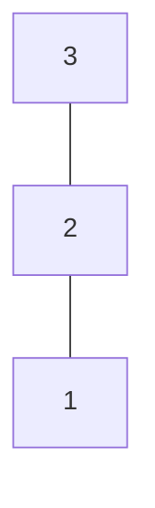

> [!important] Замечания
> - $(\mathbb{N}, \le)$ и $(\mathbb{R}, \le)$ — линейные, делимость — лишь частичная.
> - У **строгого** линейного порядка сравнимы любые два **различных** элемента: равных исключает иррефлексивность.

### Лексикографический порядок

Порядок можно собирать из готовых.

> [!info] Определение (Лексикографический порядок)
> Кортежи равной длины сравниваются по **первой различающейся позиции**:
> $$(a_1, a_2) \prec (b_1, b_2) \iff a_1 \prec b_1 \ \lor\ (a_1 = b_1 \land a_2 \prec b_2).$$

> [!example] Пары битов
> На $\{0, 1\} \times \{0, 1\}$ порядок выстраивает все четыре пары:
> $$(0, 0) \prec (0, 1) \prec (1, 0) \prec (1, 1).$$
> Пары $(0, 1)$ и $(1, 0)$ различаются первыми координатами, и $0 \prec 1$ решает дело — хотя вторая координата левой пары больше. Словари сравнивают строки так же: это тот же порядок на буквах-координатах.

> [!theorem] Теорема (Линейность лексикографического порядка)
> Лексикографический порядок линеен тогда и только тогда, когда линейны оба исходных порядка.

**Доказательство.**
- $(\Leftarrow)$ Если оба порядка линейны, то пару сравнивают первые координаты (они сравнимы), а при их равенстве — вторые (тоже сравнимы).
- $(\Rightarrow)$ Фиксация второй координаты даёт сравнимость первых: $(a, c)$ и $(b, c)$ сравнимы $\Rightarrow$ $a, b$ сравнимы. Фиксация первой — сравнимость вторых. $\blacksquare$

> [!example] Где линейность ломается
> На $\mathbb{N} \times \mathbb{N}$ с обычным $\le$ порядок линеен. А с делимостью в первой координате пары $(2, 1)$ и $(3, 1)$ **несравнимы**.

### Shortlex

> [!info] Определение (Shortlex)
> Строки сравниваются **сначала по длине**, при равных длинах — словарно.

> [!example] Алфавит $\{a, b\}$
> $$\varepsilon \prec a \prec b \prec aa \prec ab \prec ba \prec bb \prec aaa \prec \dots$$
> В обычном **словарном** порядке у набора $\{b, ab, aab, aaab, \dots\}$ наименьшей строки **нет**: перед $b$ стоит бесконечный хвост строк, начинающихся на $a$ ($\dots \prec aaab \prec aab \prec ab \prec b$).

> [!theorem] Теорема (Наименьшая строка в shortlex)
> У любого непустого множества строк над конечным алфавитом есть наименьшая в shortlex.

**Доказательство.** Длины — натуральные числа, значит, минимальная длина $\ell$ существует. Строк длины $\ell$ над конечным алфавитом $\Sigma$ конечное число ($\le |\Sigma|^\ell$), и среди них есть наименьшая словарно (конечный линейный порядок). $\blacksquare$

> [!tip] Зачем это нужно
> Перечисление строк (например, всех программ или всех слов языка) не должно «спотыкаться»: shortlex гарантирует наименьший элемент у любого набора кандидатов — в отличие от словарного порядка.

### Порядок в коде (Rust)

Стандартная библиотека Rust разделяет частичный и линейный порядок на два трейта:

```rust
pub trait PartialOrd<Rhs = Self> {
    // None — элементы несравнимы
    fn partial_cmp(&self, other: &Rhs) -> Option<Ordering>;
}

pub trait Ord {
    // линейность: результат определён для любой пары
    fn cmp(&self, other: &Self) -> Ordering;
}
```

Несравнимость выражается значением `None`:

```rust
// Div(2) и Div(3) несравнимы, Div(2) <= Div(6)
struct Div(u64);

impl PartialOrd for Div {
    fn partial_cmp(&self, other: &Self) -> Option<Ordering> {
        match (self.0 % other.0, other.0 % self.0) {
            // взаимная делимость — равенство
            (0, 0) => Some(Ordering::Equal),
            (_, 0) => Some(Ordering::Less),
            (0, _) => Some(Ordering::Greater),
            _ => None,
        }
    }
}
```

Аналог на **C++20** — категория сравнения `std::partial_ordering` с особым значением `unordered`:

```cpp
#include <compare>
#include <cstdint>

struct Div {
    std::uint64_t value;

    // Частичный порядок по делимости: unordered для несравнимых пар.
    [[nodiscard]] constexpr std::partial_ordering
    operator<=>(const Div& other) const noexcept {
        const bool self_divides_other = other.value % value == 0;  // value | other
        const bool other_divides_self = value % other.value == 0;  // other | value
        if (self_divides_other && other_divides_self) return std::partial_ordering::equivalent;
        if (self_divides_other) return std::partial_ordering::less;
        if (other_divides_self) return std::partial_ordering::greater;
        return std::partial_ordering::unordered;  // 2 и 3: ни одно не делит другое
    }
    [[nodiscard]] constexpr bool operator==(const Div&) const noexcept = default;
};

static_assert(Div{2} < Div{6});
static_assert(!(Div{2} < Div{3}) && !(Div{3} < Div{2}) && !(Div{2} == Div{3}));
```

> [!warning] Ловушка сортировки
> `std::sort` и `slice::sort` требуют **строгого слабого (линейного по классам) порядка**. Сортировка по частичному порядку (делимость, включение) даёт неопределённое поведение или бессмысленный результат — для частичных порядков нужна **топологическая сортировка** (раздел 6).

### Порядки и не-порядки: предпорядок

> [!info] Определение (Предпорядок)
> Рефлексивное и транзитивное отношение называется **предпорядком**.

> [!example] Классификация
> - **Делимость $a \mid b$:** на $\mathbb{N}$ — порядок ($2$ и $3$ несравнимы), а на $\mathbb{Z}$ — **не** порядок: $2 \mid -2$ и $-2 \mid 2$, но $2 \ne -2$ (нарушена антисимметричность).
> - **Включение множеств:** порядок, $\{1\}$ и $\{2\}$ несравнимы.
> - **«Разность кратна 3» на $\mathbb{Z}$:** рефлексивно, транзитивно и **симметрично** — это эквивалентность, а не порядок.
> - **Совместимость версий пакетов:** рефлексивно и транзитивно, но не антисимметрично — **предпорядок**.

| Тип отношения | Рефлексивность | Транзитивность | Дополнительная аксиома |
| :--- | :---: | :---: | :--- |
| Предпорядок | ✅ | ✅ | — (нет требований) |
| Частичный порядок | ✅ | ✅ | антисимметричность |
| Эквивалентность | ✅ | ✅ | симметричность |
| Линейный порядок | ✅ | ✅ | антисимметричность + сравнимость любой пары |

Эквивалентность, порядок и предпорядок — три набора аксиом на общем каркасе рефлексивности и транзитивности.

> [!tip] Связь предпорядка, эквивалентности и порядка
> Из предпорядка $\lesssim$ всегда получается эквивалентность $a \sim b \iff a \lesssim b \land b \lesssim a$, и на классах $A/{\sim}$ предпорядок становится **частичным порядком** (так устроена совместимость версий, раздел 6).

### ✅ Проверка порядков (вопросы со слайда)

1. **Является ли отношение $x^2 \le y^2$ порядком на $\mathbb{Z}$?**
   > [!note]- Решение
   > Рефлексивно ($x^2 \le x^2$) и транзитивно (транзитивность $\le$ на квадратах). Но **не антисимметрично**: $1^2 \le (-1)^2$ и $(-1)^2 \le 1^2$, хотя $1 \ne -1$. Это **предпорядок**, не порядок. Классы эквивалентности — $\{x, -x\}$; на них отношение становится линейным порядком (по $|x|$).
2. **Отношение «не длиннее» на строках рефлексивно и транзитивно, а строки `01` и `10` не длиннее друг друга одновременно. Порядок или предпорядок?**
   > [!note]- Решение
   > Антисимметричность нарушена: `01` $\lesssim$ `10` и `10` $\lesssim$ `01`, но строки различны. Значит, это **предпорядок**. Отождествление строк одной длины даёт линейный порядок на длинах $(\mathbb{N}, \le)$.

---

## 2. 🪜 Диаграммы Хассе

### Построение

Диаграмма Хассе — «скелет» частичного порядка.

> [!note] Алгоритм построения диаграммы Хассе
> 1. Убрать все **петли** (рефлексивность подразумевается).
> 2. Убрать рёбра, следующие из **транзитивности**. Остаются только ближайшие связи.
> 3. Расположить $a$ **выше** $b$, когда $b \prec a$.
> 4. Нарисовать линии между соседними элементами.

> [!important] Почему это корректно
> - Рёбра диаграммы — ближайшие связи, и **стрелки не нужны**: все они указывали бы в одну сторону (вверх).
> - Каждое сокращение безопасно: убранное восстанавливается по аксиомам порядка.
> - Хассе рисует **транзитивное сокращение** порядка — минимальный граф с тем же транзитивным замыканием (см. [[04. Лекция - Отношения и эквивалентность (2026-09-30)]]).

### От орграфа к Хассе: делимость на $\{1, 2, 3, 6\}$

**Слева — весь порядок** как орграф: петли у каждой вершины, стрелки $1 \to 2$, $1 \to 3$, $2 \to 6$, $3 \to 6$ и **транзитивное ребро** $1 \to 6$:

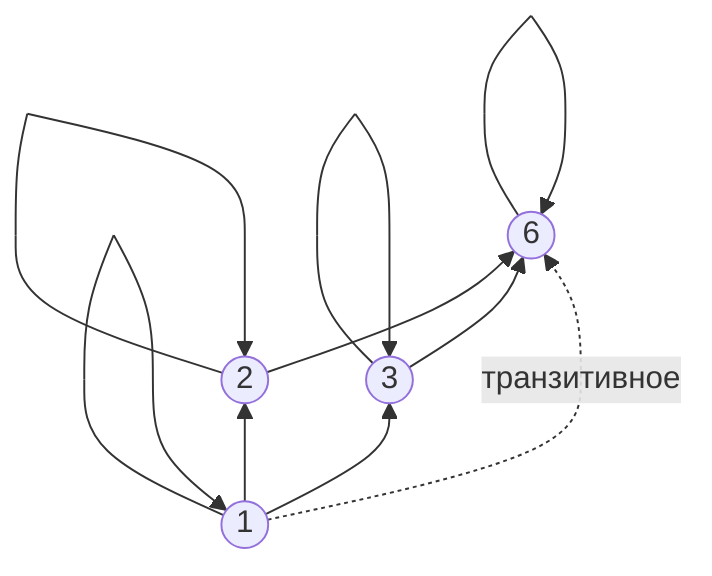

**Справа — скелет (Хассе):** четыре ребра покрытия; убранное восстанавливается транзитивностью:

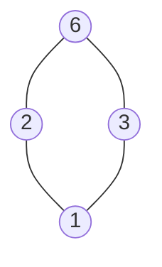

### Делители числа 12

$D_{12} = \{1, 2, 3, 4, 6, 12\}$ с отношением делимости:

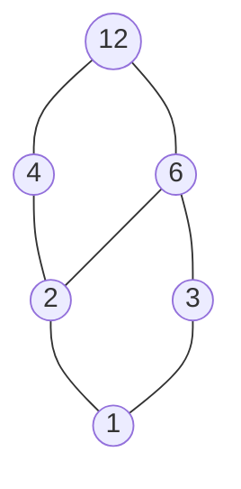

> [!example] Как читать диаграмму
> - Ребро — ближайшая связь, а порядок восстанавливается **движением вверх**: $1 \preceq 4$ по пути $1 - 2 - 4$, а из $2$ в $3$ пути вверх нет ($2$ и $3$ несравнимы).
> - **Ступень** элемента — сумма показателей простых множителей ($12 = 2^2 \cdot 3$ — ступень $3$; $6 = 2 \cdot 3$ — ступень $2$). Вверх каждый показатель только растёт, ребро прибавляет единицу ровно одному показателю, поэтому **все пути между двумя элементами одной длины**.

### Отношение покрытия

> [!info] Определение (Покрытие)
> $a$ **покрывает** $b$ (пишут $b \lessdot a$), если $b \prec a$ и между ними **нет промежуточного** элемента в $A$:
> $$b \lessdot a \iff b \prec a \ \land\ \nexists c \in A : b \prec c \prec a.$$
> Покрытие зависит от того, какие элементы взяты. Отношение покрытия — ровно те пары, которые **нельзя вывести** из транзитивности.

> [!example] Ребро $1 - 4$ в $D_{12}$
> Ребро $1 - 4$ не рисуется: хотя $1 \mid 4$, связь следует через $2$: $1 \mid 2 \mid 4$. А ребро $2 - 4$ рисуется: промежуточного делителя между $2$ и $4$ в множестве нет.
>
> Если же взять множество $\{1, 4, 12\}$ (без $2$), то $4$ **покрывает** $1$ — покрытие зависит от носителя.

### Несравнимые элементы и независимость задач

> [!important] Несравнимость = независимость
> Несравнимость $a$ и $b$ не задаёт порядка между ними: ни один из элементов не обязан идти раньше. Если элементы описывают задачи, такую пару можно выполнять **в любом порядке или параллельно**.

> [!example] Параллелизм
> - Задачи «написать отчёт» и «собрать данные» независимы.
> - Компилятор собирает несравнимые модули параллельно (флаг `make -j`).
>
> Планировщик извлекает параллелизм **именно из несравнимых пар**: сравнимым задачам порядок предписывает очередь.

### Цепи, антицепи и ширина

> [!info] Определение (Цепь и антицепь)
> Подмножество называется **цепью**, если любые два его элемента сравнимы, и **антицепью**, если любые два его элемента различны и несравнимы.

> [!info] Определение (Ширина)
> **Ширина** ЧУМ — наибольший размер антицепи. **Длиной** цепи называют число её элементов.

> [!example] Цепи и антицепи в $D_{12}$
> - Антицепи размера два: $\{2, 3\}$, $\{3, 4\}$ и $\{4, 6\}$.
> - Цепь: $1 \mid 2 \mid 4 \mid 12$ (длина $4$, наибольшая).
> - **Ширина равна $2$:** три попарно несравнимых делителя не набираются (на любой «ступени» не больше двух элементов, а элементы разных ступеней проверяются перебором: $\{3, 4\}$ нельзя дополнить ни $2$ ($2 \mid 4$), ни $6$ ($3 \mid 6$)).

> [!tip] Интерпретация
> Цепь — **последовательная** работа, антицепь — **параллельная**, и ширина говорит, сколько потоков нужно.

### Включение подмножеств: $B_2$ и $B_3$

Подмножества $\{1, 2\}$ по включению — квадрат $B_2$:

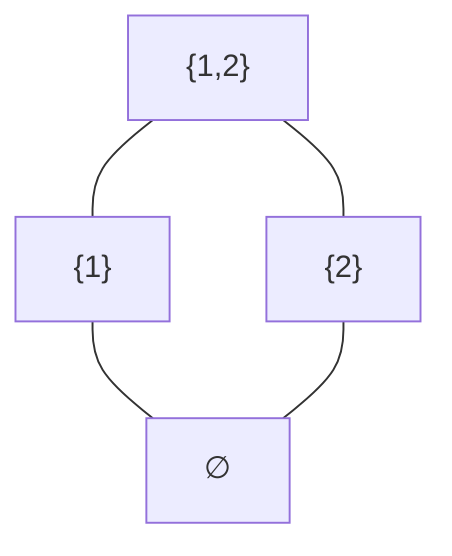

Подмножества $\{1, 2, 3\}$ — куб $B_3$:

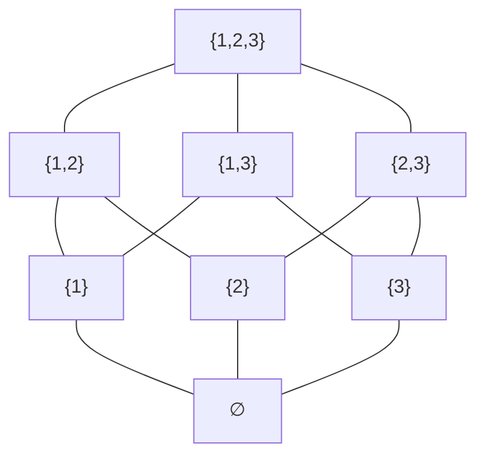

- Каждый путь вверх из $\varnothing$ в $\{1, 2, 3\}$ — **порядок добавления элементов**, и таких путей $3! = 6$.
- Две диагонали обязаны пересечься — нарисовать $B_3$ на плоскости в стиле Хассе **без пересечений рёбер нельзя**.

> [!important] Структура булеана
> Ребро булеана — добавление **ровно одного** элемента, и максимальных цепей в $B_n$ ровно $n!$ (каждая цепь $\varnothing \subset \{x_1\} \subset \{x_1, x_2\} \subset \dots$ — перестановка элементов).

---

## 3. 🏔️ Экстремальные элементы и грани

### Минимальные и максимальные элементы

Экстремальные элементы обобщают «первый» и «последний» на случай, когда порядок не линеен.

> [!info] Определение (Минимальный и максимальный)
> $m$ **минимален**, если нет элемента строго меньше: $\nexists a : a \prec m$.
> $m$ **максимален**, если нет строго большего: $\nexists a : m \prec a$.

> [!example] Максимальный, но не наибольший
> ЧУМ: бесконечная цепь $x_1 \prec x_2 \prec x_3 \prec \dots$ и отдельный элемент $m$, несравнимый ни с одним $x_i$.
>
> ```mermaid
> graph BT
>     x1["x₁"] --- x2["x₂"] --- x3["x₃"] --- xd["…"]
>     m["m"]
> ```
>
> $m$ максимален (над ним никого нет), но **не наибольший**: он несравним с $x_i$. А цепь вообще не имеет максимальных элементов: над каждым $x_i$ есть $x_{i+1}$.

### Наименьший и наибольший элементы

Вторая пара свойств **глобальна**: элемент сравним со всеми.

> [!info] Определение (Наименьший и наибольший)
> $m$ **наименьший**, если он (нестрого) меньше всех: $\forall a \in A : m \preceq a$.
> $m$ **наибольший**, если он (нестрого) больше всех: $\forall a \in A : a \preceq m$.

> [!example] Примеры
> - В $(\{1, 2, 3\}, \le)$ наименьший — $1$, наибольший — $3$.
> - В ЧУМ $(\{2, 3, 6\}, \mid)$ наименьшего нет: $2$ и $3$ несравнимы. Наибольший — $6$.

### Сравнение экстремальных элементов

| Понятие | Единственен? | Существует в конечном ЧУМ? | Сравним со всеми? |
| :--- | :---: | :---: | :---: |
| Минимальный | нет | да (лемма о спуске) | не обязан |
| Максимальный | нет | да (лемма о спуске) | не обязан |
| Наименьший | да | не гарантирован | да |
| Наибольший | да | не гарантирован | да |

> [!example] Две ситуации
> - В $D_{12}$ роли совпадают: минимальный элемент один — единица, и он же наименьший.
> - В $(\{2, 3, 4, 6, 12\}, \mid)$ минимальных **два** ($2$ и $3$), а наименьшего **нет**.

### Лемма о спуске

Цепочка спуска $a \succ a_1 \succ a_2 \succ \dots$ в конечном множестве не может тянуться вечно.

> [!theorem] Лемма о спуске
> В конечном непустом ЧУМ есть минимальный и есть максимальный элемент.

**Доказательство (от противного).** Пусть минимального нет. Тогда для каждого элемента найдётся строго меньший, и от произвольного $a$ строится бесконечная убывающая цепочка $a \succ a_1 \succ a_2 \succ \dots$. В конечном множестве какой-то элемент повторится: $a_i = a_j$ при $i < j$. Транзитивность участка $a_i \succ a_{i+1} \succ \dots \succ a_j$ даёт $a_i \succ a_j = a_i$, т.е. $a_i \prec a_i$ — противоречие с иррефлексивностью строгого порядка. Значит, спуск обрывается на минимальном элементе. Для максимума рассуждение двойственное. $\blacksquare$

### Двойственность

> [!info] Определение (Двойственный порядок)
> Двойственный порядок к $(A, \preceq)$ — это $(A, \succeq)$, где $a \succeq b$ означает $b \preceq a$.

Диаграмма Хассе двойственного ЧУМ получается **переворотом** исходной вверх ногами.

> [!important] Принцип двойственности
> Минимальный и максимальный, наименьший и наибольший, супремум и инфимум, join и meet — **пары двойственных понятий**. Отсюда приём «двойственное рассуждение»: верное утверждение остаётся верным при замене порядка на двойственный, и второе доказательство не нужно.

### Единственность наименьшего и наибольшего

За каждым «единственным» стоит один шаблон: два кандидата на одну роль оказываются равны по антисимметричности.

> [!theorem] Теорема (Наименьший и наибольший единственны)
> В ЧУМ не бывает двух различных наименьших элементов, как и двух различных наибольших.

**Доказательство.** Пусть $m$ и $m'$ — наименьшие. Каждый лежит ниже всех, в частности $m \preceq m'$ и $m' \preceq m$. Антисимметричность даёт $m = m'$. Для наибольших — двойственно. $\blacksquare$

### Наименьший и минимальный

ЧУМ $(\{2, 3, 6\}, \mid)$ с двумя минимальными элементами:

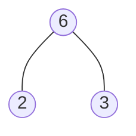

> [!theorem] Теорема
> Всякий наименьший элемент минимален, а обратное неверно.

**Доказательство.** Если $m$ наименьший, то $m \preceq a$ для каждого $a$. Если бы нашёлся $a \prec m$, то $a \preceq m$ и $m \preceq a$ дали бы $a = m$, что противоречит $a \ne m$. Значит, строго меньшего нет — $m$ минимален. Обратное неверно: на диаграмме выше $2$ и $3$ минимальны, а наименьшего нет. $\blacksquare$

### Верхние и нижние грани

Грани характеризуют **подмножество**, а не всё ЧУМ.

> [!info] Определение (Грани)
> Пусть $S \subseteq A$.
> - $u$ — **верхняя грань** (*upper bound*) $S$, если $s \preceq u$ для всех $s \in S$.
> - $l$ — **нижняя грань** (*lower bound*) $S$, если $l \preceq s$ для всех $s \in S$.

> [!example] Грани пары $S = \{2, 3\}$ в $D_{12}$
> - Верхние грани: $6$ и $12$ (оба делятся на $2$ и на $3$).
> - Нижняя грань: $1$.
> - $4$ — не верхняя грань ($3 \nmid 4$).

### Супремум и инфимум

> [!info] Определение (Супремум и инфимум)
> - **Супремум** $S$ — **наименьшая** верхняя грань, обозначается $\sup S$.
> - **Инфимум** $S$ — **наибольшая** нижняя грань, $\inf S$.
> - Для пары $\{a, b\}$ супремум называют **join** ($a \lor b$), инфимум — **meet** ($a \land b$).

> [!example] В $D_{12}$
> - $\sup\{2, 3\} = 6$: верхние грани $\{6, 12\}$, наименьшая — $6$.
> - $\inf\{4, 6\} = 2$: нижние грани $\{1, 2\}$, наибольшая — $2$.
>
> В делителях $\sup = \operatorname{НОК}$, $\inf = \operatorname{НОД}$.

### Супремум может не существовать

Грань обязана быть **элементом ЧУМ**: если над парой нет вершины, супремум взять неоткуда.

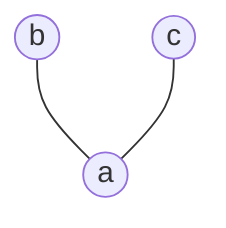

> [!example] «Галочка» $\{a, b, c\}$
> $a \prec b$, $a \prec c$, а $b$ и $c$ несравнимы. У пары $\{b, c\}$ **нет верхней грани**: элемента над обоими в множестве нет. Значит, $\sup\{b, c\}$ не существует, хотя $\inf\{b, c\} = a$ есть. **Существование граней несимметрично.**

### Единственность супремума и инфимума

> [!theorem] Теорема (Единственность граней)
> У подмножества ЧУМ не бывает двух различных супремумов, как и двух различных инфимумов.

**Доказательство.** Пусть $u$ и $u'$ — наименьшие верхние грани множества $S$. Обе они — верхние грани, поэтому (по минимальности каждой) $u \preceq u'$ и $u' \preceq u$, а антисимметричность даёт $u = u'$. Для инфимума — двойственно. $\blacksquare$

> [!important] Итог
> Супремум и инфимум **единственны, когда существуют**. Но в произвольном ЧУМ они могут отсутствовать.

### Две минимальные верхние грани

Верхние грани могут существовать, а **наименьшей** среди них не быть.

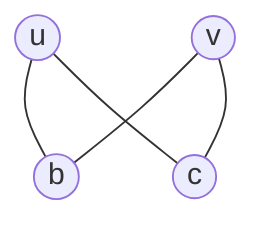

> [!example] «Бабочка» $\{b, c, u, v\}$
> Каждый из $u$ и $v$ лежит над обоими элементами пары $\{b, c\}$, а $u$ и $v$ несравнимы. Верхние грани пары $\{b, c\}$ — ровно $u$ и $v$; наименьшей из них нет, поэтому **супремума нет**, хотя верхние грани есть.

### Инфимум без наименьшего

У **бесконечного** множества наименьшего элемента может не быть.

> [!example] Последовательность $1/n$
> Множество $S = \{1, \tfrac12, \tfrac13, \tfrac14, \dots\} \subset \mathbb{R}$ не имеет наименьшего элемента: для любого $\tfrac1n$ есть меньшее $\tfrac{1}{n+1}$. Но инфимум есть: $\inf S = 0$ — и $0 \notin S$.

> [!note] Чем $\mathbb{R}$ отличается от $\mathbb{Q}$
> В самом $\mathbb{Q}$ у множества $\{q \in \mathbb{Q} : q^2 < 2\}$ **супремума нет**, а в $\mathbb{R}$ он равен $\sqrt{2}$. Существование супремума у любого ограниченного сверху множества (полнота) — ровно то, чем $\mathbb{R}$ отличается от $\mathbb{Q}$.

> [!important] Супремум $\ne$ максимум
> Максимум (наибольший элемент) обязан **принадлежать** множеству, супремум — лишь наилучшая граница. Если максимум есть, он совпадает с супремумом; обратное неверно.

### ✅ Проверка экстремальных элементов (вопросы со слайда)

1. **Может ли в конечном ЧУМ быть ровно один максимальный элемент, не являющийся наибольшим?**
   > [!note]- Решение
   > **Нет.** В конечном ЧУМ над любым элементом $a$ лежит хотя бы один максимальный: поднимаемся $a \prec a_1 \prec a_2 \prec \dots$, и по лемме о спуске (двойственной) подъём обрывается на максимальном. Если максимальный $m$ ровно один, то каждый $a$ лежит под ним: $a \preceq m$ — значит, $m$ наибольший. В бесконечном ЧУМ это неверно (пример с цепью $x_1 \prec x_2 \prec \dots$ и изолированным $m$).
2. **Найдите в $D_{12}$ все верхние грани множества $\{3, 4\}$ и его супремум.**
   > [!note]- Решение
   > Верхняя грань должна делиться на $3$ и на $4$: среди $\{1, 2, 3, 4, 6, 12\}$ это только $12$. Значит, верхние грани — $\{12\}$, $\sup\{3, 4\} = 12 = \operatorname{НОК}(3, 4)$.

---

## 4. 💎 Решётки

### Определение решётки

У множеств есть объединение и пересечение, у пары чисел — НОК и НОД: обе операции определены для **любой** пары, и решётка называет это свойство.

> [!info] Определение (Решётка)
> ЧУМ называется **решёткой**, если у каждой пары элементов существуют и супремум (join, $a \lor b$), и инфимум (meet, $a \land b$).

| Решётка | Join $a \lor b$ | Meet $a \land b$ |
| :--- | :--- | :--- |
| Булеан $(\mathcal{P}(A), \subseteq)$ | $X \cup Y$ | $X \cap Y$ |
| Делители $(D_n, \mid)$ | $\operatorname{НОК}(a, b)$ | $\operatorname{НОД}(a, b)$ |
| Линейный порядок | $\max(a, b)$ | $\min(a, b)$ |

> [!important] Линейность не требуется
> Решётка допускает несравнимые элементы, но каждая пара обязана иметь **точные** грани.

### ЧУМ, не являющееся решёткой

> [!example] $(\{2, 3, 4, 6, 12\}, \mid)$ — не решётка
> У пары $\{2, 3\}$ нет нижней грани в этом множестве: инфимум был бы $1$, но единицы в множестве нет.
>
> ```mermaid
> graph BT
>     q2((2)) --- q4((4))
>     q2 --- q6((6))
>     q3((3)) --- q6
>     q4 --- q12((12))
>     q6 --- q12
> ```

> [!important] Одного элемента достаточно
> Добавление $1$ превращает множество в $D_{12}$ — решётку делителей $12$: у каждой пары появляются обе грани.

### Дистрибутивная решётка

Для операций решётки можно проверять тождества — как для сложения и умножения.

> [!info] Определение (Дистрибутивная решётка)
> Решётка **дистрибутивна**, если для всех $a, b, c$:
> $$a \land (b \lor c) = (a \land b) \lor (a \land c).$$
> Здесь $\land$ — meet, $\lor$ — join.

> [!example] Дистрибутивные решётки
> - **Булеан:** $A \cap (B \cup C) = (A \cap B) \cup (A \cap C)$ и двойственное тождество.
> - **Делители любого числа:** НОК и НОД действуют на показателях простых **поточечно**, как $\max$ и $\min$, а $\min(a, \max(b, c)) = \max(\min(a, b), \min(a, c))$. Например, для $4 = 2^2$ и $6 = 2 \cdot 3$: $\operatorname{НОК} = 2^{\max(2,1)} \cdot 3^{\max(0,1)} = 2^2 \cdot 3 = 12$.

### Модулярная решётка и ромб $M_3$

> [!info] Определение (Модулярная решётка)
> Решётка **модулярна**, если из $a \preceq c$ следует
> $$a \lor (b \land c) = (a \lor b) \land c.$$

Ромб $M_3$ ($\top$ и $\bot$ — наибольший и наименьший элементы, $a, b, c$ попарно несравнимы):

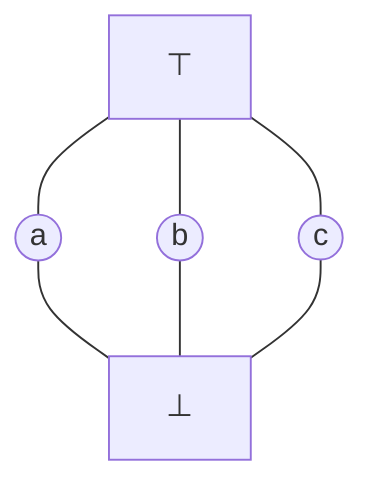

> [!example] $M_3$ модулярен, но не дистрибутивен
> Нарушение дистрибутивности:
> $$a \land (b \lor c) = a \land \top = a, \qquad (a \land b) \lor (a \land c) = \bot \lor \bot = \bot \ne a.$$
> Модулярность выполняется: в $M_3$ условие $x \preceq z$ возможно лишь при $x = \bot$, $z = \top$ или $x = z$. Проверяем $x \lor (y \land z) = (x \lor y) \land z$:
> - $x = \bot$: обе части равны $y \land z$;
> - $z = \top$: обе части равны $x \lor y$;
> - $x = z$: левая часть $x \lor (y \land x) = x$, правая $(x \lor y) \land x = x$ (законы поглощения).

> [!important] Иерархия
> Всякая дистрибутивная решётка модулярна (при $a \preceq c$: $(a \lor b) \land c = (a \land c) \lor (b \land c) = a \lor (b \land c)$), обратное неверно — пример $M_3$.

### Запрещённая подрешётка: пентагон $N_5$

> [!info] Определение (Подрешётка)
> Подрешётка — подмножество, **замкнутое** относительно join и meet.

Пентагон $N_5$: $\bot \prec a \prec b \prec \top$ и $\bot \prec c \prec \top$, $c$ несравним с $a$ и $b$:

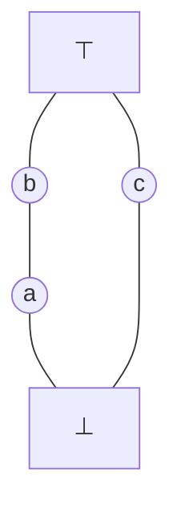

> [!example] В $N_5$ модулярный закон нарушается
> При $a \preceq b$ и элементе $c$:
> $$a \lor (c \land b) = a \lor \bot = a, \qquad (a \lor c) \land b = \top \land b = b \ne a.$$

### Теорема Дедекинда — Биркгофа

Модулярность и дистрибутивность проверяются **запрещёнными фигурами**, и списки препятствий полны.

> [!theorem] Теорема Дедекинда — Биркгофа
> - Решётка **модулярна** $\iff$ в ней нет подрешётки, изоморфной $N_5$.
> - Решётка **дистрибутивна** $\iff$ в ней нет подрешёток, изоморфных $M_3$ и $N_5$.

### Булева алгебра

Логика высказываний и алгебра множеств попадают в один каркас, если к дистрибутивной решётке добавить **дополнение**.

> [!info] Определение (Булева алгебра)
> Булева алгебра — дистрибутивная решётка с наименьшим элементом $0$, наибольшим $1$ и дополнением $\overline{a}$:
> $$a \land \overline{a} = 0, \qquad a \lor \overline{a} = 1.$$

| Модель | $0$ | $1$ | $\land$ | $\lor$ | Дополнение |
| :--- | :--- | :--- | :--- | :--- | :--- |
| Булеан $\mathcal{P}(A)$ | $\varnothing$ | $A$ | $\cap$ | $\cup$ | $\overline{S} = A \setminus S$ |
| Логика $\{0, 1\}$ | ложь | истина | $\land$ | $\lor$ | $\neg$ |
| Делители $D_{30}$ (бесквадратное число) | $1$ | $30$ | НОД | НОК | $30 / a$ |

> [!important] Единый каркас
> Логика, множества и схемы устроены одинаково: дистрибутивная решётка с дополнением в разных записях (подробно — [[12. Лекция - Булевы функции, совершенные формы, задача SAT, алгоритмы DPLL и CDCL (2026-11-25)]]).

### Права доступа Unix как решётка

Права доступа — подмножество $\{r, w, x\}$ с порядком по включению — та же решётка $B_3$, с её неизбежными пересечениями диагоналей:

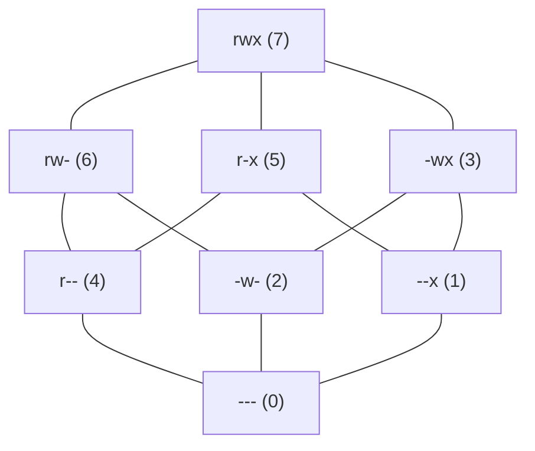

> [!example] chmod
> Восьмеричная запись кодирует подмножество в двоичном виде: $7 = 111_2$ выдаёт все три права, $6 = 110_2$ — чтение и запись без запуска. Join прав — побитовое `|`, meet — побитовое `&`.

### Решётка разбиений

Разбиения (см. лекцию об эквивалентности) тоже образуют ЧУМ: разбиение **уточняет** другое, если каждый его блок лежит в каком-то блоке другого.

Решётка разбиений трёхэлементного множества $\{1, 2, 3\}$:

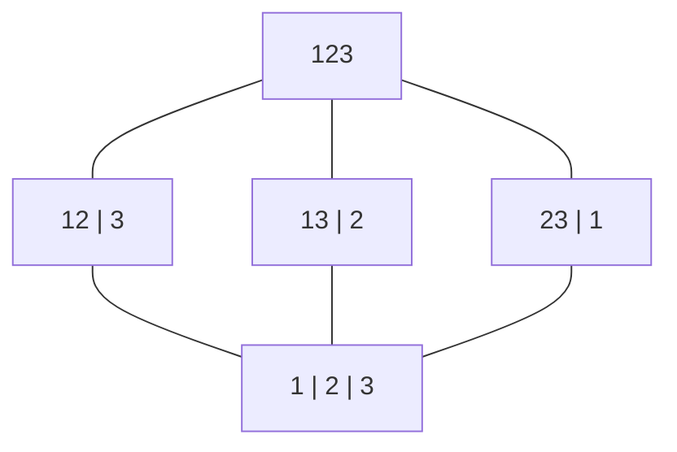

> [!example] Операции на разбиениях
> - **Инфимум** двух разбиений — их общее уточнение (попарные пересечения блоков).
> - **Супремум** — общее укрупнение: блоки склеиваются, пока пересекающиеся не кончатся.
>
> Ромб $M_3$ — не выдумка: это **решётка разбиений трёхэлементного множества**, и потому решётки разбиений (при $n \ge 3$) не дистрибутивны.

### Знаковая решётка

Знаки из **статического анализа** (проверки программы без запуска): $+$, $-$ и $0$ посередине, $\top$ — любой знак, $\bot$ — чисел нет.

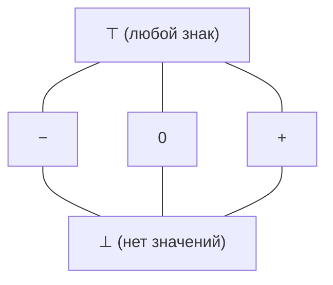

> [!note] Как работает анализ
> Значение переменной заменяется элементом решётки. **Слияние ветвей** условного оператора берёт супремум: $+$ и $-$ дают $\top$ — точный знак теряется.

> [!important] Безопасность деления
> Если анализ вывел для $x$ знак $+$ или знак $-$, деление на $x$ безопасно. **Абстрактная интерпретация** трактует свойства программы как элементы решётки.

---

## 5. 🔁 Неподвижные точки в решётках *(звёздный раздел)*

### Монотонность, неподвижные точки, полные решётки

Рекурсивное определение — это уравнение $X = F(X)$, где $F$ — шаг пересчёта. Когда решение существует и как его найти, отвечает решёточная структура.

- Функция $f : L \to L$ **монотонна**, если $x \preceq y \implies f(x) \preceq f(y)$.
- **Неподвижная точка** (fixed point) функции $f$ — элемент $x$ с $f(x) = x$.

> [!info] Определение (Полная решётка)
> Решётка называется **полной**, если **любое** подмножество (не только конечное) имеет супремум и инфимум.

> [!example] Полные и неполные
> - Булеан полон: супремум произвольного семейства — объединение, инфимум — пересечение.
> - $(\mathbb{N}, \le)$ не полна: супремума всего $\mathbb{N}$ нет.
> - Всякая **конечная** решётка полна.

### Где неподвижные точки в программировании

Значение задаётся рекурсивным уравнением, меняется только содержимое решётки:

| Область | Решётка | Что ищем |
| :--- | :--- | :--- |
| Абстрактная интерпретация | абстрактные состояния программы | наименьшую неподвижную точку (результат анализа) |
| Денотационная семантика (Скотт, 1970-е) | частичные функции по «определённости» | наименьшую неподвижную точку (смысл рекурсивной функции) |
| Теория типов | типы | неподвижную точку уравнения на типах (`List = 1 + T × List`) |
| Model checking (перебор состояний) | множества состояний | достижимые — наименьшую, инварианты — наибольшую |

### Теорема Кнастера — Тарского

Полнота решётки делает построение неподвижных точек безопасным: инфимум по всем точкам, где $f(x) \preceq x$, обязан существовать.

> [!theorem] Теорема Кнастера — Тарского (1928–1955)
> Пусть $(L, \preceq)$ — полная решётка. Всякая монотонная функция $f : L \to L$ имеет **наименьшую** и **наибольшую** неподвижные точки. Их обозначают $\mathrm{lfp}(f)$ и $\mathrm{gfp}(f)$:
> $$\mathrm{lfp}(f) = \inf\{x \in L \mid f(x) \preceq x\}, \qquad \mathrm{gfp}(f) = \sup\{x \in L \mid x \preceq f(x)\}.$$

> [!warning] Монотонность нельзя убрать
> Отражение $x \mapsto 1 - x$ на решётке $\{0, 1\}$ немонотонно и неподвижных точек не имеет: $0 \mapsto 1$, $1 \mapsto 0$.

### Доказательство Кнастера — Тарского (построение)

Наименьшая неподвижная точка — инфимум множества точек с $f(x) \preceq x$.

1. Рассмотрим $P = \{x \in L \mid f(x) \preceq x\}$ и $a = \inf P$. Множество $P$ непусто, потому что $f(\top) \preceq \top$; инфимум существует по полноте.
2. Для всех $x \in P$: из $a \preceq x$ и монотонности $f(a) \preceq f(x) \preceq x$. Значит, $f(a)$ — нижняя грань $P$.
3. Инфимум — **наибольшая** из нижних граней, поэтому $f(a) \preceq a$, т.е. $a \in P$.
4. По монотонности из $f(a) \preceq a$ получаем $f(f(a)) \preceq f(a)$, т.е. $f(a) \in P$. Тогда $a = \inf P \preceq f(a)$.
5. По антисимметричности $f(a) = a$ — неподвижная точка.
6. **Наименьшая:** если $b$ — неподвижная точка, то $f(b) = b \preceq b$, значит $b \in P$, и $a \preceq b$.

Наибольшая точка — двойственное рассуждение (супремум множества $\{x \mid x \preceq f(x)\}$). $\blacksquare$

### Итерация к неподвижной точке

> [!example] Итерация на $\mathcal{P}(\{1, 2, 3\})$
> Монотонная функция $f(X) = X \cup \{1\}$. Итерация от низа:
> $$\varnothing \xrightarrow{f} \{1\} \xrightarrow{f} \{1\} \xrightarrow{f} \dots$$
> Уже на втором шаге множество перестало меняться: $\{1\}$ — неподвижная точка, и она **наименьшая** (любая неподвижная точка содержит $1$). Наибольшая — $\{1, 2, 3\}$.

В анализе программ та же картина: решётка — множества фактов, функция — эффект тела цикла. В **конечной** решётке итерация от низа $\bot \preceq f(\bot) \preceq f^2(\bot) \preceq \dots$ — возрастающая цепь, которая стабилизируется за конечное число шагов — на наименьшей неподвижной точке.

Псевдокод (нотация CLRS):

```text
LEAST-FIXED-POINT(f, ⊥)
1  x ← ⊥
2  repeat
3      x_prev ← x
4      x ← f(x_prev)
5  until x = x_prev
6  return x
```

Реализация на C++20 для решётки подмножеств, закодированных битовыми масками:

```cpp
#include <concepts>
#include <cstdint>

// Итерация Клини от низа решётки до наименьшей неподвижной точки.
// Требование: f монотонна, решётка конечна — тогда цепь ⊥ ⪯ f(⊥) ⪯ f²(⊥) ⪯ … стабилизируется.
template <std::equality_comparable T, std::invocable<const T&> F>
    requires std::convertible_to<std::invoke_result_t<F, const T&>, T>
[[nodiscard]] constexpr T least_fixed_point(F f, T bottom) {
    T x = bottom;
    while (true) {
        T next = f(x);
        if (next == x) return x;  // f(x) = x — неподвижная точка
        x = next;
    }
}

// Пример со слайда: f(X) = X ∪ {1} на P({1,2,3}), бит 0 — элемент 1.
static_assert(least_fixed_point([](const std::uint8_t& s) -> std::uint8_t { return s | 0b001; },
                                std::uint8_t{0}) == 0b001);
```

### Какую неподвижную точку брать?

Выбор диктует смысл задачи:
- **Состояние анализа ищут снизу.** В конечной решётке фактов итерация от пустого множества стабилизируется на **наименьшей** точке (ровно то, что выводится, ничего лишнего).
- **Инварианты ищут сверху.** **Наибольшая** неподвижная точка — самый широкий факт, верный на всех проходах цикла.

> [!warning] Полнота существенна
> Без полноты рекурсивное определение может не иметь решения вовсе.

### Первый взгляд на абстрактную интерпретацию

Статический анализ рассуждает о программе, не запуская её. Программа читает число и делит на него:

```rust
let x = read();
let y = 100 / x;
```

Перебрать входы невозможно — их бесконечно много. Анализ заменяет конкретные значения элементами решётки, а цикл — неподвижной точкой решёточной функции. Здесь `read()` даёт $\top$ (любой знак), и анализ **предупредит о делении на ноль**, ведь $x$ бывает нулём.

> [!important] Анализ ошибается в одну сторону
> Вердикт «безопасно» даётся **с гарантией**, а «возможно падение» бывает **ложной тревогой** (over-approximation). Знаки — только первый шаг; дальше идут интервалы $[a, b]$ и остатки по модулю.

---

## 6. ⚙️ Приложения порядка

### Топологическая сортировка

Зависимости образуют граф, и его транзитивное замыкание задаёт порядок: путь из $a$ в $b$ означает «$a$ прежде $b$».

> [!info] Определение (Топологическая сортировка)
> Линейный порядок $\le$ на ЧУМ $(A, \preceq)$ такой, что $a \preceq b \implies a \le b$, называется **топологической сортировкой** (линейным расширением).

> [!example] Сборка системы
> Зависимости: ядро $\preceq$ драйверы, ядро $\preceq$ тесты, драйверы $\preceq$ образ системы.
>
> ```mermaid
> graph BT
>     k["ядро"] --- d["драйверы"]
>     k --- t["тесты"]
>     d --- img["образ"]
> ```
>
> Допустимы обе последовательности: «ядро, драйверы, тесты, образ» и «ядро, тесты, драйверы, образ» — драйверы и тесты несравнимы. (Также допустима «ядро, драйверы, образ, тесты».)

> [!important] Неединственность
> Несравнимые элементы получают произвольный порядок: сортировок, как правило, несколько.

### Существование топологической сортировки

> [!theorem] Теорема
> Любое конечное ЧУМ имеет хотя бы одну топологическую сортировку.

**Доказательство (построением).** Минимальный элемент существует по лемме о спуске. Выводим его, удаляем и повторяем для оставшихся (подмножество ЧУМ — снова ЧУМ). Когда элемент выводится, все его предшественники уже удалены — иначе среди них нашёлся бы меньший, и элемент не был бы минимальным. Значит, $a \prec b$ влечёт: $a$ выведен раньше $b$. $\blacksquare$

> [!important] Циклы
> «Снять минимальный» никогда не застревает. Если же отношение содержит цикл $a \prec b \prec a$, топологической сортировки не существует: антисимметричность требовала бы $a = b$.

### Алгоритм Кана

> [!note] Алгоритм Кана (Kahn, 1962)
> 1. Посчитать число входящих рёбер (in-degree) у каждой вершины.
> 2. Положить в очередь все вершины с нулевым входом.
> 3. Пока очередь не пуста:
>    - извлечь вершину и вывести её;
>    - уменьшить вход каждого соседа;
>    - если вход соседа стал нулевым, добавить его в очередь.
> 4. Если выведены не все вершины, в графе есть **цикл**.

Псевдокод (нотация CLRS):

```text
KAHN-TOPOLOGICAL-SORT(G)
 1  for each u ∈ G.V
 2      in[u] ← 0
 3  for each (u, v) ∈ G.E
 4      in[v] ← in[v] + 1
 5  Q ← ∅;  L ← ⟨⟩
 6  for each u ∈ G.V
 7      if in[u] = 0
 8          ENQUEUE(Q, u)
 9  while Q ≠ ∅
10      u ← DEQUEUE(Q)
11      append u to L
12      for each v ∈ G.Adj[u]
13          in[v] ← in[v] − 1
14          if in[v] = 0
15              ENQUEUE(Q, v)
16  if |L| < |G.V|
17      error "граф содержит цикл"
18  return L
```

Реализация на C++20:

```cpp
#include <cstddef>
#include <optional>
#include <queue>
#include <span>
#include <vector>

// adj[u] — список вершин v, для которых u ⪯ v (ребро u → v).
// Возвращает топологический порядок или std::nullopt при наличии цикла.
[[nodiscard]] std::optional<std::vector<std::size_t>>
kahn_topological_sort(std::span<const std::vector<std::size_t>> adj) {
    const std::size_t n = adj.size();
    std::vector<std::size_t> in_degree(n, 0);
    for (const auto& successors : adj)
        for (const std::size_t v : successors) ++in_degree[v];

    std::queue<std::size_t> ready;  // инвариант: в очереди только вершины без невыведенных предшественников
    for (std::size_t u = 0; u < n; ++u)
        if (in_degree[u] == 0) ready.push(u);

    std::vector<std::size_t> order;
    order.reserve(n);
    while (!ready.empty()) {
        const std::size_t u = ready.front();
        ready.pop();
        order.push_back(u);
        for (const std::size_t v : adj[u])
            if (--in_degree[v] == 0) ready.push(v);  // последний предшественник v выведен
    }

    if (order.size() != n) return std::nullopt;  // вершины цикла никогда не получат нулевой вход
    return order;
}
```

**Трассировка** на примере сборки (0 — ядро, 1 — драйверы, 2 — тесты, 3 — образ; рёбра $0 \to 1$, $0 \to 2$, $1 \to 3$):

| Шаг | Извлечена | in-degree $[0, 1, 2, 3]$ после шага | Очередь | Вывод |
| :---: | :---: | :---: | :--- | :--- |
| 0 | — | $[0, 1, 1, 1]$ | $\langle 0 \rangle$ | $\langle\rangle$ |
| 1 | $0$ | $[0, 0, 0, 1]$ | $\langle 1, 2 \rangle$ | $\langle 0 \rangle$ |
| 2 | $1$ | $[0, 0, 0, 0]$ | $\langle 2, 3 \rangle$ | $\langle 0, 1 \rangle$ |
| 3 | $2$ | $[0, 0, 0, 0]$ | $\langle 3 \rangle$ | $\langle 0, 1, 2 \rangle$ |
| 4 | $3$ | $[0, 0, 0, 0]$ | $\langle\rangle$ | $\langle 0, 1, 2, 3 \rangle$ |

> [!important] Сложность
> $O(V + E)$: каждая вершина и каждое ребро обрабатываются по разу. Результат — порядок сборки или отказ при цикле. Применения: сборка модулей (вершина — модуль, ребро — зависимость), расписания, CI/CD-пайплайны.

### Иерархии типов

Отношение «является подтипом» ($<:$) — частичный порядок на типах:
- рефлексивно: $T <: T$;
- транзитивно: если `A <: B` и `B <: C`, то `A <: C`;
- антисимметрично: если `A <: B` и `B <: A`, то $A$ и $B$ — один тип.

`Dog <: Animal` и `Cat <: Animal`, при этом `Dog` и `Cat` **несравнимы**.

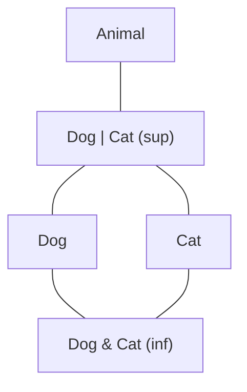

- Объединение типов `Dog | Cat` — **наименьший общий надтип**, супремум в решётке типов.
- Пересечение типов `Dog & Cat` — **инфимум**.

> [!note] Идеализация
> Большинство языков не гарантируют наименьший общий надтип для произвольной пары типов. Решёточная модель — идеализация, описывающая систему типов структурно (её реализуют, например, TypeScript и Scala 3 с типами-объединениями и пересечениями).

### Семантическое версионирование

Семантическое версионирование сочетает **два разных порядка** на одном множестве версий:

| Порядок | Тип | Пример |
| :--- | :--- | :--- |
| Старшинство версий | линейный (лексикографический на тройках чисел) | $1.2.0 < 1.2.1 < 1.3.0 < 2.0.0$ — любые две версии сравнимы |
| Обратная совместимость | предпорядок (после отождествления взаимно совместимых версий — частичный порядок) | $1.2.0$ и $1.2.1$ сравнимы (вторая совместима с первой); $1.2.0$ и $2.0.0$ несравнимы (мажорная версия изменилась) |

> [!important] Пакетные менеджеры
> Выбор совместимого набора зависимостей — поиск **максимальной конфигурации** в ЧУМ версий. Эту задачу решают npm, Cargo, pip.

### Частичный порядок Лампорта *(звёздный раздел)*

В распределённой системе у машин нет общих часов, а синхронизировать физическое время дорого. Лампорт (1978) предложил обойтись без глобального «сейчас» — отношением **«произошло-до»** (*happened-before*): $a \to b$ означает, что $a$ причинно предшествует $b$.

> [!info] Определение (Отношение произошло-до)
> 1. Если $a$ и $b$ — события **одного процесса** и $a$ произошло раньше $b$, то $a \to b$.
> 2. Если $a$ — **отправка** сообщения, а $b$ — его **получение**, то $a \to b$.
> 3. **Транзитивность:** $a \to b$ и $b \to c$ влекут $a \to c$.

- Отношение **иррефлексивно**: цикл $a \to \dots \to a$ означал бы событие раньше самого себя, а локальный порядок процесса и пересылка сообщений идут только вперёд по времени.
- С иррефлексивностью и транзитивностью теорема из раздела 1 даёт асимметричность: **это строгий частичный порядок**.

> [!example] События двух процессов
> Процесс $P_1$ выполняет $a_1$, затем отправляет сообщение (событие $a_2$). Процесс $P_2$ выполняет $b_1$, получает сообщение ($b_2$) и продолжает с $b_3$.
>
> ```mermaid
> flowchart LR
>     subgraph P1
>         a1["a₁"] --> a2["a₂ (send)"]
>     end
>     subgraph P2
>         b1["b₁"] --> b2["b₂ (recv)"] --> b3["b₃"]
>     end
>     a2 -- "сообщение" --> b2
> ```
>
> Правила дают $a_1 \to a_2$, $a_2 \to b_2$, $b_2 \to b_3$, и транзитивность соединяет цепочку: $a_1 \to b_3$. События $a_2$ и $b_1$ **конкурентны**: между ними нет ни локального порядка, ни сообщения.

События с $a \not\to b$ и $b \not\to a$ называются **конкурентными**: причинной связи нет, и разные машины могут увидеть их в разном порядке. Отношение задаёт порядок, но не даёт способа проверить его по данным — это делают векторные часы.

### Векторные часы

**Логические часы Лампорта** $C$ (счётчик событий процесса, растущий на каждом событии и переносимый в сообщениях) дают импликацию только в одну сторону:
$$a \to b \implies C(a) < C(b), \quad\text{но не обратно.}$$

**Векторные часы** восстанавливают равносильность: каждый из $N$ процессов хранит массив $\mathrm{VC}[1..N]$, изначально из нулей.

1. **Локальное событие** процесса $i$: $\mathrm{VC}[i] \leftarrow \mathrm{VC}[i] + 1$.
2. **Отправка** сообщения: процесс вкладывает в него свой текущий вектор $\mathrm{VC}$.
3. **Получение:** поэлементный максимум $\mathrm{VC}[j] \leftarrow \max(\mathrm{VC}[j], \mathrm{VC}_{\text{msg}}[j])$ для всех $j$, затем инкремент $\mathrm{VC}[i]$.

**Сравнение:**
$$a \to b \iff \forall j : \mathrm{VC}(a)[j] \le \mathrm{VC}(b)[j] \ \text{ и хотя бы одно неравенство строгое.}$$
Обе импликации доказывают индукцией по построению векторов: инкремент и поэлементный максимум монотонны. **Несравнимые векторы — конкурентные события.** Векторы с покомпонентным $\le$ образуют решётку ($\mathbb{N}^N$, join — поэлементный $\max$).

> [!example] Сравнение векторов
> Новый прогон, обмена сообщениями нет: процесс $P_1$ сработал дважды (событие $x$, $\mathrm{VC} = [2, 0]$), $P_2$ — один раз (событие $y$, $\mathrm{VC} = [0, 1]$).
> - Векторы **несравнимы** ($2 > 0$, но $0 < 1$), и тест честно отвечает: события конкурентны.
> - Скалярные часы на том же прогоне дают $C(y) = 1 < C(x) = 2$, хотя причинности между $y$ и $x$ **нет** — скаляр «врёт» о порядке.

> [!tip] Цена точности
> Проверка причинности — один проход по вектору, $O(N)$, и вектор растёт вместе с числом процессов: за точность платят памятью. Так реплики распределённых хранилищ в духе **Dynamo** обнаруживают конфликтующие обновления: несравнимые векторы — два параллельных изменения одних данных.

```cpp
#include <algorithm>
#include <cstddef>
#include <cstdint>
#include <vector>

enum class Causality { Before, After, Equal, Concurrent };

// Сравнение векторных часов: покомпонентный частичный порядок на ℕ^N.
[[nodiscard]] Causality compare(const std::vector<std::uint64_t>& a,
                                const std::vector<std::uint64_t>& b) noexcept {
    bool some_less = false, some_greater = false;
    for (std::size_t j = 0; j < a.size(); ++j) {
        some_less    |= a[j] < b[j];
        some_greater |= a[j] > b[j];
    }
    if (some_less && some_greater) return Causality::Concurrent;  // несравнимы
    if (some_less) return Causality::Before;
    if (some_greater) return Causality::After;
    return Causality::Equal;
}

// Получение сообщения процессом i: поэлементный max (join в решётке), затем инкремент.
void on_receive(std::vector<std::uint64_t>& local, const std::vector<std::uint64_t>& msg,
                std::size_t i) {
    std::ranges::transform(local, msg, local.begin(),
                           [](std::uint64_t x, std::uint64_t y) { return std::max(x, y); });
    ++local[i];
}
```

---

## 7. 🧮 Цепи, антицепи и фундированность *(звёздный раздел)*

### Теорема Дилуорса

Сколько цепей нужно, чтобы покрыть конечное ЧУМ?

> [!theorem] Теорема Дилуорса (1950)
> В конечном ЧУМ наименьшее число цепей, на которые разбивается множество, равно **ширине** (размеру наибольшей антицепи):
> $$\min \#\{\text{цепей в разбиении}\} = \max |\text{антицепь}|.$$

> [!example] Булеан $\mathcal{P}(\{1, 2, 3\})$
> Ширина равна $3$: множества одного размера несравнимы, а самый широкий слой — три одноэлементных множества (или три двухэлементных). По теореме булеан разбивается на $3$ цепи, например:
> $$\varnothing \subset \{1\} \subset \{1, 2\} \subset \{1, 2, 3\}, \qquad \{2\} \subset \{2, 3\}, \qquad \{3\} \subset \{1, 3\},$$
> и меньшего числа цепей не хватит.

### Доказательство Дилуорса (набросок)

**Неравенство $|S| \le k$ — полностью.** Пусть множество разбито на $k$ цепей, а $S$ — антицепь. Элементы $S$ попарно несравнимы, а в цепи любые два сравнимы, поэтому каждая цепь содержит **не более одного** элемента $S$, и $|S| \le k$.

**Обратно: разбиение ровно на ширину цепей.**
1. Сделаем две копии каждого элемента, левую $x^L$ и правую $x^R$, и соединим ребром $x^L$ и $y^R$ для каждой пары $x \prec y$ — получится двудольный граф.
2. **Паросочетание** — набор рёбер без общих вершин. Каждое ребро паросочетания $x^L - y^R$ склеивает $x$ и $y$ в цепочку (у элемента не больше одного «последователя» и одного «предшественника»). Поэтому паросочетание из $m$ рёбер разрезает ЧУМ из $n$ элементов на $n - m$ цепей; наибольшее паросочетание даёт наименьшее такое число.
3. Осталось показать, что $n - m$ не превосходит ширину — нужна антицепь из $n - m$ элементов. **Теорема Кёнига:** в двудольном графе размер наибольшего паросочетания равен размеру наименьшего вершинного покрытия (набора вершин, задевающего все рёбра).
4. Возьмём наименьшее вершинное покрытие ($m$ вершин). Элементы, **ни одна** копия которых не попала в покрытие (их не меньше $n - m$), попарно несравнимы: пара $x \prec y$ оставила бы ребро $x^L - y^R$ непокрытым.
5. Это антицепь из $\ge n - m$ элементов, значит, $n - m \le$ ширина, и $n - m$ цепей — ровно ширина. $\blacksquare$

### Теорема Мирского

Двойственное утверждение: цепи и антицепи меняются местами.

> [!theorem] Теорема Мирского (1971)
> Минимальное число антицепей, на которые разбивается конечное ЧУМ, равно длине его наибольшей цепи.

**Доказательство.**
- Поместим элемент $x$ на **уровень** $\rho(x)$ — длину наибольшей цепи, кончающейся в $x$.
- Элементы одного уровня несравнимы: при $x \prec y$ цепь, кончающаяся в $x$, продолжается в $y$, и $\rho(y) > \rho(x)$.
- Уровни $1, 2, \dots, h$ ($h$ — длина наибольшей цепи) дают разбиение на $h$ антицепей.
- Меньше нельзя: наибольшая цепь встречает каждую антицепь максимум одним элементом, поэтому антицепей не меньше $h$. $\blacksquare$

> [!example] $D_{12}$
> Уровни: $\rho = 1: \{1\}$; $\rho = 2: \{2, 3\}$; $\rho = 3: \{4, 6\}$; $\rho = 4: \{12\}$ — четыре антицепи, и наибольшая цепь $1 \mid 2 \mid 4 \mid 12$ имеет длину $4$. По Дилуорсу $D_{12}$ разбивается на $2$ цепи: $1 \mid 2 \mid 4 \mid 12$ и $3 \mid 6$.

### Теорема Эрдёша — Секереша

> [!theorem] Теорема Эрдёша — Секереша (1935)
> Всякая последовательность из $(r - 1)^2 + 1$ различных чисел содержит монотонную подпоследовательность длины $r$.

**Доказательство.**
1. Сопоставим элементу последовательности пару $(i, a_i)$ и упорядочим пары: $(i, a_i) \prec (j, a_j)$, если $i < j$ и $a_i < a_j$.
2. **Возрастающая** подпоследовательность — цепь. **Убывающая** — антицепь: при $i < j$ и $a_i > a_j$ пары несравнимы.
3. Пусть цепей длины $r$ нет. По теореме Мирского пары разбиваются на $\le r - 1$ антицепей. По принципу Дирихле какая-то антицепь содержит не меньше $\left\lceil \frac{(r-1)^2 + 1}{r - 1} \right\rceil = r$ пар — это убывающая подпоследовательность длины $r$. $\blacksquare$

> [!example] $r = 3$: последовательность из $5$ чисел
> $3, 1, 4, 5, 2$: возрастающая $3, 4, 5$ (длина $3$). Граница точна: в $2, 1, 4, 3$ (четыре числа $= (3-1)^2$) нет монотонной подпоследовательности длины $3$.

### Плотность порядка

> [!info] Определение (Плотный порядок)
> Линейный порядок **плотен**, если для любых $a \prec b$ найдётся $c$ с $a \prec c \prec b$.

> [!example] Плотные и дискретные
> - $(\mathbb{Q}, <)$ плотен: между $\tfrac13$ и $\tfrac12$ лежит среднее $\dfrac{1/3 + 1/2}{2} = \dfrac{5}{12}$, и приём повторяется без конца.
> - $(\mathbb{Z}, <)$ и $(\mathbb{N}, <)$ **дискретны**: между $n$ и $n + 1$ нет целых чисел.

Различие видно и на диаграмме Хассе: у дискретного порядка есть рёбра покрытия, у плотного их **нет вовсе** — между любыми двумя элементами помещается третий.

### Фундированные порядки

Спуск может обрываться и в бесконечном множестве — если порядок запрещает бесконечные убывающие цепочки.

> [!info] Определение (Фундированный порядок)
> Порядок **фундирован** (*well-founded*), если в нём нет бесконечной убывающей цепочки $a_0 \succ a_1 \succ a_2 \succ \dots$.

> [!example] Примеры
> - $(\mathbb{N}, <)$ фундирован: ниже нуля спуск не продолжается.
> - $(\mathbb{Z}, <)$ и $(\mathbb{Q}, <)$ — нет: цепочки $0 \succ -1 \succ -2 \succ \dots$ и $1 \succ \tfrac12 \succ \tfrac13 \succ \dots$ бесконечны.
> - $(\mathbb{N}, \mid)$ без нуля фундирован: делитель $\le$ числа.

> [!important] Конечный случай
> Конечное ЧУМ фундировано автоматически: бесконечная цепочка в конечном множестве не помещается (это лемма о спуске).

### Нётерова индукция

> [!theorem] Теорема (Индукция по фундированному порядку)
> Пусть $(A, \prec)$ фундирован. Если из истинности утверждения $P$ на всех $y \prec x$ следует его истинность на $x$:
> $$\forall x \in A : \big(\forall y \prec x : P(y)\big) \implies P(x),$$
> то $P$ истинно на всех элементах $A$.

**Доказательство (от противного).** Пусть утверждение где-то ложно. Тогда найдётся ложный элемент, у которого все меньшие элементы истинны — иначе от любого ложного элемента строилась бы бесконечная убывающая цепочка ложных элементов, что запрещено фундированностью. На этом элементе посылка индукции выполнена, значит, утверждение на нём верно — противоречие. $\blacksquare$

> [!tip] Частные случаи
> На $(\mathbb{N}, <)$ это **полная (сильная) индукция**; на лексикографическом $\mathbb{N} \times \mathbb{N}$ — индукция по парам (функция Аккермана); на ординалах — **трансфинитная индукция** ([[08. Лекция - Трансфинитные числа, ординалы, вполне упорядоченные множества и трансфинитная индукция (2026-10-28)]]).

### Завершаемость и ранжирующая функция

> [!example] Евклид и Коллатц
> - **Алгоритм Евклида** $(a, b) \mapsto (b, a \bmod b)$: остаток строго меньше делителя, поэтому второй компонент пары убывает с каждым шагом, а бесконечный спуск в $\mathbb{N}$ невозможен — алгоритм завершается.
> - **Гипотеза Коллатца** спрашивает то же самое: обрывается ли (доходит ли до $1$) последовательность $n \mapsto n/2$ для чётных $n$ и $n \mapsto 3n + 1$ для нечётных. Все числа до $2^{68}$ проверены, но **доказательства нет** — ранжирующая функция не найдена.

> [!important] Ранжирующая функция
> Ранжирующая функция переводит состояния процесса в **фундированный** порядок: строгое убывание меры на каждом шаге и есть доказательство завершимости.

```cpp
#include <cstdint>

// Ранжирующая функция: rank(a, b) = b ∈ ℕ строго убывает на каждой итерации (a mod b < b).
[[nodiscard]] constexpr std::uint64_t gcd(std::uint64_t a, std::uint64_t b) noexcept {
    while (b != 0) {
        const std::uint64_t r = a % b;  // инвариант: gcd(a, b) сохраняется; мера: r < b
        a = b;
        b = r;
    }
    return a;
}
static_assert(gcd(12, 18) == 6);
```

---

## 🏆 Пример: лидерборд (дополнение по слайдам 13 октября)

Лидерборд — ЧУМ по отношению «не лучше ни по одному критерию» (порядок Парето по рейтингу и числу побед): $A\preceq B$, когда $B$ не уступает $A$ в обоих критериях. Игрок, лучший по рейтингу и худший по победам, **несравним** с конкурентом, и наибольшего элемента может не быть. Если результаты транзитивны (все игроки сравнимы), чемпионат линеен — и наибольший всегда есть.

---

## 📊 Сводные таблицы

### Свойства видов порядка

| Вид | Аксиомы | Пример | Несравнимые пары |
| :--- | :--- | :--- | :---: |
| Предпорядок | рефл., транз. | $x^2 \le y^2$ на $\mathbb{Z}$, совместимость версий | возможны |
| Частичный порядок | рефл., антисимм., транз. | $(\mathbb{N}, \mid)$, $(\mathcal{P}(A), \subseteq)$ | возможны |
| Строгий порядок | иррефл., транз. (асимм. — следствие) | $<$, $\subset$, «произошло-до» | возможны |
| Линейный порядок | частичный + сравнимость | $(\mathbb{R}, \le)$, лексикографический, shortlex | нет |
| Плотный порядок | линейный + элемент между любыми двумя | $(\mathbb{Q}, <)$ | нет |
| Фундированный порядок | нет бесконечного спуска | $(\mathbb{N}, <)$, ординалы | возможны |

### Иерархия решёток

| Класс | Определяющее свойство | Запрещённые подрешётки | Пример |
| :--- | :--- | :--- | :--- |
| Решётка | у каждой пары есть $\lor$ и $\land$ | — (определение) | $M_3$, $N_5$ |
| Модулярная | $a \preceq c \Rightarrow a \lor (b \land c) = (a \lor b) \land c$ | $N_5$ | $M_3$, решётка подпространств |
| Дистрибутивная | $a \land (b \lor c) = (a \land b) \lor (a \land c)$ | $M_3$ и $N_5$ | $D_n$, любой линейный порядок |
| Булева алгебра | дистрибутивная + $0$, $1$, дополнение | $M_3$ и $N_5$ | $\mathcal{P}(A)$, $\{0, 1\}$ |
| Полная | $\sup$ и $\inf$ у любого подмножества | — (свойство полноты) | $\mathcal{P}(A)$, любая конечная решётка |

### Алгоритмы лекции

| Алгоритм | Задача | Время | Память |
| :--- | :--- | :---: | :---: |
| Алгоритм Кана | топологическая сортировка / поиск цикла | $O(V + E)$ | $O(V)$ |
| Итерация от $\bot$ (Клини) | наименьшая неподвижная точка в конечной решётке высоты $h$ | $O(h \cdot T_f)$ | $O(1)$ элементов решётки |
| Сравнение векторных часов | проверка «произошло-до» | $O(N)$ | $O(N)$ на событие |
| Паросочетание (Дилуорс) | разбиение на минимальное число цепей | $O(E\sqrt{V})$ (Хопкрофт — Карп) | $O(V + E)$ |

---

## ⚠️ Предупреждения и ловушки

> [!warning] Частые ошибки
> 1. **Минимальный $\ne$ наименьший.** Минимальных может быть несколько; наименьший единственен и сравним со всеми.
> 2. **Супремум $\ne$ максимум.** Супремум может не принадлежать множеству ($\inf\{1/n\} = 0$).
> 3. **Антисимметричность $\ne$ асимметричность.** Первая — для $\preceq$, вторая — для $\prec$.
> 4. **Делимость на $\mathbb{Z}$ — не порядок** ($2 \mid -2$, $-2 \mid 2$), а на $\mathbb{N}$ — порядок.
> 5. **Не всякий ЧУМ — решётка:** грани обязаны лежать в множестве ($\{2, 3, 4, 6, 12\}$ без $1$).
> 6. **Существование граней несимметрично:** у пары может быть инфимум без супремума («галочка»).
> 7. **Кнастер — Тарский требует монотонности и полноты** — без них неподвижной точки может не быть.
> 8. **Словарный порядок на бесконечном множестве строк** может не иметь наименьшего элемента — для перечисления нужен shortlex.

> [!tip] Чек-лист проверки «является ли отношение порядком»
> - [ ] Рефлексивность (все петли) — иначе, возможно, строгий порядок.
> - [ ] Антисимметричность (нет взаимных пар $a \ne b$) — иначе предпорядок.
> - [ ] Транзитивность (все пути длины 2 замкнуты).
> - [ ] Для линейности — сравнимость любой пары.

---

## ❓ Вопросы для самопроверки к коллоквиуму / экзамену

- [ ] **1. Проверьте, что делимость является частичным порядком на натуральных числах.**
  > [!note]- Решение
  > Рефлексивность: $a = 1 \cdot a$. Антисимметричность: $b = ka$, $a = lb$ $\Rightarrow$ $a = kla$, $kl = 1$, на $\mathbb{N}$ $k = l = 1$, $a = b$. Транзитивность: $b = ka$, $c = lb$ $\Rightarrow$ $c = (kl)a$. Порядок не линеен: $2$ и $3$ несравнимы.
- [ ] **2. Приведите пример ЧУМ с двумя минимальными элементами и без наименьшего.**
  > [!note]- Решение
  > $(\{2, 3, 6\}, \mid)$: $2$ и $3$ минимальны, несравнимы, наименьшего нет. Другой пример — $(\{2, 3, 4, 6, 12\}, \mid)$.
- [ ] **3. Чем супремум отличается от максимума? Приведите пример множества, где супремум есть, а максимума нет.**
  > [!note]- Решение
  > Максимум обязан принадлежать множеству, супремум — наименьшая верхняя грань, возможно, вне множества. Пример: $S = \{1 - \tfrac1n : n \ge 1\} \subset \mathbb{R}$ — $\sup S = 1 \notin S$, максимума нет. Или интервал $(0, 1)$: $\sup = 1$.
- [ ] **4. Является ли булеан $\{1, 2, 3\}$ с включением решёткой? Дистрибутивной?**
  > [!note]- Решение
  > Да: $X \lor Y = X \cup Y$, $X \land Y = X \cap Y$ всегда существуют. Дистрибутивна: $A \cap (B \cup C) = (A \cap B) \cup (A \cap C)$ — закон алгебры множеств. Более того, это булева алгебра (дополнение $\{1,2,3\} \setminus X$).
- [ ] **5. Почему частичный порядок допускает параллелизм, а линейный — нет?**
  > [!note]- Решение
  > Параллельно можно выполнять только несравнимые задачи (между ними нет предписанной очереди). В линейном порядке любые два элемента сравнимы — антицепи имеют размер $1$, ширина $= 1$, и по Дилуорсу всё множество — одна цепь, т.е. строго последовательное выполнение.
- [ ] **6. Нарисуйте диаграмму Хассе для делителей числа 18.**
  > [!note]- Решение
  > $D_{18} = \{1, 2, 3, 6, 9, 18\}$, $18 = 2 \cdot 3^2$. Рёбра покрытия: $1 - 2$, $1 - 3$, $2 - 6$, $3 - 6$, $3 - 9$, $6 - 18$, $9 - 18$.
  >
  > ```mermaid
  > graph BT
  >     e1((1)) --- e2((2))
  >     e1 --- e3((3))
  >     e2 --- e6((6))
  >     e3 --- e6
  >     e3 --- e9((9))
  >     e6 --- e18((18))
  >     e9 --- e18
  > ```
  >
  > Структура — произведение цепей $\{1, 2\} \times \{1, 3, 9\}$ (показатели $2^{0..1}$ и $3^{0..2}$); ширина $2$, длина наибольшей цепи $4$.
- [ ] **7. Докажите, что в конечном ЧУМ топологическая сортировка существует всегда.**
  > [!note]- Решение
  > Индукция по $|A|$. При $|A| = 0$ — пустая последовательность. Иначе по лемме о спуске есть минимальный $m$; ставим его первым, а оставшееся $A \setminus \{m\}$ (снова ЧУМ) по предположению индукции линейно упорядочиваем. Если $a \prec b$, то либо $a = m$ (стоит первым), либо $a, b \in A \setminus \{m\}$ ($b = m$ невозможно — $m$ минимален) и порядок сохранён по индукции.
- [ ] **8. Является ли отношение $x^2 \le y^2$ порядком на $\mathbb{Z}$?** (Ответ: предпорядок — нет антисимметричности.)
- [ ] **9. Может ли в конечном ЧУМ быть ровно один максимальный элемент, не являющийся наибольшим?** (Ответ: нет — см. раздел 3.)
- [ ] **10. Почему ромб $M_3$ не дистрибутивен и где он встречается?**
  > [!note]- Решение
  > $a \land (b \lor c) = a \land \top = a$, но $(a \land b) \lor (a \land c) = \bot$. $M_3$ — решётка разбиений трёхэлементного множества.
- [ ] **11. Сформулируйте теорему Кнастера — Тарского и укажите, где используется монотонность.**
  > [!note]- Решение
  > На полной решётке монотонная $f$ имеет $\mathrm{lfp}$ и $\mathrm{gfp}$. Монотонность используется в шаге $a \preceq x \Rightarrow f(a) \preceq f(x)$ (доказательство, что $f(a)$ — нижняя грань $P$) и в шаге $f(a) \preceq a \Rightarrow f(f(a)) \preceq f(a)$.
- [ ] **12. Почему векторные часы точнее скалярных часов Лампорта?**
  > [!note]- Решение
  > Скалярные часы гарантируют только $a \to b \Rightarrow C(a) < C(b)$; обратное неверно (пример $[2,0]$ vs $[0,1]$: $C(y) < C(x)$ без причинности). Векторные часы дают равносильность $a \to b \iff \mathrm{VC}(a) < \mathrm{VC}(b)$ покомпонентно, а несравнимость векторов точно распознаёт конкурентность.
- [ ] **13. Сформулируйте теоремы Дилуорса и Мирского; найдите ширину и высоту $D_{12}$.**
  > [!note]- Решение
  > Дилуорс: min число цепей разбиения $=$ ширина. Мирский: min число антицепей $=$ длина наибольшей цепи. Для $D_{12}$: ширина $2$, высота $4$.
- [ ] **14. Что такое фундированный порядок и как он доказывает завершимость программ?**
  > [!note]- Решение
  > Порядок без бесконечных убывающих цепочек. Если каждому состоянию сопоставить меру из фундированного порядка, строго убывающую на каждом шаге, то бесконечное выполнение дало бы бесконечный спуск — невозможно, значит, программа завершается (пример — Евклид с мерой $b$).

---

## 🔗 Связанные материалы
- [[Дискретная математика]] — главный хаб дисциплины
- [[04. Лекция - Отношения и эквивалентность (2026-09-30)]] — свойства отношений, транзитивное сокращение, разбиения
- [[04. Практика - Бинарные отношения, свойства, фактор-множества, замыкания и композиция (2026-09-30)]]
- [[06. Лекция - Функции и отображения, инъекция, сюръекция, биекция и композиция (2026-10-14)]] — итерации функций и неподвижные точки
- [[07. Лекция - Мощность множеств, счетность, континуум и теорема Кантора-Бернштейна (2026-10-21)]]
- [[08. Лекция - Трансфинитные числа, ординалы, вполне упорядоченные множества и трансфинитная индукция (2026-10-28)]] — вполне упорядоченные множества, трансфинитная индукция
- [[12. Лекция - Булевы функции, совершенные формы, задача SAT, алгоритмы DPLL и CDCL (2026-11-25)]] — булева алгебра
- [[Теорминимум 1 - Коллоквиум по теории множеств и отношениям (2026-10-28)]]
