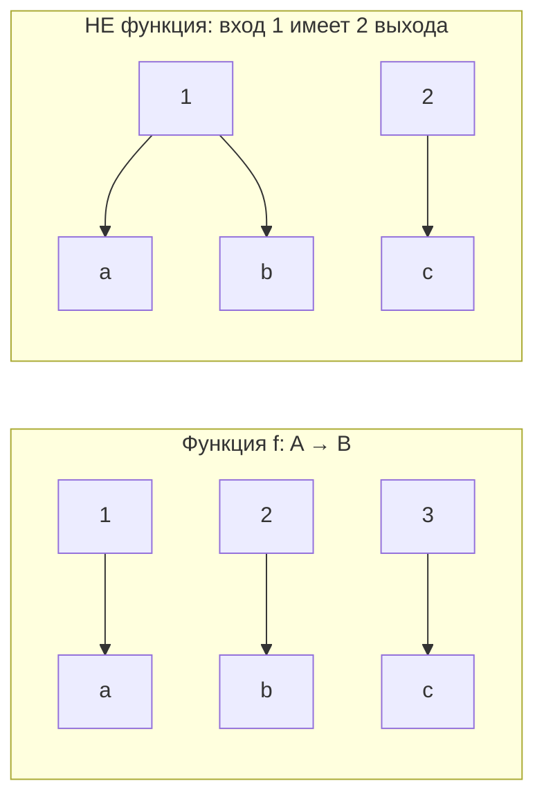
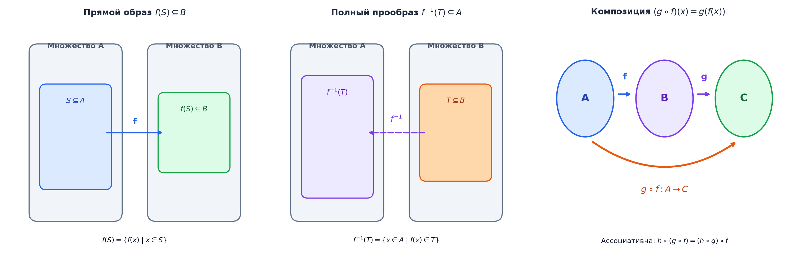
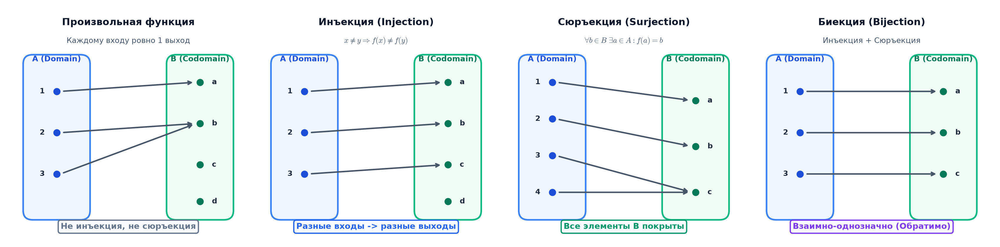

# 📝 Лекция 6: Функции

> [!info] ⏳ Предварительный конспект (сверен со слайдами)
> Конспект сверен с презентацией `s1-lec06-functions.typ` из репозитория Lipen/discrete-math-course (редакция от 13 октября 2026, неделя 13–14 октября). Конспект будет дополнен после очной лекции.

> [!abstract] О занятии
> - **Дисциплина:** [[Дискретная математика]] (1 семестр, 2026/27 уч. год)
> - **Дата:** 14 октября 2026 года (6-я неделя)
> - **Лектор:** Константин Чухарев ([@Lipen](https://github.com/Lipen), Университет ИТМО)
> - **Модуль 2:** Бинарные отношения, порядки и функции
> - **Источники:** слайды `s1-lec06-functions.typ`; главы книги `m06` («Определения и базовые понятия», «Инъекция», «Сюръекция», «Биекция», «Критерии мощности», «Композиция функций», «Алгебра образов и прообразов», «Характеристическая функция», «Пол, потолок и нотация Айверсона», «Лямбда-нотация», «Асимптотические обозначения», «Каррирование»), `m05`.
> - **Ключевые темы:** функция как отношение, функция Дирихле, число функций, образ и прообраз, тотальные/частичные функции, график, инъекция/сюръекция/биекция и обратные, ядро, принцип Дирихле, канторова пара, композиция, итерации, алгебра образов и прообразов, характеристическая функция, пол и потолок, нотация Айверсона, $\lambda$-абстракция, каррирование, $\mathcal O,\Omega,\Theta,o,\omega$.

## 📌 Краткое резюме (TL;DR)

- **Функция** $f:A\to B$ — отношение $f\subseteq A\times B$ с тотальностью и функциональностью: у каждого входа ровно один выход.
- Число функций $\vert B\vert^{\vert A\vert}$; формула задаёт функцию только вместе с областью и кодоменом.
- **Инъекция** ⇔ левая обратная; **сюръекция** ⇔ правая обратная (для бесконечных — аксиома выбора); **биекция** ⇔ обратимость (обратная единственна).
- Для конечных множеств: инъекция $\vert A\vert\le\vert B\vert$, сюръекция $\ge$, биекция $=$; **принцип Дирихле**.
- Композиция ассоциативна, но не коммутативна; $(g\circ f)^{-1}=f^{-1}\circ g^{-1}$.
- **Прообраз** коммутирует со всеми булевыми операциями, **образ** — только с объединением; $f(A_1\cap A_2)=f(A_1)\cap f(A_2)$ $\iff$ $f$ инъективна.
- $X\mapsto\chi_X$ — биекция подмножеств и функций $U\to\{0,1\}$; $\mathcal O,\Omega,\Theta$ — язык скорости роста.

---

## 1. Функции и отображения

> [!quote] Эпиграф
> «Функция ненасыщена (*ungesättigt*): она содержит место, которое заполняется аргументом.» — Готлоб Фреге

### 1.1. Функция

> [!info] Определение
> Пусть $A,B$ — множества. **Функция** $f:A\to B$ сопоставляет каждому $a\in A$ ровно один $b\in B$: $\forall a\in A\ \exists!\,b\in B\ f(a)=b$.

> [!example]
> $f(x)=x^2$ как $\mathbb{R}\to\mathbb{R}$: каждому входу отвечает один выход. Два входа могут давать один выход ($2^2=(-2)^2=4$) — это законно; один вход не может давать два разных выхода.

**Задача без формулы.** Формула-выражение вроде $x^2+1$ — рецепт вычисления; формула-определение называет функцию, но не говорит, как вычислять. Правило «наибольшее простое число, меньшее $n$» задаёт функцию без формулы: пользоваться им приходится перебором от $n$ вниз.

**Функция Дирихле (1837).**
$$D(x)=\begin{cases}1,&x\in\mathbb{Q}\\0,&x\notin\mathbb{Q}\end{cases}$$
До Дирихле функцией считали только аналитическое выражение. Здесь определение есть, а способа вычислить значения нет: чтобы узнать $D(x)$, нужно знать про $x$ всё.

| $x$ | $D(x)$ | Что это |
|:-:|:-:|:--|
| $1/2$ | $1$ | рациональное |
| $0{,}5$ | $1$ | то же число в десятичной записи |
| $\sqrt2$ | $0$ | иррациональное |
| $\pi$ | $0$ | иррациональное |

Графика нарисовать нечем: между любыми двумя точками одного цвета найдётся точка другого — ни дуги, ни скачка, два вперемешку класса точек.

### 1.2. Функция как отношение

> [!info] Определение
> Бинарное отношение $f\subseteq A\times B$ — **функция** из $A$ в $B$, если (1) для каждого $a\in A$ найдётся $b$ с $(a,b)\in f$ (*тотальность слева*); (2) из $(a,b_1)\in f$ и $(a,b_2)\in f$ следует $b_1=b_2$ (*функциональность*).

Это два знакомых свойства отношения из [[04. Лекция - Отношения и эквивалентность (2026-09-30)]].

> [!example] Проверка на малых множествах
> $A=\{1,2\}$, $B=\{a,b\}$. $f_1=\{(1,a),(2,b)\}$ — функция. $f_2=\{(1,a),(1,b)\}$ — не функция (входу 1 отвечают два выхода). $f_3=\{(1,a)\}$ — функция на $\{1\}$, но не на $\{1,2\}$ (вход 2 ни с чем не сопоставлён).



### 1.3. Сколько всего функций?

Подмножеств $A\times B$ всего $2^{\vert A\vert\vert B\vert}$, а функций среди них куда меньше.

| $\vert A\vert$ | $\vert B\vert$ | Всего отношений | Из них функций |
|:-:|:-:|:-:|:-:|
| 2 | 2 | $2^4=16$ | $2^2=4$ |
| 3 | 2 | $2^6=64$ | $2^3=8$ |
| 2 | 3 | $2^6=64$ | $3^2=9$ |
| $n$ | 2 | $2^{2n}$ | $2^n$ |

> [!important]
> Каждому из $\vert A\vert$ входов независимо сопоставляется один из $\vert B\vert$ выходов — функций ровно $\vert B\vert^{\vert A\vert}$.

При $\vert A\vert=\vert B\vert=10$: функций $10^{10}$, отношений $2^{100}\approx1{,}3\cdot10^{30}$ — отношений в $\approx1{,}3\cdot10^{20}$ раз больше, потому что «ровно один выход» отсекает почти всё.

### 1.4. Тождественная функция

$\mathrm{id}_A(a)=a$. На $A=\{1,2,3\}$ диагональ даёт $\mathrm{id}_A=\{(1,1),(2,2),(3,3)\}$. Это нейтраль композиции: $f\circ\mathrm{id}_A=f=\mathrm{id}_B\circ f$; она ничего не склеивает, и по выходу вход восстанавливается сразу.

### 1.5. Область определения, кодомен, образ и прообраз

Сигнатура $f:A\to B$ называет два множества ($A$ — *область определения*, $B$ — *кодомен*), значения функции добавляют ещё два.

> [!info] Образ и прообраз
> *Образ* $X\subseteq A$: $f(X)=\{f(x)\mid x\in X\}$. *Прообраз* $Y\subseteq B$: $f^{-1}(Y)=\{a\in A\mid f(a)\in Y\}$.



> [!example]
> $f:\{1,2,3\}\to\{a,b\}$, $f=\{(1,a),(2,b),(3,a)\}$: $f^{-1}(\{a\})=\{1,3\}$ (два входа), $f^{-1}(\{b\})=\{2\}$.

Для $f:\{1,2,3,4\}\to\{a,b,c\}$, $f=\{(1,a),(2,b),(3,a),(4,c)\}$:

| Множество | Образ | Пояснение |
|:-:|:-:|:--|
| $\{1,3\}$ | $\{a\}$ | два входа дают один выход |
| $\{1,2,4\}$ | $\{a,b,c\}$ | весь кодомен |
| $\varnothing$ | $\varnothing$ | образ пустого множества пуст |
| $\{4\}$ | $\{c\}$ | один вход |

| Множество | Прообраз | Пояснение |
|:-:|:-:|:--|
| $\{a\}$ | $\{1,3\}$ | оба входа |
| $\{a,c\}$ | $\{1,3,4\}$ | прообраз сохраняет объединение |
| $\{a,b\}$ | $\{1,2,3\}$ | три входа |
| $\varnothing$ | $\varnothing$ | в $\varnothing$ не лежит ни один выход |

Образ определён для любого $X\subseteq A$ без повторов ($f(1)=f(3)=a$, но $a$ входит один раз). Прообраз $f^{-1}(Y)$ определён для любого $Y\subseteq B$, даже когда обратной функции не существует. $f^{-1}(f(X))$ может быть шире $X$ — в него попадают все входы, ведущие в те же выходы.

### 1.6. Тотальные и частичные функции

> [!info] Определение
> *Тотальная* $f:A\to B$ определена для каждого $a\in A$. *Частичная* $f:A\rightharpoonup B$ определена лишь на подмножестве $A$ (строго говоря, не функция в смысле определения: нарушена тотальность).

$f(x)=1/x$ частична на $\mathbb{R}$ (в нуле не определена); сужение $\mathbb{R}\setminus\{0\}$ превращает ту же формулу в тотальную. В Rust чтение `arr[i]` за границей не определено, и система типов выносит частичность в сигнатуру `Option`; в C++20 — `std::optional<T>` вместо неопределённого поведения.

**Частичные функции и вычисление.** «Вычислить» — применить правило к входу и получить выход; частичная функция — модель вычисления, которое может не завершиться (исключение или бесконечный цикл).

> [!example] Правило без гарантии завершения
> $n\to n/2$ для чётных и $n\to3n+1$ для нечётных: с $6$ получается $6,3,10,5,16,8,4,2,1$. Тотальна ли функция «число шагов до единицы», не знает никто (гипотеза Коллатца проверена до $2^{68}$, доказательства нет).

Проблема остановки: алгоритма, определяющего завершимость программы, не существует (Тьюринг, 1936). В Coq и Agda завершение доказывают, в Python и C — нет.

### 1.7. График функции

*График* $f:A\to B$ — множество пар $\{(a,f(a))\mid a\in A\}$ — сама функция как отношение. $f(x)=x^2$ на $\{1,2,3\}$: $\{(1,1),(2,4),(3,9)\}$. Формула — ещё не функция: уравнение окружности $x^2+y^2=1$ не задаёт функцию (при $x=0$ подходят $y=1$ и $y=-1$).

> [!note] Критерий вертикальной прямой
> Множество точек плоскости — график частичной функции ровно тогда, когда каждая вертикальная прямая пересекает его не более одного раза.

Для тотальной $f:[a,b]\to B$ каждая вертикаль $x\in[a,b]$ пересекает график ровно один раз. Парабола $y=x^2$ проверку проходит, её отражение $x=y^2$ — нет ($x=1$ при $y=\pm1$); отражение — график функции ровно тогда, когда $f$ инъективна и накрывает кодомен (биективна).

---

## 2. Инъекция, сюръекция, биекция



### 2.1. Инъекция

> [!info] Определение
> $f$ **инъективна**, если $f(a_1)=f(a_2)\Rightarrow a_1=a_2$ (эквивалентно $a_1\ne a_2\Rightarrow f(a_1)\ne f(a_2)$).

$f(x)=2x+1$ на $\mathbb{R}$ инъективна; $g(x)=x^2$ нет: $g(2)=g(-2)=4$. Инъективность — требование к *разным* входам, а «каждому входу ровно один выход» — определение функции. Для конечных множеств инъекция возможна лишь при $\vert A\vert\le\vert B\vert$. Функция не обязана накрывать весь кодомен: у $f:\{1,2\}\to\{a,b,c\}$ с $f(1)=a$, $f(2)=b$ элемент $c$ не достигнут.

> [!note] Теорема (левая обратная)
> При $A\ne\varnothing$ функция $f:A\to B$ инъективна $\iff$ существует $g:B\to A$ с $g\circ f=\mathrm{id}_A$.

*Доказательство в обе стороны.* Пусть $f$ инъективна. Для $b$ из образа есть единственный $a$ с $f(a)=b$ — положим $g(b)=a$; для остальных $b$ — любое значение (фиксированный $a_0$). Тогда $g(f(a))=a$. Обратно: если $g\circ f=\mathrm{id}_A$ и $f(a_1)=f(a_2)$, то $a_1=g(f(a_1))=g(f(a_2))=a_2$. $\blacksquare$ Значение $g$ вне образа произвольно, поэтому левая обратная не единственна.

> [!example]
> $f:\{1,2,3\}\to\{a,b,c,d\}$, $f(1)=a$, $f(2)=b$, $f(3)=c$. На образе $g(a)=1$, $g(b)=2$, $g(c)=3$, для $d$ — произвольное, скажем $1$. Тогда $g\circ f=\mathrm{id}_A$.

> [!note] Монотонность и инъективность
> Если $f:\mathbb{R}\to\mathbb{R}$ строго возрастает, она инъективна.

*От противного.* Пусть $a_1<a_2$, но $f(a_1)=f(a_2)$; строгое возрастание даёт $f(a_1)<f(a_2)$ — противоречие. $\blacksquare$

> [!warning] Обратное неверно
> $f(x)=1/x$ инъективна на $\mathbb{R}\setminus\{0\}$, но не монотонна: на каждой половине строго убывает, а через разрыв значения снова растут ($f(-1)=-1<1=f(1)$). Строгость существенна: неубывающая ступенька (равная $2$ на $[2,3)$) склеивает точки.

**Ядро функции** — отношение $\ker f=\{(a_1,a_2)\mid f(a_1)=f(a_2)\}$ на $A$. Для $f(1)=f(3)=a$, $f(2)=b$: пары ядра $(1,1),(2,2),(3,3),(1,3),(3,1)$, классы $\{1,3\}$ и $\{2\}$; у хеш-функции классы ядра — корзины таблицы. Ядро любой функции — отношение эквивалентности (рефлексивность и симметричность — от равенства значений, транзитивность — из однозначности выхода). Инъективность оставляет в каждом классе один вход: $\ker f=\mathrm{id}_A$.

### 2.2. Сюръекция

> [!info] Определение
> $f$ **сюръективна**, если $\forall b\in B\ \exists a\in A\ f(a)=b$; эквивалентно $f(A)=B$.

$f(x)=x^3$ сюръективна на $\mathbb{R}$. $g(x)=e^x$ как $\mathbb{R}\to\mathbb{R}$ — нет (ноль и отрицательные недостижимы), но как $\mathbb{R}\to\mathbb{R}^+$ — да: сюръективность зависит не от формулы, а от кодомена.

> [!note] Теорема (правая обратная)
> $f:A\to B$ сюръективна $\iff$ существует $g:B\to A$ с $f\circ g=\mathrm{id}_B$.

*Доказательство.* Если $f$ сюръективна, для каждого $b$ множество $f^{-1}(b)$ непусто — выберем из него элемент и положим $g(b)$; тогда $f(g(b))=b$. Обратно: если $f\circ g=\mathrm{id}_B$, любой $b$ достигается как $f(g(b))$. $\blacksquare$ Для бесконечного $B$ одновременный выбор прообраза для каждого $b$ требует аксиомы выбора.

> [!example]
> $f:\{1,2,3,4\}\to\{a,b\}$, $f(1)=f(2)=a$, $f(3)=f(4)=b$. Подходит $g(a)=1$, $g(b)=3$ и $g'(a)=2$, $g'(b)=4$, и ещё две — каждая правая обратная задаётся выбором прообраза для каждого выхода.

### 2.3. Биекция

> [!info] Определение
> $f$ **биективна**, если инъективна и сюръективна.

$f:\{1,2,3\}\to\{a,b,c\}$ с $f(1)=a$, $f(2)=b$, $f(3)=c$ — биекция. $g(x)=x^2$ на $\mathbb{R}$ — нет. Только биекция имеет полноценную обратную: $f^{-1}\circ f=\mathrm{id}_A$ и $f\circ f^{-1}=\mathrm{id}_B$; для конечных множеств биекция возможна лишь при $\vert A\vert=\vert B\vert$.

> [!note] Единственность обратной
> У биекции ровно одна обратная функция.

*Доказательство.* Пусть $g_1,g_2$ — обе обратные: $g_1=g_1\circ\mathrm{id}_B=g_1\circ(f\circ g_2)=(g_1\circ f)\circ g_2=\mathrm{id}_A\circ g_2=g_2$. $\blacksquare$ Для $f:\{1,2\}\to\{a,b\}$ прообразы $f^{-1}(\{a\})=\{1\}$, $f^{-1}(\{b\})=\{2\}$ одноэлементны — степеней свободы нет.

**Критерии мощности.**

| Тип | Условие | Мощность | Обратная |
|:--|:--|:-:|:--|
| Инъекция | $a_1\ne a_2\Rightarrow f(a_1)\ne f(a_2)$ | $\vert A\vert\le\vert B\vert$ | левая $g\circ f=\mathrm{id}_A$ |
| Сюръекция | $\forall b\,\exists a\,f(a)=b$ | $\vert A\vert\ge\vert B\vert$ | правая $f\circ g=\mathrm{id}_B$ |
| Биекция | инъекция + сюръекция | $\vert A\vert=\vert B\vert$ | двусторонняя $f^{-1}$ |

Для конечных множеств одинакового размера инъекция автоматически биективна; для бесконечных — нет: $f(n)=2n$ инъективна, но не сюръективна.

> [!note] Принцип Дирихле
> При $\vert A\vert>\vert B\vert$ никакая $f:A\to B$ не инъективна.

*От противного.* При инъекции значения $f(a)$ различны, их $\vert A\vert$ штук, и все лежат в $B$ из $\vert B\vert<\vert A\vert$ элементов — противоречие. $\blacksquare$ Среди любых 13 человек двое родились в одном месяце; контрольная сумма с $2^{32}$ значениями на $10^{10}$ сообщениях неизбежно даёт коллизии.

**Архивация и Дирихле.** Файлов длины ровно $n$ байт $256^n$, а строк короче $n$ — лишь $1+256+\dots+256^{n-1}=(256^n-1)/255$. При $n=2$: файлов $65\,536$, коротких строк $257$ — инъекция из большего множества в меньшее запрещена. У любого архиватора есть входы, на которых файл растёт.

**Прообраз и обратная функция.** $f^{-1}(b)$ — *прообраз* (множество входов, ведущих в $b$); запись $f^{-1}:B\to A$ — *обратная функция*, существует только для биекций. Для $x^2$ прообраз $f^{-1}(4)=\{-2,2\}$ определён всегда, а обратной нет. Сужение возвращает обратимость: $x^2$ — биекция на $[0,\infty)$, $\sin$ — на $[-\pi/2,\pi/2]$.

> [!example] $f(x)=2x+1$ на $\mathbb{Z}$
> Инъективность: $2a+1=2b+1\Rightarrow a=b$. Сюръективность: $2x+1=y$ даёт $x=(y-1)/2$, целое лишь при нечётном $y$ — на $\mathbb{Z}$ не сюръективна. Та же формула — биекция между $\mathbb{Z}$ и нечётными числами $\{2k+1\mid k\in\mathbb{Z}\}$.

**Инъекция и код.** Base64 кодирует блок из 3 байт четырьмя символами по 6 бит ($3\cdot8=4\cdot6=24$): разные блоки получают разные записи, декодер восстанавливает байты.

### 2.3а. Канторова пара

Кодировать пару чисел одним — задача о биекции $\mathbb{N}\times\mathbb{N}\to\mathbb{N}$.

> [!info] Определение
> $J(k_1,k_2)=\dfrac{(k_1+k_2)(k_1+k_2+1)}2+k_1$.

Диагональ $k_1+k_2=0$: $J(0,0)=0$. Диагональ $1$: $J(0,1)=1$, $J(1,0)=2$. Диагональ $2$: $J(0,2)=3$, $J(1,1)=4$, $J(2,0)=5$. Пары занумерованы по диагоналям возрастающей суммы: внутри диагонали номера идут подряд, между диагоналями пропусков нет; блоки $\{0\},\{1,2\},\{3,4,5\}$.

В железе тот же приём по степеням двойки: RGB $(R,G,B)\mapsto R\cdot2^{16}+G\cdot2^8+B$, а `#f0b429` распаковывается сдвигами: $R=n\gg16=240$, $G=(n\gg8)\,\&\,255=180$, $B=n\,\&\,255=41$. Канторова пара делает то же для неограниченных чисел.

> [!note] Теорема (биективность)
> $J:\mathbb{N}\times\mathbb{N}\to\mathbb{N}$ биективно.

*Доказательство.* Пары с суммой $s$ идут подряд: перед ними $s(s+1)/2$ пар меньших диагоналей, поэтому диагонали — отрезки номеров без дыр и пересечений, а внутри диагонали номер растёт с $k_1$. Инъективность: разные пары дают разные номера (по положению в диагонали или по самой диагонали). Сюръективность: по $n$ находим наибольшее $s$ с $s(s+1)/2\le n$, затем $k_1=n-s(s+1)/2$ и $k_2=s-k_1$. $\blacksquare$

> [!example] Распаковка
> $n=4$: наибольшее $s$ с $s(s+1)/2\le4$ равно $2$ ($3\le4<6$), $k_1=4-3=1$, $k_2=2-1=1$ — пара $(1,1)$. $n=5$: $s=2$, $k_1=2$, $k_2=0$ — замыкает диагональ.

Упаковка работает и на уровне функций: для $f,g:\mathbb{N}\to\mathbb{N}$ функция $h(n)=J(f(n),g(n))$ несёт два значения в одном числе — тот же приём позже закодирует конфигурацию машины Тьюринга одним номером.

---

## 3. Композиция, образ и прообраз

> [!quote] Эпиграф
> «Если я видел дальше других, то потому, что стоял на плечах гигантов.» — Исаак Ньютон

### 3.1. Композиция

> [!info] Определение
> $(g\circ f)(a)=g(f(a))$ для $f:A\to B$, $g:B\to C$.

Композиция ассоциативна: $h\circ(g\circ f)=(h\circ g)\circ f$. Коммутативности нет: $f(x)=x+1$, $g(x)=x^2$ дают $(g\circ f)(x)=(x+1)^2$, а $(f\circ g)(x)=x^2+1$. Верхний путь на схеме — два шага по очереди, нижняя дуга — составное отображение; обе дороги ведут из $A$ в $C$.

> [!note] Композиция инъекций и сюръекций
> Если $f,g$ инъективны, то $g\circ f$ инъективна; если сюръективны — сюръективна; если биективны — биективна.

*Доказательство.* Инъективность: пусть $g(f(a_1))=g(f(a_2))$; инъективность $g$ даёт $f(a_1)=f(a_2)$, инъективность $f$ — $a_1=a_2$. Сюръективность: $c\in C$ достигается как $g(b)$, а $b$ — как $f(a)$. $\blacksquare$

> [!example]
> На $\mathbb{Z}$ инъективность $f(x)=x+1$ не делает инъективной композицию с $g(x)=x^2$: $(x+1)^2$ склеивает $1$ и $-3$. Обе инъективные $f(x)=2x$ и $g(x)=x+3$ дают инъективную $2x+3$.

> [!note] Что следует из композиции
> Если $g\circ f$ инъективна, то $f$ инъективна. Если $g\circ f$ сюръективна, то $g$ сюръективна.

*Доказательство.* Из $f(a_1)=f(a_2)$ получаем $(g\circ f)(a_1)=(g\circ f)(a_2)$, откуда $a_1=a_2$. Сюръективность: любой $c$ достигается как $g(f(a))$ — лежит в образе $g$. $\blacksquare$

> [!warning] Обратные импликации не работают
> Первое обращение: $f=\mathrm{id}_\mathbb{Z}$ инъективна, но $g(x)=x^2$ даёт неинъективную композицию ($g(f(-1))=g(f(1))=1$). Второе: $g=\mathrm{id}_\mathbb{N}$ сюръективна, но при $f(n)=2n$ композиция оставляет нечётные недостижимыми.

> [!note] Обратная композиции
> Для биекций $f,g$: $(g\circ f)^{-1}=f^{-1}\circ g^{-1}$.

*Подстановкой.* $(f^{-1}\circ g^{-1})\circ(g\circ f)=f^{-1}\circ\mathrm{id}_B\circ f=\mathrm{id}_A$; симметричный подсчёт даёт $\mathrm{id}_C$. $\blacksquare$ Порядок меняется: сначала снимается $g$, затем $f$.

> [!example]
> $f(x)=2x$, $g(x)=x+3$: $(g\circ f)^{-1}(y)=(y-3)/2$; $f^{-1}(y)=y/2$, $g^{-1}(y)=y-3$, $f^{-1}(g^{-1}(y))=(y-3)/2$ — совпало. При $y=7$: $(7-3)/2=2$ и $f^{-1}(g^{-1}(7))=f^{-1}(4)=2$.

**Итерации.** $f^0=\mathrm{id}_A$, $f^{n+1}=f\circ f^n$. Для $f(x)=2x$: $f^n(x)=2^nx$; для $f(x)=x+1$ на $\mathbb{N}$: $f^n(x)=x+n$. Для возрастающих функций итерации либо уходят в бесконечность, либо стабилизируются на неподвижной точке (см. Кнастер–Тарский в [[05. Лекция - Отношение порядка, диаграммы Хассе, цепи, антицепи и решетки (2026-10-07)]]); для произвольной $f$ возможны циклы. Пример цикла длины два: $f(x)=1-x$ на $\{0,1\}$. Возрастающая $f(x)=x/2+1$ цикла не даёт: неподвижная точка $2$ притягивает $3\to2{,}5\to2{,}25\to\dots\to2$.

**Композиция и код.** Конвейеры `x |> f |> g |> h` — композиция, записанная слева направо; так устроены `ps | grep` и итераторы Rust:

```rust
let total: i32 = data.iter().map(|x| x * 2).filter(|x| *x > 10).sum();
```

`map` применяет функцию к каждому элементу, а `filter` оставляет элементы по предикату — это не функция из элементов, а предикат на них.

### 3.2. Алгебра образов и прообразов

> [!note] Образ и операции
> $f(A\cup B)=f(A)\cup f(B)$, $\ f(A\cap B)\subseteq f(A)\cap f(B)$.

*Доказательство.* $y\in f(A\cup B)$, если есть $x\in A\cup B$ с $f(x)=y$, то есть $y\in f(A)$ или $y\in f(B)$. Для пересечения включение может быть строгим: на $f(x)=x^2$ $f(\{-1\}\cap\{1\})=\varnothing$, но $f(\{-1\})\cap f(\{1\})=\{1\}$. $\blacksquare$

> [!note] Пересечение и инъективность
> Равенство $f(A_1\cap A_2)=f(A_1)\cap f(A_2)$ для всех $A_1,A_2\subseteq X$ выполнено $\iff$ $f$ инъективна.

*Доказательство.* Пусть $f$ инъективна и $y\in f(A_1)\cap f(A_2)$: $y=f(a_1)=f(a_2)$, $a_i\in A_i$; инъективность даёт $a_1=a_2$, значит, $y\in f(A_1\cap A_2)$. Обратно: если $f(a_1)=f(a_2)$ при $a_1\ne a_2$, возьмём $A_1=\{a_1\}$, $A_2=\{a_2\}$ — пересечение пусто, а образы пересекаются. $\blacksquare$

> [!example]
> $f(x)=2x+1$ над $\mathbb{Z}$, $A_1=\{1,2\}$, $A_2=\{2,3\}$: $f(A_1\cap A_2)=f(\{2\})=\{5\}$; $f(A_1)\cap f(A_2)=\{3,5\}\cap\{5,7\}=\{5\}$ — у инъекции общие выходы появляются только через общий вход.

> [!note] Прообраз и операции
> $f^{-1}(C\cup D)=f^{-1}(C)\cup f^{-1}(D)$, $\ f^{-1}(C\cap D)=f^{-1}(C)\cap f^{-1}(D)$, $\ f^{-1}(C\setminus D)=f^{-1}(C)\setminus f^{-1}(D)$.

*Подстановкой.* $a\in f^{-1}(C\cup D)$, если $f(a)\in C\cup D$, то есть $a\in f^{-1}(C)$ или $a\in f^{-1}(D)$; остальные — тем же ходом: прообраз дословно повторяет булеву операцию. $\blacksquare$ Пример: $f(x)=x^2$, $f^{-1}(\{1,4\})=\{-2,-1,1,2\}$; $f^{-1}(\{1\}\cap\{4\})=\varnothing=f^{-1}(\{1\})\cap f^{-1}(\{4\})$. В частности $f^{-1}(B\setminus Y)=A\setminus f^{-1}(Y)$.

> [!important]
> Прообраз коммутирует со всеми булевыми операциями, образ — только с объединением.

> [!note] Монотонность
> Если $X_1\subseteq X_2$, то $f(X_1)\subseteq f(X_2)$; если $Y_1\subseteq Y_2$, то $f^{-1}(Y_1)\subseteq f^{-1}(Y_2)$.

*Включением.* Возьмём $y\in f(X_1)$: есть $x\in X_1\subseteq X_2$ с $f(x)=y$, значит, $y\in f(X_2)$. Прообраз — тем же ходом. $\blacksquare$ Пример: $f(x)=x^2$, $f([-1,1])=[0,1]\subseteq[0,4]=f([-1,2])$; $f^{-1}([0,1])=[-1,1]\subseteq[-2,2]=f^{-1}([0,4])$.

### 3.3. Характеристическая функция

> [!info] Определение
> $\chi_X(x)=1$ при $x\in X$, иначе $0$. Функция Дирихле — характеристическая функция $\mathbb{Q}$.

Для $U=\{1,\dots,10\}$, $P=\{2,3,5,7\}$: $\sum_{x=1}^{10}\chi_P(x)=4$ — количество простых. Права Unix — три характеристические функции на множестве «чтение, запись, исполнение», по одной для владельца, группы и остальных.

| `chmod 754` | Права | Биты | Число |
|:-:|:-:|:-:|:-:|
| владелец | `rwx` | $111_2$ | 7 |
| группа | `r-x` | $101_2$ | 5 |
| остальные | `r--` | $100_2$ | 4 |

Для конечного $U$: $\vert X\vert=\sum_{x\in U}\chi_X(x)$; битовые маски — $\chi_X$ в двоичной записи.

> [!note] Соответствие $X\mapsto\chi_X$
> Отображение $X\mapsto\chi_X$ — биекция между подмножествами $U$ и функциями $U\to\{0,1\}$; подмножеств ровно $2^{\vert U\vert}$.

*Взаимная однозначность.* Из произвольной $g:U\to\{0,1\}$ восстанавливается $X=\{x\mid g(x)=1\}$, и $\chi_X=g$; обратно, $\chi_X$ определена однозначно, поэтому разные подмножества дают разные функции. $\blacksquare$

| $U=\{1,2,3\}$ | $\chi$-строка |
|:-:|:-:|
| $\varnothing$ | $(0,0,0)$ |
| $\{2\}$ | $(0,1,0)$ |
| $\{1,3\}$ | $(1,0,1)$ |
| $U$ | $(1,1,1)$ |

Подмножества из двух элементов у $U=\{1,2,3\}$: $\{1,2\},\{1,3\},\{2,3\}$ — $\binom32=3$ строки с двумя единицами. По размерам: $1,3,3,1$; $1+3+3+1=8=2^3$.

**Булева арифметика индикаторов.**

| Множества | Функции | Смысл |
|:-:|:-:|:--|
| $A\cap B$ | $\chi_A\cdot\chi_B$ | оба индикатора равны 1 |
| $A\cup B$ | $\max(\chi_A,\chi_B)$ | хотя бы один равен 1 |
| $A\setminus B$ | $\chi_A\cdot(1-\chi_B)$ | в $A$, но не в $B$ |
| $U\setminus A$ | $1-\chi_A$ | дополнение |

Операции над множествами становятся арифметикой: де Морган превращается в тождество $\max(\chi_A,\chi_B)=1-(1-\chi_A)(1-\chi_B)$.

### 3.4. Пол, потолок, нотация Айверсона

> [!info] Определение
> $\lfloor x\rfloor$ — наибольшее целое, не превышающее $x$; $\lceil x\rceil$ — наименьшее целое, не меньшее $x$.

$\lfloor3{,}7\rfloor=3$, $\lceil3{,}7\rceil=4$; $\lfloor-3{,}7\rfloor=-4$, $\lceil-3{,}7\rceil=-3$ (у отрицательных пол уходит прочь от нуля, потолок — к нулю). Всегда $\lceil x\rceil-\lfloor x\rfloor\le1$. Левый конец каждой ступени замкнут, правый открыт. Потолок — зеркальный пол: $\lceil x\rceil=-\lfloor-x\rfloor$; $\lceil2{,}7\rceil=-\lfloor-2{,}7\rfloor=3$. Для $x=5{,}9$: $\lfloor5{,}9\rfloor=5$, $\lceil5{,}9\rceil=6$; $x=-0{,}4$: $\lfloor-0{,}4\rfloor=-1$, $\lceil-0{,}4\rceil=0$.

> [!warning] Ловушка: пол суммы
> $\lfloor x\rfloor+\lfloor y\rfloor=\lfloor x+y\rfloor$ неверно: $x=y=0{,}5$ даёт $0$ против $\lfloor1\rfloor=1$. Верно лишь $\lfloor x\rfloor+\lfloor y\rfloor\le\lfloor x+y\rfloor$.

Разбиение на блоки: $n$ элементов по блокам размера $k$ — $\lceil n/k\rceil$ блоков; $n=1000$, $k=7$: $1000=7\cdot142+6$, $\lceil1000/7\rceil=143$ блока, а $\lfloor1000/7\rfloor=142$ оставил бы 6 элементов без блока.

> [!info] Нотация Айверсона
> $[P]=1$, если $P$ истинно, и $0$ иначе — превращает логическое условие в алгебраическое выражение.

Чётных от $1$ до $n$: $\sum_{i=1}^n[i\text{ чётно}]=\lfloor n/2\rfloor$ (при $n=10$: $2,4,6,8,10$ — 5). Простых: $\pi(n)=\sum_{k=1}^n[k\text{ простое}]$, $\pi(10)=4$. Среднее по положительным: $\mathrm{avg}=\dfrac{\sum x_i[x_i>0]}{\sum[x_i>0]}$; для $x=(3,-1,4,0,5)$: числитель $12$, знаменатель $3$, среднее $4$ (знаменатель — ноль, если положительных нет). Символ Кронекера $\delta_{ij}=[i=j]$ — характеристическая функция диагонали, то есть графика тождественной функции; $(\delta_{ij})_{i,j=1}^2=\begin{pmatrix}1&0\\0&1\end{pmatrix}$. Вероятность события — математическое ожидание его индикатора.

### 3.5. $\lambda$-абстракция и каррирование

> [!info] $\lambda$-абстракция
> $\lambda x\in A.\,e(x)$ — функция, отображающая $x$ в $e(x)$, без имени.

$(\lambda x.\,x^2+2x+1)(3)=9+6+1=16$; `map(lambda x: 2*x + 1, [0, 1, 2, 3])` даёт `[1, 3, 5, 7]`.

> [!info] Каррирование
> $\mathrm{curry}\,f=\lambda x.\,\lambda y.\,f(x,y)$.

$\mathrm{curry}(+)(2)$ — «прибавить два»: $(+2)(3)=5$; $\mathrm{curry}(+):\mathbb{N}\to(\mathbb{N}\to\mathbb{N})$, частичное применение даёт конкретную функцию (в коде — замыкания, `mul(2)` возвращает функцию). Каррирование — биекция между $A\times B\to C$ и $A\to(B\to C)$: две записи описывают одно вычисление.

---

## 4. Асимптотические обозначения

Маршрут: $\mathcal O,\Omega,\Theta$ — верхняя, нижняя граница и их совпадение; $o,\omega$ — строгие оценки; предельный критерий; классы времени.

**Поточечное сравнение не годится.** Алгоритм за $n^2$ рано или поздно станет медленнее алгоритма за $n\log n$ (при малых $n$ константы скрывают разницу): $\lim_{n\to\infty}\dfrac{n^2}{n\log n}=\lim\dfrac n{\log n}=\infty$; при $n=10^6$: $\log_2n\approx20$ и $n/\log_2n\approx50\,000$.

> [!info] O-большое
> $f(n)\in\mathcal O(g(n))$: $\exists C>0,n_0\ \forall n\ge n_0\ f(n)\le C\,g(n)$ — первая функция растёт не быстрее второй. $\mathcal O(g(n))$ — множество функций, а не одна функция.

$5n^2+3\in\mathcal O(n^2)$: при $n\ge1$ имеем $5n^2+3\le8n^2$, $C=8$, $n_0=1$.

> [!warning] Запись через равенство
> $f(n)=\mathcal O(g(n))$ означает то же, но знак равенства условен: по смыслу это принадлежность классу. Из $n=\mathcal O(n^2)$ и $n^2=\mathcal O(n^2)$ не следует $n=n^2$. Строгая запись: $f(n)\in\mathcal O(g(n))$.

> [!info] Омега и Тета
> $f\in\Omega(g)$: $\exists c>0,n_0\ \forall n\ge n_0\ f(n)\ge c\,g(n)$ — не медленнее. $f\in\Theta(g)$: $f\in\mathcal O(g)$ и $f\in\Omega(g)$ — та же скорость; $\Theta=\mathcal O\cap\Omega$.

$n^2\in\Omega(n)$: $c=1$, $n_0=1$. $3n+5\in\Theta(n)$: при $n\ge5$ имеем $3n+5\le4n$ ($C=4$) и $3n+5\ge3n$ ($c=3$). В анализе алгоритмов нижняя граница — гарантия, что алгоритм не может быть асимптотически быстрее $g$.

> [!info] Строгие оценки
> $f\in o(g)$: $\forall c>0\ \exists n_0\ \forall n\ge n_0\ f(n)\le c\,g(n)$ — строго медленнее. $f\in\omega(g)$: $\forall c>0\ \exists n_0\ \forall n\ge n_0\ f(n)\ge c\,g(n)$ — строго быстрее.

Порядок кванторов решает всё: в $\mathcal O$ константа «какая-то» ($\exists C$), в $o$ — «любая» ($\forall c>0$). Из $f\in o(g)$ следует $f\in\mathcal O(g)$.

> [!note] Предельный критерий
> Пусть $f,g:\mathbb{N}\to\mathbb{R}^+$ и $L=\lim f(n)/g(n)$ существует. При $L=0$: $f\in o(g)$; при $0<L<\infty$: $f\in\Theta(g)$; при $L=\infty$: $f\in\omega(g)$.

Доказательство — разбор трёх случаев по определению; при $0<L<\infty$ подходят $c=L/2$ и $C=2L$. Примеры: $5n^2+3n+10\in\Theta(n^2)$ (предел 5); $n\log n\in o(n^2)$ (предел $\log n/n=0$); $2^n\in\omega(n^{10})$ (предел $\infty$); $\forall\varepsilon>0\ \log n\in o(n^\varepsilon)$ — логарифм медленнее любой положительной степени, экспонента быстрее любого полинома.

**Иерархия:** $1\in o(\log n)$ (в слайдах), $\log n\in o(n)$, $n\in o(n\log n)$, $n\log n\in o(n^2)$, $n^2\in o(n^3)$, $n^3\in o(2^n)$, $2^n\in o(n!)$. При $n=64$: $\log_2n=6$, $n\log_2n=384$, $n^2=4096$, $2^n\approx1{,}8\cdot10^{19}$.

> [!example] Оценка без предела
> $f(n)=2n$ при чётном $n$, $f(n)=1$ при нечётном. Отношение $f(n)/n$ на чётных равно 2, на нечётных $1/n$ — предела нет. Но $f(n)\le2n$ при всех $n\ge1$: $f\in\mathcal O(n)$ ($C=2$, $n_0=1$). Если предела нет, оценку устанавливают по определению.

> [!info] Классы времени ($n=10^6$, $10^9$ операций в секунду)
> | Класс | Время работы | Пример задачи |
> |:--|--:|:--|
> | $n$ | миллисекунда | просмотреть массив |
> | $n\log_2n$ | около $20$ мс | сортировка сравнением |
> | $n^2$ | около $17$ минут | перебор всех пар |
> | $2^n$ | не дождаться: $2^{10^6}$ — $301\,030$ цифр | перебор подмножеств |

При $n\sim100$ класс $2^n$ — это $\approx4\cdot10^{13}$ лет счёта.

---

## 5. Связь с Computer Science

- **Хеширование и коллизии.** $h:\text{Keys}\to\text{Buckets}$ при $\vert\text{Keys}\vert\gg\vert\text{Buckets}\vert$ по Дирихле не инъективна; $k_1\ne k_2$ с $h(k_1)=h(k_2)$ — *коллизия*. Идеальное хеширование строит инъекцию для заранее известного набора ключей.
- **Криптография.** Блочный шифр $E_k:\text{Block}\to\text{Block}$ обязан быть биекцией (иначе расшифровка неоднозначна). Односторонние функции: легко вычислить, но вычислительно нереализуемо обратить (основа RSA, SHA-256).
- **Чистые функции**: без побочных эффектов, ссылочная прозрачность.

| Тип $f:A\to B$ | Ограничение | Количество отображений |
|:--|:-:|:-:|
| Все тотальные | любые $m,n\ge0$ | $n^m$ |
| Инъекции | $m\le n$ | $(n)_m=\dfrac{n!}{(n-m)!}$ |
| Биекции | $m=n$ | $n!$ |
| Сюръекции | $m\ge n$ | $n!\cdot S(m,n)=\sum_{k=0}^n(-1)^{n-k}\binom nk k^m$ |

Здесь $\vert A\vert=m$, $\vert B\vert=n$, $S(m,n)$ — числа Стирлинга второго рода.

---

## 6. Что мы поняли?

Три класса отображений — три сравнения размеров на конечных множествах: инъекция $A\to B\iff\vert A\vert\le\vert B\vert$; сюръекция $\iff\vert A\vert\ge\vert B\vert$; биекция $\iff\vert A\vert=\vert B\vert$.

- Функция — отношение, в котором каждый вход имеет ровно один выход; формула задаёт её только вместе с областью и кодоменом.
- Композиция сохраняет инъективность, сюръективность и биективность — корректность целого из корректности частей.
- Прообраз коммутирует со всеми булевыми операциями, а образ может терять информацию.

## ❓ Вопросы для самопроверки к коллоквиуму / экзамену

- [ ] Какие из отношений $R\subseteq\{1,2,3\}\times\{a,b\}$ — функции? $R_1=\{(1,a),(2,b),(3,a)\}$, $R_2=\{(1,a),(1,b),(2,a)\}$, $R_3=\{(1,a),(3,b)\}$.
  > [!note] Решение
  > Только $R_1$. У $R_2$ вход 1 ведёт к двум выходам; у $R_3$ вход 2 без пары.
- [ ] Найдите $f(A)$ и $f^{-1}(B)$ для $f(x)=x^2$, $A=\{-2,-1,0,1,2\}$, $B=\{0,1,4,9\}$.
  > [!note] Решение
  > $f(A)=\{0,1,4\}$ (квадраты склеивают $-2$ с $2$ и $-1$ с $1$); $f^{-1}(B)=\{-3,-2,-1,0,1,2,3\}$.
- [ ] Приведите пример сюръективной, но не инъективной $f:\mathbb{N}\to\mathbb{N}$.
  > [!note] Решение
  > $f(0)=0$, $f(n)=n-1$ при $n\ge1$: каждое $m$ достигается, но $f(0)=f(1)=0$.
- [ ] Докажите: если $g\circ f$ инъективна, то $f$ инъективна. Контрпример, что $g$ может не быть инъективной.
  > [!note] Решение
  > Из $f(a_1)=f(a_2)$ следует $(g\circ f)(a_1)=(g\circ f)(a_2)$, откуда $a_1=a_2$. Контрпример: $f:\{1\}\to\{a\}$, $g:\{a,b\}\to\{0\}$, $g\circ f$ инъективна, $g$ нет.
- [ ] Почему $(g\circ f)^{-1}=f^{-1}\circ g^{-1}$ и почему порядок меняется?
- [ ] Почему прообраз сохраняет пересечение, а образ — не всегда?
  > [!note] Решение
  > Прообраз собирает входы, удовлетворяющие обоим условиям, — ровно пересечение; образ теряет информацию, кто дал выход: $f(\{-1\}\cap\{1\})=\varnothing$, а $f(\{-1\})\cap f(\{1\})=\{1\}$.
- [ ] Запишите $\lambda$-абстракцию, удваивающую аргумент.
  > [!note] Решение
  > $\lambda x.\,2x$.
- [ ] Инъективна ли, сюръективна ли $f(x)=x^3-x$ на $\mathbb{R}$?
  > [!note] Решение
  > Не инъективна ($f(-1)=f(0)=f(1)=0$), сюръективна (непрерывная, уходит в $\pm\infty$).
- [ ] Сколько инъекций из $\{1,2,3\}$ в $\{a,b,c,d,e\}$?
  > [!note] Решение
  > $5\cdot4\cdot3=60$.
- [ ] Найдите $f^{-1}([0,1])$ для $f(x)=\sin x$.
  > [!note] Решение
  > $\bigcup_{k\in\mathbb{Z}}[2\pi k,\ \pi+2\pi k]$.
- [ ] Почему для существования правой обратной у любой сюръекции нужна аксиома выбора?
- [ ] Докажите $5n^2+3n+10\in\Theta(n^2)$ по предельному критерию.

## 📚 Что почитать (книга курса)

- `m06` — «Определения и базовые понятия», «Инъекция», «Сюръекция», «Биекция», «Критерии мощности».
- `m06` — «Композиция функций», «Алгебра образов и прообразов»; «Характеристическая функция», «Пол, потолок и нотация Айверсона», «Лямбда-нотация»; «Асимптотические обозначения», «Каррирование».
- `m05` — «Отношение эквивалентности», «Теорема о разбиении».

## 🔗 Связанные материалы

- [[Дискретная математика]] — главная страница дисциплины
- [[04. Лекция - Отношения и эквивалентность (2026-09-30)]]
- [[05. Лекция - Отношение порядка, диаграммы Хассе, цепи, антицепи и решетки (2026-10-07)]]
- [[07. Лекция - Мощность множеств, счетность, континуум и теорема Кантора-Бернштейна (2026-10-21)]]
- [[Теорминимум 1 - Коллоквиум по теории множеств и отношениям (2026-10-28)]]
