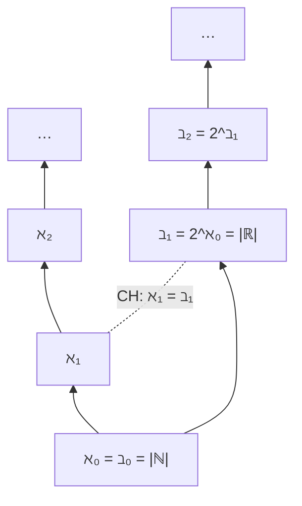

# 📌 Лекция 7: Счётность и несчётность

> [!info] ⏳ Предварительный конспект (сверен со слайдами)
> Конспект сверен с презентацией `s1-lec07-cardinality.typ` из репозитория Lipen/discrete-math-course (редакция от 13 октября 2026, лекция недели 20–21 октября). Он будет дополнен после очной лекции.

> [!abstract] О лекции
> - **Дисциплина:** [[Дискретная математика]] (1 семестр)
> - **Лектор:** Константин Чухарев ([@Lipen](https://github.com/Lipen), Университет ИТМО)
> - **Источники:** слайды `s1-lec07-cardinality.typ`; главы книги курса `m07` («Равномощность», «Счётные и несчётные множества», «Теорема Кантора», «Отель Гильберта», «Инструменты счётности», «Кардинальные числа и арифметика», «Теорема Кантора–Бернштейна–Шрёдера»), `m22` («Недостижимые кардиналы и аксиомы больших кардиналов»).
> - **Ключевые темы:** равномощность, кардинальные числа, сравнение мощностей, дедекиндова бесконечность, отель Гильберта, счётность $\mathbb{Z}$ и $\mathbb{Q}$, диагональный аргумент Кантора, $\vert\mathbb{R}\vert = \vert(0,1)\vert = \vert[0,1]^2\vert$, алгебраические и трансцендентные числа, диагональный язык, теорема Кантора, алефы и беты, континуум-гипотеза, теорема КБШ.

## 📌 Краткое резюме (TL;DR)

- У бесконечности нет числа, но есть **размер**; бесконечностей много, и они разные.
- $\vert A\vert=\vert B\vert$ означает существование **биекции**. Часть может быть равномощна целому: $\vert E\vert = \vert\mathbb{N}\vert=\aleph_0$.
- Отель Гильберта: $\aleph_0+1=\aleph_0$, $\aleph_0+\aleph_0=\aleph_0$, $\aleph_0\cdot\aleph_0=\aleph_0$.
- $\mathbb{Z}$ и $\mathbb{Q}$ счётны, $\mathbb{R}$ несчётно (диагональный аргумент Кантора, 1891).
- **Теорема Кантора:** $\vert A\vert<\vert\mathcal{P}(A)\vert$, лестница $\aleph_0<2^{\aleph_0}<2^{2^{\aleph_0}}<\dots$ бесконечна.
- Программ счётно много, языков и функций $\mathbb{N}\to\mathbb{N}$ — континуум, поэтому почти всё невычислимо.
- **КБШ:** две инъекции (туда и обратно) дают биекцию.

---

## 1. Равномощность и отель Гильберта

> [!quote] Эпиграф
> «Я протестую против использования бесконечной величины как чего-то завершённого.» — Карл Фридрих Гаусс

### 1.1. Сколько существует бесконечностей?

Натуральных чисел бесконечно много, действительных — тоже. На первый взгляд ответ одинаков, но:

> [!important]
> У бесконечности нет числа, но есть размер. Кантор показал: бесконечностей много, и они разного размера.

### 1.2. Что значит «посчитать множество»?

Чтобы получить количество элементов, сопоставляем каждому $a\in A$ ровно один номер из $\{1,\dots,n\}$. Такое сопоставление — биекция $A\to\{1,\dots,n\}$.

> [!example] Пять овец
> Биекция с $\{1,2,3,4,5\}$: каждая овца получает ровно один номер, и ни одна — два. Поэтому $\vert A\vert=5$, а обратное отображение по номеру возвращает овцу.

> [!important]
> Определение опирается на биекцию, а не на арифметику, поэтому переносится на бесконечные множества: сравнивать их можно и тогда, когда пересчитать нельзя.

### 1.3. Равномощность

> [!info] Определение
> Множества $A$ и $B$ **равномощны** (*equinumerous*), $\vert A\vert=\vert B\vert$, если существует биекция $f:A\to B$.

- Для конечных множеств это совпадает с подсчётом.
- Для бесконечных даёт контринтуитивные выводы.

> [!example] Чётные числа
> $\mathbb{N}$ и $E=\{0,2,4,\dots\}$ равномощны: $f(n)=2n$, обратная $g(m)=m/2$. Проверка: $f(3)=6$, $g(6)=3$.

Мощность $\mathbb{N}$ обозначается $\aleph_0$; $\mathbb{Z}$ и $\mathbb{Q}$ равномощны $\mathbb{N}$ (доказательства ниже).

### 1.4. Свойства равномощности

> [!note] Теорема
> Равномощность рефлексивна, симметрична и транзитивна.

*Доказательство построением биекций.*

1. Рефлексивность: $\mathrm{id}_A$.
2. Симметричность: обратная к биекции — биекция.
3. Транзитивность: композиция биекций биективна и ведёт из первого множества сразу в третье. $\blacksquare$

> [!example] Поровну ли чётных и нечётных?
> Чётные равномощны $\mathbb{N}$ через $n\mapsto 2n$, нечётные — через $n\mapsto 2n+1$. Композиция даёт биекцию $2n\mapsto 2n+1$ между чётными и нечётными, обратная — $2n+1\mapsto 2n$. Оба класса лежат внутри $\mathbb{N}$ и вместе покрывают его без остатка.

### 1.5. Кардинальное число

Равномощность — эквивалентность, а эквивалентности разбивают носитель на классы.

> [!info] Определение (кардинальное число)
> **Кардинальное число** — класс всех множеств, равномощных данному.

- Класс $\aleph_0$ собирает $\mathbb{N}$, $\mathbb{Z}$, $\mathbb{Q}$ и чётные числа.
- Класс $5$ — все пятиэлементные множества: пальцы руки, вершины пятиугольника.
- Запись $\vert A\vert=\vert B\vert$ означает попадание в один класс.

> [!important]
> Это факторизация по классам эквивалентности, поднятая на все множества. Арифметика кардиналов — операции над классами: $\aleph_0+1=\aleph_0$ получится в отеле.

### 1.6. Сравнение мощностей

> [!info] Определение
> $\vert A\vert\le\vert B\vert$, если существует инъекция $f:A\to B$.
> $\vert A\vert<\vert B\vert$, если $\vert A\vert\le\vert B\vert$, а биекции нет.

> [!example]
> Включения $\mathbb{N}\subseteq\mathbb{Z}\subseteq\mathbb{Q}$ дают цепочку инъекций и $\vert\mathbb{N}\vert\le\vert\mathbb{Z}\vert\le\vert\mathbb{Q}\vert$. Крайние множества счётны, поэтому $\vert\mathbb{N}\vert=\vert\mathbb{Q}\vert$: нестрогое неравенство оказалось равенством. Инъекция слабее биекции, поэтому знак $\le$ сам по себе строгого вывода не даёт.

Антисимметрию сравнения даёт теорема КБШ, а **линейность** потребует аксиомы выбора.

> [!note] Транзитивность сравнения
> Из $\vert A\vert\le\vert B\vert$ и $\vert B\vert\le\vert C\vert$ следует $\vert A\vert\le\vert C\vert$.
> *Доказательство.* Инъекции $f:A\to B$ и $g:B\to C$ компонуются в $g\circ f:A\to C$; композиция инъекций инъективна. $\blacksquare$

### 1.7. Часть равна целому

- Для конечных множеств часть всегда строго меньше целого.
- Для бесконечных — нет: $E\subset\mathbb{N}$, но $\vert E\vert=\vert\mathbb{N}\vert=\aleph_0$.

> [!important] Дедекиндова бесконечность
> Дедекинд определял бесконечность так: множество, равномощное своему собственному подмножеству.

> [!note]
> Эквивалентность двух определений бесконечности — теорема ZFC. В ZF из дедекиндовского определения выводится стандартное, а обратный переход требует некоторой формы выбора (достаточно счётного выбора).

**Почему у конечных часть всегда меньше?** Дедекиндовское определение опирается на факт, который для конечных множеств надо доказать.

> [!note] Теорема
> Если $A\subseteq B$, $B$ конечно и $\vert A\vert=\vert B\vert$, то $A=B$.

*Доказательство от противного.* Пусть $b\in B\setminus A$. Включение $i:A\to B$ инъективно, его образ — само $A$. Инъекция между конечными множествами равной численности сюръективна (принцип Дирихле: $\vert A\vert$ элементов занимают $\vert B\vert=\vert A\vert$ мест, пустых мест не остаётся). Тогда $b$ лежит в образе, то есть в $A$ — противоречие. $\blacksquare$

> [!example] Сдвиг
> $n\mapsto n+1$ переводит $\mathbb{N}$ в хвост $\mathbb{N}\setminus\{0\}$, обратное $m\mapsto m-1$ возвращает каждого на место. Значит, $\mathbb{N}$ равномощно своему собственному подмножеству. Для конечного множества приём ломается: на $\{0,1,2\}$ сдвиг отправляет $2$ в $3\notin\{0,1,2\}$.

$\mathbb{N}$ — дедекиндово бесконечное множество.

### 1.8. Отель Гильберта

В отеле счётное число комнат $0,1,2,\dots$, все заняты. Постоялец приходит в полночь, комнат на всех по-прежнему нет.

> [!important] Правила
> Администратор расселяет гостей, никого не выселяя и не подселяя двоих в одну комнату. После каждого заселения отель снова заполнен полностью.

**Один новый гость.** Все сдвигаются $n\mapsto n+1$, в освободившуюся комнату $0$ заселяется гость:

$$\aleph_0+1=\aleph_0.$$

**Автобус с бесконечным числом гостей** $b_0,b_1,b_2,\dots$. Старых постояльцев — в чётные комнаты ($n\mapsto 2n$), новых — в нечётные ($b_k\mapsto 2k+1$):

$$\aleph_0+\aleph_0=\aleph_0.$$

**Бесконечное число автобусов.** Гость на месте $j$ в автобусе $i$ — $a_{i,j}$, $i,j\in\mathbb{N}$.

1. Текущих постояльцев расселяем $n\mapsto 2n$ — в чётные комнаты.
2. Каждая нечётная комната получает пару $(i,j)$: диагональное перечисление пар даёт каждой паре свой номер.
3. Диагоналей бесконечно много, но на каждой конечное число пар — обход доходит до всех и не застревает.

$$\aleph_0\cdot\aleph_0=\aleph_0.$$

| Наплыв | Правило расселения | Что доказывает |
|---|---|---|
| один гость | $n\mapsto n+1$ | биекция $\mathbb{N}\to\mathbb{N}\setminus\{0\}$ |
| автобус | $2n$, $2k+1$ | разбиение на чётные и нечётные |
| автобусов | диагонали $\mathbb{N}\times\mathbb{N}$ | биекция $\mathbb{N}\times\mathbb{N}\to\mathbb{N}$ |

> [!warning] Ловушка
> Отель — не про пределы и не про бесконечные процессы. Каждый пункт расселения — готовое правило, задающее биекцию. Никакого «дойти до бесконечности» в доказательстве нет.

**Диагональ в числах (канторова пара).** Диагонали по возрастанию суммы:

| Сумма $i+j$ | Пары | Номера |
|---|---|---|
| $0$ | $(0,0)$ | $0$ |
| $1$ | $(0,1)$, $(1,0)$ | $1$, $2$ |
| $2$ | $(0,2)$, $(1,1)$, $(2,0)$ | $3$, $4$, $5$ |

Формула $J(i,j)=\dfrac{(i+j)(i+j+1)}{2}+i$ нумерует все пары подряд, без повторов и пропусков. Комнаты отеля и пары «автобус, место» — одно и то же множество, пересчитанное двумя способами.

**Итог отеля:**

| Наплыв гостей | Мощность |
|---|---|
| один гость | $\aleph_0+1=\aleph_0$ |
| счётный автобус | $\aleph_0+\aleph_0=\aleph_0$ |
| счётное число автобусов | $\aleph_0\cdot\aleph_0=\aleph_0$ |

Отель примет любой счётный наплыв, но отступит перед несчётным: действительные числа не расселить ни по какой схеме.

---

## 2. Счётные множества

### 2.1. Счётные операции

> [!note] Теорема
> Счётное объединение счётных множеств счётно.

*Доказательство построением перечисления.* Выложим элементы каждого множества в строку: элемент получает пару «(строка, место)», пары $\mathbb{N}\times\mathbb{N}$ нумеруются диагоналями. Вычёркиваем повторы: на каждой диагонали пар конечное число, перечисление не застревает, и каждый элемент остаётся на своём первом вхождении. $\blacksquare$

### 2.2. Счётные и несчётные

> [!info] Определение
> - Множество **счётно**, если оно конечно или равномощно $\mathbb{N}$.
> - Множество **несчётно**, если оно бесконечно и не равномощно $\mathbb{N}$.

Счётность замкнута относительно конечных произведений и счётных объединений, а булеан выводит за пределы счётного. Счётное бесконечное множество можно **перечислить** — выписать в один бесконечный список.

### 2.3. Три характеризации счётности

Счётность доказывают инъекцией в $\mathbb{N}$: строить биекцию целиком не обязательно.

> [!note] Теорема
> Для множества $X$ равносильны:
> 1. $X$ счётно;
> 2. существует инъекция $X\to\mathbb{N}$;
> 3. $X$ пусто или существует сюръекция $\mathbb{N}\to X$.

Цикл замыкается так: счётность даёт инъекцию по определению; инъекция сужается до биекции с подмножеством $\mathbb{N}$, а бесконечное подмножество $\mathbb{N}$ счётно. Обратно, из сюръекции $\mathbb{N}\to X$ каждый $x\in X$ получает наименьший номер своего прообраза — инъекция $X\to\mathbb{N}$ без какого-либо выбора.

> [!example] Примеры
> - $\mathbb{Q}^+$: инъекция в $\mathbb{N}$ — номер пары $(n,d)$ в диагональном перечислении по несократимой записи.
> - $\mathbb{N}\to\mathbb{Z}$: сюръекция — перечисление $0,-1,1,-2,2,\dots$.

### 2.4. $\mathbb{Z}$ счётно

Биекция $f:\mathbb{N}\to\mathbb{Z}$ перечисляет $0,-1,1,-2,2,-3,3,\dots$:

$$f(n)=\begin{cases} n/2, & n\text{ чётно},\\ -(n+1)/2, & n\text{ нечётно}.\end{cases}$$

Проверка: $f(5)=-3$ — в списке $-3$ стоит на месте $5$, и каждое целое получило ровно один номер. На первый взгляд целых «вдвое больше», чем натуральных, но $\vert\mathbb{Z}\vert=\vert\mathbb{N}\vert=\aleph_0$.

> [!warning] Исправление относительно прежней версии
> Раньше в конспекте стояла формула $-(n-1)/2$ для нечётных $n$ — она даёт $f(1)=0=f(0)$, то есть не инъективна. Верная формула: $-(n+1)/2$.

### 2.5. $\mathbb{Q}$ счётно

Рациональные числа плотно заполняют прямую, и всё же их можно перечислить. Дроби $p/q$ раскладываются в бесконечную матрицу: строки — числители, столбцы — знаменатели.

- Построчный обход не работает: переписывая первую строку $1/1,2/1,3/1,\dots$, мы никогда не дойдём до второй.
- Диагонали решают задачу: на каждой конечное число дробей, и диагонали проходятся по очереди.

Одна конструкция обслуживает и отель: диагональный обход нумерует пары $\mathbb{N}\times\mathbb{N}$.

**Счёт по высоте.** Высота дроби $n/d$ — сумма $n+d$; на $k$-й диагонали стоит ровно $k-1$ дробей.

| Высота | Дроби |
|---|---|
| $2$ | $1/1$ |
| $3$ | $1/2$, $2/1$ |
| $4$ | $1/3$, $2/2$, $3/1$ |

Суммарная длина первых $m$ диагоналей — $1+2+\dots+(m-1)$. Каждая дробь стоит на своей диагонали, значит, перечисление проходит все положительные рациональные числа. Отрицательные и нуль добавляются объединением двух счётных списков.

**Начало списка:**

$$\frac11,\ \frac12,\ \frac21,\ \frac13,\ \frac22,\ \frac31,\ \frac14,\ \frac23,\ \frac32,\ \frac41,\ \dots$$

Дроби с сокращением ($2/2=1/1$) выбрасываются — их конечное число на каждой диагонали. После вычёркивания каждое положительное рациональное число встречается ровно один раз.

> [!warning] Ловушка
> Плотность не означает «больше». Между любыми двумя вещественными числами лежит рациональное, и всё же рациональных чисел столько же, сколько натуральных.

---

## 3. $\mathbb{R}$ несчётно: диагональный аргумент Кантора

> [!important] Теорема (Кантор, 1891)
> Интервал $(0,1)$ несчётен, а вместе с ним и вся прямая $\mathbb{R}$.

*Доказательство от противного.* Предположим, что все числа интервала выписаны в список $r_1,r_2,r_3,\dots$. Каждое $r_i$ записываем бесконечной десятичной дробью без хвоста из девяток:

$$r_i=0.d_{i1}d_{i2}d_{i3}\dots$$

Строим $r=0.e_1e_2e_3\dots$ по одной цифре за шаг: $e_i=4$, если $d_{ii}\ne4$, и $e_i=5$, если $d_{ii}=4$. Только цифры 4 и 5, поэтому у $r$ нет второй записи вида $0.0999\dots=0.1000\dots$. Тогда $r\in(0,1)$ и $r$ отличается от $r_i$ в $i$-й цифре для каждого $i$. Список был полным, а число в нём не нашлось — противоречие. $\blacksquare$

На всю прямую результат переносит биекция $\mathbb{R}\to(0,1)$ (раздел 3.2).

![Диагональный метод Кантора: доказательство несчётности [0, 1]](images/dm_fig05_cantor_diagonal.png)

**Диагональ на числах.** Пусть первые четыре строки перечисления выглядят так:

| Строка | 1-я цифра | 2-я | 3-я | 4-я | дальше |
|---|---|---|---|---|---|
| $r_1$ | $3$ | $4$ | $1$ | $5$ | $\dots$ |
| $r_2$ | $7$ | $3$ | $2$ | $6$ | $\dots$ |
| $r_3$ | $8$ | $7$ | $1$ | $1$ | $\dots$ |
| $r_4$ | $2$ | $5$ | $6$ | $4$ | $\dots$ |
| $d$ | $4$ | $4$ | $4$ | $5$ | $\dots$ |

Диагональные цифры — $3,3,1,4$, правило даёт $d=0.4445\dots$. Построчная проверка: $4\ne3$, $4\ne3$, $4\ne1$, $5\ne4$ — $d$ отличается от каждой строки в своём разряде. Для любой предложенной таблицы диагональ строит число вне списка.

### 3.1. Второе доказательство (через теорему Кантора)

Подмножество $S\subseteq\mathbb{N}$ кодируется битовой строкой (единица на позиции $n$ означает $n\in S$). Строка с ведущей единицей читается как троичная дробь $0.1d_1d_2\dots$: цифры 0 и 1 двояких записей не создают, значения лежат в $[1/3,1/2]\subset(0,1)$, поэтому $\vert\mathcal{P}(\mathbb{N})\vert\le\vert(0,1)\vert$. По теореме Кантора $\vert\mathbb{N}\vert<\vert\mathcal{P}(\mathbb{N})\vert$, и цепочка $\aleph_0<2^{\aleph_0}\le\vert(0,1)\vert$ даёт: интервал несчётен.

> [!example] Подмножества как троичные дроби
> Простым числам отвечает строка $001101010001\dots$: единицы в позициях $2,3,5,7,11,\dots$ (нумерация с нуля). Приписав слева единицу и прочитав как троичную дробь, получаем число из $(0,1)$; обратно каждая такая дробь разрезается на подмножество $\mathbb{N}$.

### 3.2. Прямая и интервал

> [!note] Теорема
> $\vert\mathbb{R}\vert=\vert(0,1)\vert$.

> [!example] Явная биекция
> $x\mapsto \dfrac{1}{1+e^{-x}}$ переводит $\mathbb{R}$ в $(0,1)$ строго монотонно. Края сходятся: $x=0\mapsto 1/2$, $-\infty$ прижимается к $0$, $+\infty$ — к $1$. Обратная: $y\mapsto\ln\dfrac{y}{1-y}$.
> Другая удобная пара — $x\mapsto\operatorname{tg}\bigl(\pi(x-\tfrac12)\bigr)$ и обратная $y\mapsto\tfrac12+\dfrac{\operatorname{arctg}y}{\pi}$.

### 3.3. Отрезок и квадрат

Размерность кажется весомым аргументом: квадрат двумерен, отрезок одномерен, значит, точек в квадрате больше.

> [!note] Теорема
> $\vert[0,1]\vert=\vert[0,1]^2\vert$. То же верно для куба и любой конечной размерности: $\vert\mathbb{R}\vert=\vert\mathbb{R}^n\vert$. Траектория из $n$ вещественных чисел — состояние системы — кодируется одним вещественным числом.

*Доказательство инъекциями в обе стороны (КБШ).*

1. Инъекция в одну сторону: $x\mapsto(x,0)$ укладывает отрезок на сторону квадрата.
2. Обратно: точке квадрата сопоставим канонические десятичные разложения $x=0.x_1x_2\dots$ и $y=0.y_1y_2\dots$ (без хвоста из девяток) и сплетём цифры: $z=0.x_1y_1x_2y_2\dots$.
3. Разрезание $z$ на нечётные и чётные позиции возвращает $x$ и $y$, значит, сплетение инъективно.
4. Оговорка про концы: у координаты, равной $1$, разложения $0.x_1x_2\dots$ нет, поэтому сплетение честно проводим на открытом квадрате $(0,1)^2$; концы отрезка уводит биекция $[0,1]\to(0,1)$ (раздел 3.2). $\blacksquare$

> [!quote]
> Кантор три года искал доказательство, что биекции нет, — и нашёл биекцию. «Я вижу это, но не верю» (Кантор — Дедекинду, 1877).

### 3.4. Ловушка: числа в машине

> [!warning]
> Из счётности машинных чисел не следует, что вещественные числа счётны. Число с плавающей точкой — конечная битовая строка; таких строк счётно много, но каждая — лишь рациональная дробь со знаменателем-степенью двойки. Вещественное число — не строка и не приближение: перечислить сами вещественные числа машинными значениями нельзя.

Вычислимые вещественные числа счётны: каждому отвечает программа. Континуум — мощность $\mathbb{R}$, она же $2^{\aleph_0}$ — шире: почти каждое вещественное число не вычислимо ни одной программой. Даже `int` в Python не ограничен по величине, но каждое значение — конечная строка цифр: бесконечно больших чисел в памяти не бывает.

### 3.5. Алгебраические и трансцендентные числа

> [!info] Определение
> Число **алгебраично**, если оно — корень ненулевого многочлена с целыми коэффициентами. Остальные вещественные числа **трансцендентны**.

> [!example]
> $\sqrt2$ алгебраично (корень $x^2-2$). $e$ трансцендентно — Эрмит, 1873; $\pi$ — Линдеман, 1882 (метод Эрмита). Для каждого доказательство отдельное и трудное.

> [!note] Теорема
> Алгебраических чисел счётно много.

*Доказательство через счётное объединение.* Многочлен с целыми коэффициентами — конечная строка целых чисел, таких строк счётное число; корней у многочлена степени $n$ не больше $n$. Счётное объединение конечных множеств счётно (в ZFC за каждым множеством закрепляем перечисление). $\blacksquare$

> [!important]
> Вещественных чисел — континуум, алгебраических — $\aleph_0$. Значит, трансцендентные числа существуют, и их континуум: почти каждое вещественное число трансцендентно.

Доказательство неконструктивно: оно не предъявляет ни одного такого числа. Первое явное трансцендентное число — константа Лиувилля $\sum_{n\ge1}10^{-n!}=0.110001000000000000000001\dots$ (единицы на местах $1,2,6,24$). Анонс существования — 1844 год, развёрнутое доказательство — статья Лиувилля 1851 года.

### 3.6. Мощность множеств программ и языков

Каждая программа записывается конечным текстом; конечных строк над конечным алфавитом счётное число.

> [!important]
> Программ — $\aleph_0$. Языков, то есть подмножеств $\Sigma^*$, — континуум $2^{\aleph_0}$. Значит, почти все языки не вычислимы ни одной программой.

**Диагональный язык.** Выпишем программы по номерам $M_0,M_1,M_2,\dots$.

> [!info] Определение
> $L_d=\{w_k\mid w_k\notin L(M_k)\}$ — слово $w_k$ входит в $L_d$ ровно тогда, когда программа с номером $k$ его не принимает.

$L_d$ нет среди $L(M_k)$: на слове $w_k$ он отличается от каждого $L(M_k)$. Континуум языков против счётного списка программ — и один явный язык, который ни одной программой не распознаётся. Это тот же диагональный приём, что и для несчётности $\mathbb{R}$; им же доказывается неразрешимость проблемы остановки.

> [!tip] Практическая тень
> Антивирус, распознающий все вредоносные программы, существовать не может: вредоносная программа $M_k$, которая на входе $w_k$ делает «наоборот», собирается из любого такого антивируса диагональю.

### 3.7. Сколько всего функций?

| Множество | Мощность | Почему |
|---|---|---|
| функции $\mathbb{N}\to\{0,1\}$ | $2^{\aleph_0}$ | то же, что подмножества $\mathbb{N}$ |
| функции $\mathbb{N}\to\mathbb{N}$ | $2^{\aleph_0}$ | то же, что подмножества $\mathbb{N}\times\mathbb{N}$: таблица значений — множество пар |
| функции $\mathbb{R}\to\mathbb{R}$ | $2^{2^{\aleph_0}}$ | то же, что подмножества $\mathbb{R}$: функция выбирает значение в каждой точке |
| программы | $\aleph_0$ | конечные тексты |

Функций $\mathbb{N}\to\mathbb{N}$ континуум, программ — счётное число. Значит, почти все функции не вычислимы: вычислимых счётно, всех — континуум.

---

## 4. Теорема Кантора и иерархия мощностей

> [!quote] Эпиграф
> «Из рая, который создал для нас Кантор, никто не сможет нас изгнать.» — Давид Гильберт

### 4.1. Теорема Кантора

> [!important] Теорема (Кантор, 1891)
> Для любого множества $A$: $\vert A\vert<\vert\mathcal{P}(A)\vert$.

*Доказательство двумя утверждениями.*

1. Инъекция в булеан существует: $a\mapsto\{a\}$. Значит, $\vert A\vert\le\vert\mathcal{P}(A)\vert$.
2. Пусть $f:A\to\mathcal{P}(A)$ — произвольная функция. Диагональное множество $D=\{a\in A\mid a\notin f(a)\}$ — элементы, не лежащие в своём образе.
3. Если $a\in D$, то $a\notin f(a)$; если $a\notin D$, то $a\in f(a)$. В обоих случаях $f(a)\ne D$.
4. Никакой элемент не отображается в $D$, поэтому $f$ не сюръективна — и биекции нет. $\blacksquare$

> [!example] Диагональное множество на малом случае
> $A=\{1,2,3\}$, $f(1)=\{2,3\}$, $f(2)=\{1,3\}$, $f(3)=\{1,2\}$. Проверка: $1\notin f(1)$, $2\notin f(2)$, $3\notin f(3)$ — все элементы уходят в $D$, $D=\{1,2,3\}$. В образе $f$ только двухэлементные множества, поэтому $D$ там не лежит. Доказательство строит $D$ по произвольной функции, не заглядывая в её значения.

### 4.2. Лестница мощностей

$$\aleph_0<2^{\aleph_0}<2^{2^{\aleph_0}}<\dots$$

Бесконечностей бесконечно много. Для конечного $A$ из $n$ элементов $\vert\mathcal{P}(A)\vert=2^n$.

> [!example] Масштаб пропасти
> Подмножеств $\mathbb{N}$ столько же, сколько точек на прямой, и это несравнимо больше, чем атомов во вселенной ($\approx10^{80}$). $10^{80}$ — крошечное конечное число даже на фоне $\aleph_1$, первого несчётного кардинала.

Мощность $\mathbb{R}$ называется **континуумом**, обозначается $2^{\aleph_0}$. Равенство $\vert\mathbb{R}\vert=\vert\mathcal{P}(\mathbb{N})\vert$ — утверждение о мощностях: подмножество $\mathbb{N}$ кодируется битовой строкой, а строка читается как троичная дробь с цифрами 0 и 1. Обратная сторона — инъекция $\mathbb{R}\to\mathcal{P}(\mathbb{N})$: число кодируем множеством номеров рациональных приближений, двоякие записи снимает КБШ.

### 4.3. Кардинальная арифметика

| Закон | Результат | Почему |
|---|---|---|
| $\aleph_0+\aleph_0$ | $\aleph_0$ | чётные комнаты — старым, нечётные — новым |
| $\aleph_0\cdot\aleph_0$ | $\aleph_0$ | пары нумеруются диагоналями |
| $\aleph_0^k$ при конечном $k$ | $\aleph_0$ | наборы длины $k$ — те же диагонали по индукции |
| $\aleph_0+2^{\aleph_0}$ | $2^{\aleph_0}$ | меньшее слагаемое растворяется |
| $2^{\aleph_0}$ | $>\aleph_0$ | теорема Кантора |

Сложение и умножение не меняют счётную мощность. Уже степень 2 рождает больший кардинал: $2^\kappa>\kappa$.

**Мощность множества слов.** Слово — кортеж букв. Слов длины $k$ над конечным алфавитом ровно $\vert\Sigma\vert^k$ — конечное число; длины счётны, счётное объединение конечных множеств счётно. Отсюда счётность любых конечных текстов: программ, файлов, многочленов.

### 4.4. Ординалы: обзор

Кардиналы отвечают на вопрос «сколько?», ординалы — «какой по счёту?». Порядковое число — тип вполне упорядоченного множества.

- Натуральные числа по порядку: $0,1,2,3,\dots$
- За всеми натуральными идёт первый бесконечный ординал $\omega$.
- Дальше: $\omega+1$, $\omega+2$, …, $\omega+\omega$, …

> [!important]
> Сложение ординалов не коммутативно: $1+\omega=\omega$, но $\omega+1\ne\omega$. Кардиналы прибавку не замечают ($\aleph_0+1=\aleph_0$), ординалы — различают. В доказательстве завершимости программ ординалы ранжируют убывающие величины: пока ординал убывает, цикл кончится. Подробнее — [[08. Лекция - Трансфинитные числа, ординалы, вполне упорядоченные множества и трансфинитная индукция (2026-10-28)]].

### 4.5. Алефы и беты

> [!info] Бет-числа
> $\beth_0=\aleph_0$, $\beth_{n+1}=2^{\beth_n}$ — каждый уровень есть булеан предыдущего.

> [!info] Алеф-числа
> $\aleph_0,\aleph_1,\aleph_2,\dots$ перечисляют все бесконечные кардиналы по порядку: $\aleph_0=\vert\mathbb{N}\vert$, а $\aleph_{\alpha+1}$ — наименьший кардинал, больший $\aleph_\alpha$.

Беты — конструктивная лестница: на каждом уровне известно множество (булеан предыдущего). Алефы — порядковая лестница: $\aleph_1$ — наименьший кардинал больше $\aleph_0$, как множество это все счётные ординалы. Совпадает ли $\aleph_1$ с континуумом — отдельный вопрос, независимый от ZFC.

### 4.6. Континуум-гипотеза

> [!info] Определение
> **Континуум-гипотеза** (CH): не существует кардинала строго между $\aleph_0$ и континуумом, то есть $\aleph_1=\beth_1=2^{\aleph_0}=\vert\mathbb{R}\vert$.

Обобщённая континуум-гипотеза (GCH): $2^{\aleph_\alpha}=\aleph_{\alpha+1}$ для каждого ординального индекса $\alpha$ — иерархии совпадают на всей лестнице. Ни CH, ни GCH нельзя ни доказать, ни опровергнуть в ZFC: Гёдель (1940) доказал относительную непротиворечивость, Коэн (1963) — независимость. Это предел того, что аксиомы теории множеств говорят о размерах бесконечности.

---

## 5. Теорема Кантора–Бернштейна–Шрёдера

Инъекция туда и инъекция обратно — обязаны ли два множества быть равномощными? Для конечных ответ ясен, для бесконечных это отдельная теорема.

> [!important] Теорема (Кантор — Бернштейн — Шрёдер, 1898)
> Если $\vert A\vert\le\vert B\vert$ и $\vert B\vert\le\vert A\vert$, то $\vert A\vert=\vert B\vert$.

*Доказательство (цепочки).* Пусть $f:A\to B$, $g:B\to A$ — инъекции. От $a\in A$ идём назад по $g^{-1}$, затем вперёд по $f$, чередуя шаги. Каждый элемент $A$ попадает в одну из трёх цепочек:

1. цепочка обрывается в $A$ — элемент отправляем по $f$;
2. цепочка обрывается в $B$ — элемент отправляем по обратной к $g$;
3. цепочка бесконечна в обе стороны — выбираем любое из двух правил.

Правило чередуется: из $A$ идём вперёд по $f$, из $B$ — назад по $g^{-1}$. $\blacksquare$

> [!tip] Альтернативное доказательство (неподвижная точка)
> Монотонный оператор $\Phi(S)=A\setminus g(B\setminus f(S))$ на полной решётке $\mathcal{P}(A)$ имеет по теореме Кнастера–Тарского неподвижную точку $A^*$: $A\setminus A^*=g(B\setminus f(A^*))$. Так как $g$ инъективно, $g^{-1}:A\setminus A^*\to B\setminus f(A^*)$ корректно определено и биективно, а
> $$h(x)=\begin{cases}f(x),&x\in A^*\\ g^{-1}(x),&x\in A\setminus A^*\end{cases}$$
> — искомая биекция $A\to B$.

> [!important]
> Равномощность доказывается без явной биекции — достаточно инъекций в обе стороны.

> [!example] КБШ на сдвиге
> $A=\mathbb{N}$, $B=\mathbb{N}\setminus\{0\}$, $f(n)=n+1$, $g(m)=m$. Цепочка любого элемента упирается в $0$: у нуля нет прообраза под $g$, обрыв — в $A$. Все элементы уходят по $f$, и биекция КБШ — знакомый сдвиг $n\mapsto n+1$.

> [!example] Интервал и отрезок
> Инъекция $(0,1)\to[0,1]$ — включение. Инъекция $[0,1]\to(0,1)$ — сдвиг внутрь: $x\mapsto x/2+1/4$, образ — отрезок $[1/4,3/4]$. По КБШ множества равномощны; явную биекцию строить не пришлось.

> [!note]
> Транзитивность сравнения — композиция инъекций, антисимметричность — сама теорема КБШ. Линейность — сравнимость любых двух мощностей — требует аксиомы выбора. Без выбора существуют несравнимые пары множеств: инъекции нет ни в одну из сторон.

---

## 6. 🔬 Связь с Computer Science

- Программ счётно много ($\aleph_0$), решающих функций $\mathbb{N}\to\{0,1\}$ — континуум. Подавляющее большинство задач принципиально неразрешимо на компьютерах.
- Проблема остановки и теорема Райса доказываются диагональным методом Кантора (теория алгоритмов, старшие семестры).
- Ординалы ранжируют убывающие величины при доказательстве завершимости программ.

---

## 7. Что мы поняли?

Вопрос «сколько существует бесконечностей» получил ответ: бесконечно много.

- Равномощность сравнивает размеры биекцией: часть может быть равномощна целому (чётные числа и $\mathbb{N}$).
- Счётное бесконечное множество равномощно $\mathbb{N}$: отель Гильберта, $\mathbb{Z}$ и $\mathbb{Q}$ счётны.
- $\mathbb{R}$ несчётен — диагональный аргумент Кантора.
- Теорема Кантора: $\vert A\vert<\vert\mathcal{P}(A)\vert$ для любого $A$; лестница мощностей уходит вверх без конца.
- Ординалы считают «какой по счёту», кардиналы — «сколько»; континуум-гипотеза независима от ZFC.
- Теорема КБШ сводит равномощность к двум инъекциям.

## ❓ Вопросы для самопроверки к коллоквиуму / экзамену

- [ ] Докажите: множество чётных чисел равномощно $\mathbb{N}$. Приведите явную биекцию и обратную.
- [ ] Докажите: если $A$ и $B$ счётны, то $A\times B$ счётно.
- [ ] Покажите, что множество бесконечных битовых строк $\{0,1\}^\infty$ несчётно.
- [ ] Почему $\aleph_0+\aleph_0=\aleph_0$, но $2^{\aleph_0}>\aleph_0$?
- [ ] Докажите через теорему КБШ: $\vert(0,1)\vert=\vert[0,1]\vert$.
- [ ] Почему программ счётное число, а языков — континуум?
- [ ] Чем отличаются алеф- и бет-иерархии? Что утверждает континуум-гипотеза?
- [ ] Почему формула $f(n)=-(n-1)/2$ для нечётных $n$ не задаёт биекцию $\mathbb{N}\to\mathbb{Z}$?

## 🔗 Связанные материалы

- [[Дискретная математика]] — главная страница дисциплины
- [[05. Лекция - Отношение порядка, диаграммы Хассе, цепи, антицепи и решетки (2026-10-07)]]
- [[06. Лекция - Функции и отображения, инъекция, сюръекция, биекция и композиция (2026-10-14)]]
- [[08. Лекция - Трансфинитные числа, ординалы, вполне упорядоченные множества и трансфинитная индукция (2026-10-28)]]
- [[Теорминимум 1 - Коллоквиум по теории множеств и отношениям (2026-10-28)]]
