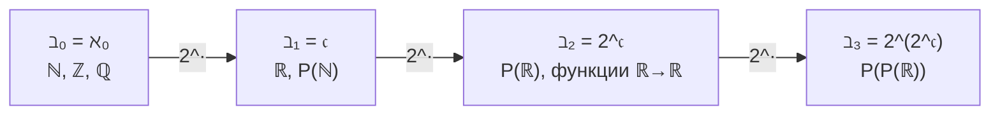

# 📝 Практика 7: Счетность, биекции, бет-числа и теорема Кантора

> [!abstract] О занятии
> - **Дисциплина:** [[Дискретная математика]] (1 семестр, 2026/27 уч. год)
> - **Поток:** Поток 2 (Software Engineering, Университет ИТМО)
> - **Дата проведения:** `2026-10-21` (7-я неделя, среда, 13:30–15:00, ауд. 2412 / 2316)
> - **Преподаватель практики:** Бебяков Артем Михайлович
> - **Лектор курса:** Константин Чухарев ([@Lipen](https://github.com/Lipen))
> - **Связанная лекция:** [[07. Лекция - Мощность множеств, счетность, континуум и теорема Кантора-Бернштейна (2026-10-21)]]
> - **Материалы занятия:** листок заданий **II.AA – II.AH** (счетность, несчетность, биекции, бет-числа) и записи на доске (теорема Кантора, бет-числа, $\aleph_0^{\aleph_0}$).
> - **Ключевые темы:** конечные строки над конечным алфавитом; вычитание счетного множества из несчетного; ошибка в «доказательстве» счетности $(0;1)$; сдвиг счетного множества $A \subseteq \mathbb{R}$ до непересечения с собой; построение биекций (отрезок/интервал, $\mathbb{N}_+$ и $\{2,3\} \times \mathbb{N}_+$, кортежи и функции, каррирование, счетное произведение континуумов); бет-числа $\beth_0..\beth_3$; конечные подмножества счетного множества; интервалы и точки разрыва монотонной функции; мощность множества монотонных функций.

> [!warning] Источник и оговорка
> Условия заданий II.AA–II.AH взяты **с фото листка**. Решения ниже — полные выкладки по материалам лекции; ход решения у доски фиксировался только фрагментарно (см. раздел 1), поэтому доказательства восстановлены и дописаны строго.

---

## 📌 Краткое резюме (TL;DR)

1. **Инъекция в счетное ⇒ не более чем счетно.** Любая «разметка» конечными строками, семейство попарно непересекающихся интервалов, множество конечных подмножеств $\mathbb{N}$ — всё это вкладывается в $\mathbb{N}$ (или $\mathbb{Q}$), поэтому счетно.
2. **Счетное объединение счетных счетно; несчетное минус счетное несчетно.** Если $A$ несчетно, а $B$ не более чем счетно, то $A \setminus B$ несчетно (иначе $A \subseteq (A \setminus B) \cup B$ счетно).
3. **Счетность не получить «по стадиям»:** конечные десятичные дроби перечислимы по длине записи, но числа с бесконечной записью ($1/3 = 0{,}333\ldots$) никогда не появятся ни на каком конечном шаге.
4. **Счетное множество можно сдвинуть с себя:** для счетного $A \subseteq \mathbb{R}$ «плохих» сдвигов $\{y - x : x, y \in A\}$ не более чем счетно, а $\mathbb{R}$ несчетно, значит хороший сдвиг $a$ существует.
5. **Каррирование:** $(A^B)^C \cong A^{B \times C}$, в кардиналах $(a^b)^c = a^{bc}$.
6. **Арифметика континуума:** $\aleph_0^{\aleph_0} = \lvert \mathbb{N}^{\mathbb{N}} \rvert = \mathfrak{c}$; счетное произведение континуумов — континуум.
7. **Бет-числа:** $\beth_0 = \aleph_0$, $\beth_{n+1} = 2^{\beth_n}$; $\beth_1 = \mathfrak{c}$.
8. **Монотонных функций $\mathbb{R} \to \mathbb{R}$ ровно $\mathfrak{c}$** (а всех функций — $2^{\mathfrak{c}}$): монотонная функция определяется значениями на $\mathbb{Q}$ и значениями в счетном множестве точек разрыва.

---

## 1. Записи на доске

### 1.1. Теорема Кантора и бет-числа

На доске зафиксированы три блока:

$$
\aleph_0^{\aleph_0} = \lvert \mathbb{N}^{\mathbb{N}} \rvert = \mathfrak{c}
$$

**Числа Бет:**

$$
\beth_0 = \aleph_0, \qquad \beth_1 = 2^{\beth_0} = \mathfrak{c}, \qquad \beth_2 = 2^{\beth_1}, \qquad \beth_3 = 2^{\beth_2}.
$$

**Теорема Кантора:**

$$
\lvert A \rvert < \lvert \mathcal{P}(A) \rvert, \quad\text{то есть}\quad
\begin{cases}
\lvert A \rvert \le \lvert \mathcal{P}(A) \rvert, \\
\lvert A \rvert \ne \lvert \mathcal{P}(A) \rvert.
\end{cases}
$$

Строгое неравенство разложено на две части: **вложение есть** ($a \mapsto \{a\}$ — инъекция $A \to \mathcal{P}(A)$), **биекции нет** (диагональный аргумент). Рядом на доске выписана степень $2^{\aleph_0}$ — именно она даёт $\mathfrak{c}$.

> [!tip] Почему $\aleph_0^{\aleph_0} = \mathfrak{c}$
> $$
> \mathfrak{c} = 2^{\aleph_0} \le \aleph_0^{\aleph_0} \le (2^{\aleph_0})^{\aleph_0} = 2^{\aleph_0 \cdot \aleph_0} = 2^{\aleph_0} = \mathfrak{c}.
> $$
> Первое неравенство: $\{0,1\}^{\mathbb{N}} \subseteq \mathbb{N}^{\mathbb{N}}$; второе: $\aleph_0 \le 2^{\aleph_0}$ (теорема Кантора) и монотонность степени по основанию; затем каррирование (задание II.AE.4) и $\aleph_0 \cdot \aleph_0 = \aleph_0$. По теореме Кантора–Бернштейна получаем равенство.

### 1.2. Остаток формализации (начало занятия)

В начале доски остались формулы на кванторах (значения предикатов на фото не записаны; естественная расшифровка: $S(x)$ — «$x$ — студент», $E(y)$ — «$y$ — экзамен», $P(x,y)$ — «$x$ сдал $y$»):

| Запись на доске | Прочтение | Замечание |
|---|---|---|
| $\forall x \, \exists y \, \big( (S(x) \land E(y)) \to P(x,y) \big)$ | «для каждого $x$ найдётся $y$, что если $x$ студент и $y$ экзамен, то $x$ сдал $y$» | **неверная формализация** «каждый студент сдал какой-то экзамен»: подойдёт любое $y$, не являющееся экзаменом (посылка ложна, импликация истинна) |
| $\forall x \, \big( S(x) \to \exists y \, ( E(y) \land P(x,y) ) \big)$ | «каждый студент сдал хотя бы один экзамен» | **верная** форма: $\exists$ идёт с $\land$, $\forall$ — с $\to$ |
| $\forall y \, \exists x \, \big( (S(x) \land E(y)) \to P(x,y) \big)$ | то же с обменом порядка кванторов | страдает той же ловушкой импликации под $\exists$ |
| $\forall y \in A \; \exists x \, \big( E(y) \land P(x,y) \big)$ | ограниченный квантор по множеству $A$ | $\forall y \in A$ раскрывается как $\forall y \, (y \in A \to \ldots)$ |

> [!warning] Правило формализации
> Под $\forall$ ставим $\to$, под $\exists$ ставим $\land$. Связка $\exists \ldots \to \ldots$ почти всегда ошибка: ложная посылка делает формулу тривиально истинной (см. [[02. Практика - Предикаты, кванторы, WOP, индукция, ПНФ и тройки Хоара (2026-09-16)]]).

---

## 2. Решения заданий листка

### Задание II.AA: Разметка конечными строками ⇒ счетность

> [!question] Условие
> Доказать, что если существует разметка (с уникальными метками) для элементов бесконечного множества $S$ конечными строками над конечным алфавитом, то само $S$ счетно бесконечно.

**Решение.**

Пусть $\Sigma$ — конечный алфавит, $\lvert \Sigma \rvert = k$, а разметка — это **инъекция** $\ell : S \to \Sigma^*$, где $\Sigma^* = \bigcup_{n \ge 0} \Sigma^n$ — множество всех конечных строк (уникальность меток = инъективность).

1. **$\Sigma^*$ счетно.** Каждое $\Sigma^n$ конечно ($\lvert \Sigma^n \rvert = k^n$). $\Sigma^*$ — счетное объединение конечных множеств, поэтому не более чем счетно, и бесконечно (содержит строки $a, aa, aaa, \ldots$). Явная нумерация: сначала строки длины $0$, затем длины $1$, затем длины $2$ и т. д.; внутри длины — лексикографически. Каждая строка получает конечный номер.
2. **$S$ вкладывается в $\Sigma^*$.** Поскольку $\ell$ инъективна, $S \sim \ell(S) \subseteq \Sigma^*$. Подмножество счетного множества не более чем счетно (оставляем строки в порядке нумерации и перенумеровываем подряд).
3. **$S$ бесконечно по условию**, значит $S$ счетно бесконечно: $\lvert S \rvert = \aleph_0$. $\blacksquare$

> [!example] Применение
> Именно так доказывается счетность множества всех программ, всех формул, всех конечных текстов: программа — конечная строка над конечным алфавитом, поэтому программ счетно, а функций $\mathbb{N} \to \{0,1\}$ их $2^{\aleph_0}$, то есть **невычислимых функций несчетно много** (ср. [[07. Лекция - Мощность множеств, счетность, континуум и теорема Кантора-Бернштейна (2026-10-21)]], п. 3.6).

---

### Задание II.AB: Несчетное минус счетное

> [!question] Условие
> Доказать, что если $A$ несчетно, а $B$ счетно (не более чем счетно), то $A \setminus B$ несчетно.

**Решение (от противного).**

Допустим, $A \setminus B$ не более чем счетно. Тогда

$$
A \subseteq (A \setminus B) \cup B,
$$

а объединение двух не более чем счетных множеств не более чем счетно (счетное объединение счетных: чередуем элементы, $\aleph_0 + \aleph_0 = \aleph_0$). Следовательно, $A$ не более чем счетно — противоречие с несчетностью $A$. $\blacksquare$

> [!tip] Следствия
> - $\mathbb{R} \setminus \mathbb{Q}$ несчетно, то есть иррациональных чисел несчетно много.
> - $\mathbb{R} \setminus \mathbb{A}$ несчетно ($\mathbb{A}$ — алгебраические числа), то есть **трансцендентных чисел несчетно много**.
> - В кардиналах: $\mathfrak{c} - \aleph_0 = \mathfrak{c}$.

---

### Задание II.AC: Где ошибка в «доказательстве» счетности $(0;1)$

> [!question] Условие
> «Перечислим все числа из $(0;1)$: сначала числа с одной цифрой после запятой, потом с двумя, потом с тремя и так далее. Каждое число из $(0;1)$ имеет десятичную запись, а значит рано или поздно появится в этом перечислении. Следовательно, $(0;1)$ счетно.» Где ошибка?

**Решение.**

Ошибка — в слове «каждое». Перечисление по числу знаков после запятой охватывает **только числа с конечной десятичной записью**:

$$
D = \bigcup_{n \ge 1} D_n, \qquad D_n = \Big\{ \tfrac{m}{10^n} : 0 < m < 10^n \Big\}, \quad \lvert D_n \rvert < 10^n.
$$

1. Это действительно счетное объединение конечных множеств, и множество $D$ счетно (это подмножество $\mathbb{Q}$).
2. Но число $x \in (0;1)$ попадает в список на шаге $n$ **только если его запись обрывается** на $n$-м знаке. Число с **бесконечной** записью ($\tfrac13 = 0{,}333\ldots$, $\tfrac{\sqrt2}{2} = 0{,}7071\ldots$, любое иррациональное) не появится ни на одном конечном шаге.
3. Фраза «имеет десятичную запись, а значит рано или поздно появится» — подмена: десятичная запись **существует**, но она **бесконечна**, а «рано или поздно» гарантируется лишь для записей **конечной** длины.

Реальный итог: $D$ счетно, а $(0;1) \setminus D$ несчетно (задание II.AB), и $(0;1)$ несчетно (диагональный аргумент Кантора).

> [!warning] Родственная ловушка
> Перечисление «по стадиям» доказывает счетность лишь тогда, когда **каждый** элемент множества попадает на **некоторую конечную** стадию. Для $\mathbb{Q}$ это так (дробь $p/q$ попадает на стадию $\lvert p \rvert + q$), для $(0;1)$ — нет.

---

### Задание II.AD: Сдвиг счетного множества до непересечения

> [!question] Условие
> Пусть $A \subseteq \mathbb{R}$, $A$ счетно. Верно ли, что $\exists a \; \big( \{x + a \mid x \in A\} \cap A = \emptyset \big)$?

**Ответ: верно.**

**Решение.**

Назовём сдвиг $a$ **плохим**, если $(A + a) \cap A \ne \emptyset$. Это значит, что найдутся $x, y \in A$ с $x + a = y$, то есть $a = y - x$. Следовательно,

$$
\mathrm{Bad} = \{ y - x : x, y \in A \} \quad\text{— образ множества } A \times A \text{ при отображении } (x,y) \mapsto y - x.
$$

1. $A \times A$ счетно (произведение двух счетных множеств, $\aleph_0 \cdot \aleph_0 = \aleph_0$).
2. Образ счетного множества при отображении не более чем счетен, поэтому $\lvert \mathrm{Bad} \rvert \le \aleph_0$.
3. $\mathbb{R}$ несчетно, значит по заданию II.AB $\mathbb{R} \setminus \mathrm{Bad} \ne \emptyset$. Любое $a$ из этого множества — искомый сдвиг: $(A + a) \cap A = \emptyset$. $\blacksquare$

> [!example] Пример
> $A = \mathbb{Z}$: плохие сдвиги $\mathrm{Bad} = \mathbb{Z}$; хороший сдвиг, например, $a = \tfrac12$: $\mathbb{Z} + \tfrac12 = \{k + \tfrac12\}$ не пересекается с $\mathbb{Z}$. Для $A = \mathbb{Q}$: $\mathrm{Bad} = \mathbb{Q}$, хороший сдвиг — $a = \sqrt2$.

---

### Задание II.AE: Пять биекций

#### 1) Биекция между $(0;1)$ и $(0;1]$

Идея — **«отель Гильберта»**: освободить место для точки $1$, сдвинув счетную цепочку $1, \tfrac12, \tfrac13, \ldots$.

$$
f : (0;1] \to (0;1), \qquad
f(x) =
\begin{cases}
\dfrac{1}{n+1}, & x = \dfrac1n, \; n \in \mathbb{N}_+, \\[2mm]
x, & \text{иначе.}
\end{cases}
$$

| $x$ | $1$ | $\tfrac12$ | $\tfrac13$ | $\tfrac14$ | $\ldots$ | остальные |
|---|---|---|---|---|---|---|
| $f(x)$ | $\tfrac12$ | $\tfrac13$ | $\tfrac14$ | $\tfrac15$ | $\ldots$ | $x$ |

- **Инъективность:** на цепочке $\tfrac1n \mapsto \tfrac1{n+1}$ строго монотонна и разные точки не склеивает; точка вне цепочки остаётся на месте и не может совпасть с $\tfrac1{m}$ (иначе была бы в цепочке).
- **Сюръективность:** значения $\tfrac1m$ при $m \ge 2$ получаются из $\tfrac1{m-1}$; все остальные $y \in (0;1)$ — из себя. Число $1$ в образ не попадает, и не должно ($1 \notin (0;1)$).

Значит $(0;1] \sim (0;1)$, обе мощности равны $\mathfrak{c}$.

#### 2) Биекция между $\mathbb{N}_+$ и $B \times \mathbb{N}_+$, $B = \{2,3\}$

Раскладываем натуральные числа по чётности:

$$
g : B \times \mathbb{N}_+ \to \mathbb{N}_+, \qquad
g(2, k) = 2k - 1, \quad g(3, k) = 2k.
$$

| $(b,k)$ | $(2,1)$ | $(3,1)$ | $(2,2)$ | $(3,2)$ | $(2,3)$ | $(3,3)$ | $\ldots$ |
|---|---|---|---|---|---|---|---|
| $g(b,k)$ | $1$ | $2$ | $3$ | $4$ | $5$ | $6$ | $\ldots$ |

Обратное отображение: нечётное $n \mapsto \big(2, \tfrac{n+1}{2}\big)$, чётное $n \mapsto \big(3, \tfrac n2\big)$. Оба отображения определены на всей области и взаимно обратны, поэтому $g$ — биекция. В кардиналах: $2 \cdot \aleph_0 = \aleph_0$.

#### 3) Биекция между $A^n$ и $A^K$, где $K = \{1,\ldots,n\}$, $A^K = \{ f \mid f : K \to A \}$

Кортеж $(a_1, \ldots, a_n)$ — это и есть функция «номер позиции $\mapsto$ элемент»:

$$
\Phi : A^n \to A^K, \quad \Phi(a_1, \ldots, a_n) = f, \quad f(i) = a_i;
\qquad
\Psi : A^K \to A^n, \quad \Psi(f) = \big(f(1), \ldots, f(n)\big).
$$

$\Psi \circ \Phi = \mathrm{id}$ и $\Phi \circ \Psi = \mathrm{id}$, значит $\Phi$ — биекция. Две записи степени (декартова и функциональная) задают одну и ту же мощность $\lvert A \rvert^n$.

#### 4) Биекция между $(A^B)^C$ и $A^{B \times C}$ (каррирование)

Элемент $(A^B)^C$ — функция $F : C \to (B \to A)$, то есть каждому $c \in C$ ставится в соответствие функция $F(c) : B \to A$. Элемент $A^{B \times C}$ — функция $G : B \times C \to A$ двух аргументов.

$$
\Phi(F)(b, c) = F(c)(b), \qquad
\Psi(G)(c) = \big( b \mapsto G(b, c) \big).
$$

Проверка:

$$
\Psi(\Phi(F))(c)(b) = \Phi(F)(b,c) = F(c)(b) \;\Longrightarrow\; \Psi \circ \Phi = \mathrm{id},
$$

$$
\Phi(\Psi(G))(b,c) = \Psi(G)(c)(b) = G(b,c) \;\Longrightarrow\; \Phi \circ \Psi = \mathrm{id}.
$$

Следовательно, $(A^B)^C \sim A^{B \times C}$, а в кардиналах $(a^b)^c = a^{bc}$.

> [!tip] Связь с программированием
> Это **каррирование** (currying): функция двух аргументов $B \times C \to A$ эквивалентна функции одного аргумента, возвращающей функцию. В C++: `std::function<std::function<A(B)>(C)>` против `std::function<A(B, C)>`.

#### 5) Счетное произведение континуумов

> [!question] Условие
> Доказать: если множество всех счетных последовательностей натуральных чисел имеет мощность $\mathfrak{c}$, а также $\lvert A_i \rvert = \mathfrak{c}$ для $i \in I$ и $\lvert I \rvert = \aleph_0$, то $\big\lvert \prod_{i \in I} A_i \big\rvert = \mathfrak{c}$. Здесь $\prod_{i \in I} A_i$ — декартово произведение.

**Решение.**

Дано $\lvert \mathbb{N}^{\mathbb{N}} \rvert = \mathfrak{c}$. Так как $\lvert A_i \rvert = \mathfrak{c}$, для каждого $i$ выберем биекцию $\varphi_i : A_i \to \mathbb{N}^{\mathbb{N}}$ (счетное семейство выборов — достаточно счетного выбора). Так как $\lvert I \rvert = \aleph_0$, перенумеруем $I = \mathbb{N}$. Тогда

$$
\prod_{i \in I} A_i \;\sim\; \prod_{i \in \mathbb{N}} \mathbb{N}^{\mathbb{N}} \;=\; \big( \mathbb{N}^{\mathbb{N}} \big)^{\mathbb{N}},
$$

где биекция действует покоординатно: $(a_i)_{i} \mapsto (\varphi_i(a_i))_{i}$. По пункту 4 (каррирование)

$$
\big( \mathbb{N}^{\mathbb{N}} \big)^{\mathbb{N}} \sim \mathbb{N}^{\mathbb{N} \times \mathbb{N}},
$$

а $\mathbb{N} \times \mathbb{N} \sim \mathbb{N}$ (нумерация Кантора: $(m,n) \mapsto \tfrac{(m+n)(m+n+1)}{2} + n$), поэтому $\mathbb{N}^{\mathbb{N} \times \mathbb{N}} \sim \mathbb{N}^{\mathbb{N}}$. Итак,

$$
\Big\lvert \prod_{i \in I} A_i \Big\rvert = \lvert \mathbb{N}^{\mathbb{N}} \rvert = \mathfrak{c}. \qquad \blacksquare
$$

В кардиналах это цепочка $\mathfrak{c}^{\aleph_0} = (2^{\aleph_0})^{\aleph_0} = 2^{\aleph_0 \cdot \aleph_0} = 2^{\aleph_0} = \mathfrak{c}$.

> [!example] Следствия
> - $\lvert \mathbb{R}^{\mathbb{N}} \rvert = \mathfrak{c}$: счетных последовательностей вещественных чисел столько же, сколько вещественных чисел.
> - Подтверждается равенство с доски $\aleph_0^{\aleph_0} = \lvert \mathbb{N}^{\mathbb{N}} \rvert = \mathfrak{c}$.

---

### Задание II.AF: Первые четыре бет-числа

> [!question] Условие
> Выписать первые четыре бет-числа и для каждого назвать конкретное множество соответствующей мощности.

**Определение:** $\beth_0 = \aleph_0$, $\beth_{n+1} = 2^{\beth_n}$.

| Число | Значение | Конкретное множество этой мощности |
|---|---|---|
| $\beth_0$ | $\aleph_0$ | $\mathbb{N}$ (также $\mathbb{Z}$, $\mathbb{Q}$, множество всех программ) |
| $\beth_1$ | $2^{\aleph_0} = \mathfrak{c}$ | $\mathbb{R}$, интервал $(0;1)$, $\mathcal{P}(\mathbb{N})$, $\{0,1\}^{\mathbb{N}}$ |
| $\beth_2$ | $2^{\mathfrak{c}}$ | $\mathcal{P}(\mathbb{R})$, множество всех функций $\mathbb{R} \to \{0,1\}$, множество всех функций $\mathbb{R} \to \mathbb{R}$ |
| $\beth_3$ | $2^{2^{\mathfrak{c}}}$ | $\mathcal{P}(\mathcal{P}(\mathbb{R}))$ |

> [!tip] Проверка для $\mathbb{R}^{\mathbb{R}}$
> $\lvert \mathbb{R}^{\mathbb{R}} \rvert = \mathfrak{c}^{\mathfrak{c}} = (2^{\aleph_0})^{\mathfrak{c}} = 2^{\aleph_0 \cdot \mathfrak{c}} = 2^{\mathfrak{c}} = \beth_2$, так как $\aleph_0 \cdot \mathfrak{c} = \mathfrak{c}$.

По теореме Кантора каждый шаг строго увеличивает мощность: $\beth_0 < \beth_1 < \beth_2 < \beth_3 < \ldots$. Равенство $\beth_n = \aleph_n$ для $n \ge 1$ — **обобщённая континуум-гипотеза**, она не выводится и не опровергается в ZFC.

---

### Задание II.AG: Три утверждения о счетности

#### а) Множество всех конечных подмножеств счетного множества счетно

> [!question] Условие
> Доказать, что множество всех конечных подмножеств счетного множества счетно.

**Решение.** Без потери общности счетное множество — $\mathbb{N}$ (иначе перенумеруем). Пусть $\mathrm{Fin}(\mathbb{N})$ — множество конечных подмножеств $\mathbb{N}$. Определим

$$
h : \mathrm{Fin}(\mathbb{N}) \to \mathbb{N}, \qquad h(F) = \sum_{a \in F} 2^a, \qquad h(\emptyset) = 0.
$$

Это двоичная запись: $F$ кодируется числом, в двоичной записи которого единицы стоят ровно на позициях из $F$.

- **Инъективность:** двоичная запись натурального числа единственна, поэтому $h(F) = h(F')$ влечёт $F = F'$.
- **Бесконечность:** одноэлементные множества $\{a\}$ дают бесконечно много различных образов $2^a$.

Таким образом, $\mathrm{Fin}(\mathbb{N})$ вкладывается в $\mathbb{N}$ и бесконечно, значит счетно. (Сюръективность $h$ тоже верна: любое $n$ — сумма различных степеней двойки.) $\blacksquare$

**Альтернативное доказательство.** $\mathrm{Fin}(\mathbb{N}) = \bigcup_{n \ge 0} [\mathbb{N}]^{n}$, где $[\mathbb{N}]^n$ — $n$-элементные подмножества; каждое $[\mathbb{N}]^n$ инъективно вкладывается в $\mathbb{N}^n$ (упорядочиваем элементы по возрастанию), а $\mathbb{N}^n$ счетно. Счетное объединение счетных множеств счетно.

> [!warning] Контраст
> Конечных подмножеств $\mathbb{N}$ — счетно, а **всех** подмножеств $\mathcal{P}(\mathbb{N})$ — континуум. Бесконечные подмножества тоже есть и их несчетно много.

#### b) Семейство попарно непересекающихся открытых интервалов на $\mathbb{R}$ не более чем счетно

**Решение.** Пусть $\{I_\alpha\}_{\alpha \in J}$ — семейство попарно непересекающихся непустых открытых интервалов. В каждом интервале найдётся рациональное число (плотность $\mathbb{Q}$ в $\mathbb{R}$). Выберем

$$
q : J \to \mathbb{Q}, \qquad q(\alpha) \in I_\alpha \cap \mathbb{Q}.
$$

Если $\alpha \ne \beta$, то $I_\alpha \cap I_\beta = \emptyset$, поэтому $q(\alpha) \ne q(\beta)$. Значит $q$ — инъекция $J \to \mathbb{Q}$, а $\mathbb{Q}$ счетно, откуда $\lvert J \rvert \le \aleph_0$. $\blacksquare$

> [!tip] Идея
> «У каждого непересекающегося интервала свой рациональный свидетель» — ровно тот же приём, что и в практике по открытым множествам на $\mathbb{R}$ (каждое открытое множество — не более чем счетное объединение непересекающихся интервалов).

#### c) Множество точек разрыва монотонной функции $\mathbb{R} \to \mathbb{R}$ не более чем счетно

**Решение.** Пусть $f$ неубывающая (для невозрастающей — переходим к $-f$).

1. **Только скачки.** В каждой точке $x$ существуют односторонние пределы $f(x^-) = \sup_{t < x} f(t)$ и $f(x^+) = \inf_{t > x} f(t)$, причём $f(x^-) \le f(x) \le f(x^+)$. Разрыв в $x$ означает $f(x^-) < f(x^+)$.
2. **Интервалы скачков.** В каждой точке разрыва $x$ определён непустой открытый интервал $J_x = \big( f(x^-), f(x^+) \big)$.
3. **Попарная непересекаемость.** Если $x < y$ — две точки разрыва, то выбираем $t$ с $x < t < y$ и получаем
$$
f(x^+) \le f(t) \le f(y^-),
$$
то есть правый конец $J_x$ не превосходит левого конца $J_y$, и $J_x \cap J_y = \emptyset$.
4. По пункту b) семейство $\{J_x\}$ не более чем счетно, а $x \mapsto J_x$ инъективно (интервалы различны, раз попарно не пересекаются и непусты). Значит точек разрыва не более чем счетно. $\blacksquare$

---

### Задание II.AH: Мощность множества монотонных функций на $\mathbb{R}$

> [!question] Условие
> Какова мощность множества всех монотонных функций на $\mathbb{R}$?

**Ответ: $\mathfrak{c}$ (континуум)** — несмотря на то, что всех функций $\mathbb{R} \to \mathbb{R}$ имеется $2^{\mathfrak{c}} = \beth_2$.

**Решение.**

*Нижняя оценка.* Константы $f_a(x) = a$, $a \in \mathbb{R}$, монотонны и попарно различны, поэтому монотонных функций не меньше $\mathfrak{c}$.

*Верхняя оценка.* Пусть $f$ неубывающая (для невозрастающих — отдельное такое же множество). Покажем, что $f$ однозначно задаётся данными, которых всего $\mathfrak{c}$:

1. Множество точек разрыва $D_f$ **не более чем счетно** (задание II.AG, пункт c).
2. В каждой точке непрерывности $x \notin D_f$ значение восстанавливается по сужению на $\mathbb{Q}$:
$$
f(x) = \lim_{\substack{q \to x \\ q \in \mathbb{Q}}} f(q) = \sup_{q \in \mathbb{Q},\, q < x} f(q).
$$
3. Остаётся значения $f$ на $D_f$.

Поэтому $f$ однозначно определяется тройкой

$$
\big( f\vert_{\mathbb{Q}},\; D_f,\; f\vert_{D_f} \big),
$$

где

| Компонента | Что это | Сколько вариантов |
|---|---|---|
| $f\vert_{\mathbb{Q}}$ | функция $\mathbb{Q} \to \mathbb{R}$, то есть счетная последовательность вещественных | $\mathfrak{c}^{\aleph_0} = \mathfrak{c}$ |
| $D_f$ | не более чем счетное подмножество $\mathbb{R}$ (последовательность вещественных, возможно с повторами) | $\mathfrak{c}^{\aleph_0} = \mathfrak{c}$ |
| $f\vert_{D_f}$ | функция $D_f \to \mathbb{R}$, то есть опять счетная последовательность вещественных | $\mathfrak{c}^{\aleph_0} = \mathfrak{c}$ |

Итого неубывающих функций не более $\mathfrak{c} \cdot \mathfrak{c} \cdot \mathfrak{c} = \mathfrak{c}$. Невозрастающих — тоже не более $\mathfrak{c}$, а объединение двух множеств мощности $\le \mathfrak{c}$ имеет мощность $\le \mathfrak{c}$. По теореме Кантора–Бернштейна мощность множества монотонных функций равна $\mathfrak{c}$. $\blacksquare$

> [!important] Вывод
> Мощность $\mathfrak{c}^{\aleph_0} = \mathfrak{c}$ (а не $2^{\mathfrak{c}}$) возникает потому, что монотонность делает функцию «счетно-определимой»: достаточно значений на плотном счетном множестве и в счетном множестве скачков. Для произвольных функций такого сжатия нет, поэтому их $\mathfrak{c}^{\mathfrak{c}} = 2^{\mathfrak{c}}$. Аналогично, непрерывных функций $\mathbb{R} \to \mathbb{R}$ ровно $\mathfrak{c}$ (задаются значениями на $\mathbb{Q}$).

---

## 3. Сводные таблицы

### Кардинальная арифметика, использованная на практике

| Равенство | Где применялось |
|---|---|
| $\aleph_0 + \aleph_0 = \aleph_0$ | II.AB, II.AE.2 |
| $\aleph_0 \cdot \aleph_0 = \aleph_0$ | II.AD, II.AE.5 |
| $2^{\aleph_0} = \mathfrak{c}$ | бет-числа, II.AF |
| $\aleph_0^{\aleph_0} = \mathfrak{c}^{\aleph_0} = \mathfrak{c}$ | доска, II.AE.5, II.AH |
| $(a^b)^c = a^{bc}$ | II.AE.4, II.AE.5 |
| $\mathfrak{c}^{\mathfrak{c}} = 2^{\mathfrak{c}} = \beth_2$ | II.AF |
| $\mathfrak{c} - \aleph_0 = \mathfrak{c}$ | II.AB |

### Приёмы доказательства счетности

| Приём | Идея | Задания |
|---|---|---|
| Инъекция в счетное | $X \hookrightarrow \mathbb{N}$ или $\mathbb{Q}$ ⇒ $X$ не более чем счетно | II.AA, II.AG |
| Счетное объединение счетных | перечисляем «по диагонали» или по стадиям | II.AB, II.AG.а |
| Образ счетного | $f(X)$ не более чем счетно | II.AD |
| Рациональный свидетель | в каждом интервале берём $q \in \mathbb{Q}$ | II.AG.б, II.AG.в |
| Отель Гильберта | сдвигаем счетную цепочку, освобождая место | II.AE.1 |
| Каррирование | $(A^B)^C \sim A^{B \times C}$ | II.AE.4 |

---

## ❓ Вопросы для самопроверки к коллоквиуму / экзамену

- [ ] Почему множество всех конечных строк над конечным алфавитом счетно, а множество бесконечных двоичных последовательностей — нет?
- [ ] Докажите: если $A$ несчетно, $B$ не более чем счетно, то $A \setminus B$ несчетно.
- [ ] В чём ошибка «доказательства» счетности $(0;1)$ перечислением по числу знаков после запятой?
- [ ] Докажите, что для счетного $A \subseteq \mathbb{R}$ существует $a$ с $(A + a) \cap A = \emptyset$. Какое множество сдвигов «плохие»?
- [ ] Постройте явную биекцию между $(0;1)$ и $(0;1]$.
- [ ] Постройте биекцию $\mathbb{N}_+ \to \{2,3\} \times \mathbb{N}_+$ и обратную к ней.
- [ ] Запишите каррирование как биекцию $(A^B)^C \to A^{B \times C}$ и проверьте, что обе композиции — тождества.
- [ ] Почему $\aleph_0^{\aleph_0} = \mathfrak{c}$? Какие два неравенства нужны?
- [ ] Выпишите $\beth_0..\beth_3$ и назовите для каждого конкретное множество.
- [ ] Почему множество конечных подмножеств $\mathbb{N}$ счетно, а $\mathcal{P}(\mathbb{N})$ — нет? Как работает двоичное кодирование?
- [ ] Почему семейство попарно непересекающихся открытых интервалов в $\mathbb{R}$ не более чем счетно?
- [ ] Почему у монотонной функции не более чем счетное число точек разрыва?
- [ ] Какова мощность множества монотонных функций $\mathbb{R} \to \mathbb{R}$ и почему она меньше мощности всех функций?
- [ ] Почему формула $\exists y \, ((S(x) \land E(y)) \to P(x,y))$ — плохая формализация «студент сдал какой-то экзамен»?

---

## 🔗 Связанные материалы

- Лекция: [[07. Лекция - Мощность множеств, счетность, континуум и теорема Кантора-Бернштейна (2026-10-21)]]
- Предыдущая практика: [[04. Практика - Бинарные отношения, свойства, фактор-множества, замыкания и композиция (2026-09-30)]]
- Следующая лекция: [[08. Лекция - Трансфинитные числа, ординалы, вполне упорядоченные множества и трансфинитная индукция (2026-10-28)]]
- Хаб предмета: [[Дискретная математика]]
- Теорминимум: [[Теорминимум 1 - Множества, отношения и формальная логика (2026-11-14)]]
