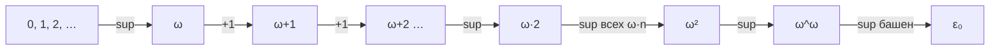
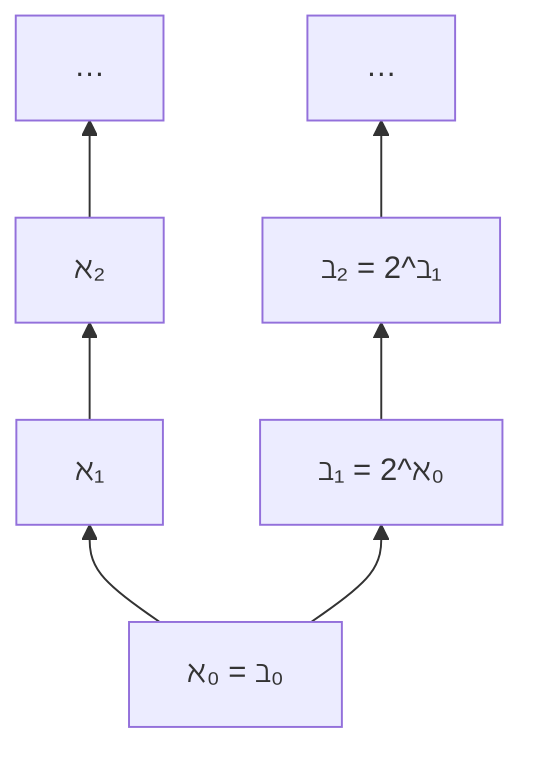

# 📌 Лекция 8: Трансфинитные числа, ординалы, вполне упорядоченные множества и трансфинитная индукция

> [!info] ⏳ Предварительный конспект (сверен со слайдами)
> Конспект сверен с презентацией `s1-lec08-transfinite.typ` (редакция Lipen от 13 октября 2026, неделя 26 октября — 1 ноября). Он будет дополнен после очной лекции.

> [!abstract] О занятии
> - **Дисциплина:** [[Дискретная математика]] (1 семестр, Поток 2)
> - **Преподаватель (лектор):** Константин Чухарев ([@Lipen](https://github.com/Lipen), Университет ИТМО)
> - **Дата проведения:** 28 октября 2026 года (неделя 9)
> - **Первоисточники курса:** Репозиторий [Lipen/discrete-math-course](https://github.com/Lipen/discrete-math-course), лекционная презентация `s1-lec08-transfinite.typ` (*«Трансфинитное»*), главы книги `m07` (*«Кардинальные числа и арифметика»*, *«Две иерархии: алефы и беты»*), `m04` (*«Парадокс Рассела и аксиоматическая теория ZFC»*).
> - **Ключевые темы:** Вполне упорядоченные множества и отсутствие бесконечного спуска; порядковый тип; ординалы фон Неймана, первый бесконечный ординал $\omega$; трансфинитная индукция (базовый, индуктивный и предельный шаги); некоммутативность сложения ординалов ($\omega + 1 \ne 1 + \omega$); лестница ординалов; кардинальные числа и арифметика бесконечных кардиналов (почему нет деления и вычитания); две иерархии бесконечностей: алефы $\aleph_\alpha$ и беты $\beth_\alpha$; континуум-гипотеза (CH) и ее независимость от ZFC (Гёдель, Коэн); парадоксы наивной теории множеств (Рассел, Кантор, Бурали-Форти); 8 аксиом системы ZF(C); кумулятивная иерархия фон Неймана $V_\alpha$; недостижимые и большие кардиналы.

---

## 📌 Краткое резюме (TL;DR)

1. **Вполне упорядоченное множество** (Well-ordered set) — линейно упорядоченное множество, в котором каждое непустое подмножество имеет наименьший элемент. Эквивалентно **отсутствию бесконечно убывающих цепочек** (бесконечного спуска). Стандартный порядок на $\mathbb{Z}$ не вполне упорядочен, но его можно переупорядочить к типу $\omega$: $0, -1, 1, -2, 2, \dots$.
2. **Ординалы (порядковые числа)** измеряют *порядковый тип* вполне упорядоченного множества (отвечают на вопрос *«какой по счету?»*). Первый бесконечный ординал $\omega = \{0, 1, 2, \dots\}$. По определению фон Неймана каждый ординал равен множеству строго меньших ординалов: $\alpha = \{\beta \mid \beta < \alpha\}$.
3. **Некоммутативность операций над ординалами:** Сложение ординалов асимметрично: $1 + \omega = \omega$ (добавление элемента в начало не меняет тип), но $\omega + 1 > \omega$ (добавление в конец создает новый предельный элемент).
4. **Трансфинитная индукция** расширяет математическую индукцию на все ординалы через три шага:
   - *База:* доказать для $\alpha = 0$;
   - *Шаг наследника:* из истинности для $\alpha$ доказать для $\alpha + 1$;
   - *Предельный шаг:* для предельного ординала $\lambda$ вывести $P(\lambda)$ из предположения, что $P(\beta)$ верно для всех $\beta < \lambda$.
5. **Кардиналы (мощности)** отвечают на вопрос *«сколько?»*. Ординалы $\omega, \omega+1, \omega \cdot 2, \omega^2$ различны по структуре порядка, но имеют одну и ту же счетную мощность $\aleph_0$.
6. **Арифметика кардиналов:** Для любых бесконечных кардиналов $\kappa, \lambda$: $\kappa + \lambda = \kappa \cdot \lambda = \max(\kappa, \lambda)$. Единственная операция, порождающая больший кардинал — возведение в степень ($2^\kappa > \kappa$ по теореме Кантора).
7. **Алефы против Бет:** $\aleph_\alpha$ перечисляет кардиналы по возрастанию мощности ($\aleph_0, \aleph_1, \dots$). $\beth_\alpha$ строится конструктивно взятием булеана: $\beth_0 = \aleph_0, \beth_{\alpha+1} = 2^{\beth_\alpha}$.
8. **Континуум-гипотеза (CH):** Утверждение $2^{\aleph_0} = \aleph_1$ (то есть $\beth_1 = \aleph_1$). Доказано, что CH **независима от ZFC**: ее нельзя ни доказать (Коэн, 1963, метод форсинга), ни опровергнуть (Гёдель, 1938, конструктивный универсум $L$).
9. **Парадоксы Кантора и Бурали-Форти:** Множества всех множеств и множества всех ординалов не существуют (являются собственными классами), так как их существование ведет к немедленному противоречию $\alpha < \alpha$. Аксиоматика ZFC разрешает парадоксы через аксиому выделения и схему подстановки.

---

## 1. 🪜 Вполне упорядоченные множества и ординалы

> [!info] Определение вполне упорядоченного множества
> Линейно упорядоченное множество $(W, \le)$ называется **вполне упорядоченным** (well-ordered), если любое его непустое подмножество $S \subseteq W$ ($S \ne \varnothing$) содержит **наименьший элемент**:
> $$\forall S \subseteq W \; (S \ne \varnothing \implies \exists m \in S : \forall x \in S \; (m \le x))$$

> [!important] Теорема об эквивалентности бесконечному спуску
> Линейный порядок $(W, \le)$ вполне упорядочен тогда и только тогда, когда в нем **не существует бесконечно убывающей последовательности элементов**:
> $$\not\exists (x_n)_{n=0}^\infty : x_0 > x_1 > x_2 > x_3 > \dots$$

### Примеры порядков на числах:
- $(\mathbb{N}, \le)$ — вполне упорядоченное множество (принцип наименьшего числа).
- $(\mathbb{Z}, \le)$ со стандартным порядком **не** вполне упорядочен, так как последовательность $-1 > -2 > -3 > \dots$ убывает бесконечно.
- Однако множество $\mathbb{Z}$ **можно переупорядочить** так, чтобы оно стало вполне упорядоченным! Например:
  $$0 \prec -1 \prec 1 \prec -2 \prec 2 \prec -3 \prec 3 \prec \dots \quad \text{(порядковый тип } \omega\text{)}$$
  или расположить все отрицательные числа после положительных:
  $$0 \prec 1 \prec 2 \prec 3 \prec \dots \prec -1 \prec -2 \prec -3 \prec \dots \quad \text{(порядковый тип } \omega + \omega = \omega \cdot 2\text{)}$$

> [!example] Порядок на $\mathbb{Z}$ можно починить
> Выпишем целые в очередь $0, 1, -1, 2, -2, \dots$: в любом непустом подмножестве берём элемент с наименьшим модулем, при равных модулях — положительный. Такой элемент всегда существует и первый в очереди, порядок вполне упорядочен и изоморфен натуральному ряду: тип $\omega$.

> [!important]
> Вполне упорядоченность — свойство **порядка**, а не множества. По теореме Цермело вполне упорядочить можно любое множество, но доказательство опирается на аксиому выбора и явного порядка на $\mathbb{R}$ не предъявляет. $\mathbb{R}$ с обычным порядком вполне упорядоченным не является: у интервала $(0,1)$ минимума нет.

### Сколько и какой по счёту?

Кардинал отвечает на вопрос «сколько элементов?», ординал — «какой по счёту?». В конечной очереди обе меры совпадают (третий в очереди из трёх ждёт ровно двоих), в бесконечной расходятся: счёт продолжается и за $\omega$.

### Бесконечного спуска нет

Во вполне упорядоченном множестве нет бесконечной убывающей цепи $a_0 > a_1 > a_2 > \dots$: множество её членов непусто, поэтому обязано иметь наименьший элемент, а в убывающей цепи его нет. Мера, строго убывающая на каждой итерации по вполне упорядоченному множеству, **гарантирует завершение цикла** (верификаторы завершаемости TLA+, Isabelle, Dafny устроены именно так). Когда натуральных чисел мало, мерой становится ординал — см. последовательности Гудстейна ниже. Индукция по натуральному ряду переносится на любое вполне упорядоченное множество — это **трансфинитная индукция**.

### Порядковый тип

> [!info] Определение
> Два вполне упорядоченных множества имеют один **порядковый тип**, если между ними есть биекция, сохраняющая порядок в обе стороны. Порядковый тип вполне упорядоченного множества называется **ординалом**.

Ординал запоминает форму очереди и забывает наполнение.

> [!example]
> Чётные числа и весь натуральный ряд — один ординал: биекция $n \mapsto 2n$ сохраняет порядок ($a<b \Rightarrow 2a<2b$). Половина ряда неотличима от целого ряда — разрежение форму очереди не меняет.

### Первый бесконечный ординал и счёт за $\omega$

$$0 < 1 < 2 < 3 < \dots < \omega.$$

У $\omega$ нет предшественника: $\omega \ne \alpha + 1$ ни для какого $\alpha$ (ноль тоже без предшественника, и $\omega$ повторяет эту особенность на следующем рубеже).

> [!example] За $\omega$ есть ещё
> - $\omega + 1$: после всех натуральных идёт ещё один элемент;
> - $\omega + 2$: ещё два;
> - после $\omega, \omega + 1, \omega + 2, \dots$ наступает $\omega + \omega = \omega \cdot 2$ — два блока по $\omega$ подряд.

Формально сложение и умножение — рекурсия по правому аргументу:

$$\alpha + 0 = \alpha, \quad \alpha + (\beta + 1) = (\alpha + \beta) + 1, \quad \alpha + \lambda = \sup_{\beta < \lambda} (\alpha + \beta),$$
$$\alpha \cdot 0 = 0, \quad \alpha \cdot (\beta + 1) = \alpha \cdot \beta + \alpha, \quad \alpha \cdot \lambda = \sup_{\beta < \lambda} (\alpha \cdot \beta).$$

Чтение прежнее — склейка очередей: сначала блок первого слагаемого, затем блок второго.

---

### Конструкция ординалов по фон Нейману

Джон фон Нейман предложил гениальное определение: **каждый ординал — это множество всех строго меньших ординалов**:
$$0 = \varnothing$$
$$1 = \{0\} = \{\varnothing\}$$
$$2 = \{0, 1\} = \{\varnothing, \{\varnothing\}\}$$
$$n + 1 = n \cup \{n\}$$
$$\omega = \{0, 1, 2, 3, \dots\} = \mathbb{N}$$
$$\omega + 1 = \omega \cup \{\omega\} = \{0, 1, 2, \dots, \omega\}$$

Отношение порядка между ординалами совпадает с отношением принадлежности:
$$\alpha < \beta \iff \alpha \in \beta$$

---

### Трансфинитная индукция

Все ординалы делятся на два типа:
1. **Ординалы-наследники:** $\alpha = \beta + 1 = \beta \cup \{\beta\}$ (имеют непосредственного предшественника);
2. **Предельные ординалы:** $\lambda = \bigcup_{\beta < \lambda} \beta = \sup_{\beta < \lambda} \beta$ (например, $\omega, \omega \cdot 2, \omega^2$).

> [!important] Принцип трансфинитной индукции
> Пусть $P(\alpha)$ — свойство ординалов. Если выполнены условия:
> 1. **База:** $P(0)$ истинно;
> 2. **Шаг наследника:** $\forall \alpha : P(\alpha) \implies P(\alpha + 1)$;
> 3. **Предельный шаг:** для любого предельного ординала $\lambda$: $(\forall \beta < \lambda : P(\beta)) \implies P(\lambda)$,
> то свойство $P(\alpha)$ истинно для **всех ординалов** $\alpha$.

Без предельного шага индукция останавливается перед $\omega$: сколько конечных $P(n)$ ни доказать, $P(\omega)$ из них не следует, а предельный шаг выводит её сразу из всей серии.

> [!note] Теорема (ассоциативность ординального сложения)
> $(\alpha + \beta) + \gamma = \alpha + (\beta + \gamma)$ для всех ординалов $\alpha, \beta, \gamma$.
>
> *Доказательство.* Фиксируем $\alpha, \beta$, индукцию ведём по $\gamma$.
> - **База.** При $\gamma = 0$ обе части равны $\alpha + \beta$.
> - **Переход.** По индуктивному предположению и определению сложения
> $$(\alpha + \beta) + (\gamma + 1) = ((\alpha + \beta) + \gamma) + 1 = (\alpha + (\beta + \gamma)) + 1 = \alpha + (\beta + (\gamma + 1)).$$
> - **Предельный шаг.** Для предельного $\lambda$:
> $$(\alpha + \beta) + \lambda = \sup_{\delta < \lambda} ((\alpha + \beta) + \delta) = \sup_{\delta < \lambda} (\alpha + (\beta + \delta)) = \alpha + (\beta + \lambda).$$
> Первое равенство — определение суммы на пределе, второе — индуктивное предположение, третье — определение на пределе и непрерывность сложения по правому аргументу. Без предельного шага утверждение не доказать уже на $\gamma = \omega$: обычная индукция до предела не доходит. $\blacksquare$

---

### Ординальная мера и завершаемость

Завершаемость доказывают **строго убывающей мерой**: шагам процесса назначается ординал, и на каждом шаге он становится меньше (обобщение ранжирующей функции из [[05. Лекция - Отношение порядка, диаграммы Хассе, цепи, антицепи и решетки (2026-10-07)]]). Натуральной меры хватает не всегда: у части завершающихся процессов убывающей **конечной** меры нет. Тогда мерой становится ординал — а убывающая последовательность ординалов обязана оборваться, поскольку ординалы вполне упорядочены и бесконечного спуска в них нет.

> [!example] Последовательности Гудстейна
> Шаг последовательности: записать число **наследственно** по основанию $b$ (показатели тоже раскладываются по $b$), заменить каждое вхождение основания на $b + 1$ и вычесть единицу.
>
> | Шаг | Основание | Наследственная запись | После замены основания $-\,1$ | Ординальная мера |
> | :---: | :---: | :--- | :--- | :--- |
> | 0 | $2$ | $4 = 2^2$ | $3^3 - 1 = 26$ | $\omega^\omega$ |
> | 1 | $3$ | $26 = 2 \cdot 3^2 + 2 \cdot 3 + 2$ | $2 \cdot 4^2 + 2 \cdot 4 + 2 - 1 = 41$ | $2\omega^2 + 2\omega + 2$ |
> | 2 | $4$ | $41 = 2 \cdot 4^2 + 2 \cdot 4 + 1$ | $2 \cdot 5^2 + 2 \cdot 5 + 1 - 1 = 60$ | $2\omega^2 + 2\omega + 1$ |
>
> Сами числа растут ($4 \to 26 \to 41 \to 60 \to \dots$), но мера строится той же записью с основанием $\omega$ вместо $b$: было $\omega^\omega$, стало $2\omega^2 + 2\omega + 2$, затем $2\omega^2 + 2\omega + 1$ — она **строго убывает** на каждом шаге.

> [!note] Вывод
> Мера убывает на каждом шаге, поэтому последовательность обрывается (доходит до $0$) на конечном шаге, каким бы длинным он ни был. Ординальные меры — рабочий инструмент проверки завершаемости программ и систем переписывания термов.

---

### Некоммутативность арифметики ординалов

Сумма двух порядковых типов $\alpha + \beta$ определяется как порядок, полученный приписыванием очереди типа $\beta$ строго следом за очередью типа $\alpha$.

> [!example] Почему $1 + \omega \ne \omega + 1$? (Пример Липеня)
> - **Порядок $1 + \omega$:** один элемент помещается *перед* бесконечным рядом:
>   $$\star, 0, 1, 2, 3, \dots$$
>   Перенумеруем: $\star \mapsto 0, 0 \mapsto 1, 1 \mapsto 2, \dots$. Этот порядок изоморфен стандартному натуральному ряду! Значит:
>   $$1 + \omega = \omega$$
> - **Порядок $\omega + 1$:** один элемент добавляется *после* бесконечного ряда:
>   $$0, 1, 2, 3, \dots, \star$$
>   В этом порядке элемент $\star$ является наибольшим (максимальным). В натуральном ряде $\omega$ максимального элемента нет! Значит, этот порядок не изоморфен $\omega$:
>   $$\omega + 1 > \omega$$
> **Вывод:** Сложение ординалов строго некоммутативно: $1 + \omega = \omega \ne \omega + 1$.

### Лестница ординалов

Тонкие стрелки на лестнице — шаги «$+1$» внутри блока, цветные — предельные переходы. У цветной стрелки нет точки, из которой она выходит: она прыгает через блок без последнего члена. Ступень после $\omega + 1$ собирается не шагом от соседа, а супремумом всей серии $\omega, \omega + 1, \omega + 2, \dots$.

**Сколько этажей?**
- $\omega + \omega = \omega \cdot 2$, дальше $\omega \cdot 3$, $\omega \cdot 4$, …
- После всех $\omega \cdot n$ наступает $\omega \cdot \omega = \omega^2$: бесконечным становится число блоков.
- Дальше $\omega^3$, …, $\omega^\omega$: бесконечным становится показатель.

> [!note] Неподвижные точки и $\varepsilon_0$
> Ординал $\varepsilon_0$ удовлетворяет $\omega^{\varepsilon_0} = \varepsilon_0$. Любая башня $\omega^{\omega^{\cdot^{\cdot^\omega}}}$ конечной высоты остаётся ниже $\varepsilon_0$ — предел всех башен и есть $\varepsilon_0$. До $\varepsilon_0$ дотягивается индукция арифметики Пеано — дальше ей нужен трансфинитный шаг.
>
> $\varepsilon_0$ — не игрушка: на нём держится доказательство завершаемости последовательностей Гудстейна, а теорема Гудстейна недоказуема в арифметике Пеано. Последовательность, стартующая с четырёх, обрывается на шаге $3 \cdot 2^{402\,653\,211} - 2$: арифметика Пеано не может этого доказать, ординальная мера до $\varepsilon_0$ — может.

> [!important] Ординалы и мощность
> Все перечисленные ординалы счётны: $\vert\omega\vert = \vert\omega + 1\vert = \vert\omega \cdot 2\vert = \vert\omega^2\vert = \aleph_0$. Порядок различает то, что размер не замечает. Для $\omega + 1$ биекция с $\omega$ отправляет новый элемент в начало: $\omega \mapsto 0$, $n \mapsto n + 1$. Мощность одна, но наибольший элемент при порядковом изоморфизме обязан сохраняться — поэтому ординалы разные.

---

## 2. 🌌 Кардинальные числа и их арифметика

> [!info] Определение кардинала
> **Кардинальным числом** (мощностью) множества $A$ называется наименьший ординал, равномощный множеству $A$:
> $$|A| = \min \{\alpha \in \mathbf{On} \mid |\alpha| = |A|\}$$

| Мера | Что измеряет | Символ счетности | Поведение при перестановке |
| :--- | :--- | :---: | :--- |
| **Ординал** | Порядковый тип (позиция, очередь) | $\omega$ | Меняется при перестановке элементов ($\omega \ne \omega + 1$) |
| **Кардинал** | Количество элементов (мощность) | $\aleph_0$ | Инвариантен к любой перестановке ($\vert \omega \vert = \vert \omega + 1 \vert = \aleph_0$) |

$\aleph_0 = \vert\mathbb{N}\vert$, континуум $2^{\aleph_0} = \vert\mathbb{R}\vert$. Класс узнаётся по любому представителю: $\mathbb{Z}$ и $\mathbb{Q}$ носят тот же $\aleph_0$, что и $\mathbb{N}$. Один кардинал собирает много ординалов: все счётные порядки ($\omega$, $\omega + 1$, $\omega^2$, $\omega^\omega$) лежат в классе $\aleph_0$.

| Вопрос | Ординал | Кардинал |
| :--- | :--- | :--- |
| Что измеряет | положение в порядке | размер множества |
| Добавить к $\mathbb{N}$ элемент в конце | $\omega + 1 \ne \omega$ | $\aleph_0 + 1 = \aleph_0$ |
| Примеры | $\omega$, $\omega + 1$, $\omega^2$, $\omega^\omega$ | $\aleph_0$, $\aleph_1$, $2^{\aleph_0}$ |

> [!info] $\aleph_1$: следующий размер
> $\aleph_1$ — наименьший кардинал, строго больший $\aleph_0$. Между ними других кардиналов нет — по построению. $\aleph_1$ несчётен, и это весь ответ о его размере. «Следующий» кардинал существует, потому что кардиналы вполне упорядочены — здесь работает аксиома выбора. Есть и первый несчётный ординал $\omega_1$ — множество всех счётных ординалов, упорядоченное по возрастанию; его кардинал — ровно $\aleph_1$.

### Определение арифметики кардиналов

Для $\kappa = \vert A\vert$ и $\lambda = \vert B\vert$:
$$\kappa + \lambda = \vert A \sqcup B\vert, \qquad \kappa \cdot \lambda = \vert A \times B\vert, \qquad \kappa^\lambda = \vert A^B\vert,$$
где $A^B$ — множество функций из $B$ в $A$. Ответ не зависит от представителей: равномощные множества дают равномощные результаты.

**Отель продолжает расселение:**

| Наплыв гостей | Кардинал | Ответ |
| :--- | :---: | :---: |
| один гость | $\aleph_0 + 1$ | $\aleph_0$ |
| счётный автобус | $\aleph_0 + \aleph_0$ | $\aleph_0$ |
| счётное число автобусов | $\aleph_0 \cdot \aleph_0$ | $\aleph_0$ |
| конечная степень | $\aleph_0^k$ | $\aleph_0$ |

Для $\aleph_0$ биекции строятся явно, для общего случая нужна аксиома выбора.

### Арифметика бесконечных кардиналов
Для любых бесконечных кардиналов $\kappa$ и $\lambda$ операции сложения и умножения вырождаются в максимум:
$$\kappa + \lambda = \max(\kappa, \lambda)$$
$$\kappa \cdot \lambda = \max(\kappa, \lambda)$$

*Следствие:* В кардинальной арифметике **не существуют операции вычитания и деления**:
$$\aleph_0 + 5 = \aleph_0, \quad \aleph_0 + \aleph_0 = \aleph_0, \quad \aleph_0 \cdot \aleph_0 = \aleph_0$$
Единственная операция, создающая кардинал строго большего размера — **возведение в степень**:
$$2^\kappa > \kappa \quad \text{(Теорема Кантора о мощности булеана)}$$

> [!warning] Что перестаёт работать
> Вычитания и деления кардиналов нет. Из $\aleph_0 + x = \aleph_0$ значение $x$ не восстанавливается: подходит любое конечное $x$ и само $\aleph_0$. Для конечных $n + 1 > n$ всегда, для бесконечных $\kappa + 1 = \kappa$: прибавка растворяется, и строгий рост исчезает вместе с ней.

> [!example] Функций из $\mathbb{N}$ в $\mathbb{N}$ ровно континуум
> $$2^{\aleph_0} \le \aleph_0^{\aleph_0} \le (2^{\aleph_0})^{\aleph_0} = 2^{\aleph_0 \cdot \aleph_0} = 2^{\aleph_0}.$$
> Слева: функция из $\mathbb{N}$ в $\{0,1\}$ — частный случай функции из $\mathbb{N}$ в $\mathbb{N}$. Справа: $\mathbb{N}$ вкладывается в булеан $\mathbb{N}$ (так как $n < 2^n$, то $\aleph_0 \le 2^{\aleph_0}$), а $\aleph_0 \cdot \aleph_0 = \aleph_0$. Обе оценки вместе с теоремой Кантора — Бернштейна — Шрёдера дают равенство.

---

## 3. 🪜 Две иерархии: Алефы ($\aleph$) и Беты ($\beth$)

В трансфинитной теории множеств сосуществуют две иерархии бесконечных масштабов:

1. **Лестница Бет ($\beth$, конструктивная):**
   Строится последовательным применением операции булеана $\mathcal{P}(\cdot)$:
   $$\beth_0 = \aleph_0 = |\mathbb{N}|$$
   $$\beth_1 = 2^{\beth_0} = 2^{\aleph_0} = |\mathbb{R}| = \mathfrak{c} \quad \text{(мощность континуума)}$$
   $$\beth_2 = 2^{\beth_1} = 2^{\mathfrak{c}} = |\mathcal{P}(\mathbb{R})|$$
   $$\beth_{\alpha+1} = 2^{\beth_\alpha}$$

2. **Лестница Алефов ($\aleph$, порядковая):**
   Перечисляет все бесконечные кардиналы в порядке строгого возрастания:
   $$\aleph_0 = |\mathbb{N}|$$
   $$\aleph_1 = \text{наименьший кардинал, строго больший } \aleph_0$$
   $$\aleph_2 = \text{наименьший кардинал, строго больший } \aleph_1$$
   $$\aleph_\omega = \sup \{\aleph_0, \aleph_1, \aleph_2, \dots\}$$

| Бет | Значение | Что имеет эту мощность |
| :---: | :---: | :--- |
| $\beth_0$ | $\aleph_0$ | натуральные числа |
| $\beth_1$ | $2^{\aleph_0}$ | континуум: $\mathbb{R}$ |
| $\beth_2$ | $2^{\beth_1}$ | подмножества $\mathbb{R}$ |

> [!important]
> Беты — конструктивная лестница: на каждом уровне известно точное множество. Алефы — лестница порядка: $\aleph_1$ определён как «следующий», а явного множества такой мощности ZFC не называет. Беты шагают булеаном, алефы — «следующим кардиналом»; совпадают ли лестницы хотя бы на первом шаге — вопрос континуум-гипотезы.

---

### Континуум-гипотеза (CH) и ее независимость от ZFC

> [!important] Континуум-гипотеза Кантора (CH)
> Существует ли промежуточная мощность между счетным множеством и континуумом?
> $$\mathbf{CH}: \quad 2^{\aleph_0} = \aleph_1 \iff \beth_1 = \aleph_1$$

Эквивалентная форма: всякое бесконечное подмножество $\mathbb{R}$ либо счётно, либо равномощно $\mathbb{R}$. На картинке лестниц: либо $\beth_1$ совпадает с $\aleph_1$, либо строго выше.

> [!note] Теорема Гёделя — Коэна о независимости CH
> Континуум-гипотеза **независима от аксиом теории множеств ZFC**:
> 1. **Курт Гёдель (1938):** Построил конструктивный универсум $L$, доказав, что если ZFC непротиворечива, то ZFC + CH также непротиворечива (CH **нельзя опровергнуть** в ZFC).
> 2. **Пол Коэн (1963):** Изобрел революционный математический метод **форсинга** (forcing) и построил модель, в которой $2^{\aleph_0} = \aleph_2$, доказав, что ZFC + $\neg$CH непротиворечива (CH **нельзя доказать** в ZFC).

> [!tip] Аналогия с пятым постулатом
> CH независима от ZFC: непротиворечивы обе теории, ZFC + CH и ZFC + ¬CH, стандартные аксиомы размер континуума не фиксируют. Ситуация повторяет пятый постулат Евклида: и евклидова геометрия, и геометрия Лобачевского непротиворечивы, выбор постулата — выбор модели.

> [!info] Обобщенная континуум-гипотеза (GCH)
> Для любого ординала $\alpha$: $2^{\aleph_\alpha} = \aleph_{\alpha+1}$ (лестницы алефов и бет полностью совпадают: $\beth_\alpha = \aleph_\alpha$).

---

## 4. ⚡ Парадоксы наивной теории и аксиоматика ZFC

Все парадоксы наивной теории множеств Кантора имеют общую причину: неограниченное применение принципа абстракции (свертки) $\{x \mid P(x)\}$, допускающее рассмотрение «множества всех множеств».

1. **Парадокс Рассела (1901):** $R = \{x \mid x \notin x\} \implies R \in R \iff R \notin R$.
2. **Парадокс Кантора (1899):** Пусть $U$ — множество всех множеств. Тогда $\mathcal{P}(U) \subseteq U \implies |\mathcal{P}(U)| \le |U|$, что прямо противоречит теореме Кантора $|\mathcal{P}(U)| > |U|$.
3. **Парадокс Бурали-Форти (1897):** Множество всех ординалов $\Omega$ само было бы вполне упорядоченным, следовательно, обладало бы порядковым типом $\alpha = \mathrm{ord}(\Omega) \in \Omega$. Но тогда $\alpha < \alpha$, что невозможно!

### Множество Рассела: разбор случаев

Кантор строил теорию на принципе свёртки: для любого свойства $P(x)$ существует множество $\{x \mid P(x)\}$. Свойство $x \notin x$ звучит безупречно ($\{1,2\} \notin \{1,2\}$, $\varnothing \notin \varnothing$), и свёртка обещает множество $R = \{x \mid x \notin x\}$.

> [!note] Теорема
> Множество Рассела не существует: каждый из случаев $R \in R$ и $R \notin R$ противоречит определению $R$.

- **Случай 1.** Если $R \in R$, то по определению $R$ выходит $R \notin R$ — противоречие.
- **Случай 2.** Если $R \notin R$, то $R$ удовлетворяет свойству $x \notin x$, значит, $R \in R$ — снова противоречие.

Оба случая исчерпаны, множества $R$ не существует, а с ним падает принцип свёртки.

> [!example] Брадобрей
> В деревне брадобрей бреет тех и только тех жителей, кто не бреется сам. Бреет ли он самого себя? Любой ответ нарушает его правило — значит, брадобрея с таким правилом в деревне нет, описание пусто. Для множества $R$ вывод тот же: свойство грамматически корректно, а объекта за ним нет — как за «наибольшим натуральным числом».

### Парадоксы Кантора и Бурали-Форти: детали

- **Кантор.** Каждое подмножество $U$ само является множеством, поэтому $\mathcal{P}(U) \subseteq U$ и $\vert\mathcal{P}(U)\vert \le \vert U\vert$. Теорема Кантора требует обратного: $\vert\mathcal{P}(U)\vert > \vert U\vert$. Оба рассуждения по отдельности безупречны, вместе несовместимы.
- **Бурали-Форти.** Тип целого строго больше типа любого собственного начала, а $\tau = \mathrm{ord}(\Omega)$ — один из элементов $\Omega$, отсюда $\tau > \tau$. Наибольшего ординала нет: как только собран «порядок всех», его тип оказывается ещё большим ординалом.

> [!note] Один и тот же корень
> Диагональное множество $D = \{a \mid a \notin f(a)\}$ отличается от каждого образа. Парадокс Рассела — та же диагональ, применённая к самой свёртке. Парадоксы Кантора, Рассела и Бурали-Форти — три проявления одного приёма.

### Аксиома выделения

> [!info] Аксиома выделения
> Из множества $A$ по свойству $P(x)$ выделяется множество $\{x \in A \mid P(x)\}$.

Свёртка обрезана: множество собирается только внутри уже существующего. Для $R = \{x \mid x \notin x\}$ объемлющего множества нет — определение не запускается. Множества всех множеств тоже нет: выдели в нём $R$ — парадокс вернётся. Поэтому дополнение в теории множеств всегда **относительно универсума**.

### Что даёт ZFC

Язык теории множеств — логика первого порядка с одним нелогическим символом $\in$. Пара, функция, число, граф — множества специального вида, кодировки. Восемь аксиом ZF плюс аксиома выбора дают ZFC. На ZFC стоит вся повседневная математика; парадоксы свёртки в ней невоспроизводимы: построить «множество всех» нечем.

> [!warning] Цена и пределы
> Вторая теорема Гёделя о неполноте: ZFC не доказывает собственную непротиворечивость. Континуум-гипотеза средствами ZFC не решается. **Аксиомы — правила игры.**

---

### Восемь аксиом Цермело — Френкеля (ZF)

| Аксиома | Формальный смысл | Значение для устранения парадоксов |
| :--- | :--- | :--- |
| **1. Объёмность (экстенсиональность)** | $\forall x (x \in A \iff x \in B) \implies A = B$ | Множества с одними и теми же элементами равны |
| **2. Выделение (спецификация)** | $\forall A \; \exists \{x \in A \mid P(x)\}$ | **Ликвидирует парадокс Рассела:** выделение разрешено только из УЖЕ существующего множества $A$ |
| **3. Пара** | $\forall a, b \; \exists \{a, b\}$ | Позволяет строить пары и декартовы произведения |
| **4. Объединение** | $\forall A \; \exists \bigcup A$ | Позволяет объединять элементы семейства |
| **5. Степень (булеан)** | $\forall A \; \exists \mathcal{P}(A)$ | Порождает новые уровни мощностей ($2^\kappa$) |
| **6. Бесконечность** | $\exists I : \varnothing \in I \land (x \in I \implies x \cup \{x\} \in I)$ | Гарантирует существование множества $\omega = \mathbb{N}$ (и $\varnothing$) |
| **7. Подстановка (Френкель, Сколем, 1922)** | образ множества при функциональном свойстве — снова множество | Без неё не доказать существование $\aleph_\omega$ и выше |
| **8. Регулярность (фундирование)** | $\forall A \ne \varnothing \; \exists m \in A : m \cap A = \varnothing$ | Запрещает цепи $\dots \in x_2 \in x_1 \in x_0$ и петли $x \in x$; всякое множество лежит на какой-то ступени $V_\alpha$ |

> [!note]
> Существование пустого множества отдельной аксиомой не нужно: оно следует из бесконечности и выделения.

> [!important] Аксиома выбора (Axiom of Choice, AC)
> Для любого семейства непустых попарно непересекающихся множеств существует функция выбора, сопоставляющая каждому множеству ровно один его элемент.
> Эквивалентна **теореме Цермело** (любое множество можно вполне упорядочить) и **лемме Цорна**.

---

## 5. 🏗️ Кумулятивная иерархия фон Неймана и большие кардиналы

Универсум теории множеств $V$ строится трансфинитными слоями (рангами) из пустого множества:
$$V_0 = \varnothing$$
$$V_{\alpha+1} = \mathcal{P}(V_\alpha)$$
$$V_\lambda = \bigcup_{\beta < \lambda} V_\beta \quad (\text{для предельного } \lambda)$$
$$V = \bigcup_{\alpha \in \mathbf{On}} V_\alpha$$

Степень делает шаг, объединение собирает предельную ступень, бесконечность даёт первую предельную ступень $V_\omega$, регулярность говорит: всякое множество лежит на какой-то ступени. Числа фон Неймана — начальный кусок лестницы ($0=\varnothing$, $1=\{\varnothing\}$, $2=\{\varnothing,\{\varnothing\}\}$): ординал — номер ступени, кардинал — размер.

Вверх ведут две операции: булеан даёт $2^\kappa$, переход к следующему кардиналу даёт $\kappa^+$. Существует ли кардинал, до которого обе операции, применённые снизу, добраться не смогут?

> [!info] Недостижимый кардинал
> Бесконечный несчетный кардинал $\kappa$ называется **сильно недостижимым**, если:
> 1. Он несчетен: $\kappa > \aleph_0$;
> 2. Он регулярен (не представим в виде объединения менее чем $\kappa$ меньших кардиналов);
> 3. Он является сильным предельным: $\forall \lambda < \kappa \implies 2^\lambda < \kappa$.
> *Следствие:* Слой $V_\kappa$ для недостижимого кардинала $\kappa$ сам является полноценной моделью ZFC! По второй теореме Гёделя о неполноте ZFC **не способна доказать существование недостижимого кардинала**.

Ни степени, ни объединения не выводят с этажей ниже $\kappa$ на сам $\kappa$ — отсюда имя. $\aleph_0$ формально удовлетворяет обоим условиям, поэтому несчётность входит в определение.

> [!example] Предел не значит недостижимость
> $\aleph_\omega$ — предел цепочки $\aleph_0, \aleph_1, \aleph_2, \dots$ Он представим объединением счётного числа меньших кардиналов: слагаемых меньше $\aleph_\omega$, и каждое меньше $\aleph_\omega$. Регулярность нарушена — недостижимым такой предел не считается. Сильный предел без регулярности недостижимым не считается.

> [!important] Почему ZFC не докажет, что они есть
> Пусть $\kappa$ недостижим. Тогда $V_\kappa$ — модель ZFC, то есть аксиома «недостижимый кардинал существует» доказывает непротиворечивость ZFC. Вторая теорема Гёделя запрещает ZFC доказывать собственную непротиворечивость, поэтому существование недостижимого кардинала — аксиома сверх ZFC: её принимают или не принимают, вывести нельзя.

**Большие кардиналы.** Недостижимый кардинал — первая ступень иерархии больших кардиналов: кардинал Мало, слабокомпактный, измеримый и далее. Каждая аксиома иерархии строго сильнее предыдущей по доказательной силе; относительную непротиворечивость одной аксиомы проверяют только через следующую. Как и с континуум-гипотезой, спор уходит в выбор аксиом.

---

## ❓ Вопросы для самопроверки к коллоквиуму / экзамену

- [ ] **Вопрос 1:** Приведите вполне упорядочение целых чисел и назовите его порядковый тип. Почему обычный порядок на $\mathbb{Z}$ не вполне упорядочен?
  > [!note] Решение
  > Обычный порядок $\mathbb{Z}$ не вполне упорядочен, так как множество отрицательных чисел $\{-1, -2, -3, \dots\}$ не имеет наименьшего элемента (бесконечный спуск). Вполне упорядочение можно задать чередованием: $0 \prec -1 \prec 1 \prec -2 \prec 2 \prec \dots$ (порядковый тип $\omega$) или размещением отрицательных чисел в конце: $0 \prec 1 \prec 2 \prec \dots \prec -1 \prec -2 \prec -3 \prec \dots$ (порядковый тип $\omega + \omega = \omega \cdot 2$).

- [ ] **Вопрос 2:** Почему $1 + \omega = \omega$, но $\omega + 1 \ne \omega$?
  > [!note] Решение
  > В порядке $1 + \omega$ новый элемент ставится перед счетной очередью $\star, 0, 1, 2, \dots$, что изоморфно натуральному ряду сдвигом индексов. В порядке $\omega + 1$ элемент добавляется в конец $0, 1, 2, \dots, \star$, становясь максимальным элементом порядка. В $\omega$ максимального элемента нет, поэтому изоморфизм невозможен.

- [ ] **Вопрос 3:** В чем ключевая разница между алефами $\aleph_\alpha$ и бетами $\beth_\alpha$?
  > [!note] Решение
  > Алефы перечисляют все кардиналы строго по возрастанию без пропусков (порядковая лестница). Беты строятся конструктивно итерацией булеана $\beth_{\alpha+1} = 2^{\beth_\alpha}$. Совпадение $\beth_1 = \aleph_1$ эквивалентно континуум-гипотезе.

- [ ] **Вопрос 4:** Как аксиома выделения в ZF предотвращает парадокс Рассела?
  > [!note] Решение
  > Аксиома выделения запрещает образовывать множество $\{x \mid x \notin x\}$ «из ниоткуда». Разрешено лишь выделять подмножество из уже существующего множества $A$: $R_A = \{x \in A \mid x \notin x\}$. Рассуждение Рассела тогда доказывает лишь то, что $R_A \notin A$, что не содержит противоречия, а лишь доказывает, что универсального множества всех множеств не существует.

- [ ] **Вопрос 5:** Зачем трансфинитной индукции предельный шаг? Какое утверждение о $\omega$ обычная индукция доказать не сможет?
  > [!note] Решение
  > Обычная индукция доказывает $P(n)$ для всех конечных $n$, но из серии $P(0), P(1), \dots$ не следует $P(\omega)$: $\omega$ не имеет предшественника. Предельный шаг выводит $P(\lambda)$ из $P(\beta)$ для всех $\beta < \lambda$. Пример — ассоциативность $(\alpha+\beta)+\omega = \alpha+(\beta+\omega)$.

- [ ] **Вопрос 6:** Чем ординал отличается от кардинала? Назовите два разных ординала одной мощности.
  > [!note] Решение
  > Ординал — тип порядка («какой по счёту»), кардинал — размер. $\omega$ и $\omega + 1$ — разные ординалы, но оба счётны: $\vert\omega\vert = \vert\omega + 1\vert = \aleph_0$.

- [ ] **Вопрос 7:** Почему разность $\aleph_0 - \aleph_0$ не определена?
  > [!note] Решение
  > Из $\aleph_0 + x = \aleph_0$ значение $x$ не восстанавливается: подходит любое конечное $x$ и само $\aleph_0$.

- [ ] **Вопрос 8:** Почему ZFC не доказывает существование недостижимого кардинала?
  > [!note] Решение
  > $V_\kappa$ для недостижимого $\kappa$ — модель ZFC, то есть существование $\kappa$ влечёт непротиворечивость ZFC, а по второй теореме Гёделя ZFC собственную непротиворечивость не доказывает.

---

## 📚 Что почитать (книга курса)

- `m29` — «Ординалы за пределами $\omega$», «Ординальная арифметика», «Трансфинитная индукция».
- `m07` — «Кардинальные числа и арифметика», «Две иерархии: алефы и беты», «Недостижимые кардиналы».
- `m04` — «Парадокс Рассела и аксиоматическая теория множеств», «Аксиоматическая теория множеств».

## 🔗 Связанные материалы
- [[Дискретная математика]] — главный хаб предмета
- [[07. Лекция - Мощность множеств, счетность, континуум и теорема Кантора-Бернштейна (2026-10-21)]]
- [[09. Лекция - Логика высказываний, тавтологии, КНФ, ДНФ и метод резолюций (2026-11-04)]]
- [[Теорминимум 1 - Коллоквиум по теории множеств и отношениям (2026-10-28)]]