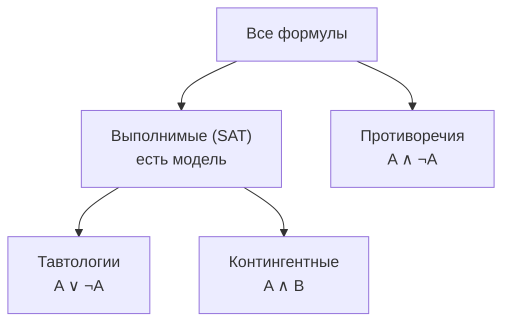
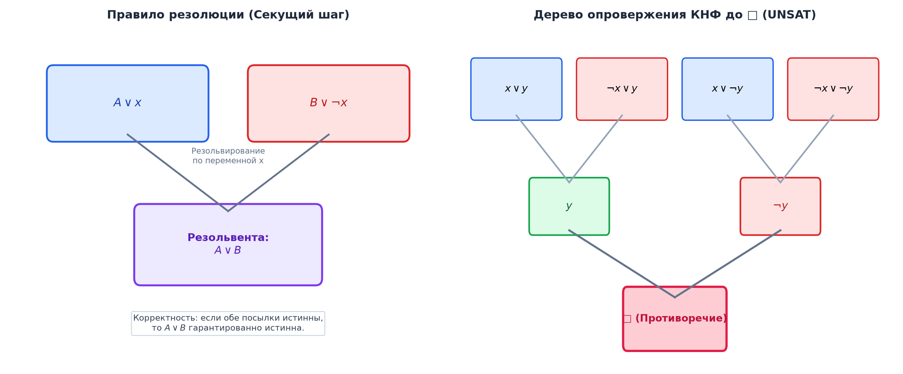

# 📝 Лекция 9: Семантика и следствие, нормальные формы, резолюция

> [!info] ⏳ Предварительный конспект (сверен со слайдами)
> Конспект сверен с презентацией `s1-lec09-propositional.typ` из репозитория Lipen/discrete-math-course (редакция от 13 октября 2026). Он будет дополнен после очной лекции.

> [!abstract] О занятии
> - **Дисциплина:** [[Дискретная математика]] (1 семестр, 2026/27 уч. год)
> - **Дата:** 4 ноября 2026 года (10-я неделя)
> - **Лектор:** Константин Чухарев ([@Lipen](https://github.com/Lipen), Университет ИТМО)
> - **Модуль 3:** Формальная логика и дедукция
> - **Источники:** слайды `s1-lec09-propositional.typ`; главы книги `m01` («Семантика: таблицы истинности», «Нормальные формы»), `m14` («Резолюция»).
> - **Ключевые темы:** таблицы истинности и интерпретации, вакуумная истинность, классы формул (тавтология, противоречие, контингентная, выполнимая), эквивалентность и принцип подстановки, законы логики, логическое следствие и теорема о дедукции, литералы, ДНФ/КНФ, СДНФ/СКНФ, правило резолюции, опровержимая полнота.

## 📌 Краткое резюме (TL;DR)

- Таблица истинности — перебор всех $2^n$ интерпретаций; значение формулы собирается из значений частей (композициональность).
- Классы формул: тавтология, противоречие, контингентная, выполнимая. $\varphi$ — тавтология $\iff$ $\neg\varphi$ — противоречие.
- $\alpha \equiv \beta$ — одинаковые столбцы значений; принцип подстановки делает переписывание законным.
- $\varphi_1,\dots,\varphi_n \models \psi$ $\iff$ $\varphi_1\wedge\dots\wedge\varphi_n\wedge\neg\psi$ невыполнима $\iff$ $(\varphi_1\wedge\dots\wedge\varphi_n)\to\psi$ — тавтология.
- ДНФ собирается из **истинных** строк, КНФ — из **ложных**; СДНФ и СКНФ единственны.
- Резолюция корректна и опровержимо полна: $\square$ выводится $\iff$ множество дизъюнктов невыполнимо.

---

## 1. Семантика и следствие

> [!quote] Эпиграф
> «Логика не учение, а отражение мира.» — Людвиг Витгенштейн

### 1.1. Связки: таблицы истинности

Связки и таблицы дают строгую семантику: что значит «формула истинна» и что значит «из чего следует что».

| $P$ | $Q$ | $\neg P$ | $P \wedge Q$ | $P \vee Q$ | $P \to Q$ | $P \leftrightarrow Q$ |
|:-:|:-:|:-:|:-:|:-:|:-:|:-:|
| И | И | Л | И | И | И | И |
| И | Л | Л | Л | И | Л | Л |
| Л | И | И | Л | И | И | Л |
| Л | Л | И | Л | Л | И | И |

**Приоритет связок:** $\neg$, затем $\wedge$, затем $\vee$, затем $\to$, затем $\leftrightarrow$.

### 1.2. Импликация: одна ложная строка

Импликация ложна ровно в одной строке: антецедент (посылка) истинен, консеквент (заключение) ложен. Обещание «если пойдёт дождь, возьму зонт» нарушено только дождём без зонта.

> [!note]
> Если посылка ложна, импликация истинна при любом заключении — **вакуумная истинность**. Зеркальное правило *verum ex quolibet sequitur*: импликация с истинным заключением истинна при любом антецеденте.

> [!warning] Отрицание не проносится внутрь
> Отрицание импликации — конъюнкция: $\neg(P\to Q) \equiv P \wedge \neg Q$. Перенос отрицания внутрь даёт $P \to \neg Q$ — другую формулу с другим столбцом значений.

### 1.3. Интерпретация

> [!info] Определение
> **Интерпретация** — функция $\nu: V \to \{\mathrm{И}, \mathrm{Л}\}$, сопоставляющая каждой переменной множества $V$ истинностное значение.

> [!example] Одна формула, разные интерпретации
> Для $\neg P \to Q$ при $\nu(P)=\mathrm{Л}$, $\nu(Q)=\mathrm{Л}$ посылка $\neg P$ истинна, заключение ложно — значение Л. При $\nu'(P)=\mathrm{И}$, $\nu'(Q)=\mathrm{Л}$ посылка ложна, работает вакуумная истинность — значение И.

Интерпретация — строка будущей таблицы истинности, а всего их $2^n$: проверка формулы — перебор всех.

### 1.4. Оценка формулы

Интерпретация $\nu$ распространяется на все формулы по связкам:

$$\nu(\neg\alpha)=\text{«не»}\ \nu(\alpha),\quad \nu(\alpha\wedge\beta)=\nu(\alpha)\ \text{«и»}\ \nu(\beta),\quad \nu(\alpha\vee\beta)=\nu(\alpha)\ \text{«или»}\ \nu(\beta),$$
$$\nu(\alpha\to\beta)=\text{«не»}\,(\nu(\alpha)\ \text{«и не»}\ \nu(\beta)).$$

Строка импликации: Л ровно при $\nu(\alpha)=\mathrm{И}$, $\nu(\beta)=\mathrm{Л}$ — нарушении обещания. Значение целого собирается из значений частей — **композициональность**: таблицу формулы можно собрать из таблиц связок.

### 1.5. Таблица истинности: полный расчёт

Формула $(P \vee Q)\wedge\neg P$:

| $P$ | $Q$ | $P \vee Q$ | $\neg P$ | $(P\vee Q)\wedge\neg P$ |
|:-:|:-:|:-:|:-:|:-:|
| Л | Л | Л | И | Л |
| Л | И | И | И | И |
| И | Л | И | Л | Л |
| И | И | И | Л | Л |

Столбцы — атомы, промежуточные подформулы и результат. Столбец значений — полный портрет формулы: каждая строка — одна интерпретация, пропущенных не бывает.

### 1.6. Цена перебора

| Переменных $n$ | Строк $2^n$ |
|:-:|:-:|
| $2$ | $4$ |
| $5$ | $32$ |
| $10$ | $1024$ |
| $20$ | $\approx 10^6$ |

Уже при двадцати переменных прямая таблица — миллион строк. Задача **SAT** — установить выполнимость быстрее перебора. Современные SAT-солверы (MiniSat, CaDiCaL) решают формулы с миллионами переменных: полный перебор им не нужен, а таблицу на $2^{10^6}$ строк не построит никакая вселенная.

### 1.7. Классы формул

> [!info] Определение
> - **Тавтология** — истинна при каждой интерпретации.
> - **Противоречие** — ложна при каждой интерпретации.
> - **Контингентная** — истинна при одних интерпретациях и ложна при других.
> - **Выполнимая** (*satisfiable*) — истинна хотя бы при одной интерпретации. Интерпретация, на которой формула истинна, — её **модель**.

> [!example]
> - $P\vee\neg P$ — тавтология: в двухстрочной таблице оба значения И.
> - $P\wedge\neg P$ — противоречие: моделей нет.
> - $P\to Q$ — контингентная: три модели, а строка И $\to$ Л — единственный контрпример к тавтологичности.

> [!note] Теорема (двойственность классов)
> - $\varphi$ — тавтология $\iff$ $\neg\varphi$ — противоречие.
> - $\varphi$ выполнима $\iff$ $\neg\varphi$ — не тавтология.

*Доказательство одним наблюдением.* Отрицание переворачивает каждое значение столбца на противоположное. Столбец из одних И переходит в столбец из одних Л — тавтология переходит в противоречие, и обратно. Если у $\varphi$ есть модель, на её строке у $\neg\varphi$ стоит Л, значит, $\neg\varphi$ не тавтология. Обратно: строка с Л у $\neg\varphi$ даёт модель $\varphi$. $\blacksquare$

### 1.8. Логическая эквивалентность и принцип подстановки

> [!info] Определение
> Формулы $\alpha$ и $\beta$ **логически эквивалентны**, $\alpha \equiv \beta$, если они принимают одинаковые значения на каждой интерпретации. Иначе: $\alpha\equiv\beta$ — это тавтологичность $\alpha\leftrightarrow\beta$.

> [!example]
> Сравним $P\vee(P\wedge Q)$ с $P$: при $P=\mathrm{И}$ обе истинны при любом $Q$, при $P=\mathrm{Л}$ обе ложны. Столбцы совпадают — поглощение подтверждено чтением строк таблицы, без выписывания её целиком.

> [!note] Теорема (принцип подстановки)
> Если $\alpha\equiv\beta$ и $\chi$ — формула, содержащая $\alpha$ как подформулу, то замена $\alpha$ на $\beta$ в $\chi$ даёт формулу, эквивалентную $\chi$.

*Доказательство.* Индукция по построению $\chi$. **База:** $\chi$ совпадает с $\alpha$ — замена даёт $\beta$, эквивалентность дана условием. **Шаг:** связка пересчитывает значение из значений частей, а части по индукционному предположению эквивалентны заменённым — значит, значение целого не меняется. $\blacksquare$

### 1.9. Законы логики

| Закон | Формулы |
|:--|:--|
| Идемпотентность | $P\vee P\equiv P$, $\quad P\wedge P\equiv P$ |
| Коммутативность | $P\vee Q\equiv Q\vee P$, $\quad P\wedge Q\equiv Q\wedge P$ |
| Ассоциативность | $(P\vee Q)\vee R\equiv P\vee(Q\vee R)$, $\quad (P\wedge Q)\wedge R\equiv P\wedge(Q\wedge R)$ |
| Дистрибутивность | $P\wedge(Q\vee R)\equiv(P\wedge Q)\vee(P\wedge R)$ |
| Дистрибутивность (двойств.) | $P\vee(Q\wedge R)\equiv(P\vee Q)\wedge(P\vee R)$ |
| Поглощение | $P\vee(P\wedge Q)\equiv P$, $\quad P\wedge(P\vee Q)\equiv P$ |
| Двойное отрицание | $\neg\neg P\equiv P$ |
| Тождество | $P\vee\bot\equiv P$, $\quad P\wedge\top\equiv P$ |
| Доминирование | $P\vee\top\equiv\top$, $\quad P\wedge\bot\equiv\bot$ |
| Дополнение | $P\vee\neg P\equiv\top$, $\quad P\wedge\neg P\equiv\bot$ |

**Законы де Моргана:** $\neg(P\wedge Q)\equiv\neg P\vee\neg Q$, $\ \neg(P\vee Q)\equiv\neg P\wedge\neg Q$. Де Морган раскрывает отрицание над любой подформулой: вложенные отрицания снимаются по шагам.

> [!example]
> $\neg(P\wedge(Q\vee R))\equiv\neg P\vee(\neg Q\wedge\neg R)$ — таблица на восемь строк не понадобилась, два шага подстановки.

**Импликация через дизъюнкцию.** $P\to Q\equiv\neg P\vee Q$: обе формулы ложны ровно в одной строке — там, где посылка истинна, а заключение ложно. Форма через конъюнкцию: $P\to Q\equiv\neg(P\wedge\neg Q)$ — обещание нарушено, значит, было $P$ и всё же $\neg Q$. Импликация выражается через $\neg$ и $\vee$: связки выразимы друг через друга.

**Две половины $\leftrightarrow$.** $P\leftrightarrow Q\equiv(P\to Q)\wedge(Q\to P)$. Эквивалентность ложна ровно на двух диагональных строках (И, Л) и (Л, И): на каждой ломается ровно одна из двух импликаций. Фраза «доказано в обе стороны» — это ровно конъюнкция прямой и обратной импликаций.

**Контрапозиция.** $P\to Q\equiv\neg Q\to\neg P$. «Если идёт дождь, то взят зонт» равносильно «если зонта нет, дождя не было». Иногда из $\neg Q$ вывести $\neg P$ проще, чем из $P$ вывести $Q$.

**Цепочка замен.**
$$P\to Q\equiv\neg P\vee Q\equiv Q\vee\neg P\equiv\neg Q\to\neg P.$$
Первый и последний шаги — импликация через дизъюнкцию, средний — коммутативность. Цепочка эквивалентностей законна без новой таблицы: каждый шаг — локальная замена.

> [!example] Упрощение: тавтология или нет?
> $$\begin{aligned}(P\wedge Q)\vee(P\wedge\neg Q)&\equiv P\wedge(Q\vee\neg Q) &&\text{дистрибутивность}\\&\equiv P\wedge\top &&\text{дополнение}\\&\equiv P &&\text{тождество}\end{aligned}$$
> Формула эквивалентна $P$: выполнима, но не тавтология. Цепочка законов заменяет перебор: упрощённый вид показывает класс формулы без единой строки таблицы.

### 1.10. Логическое следствие

> [!info] Определение
> Формула $\psi$ — **логическое следствие** формул $\varphi_1,\dots,\varphi_n$, $\varphi_1,\dots,\varphi_n\models\psi$, если каждая интерпретация, на которой истинны все $\varphi_i$, истинна и на $\psi$.

> [!example]
> - $P\to Q,\ P\models Q$ — *modus ponens*: при истинных посылке и импликации заключение обязано быть истинным.
> - $P\wedge Q\models P$ — верно, а $P\models P\wedge Q$ — нет: интерпретация (И, Л) даёт контрпример.

Опровергнуть следствие — предъявить одну интерпретацию, подтвердить — перебрать все $2^n$.

> [!note] Теорема (следствие через невыполнимость)
> $\varphi_1,\dots,\varphi_n\models\psi$ $\iff$ формула $\varphi_1\wedge\dots\wedge\varphi_n\wedge\neg\psi$ невыполнима.

*Доказательство.* Контрпример к следствию — интерпретация, на которой все $\varphi_i$ истинны, а $\psi$ ложна. Ровно на таких интерпретациях конъюнкция $\varphi_1\wedge\dots\wedge\varphi_n\wedge\neg\psi$ истинна. Контрпримеров нет — значит, конъюнкция невыполнима, и обратно. $\blacksquare$ Проверить следствие — поискать контрпример: так работают SAT-решатели.

> [!note] Теорема (семантическая теорема о дедукции)
> $\varphi_1,\dots,\varphi_n\models\psi$ $\iff$ $(\varphi_1\wedge\dots\wedge\varphi_n)\to\psi$ — тавтология.

*Доказательство.* По определению следствия нет интерпретации, где посылки истинны, а $\psi$ ложна. Импликация ложна ровно на таких интерпретациях. Значит, «нет контрпримера» — одно и то же для следствия и для импликации. $\blacksquare$ Более общая форма: $\Gamma,\varphi\models\psi\iff\Gamma\models\varphi\to\psi$.

---

## 2. Нормальные формы

> [!quote] Эпиграф
> «Снег бел» истинно тогда и только тогда, когда снег бел. — Альфред Тарский

### 2.1. Литералы и канонический вид

> [!info] Определение
> **Литерал** — атомарная переменная или её отрицание: $P$, $\neg P$.

Зачем нужен канонический вид:

- две формулы сравниваются механически: привёл к форме — сравнил;
- выполнимость и невыполнимость — вход алгоритмов;
- схемы собираются по нормальным формам, SAT работает с КНФ.

Канонический вид превращает сравнение формул в сравнение текстов.

### 2.2. ДНФ и КНФ

> [!info] ДНФ
> Формула в **дизъюнктивной нормальной форме** — дизъюнкция конъюнкций литералов:
> $$(l_{1,1}\wedge\dots\wedge l_{1,k_1})\vee\dots\vee(l_{n,1}\wedge\dots\wedge l_{n,k_n}).$$

> [!example]
> $(P\wedge\neg Q)\vee(\neg P\wedge R)$ — ДНФ. $\neg(P\vee Q)$ — не ДНФ: отрицание стоит над скобкой. Одинокая конъюнкция или одинокий литерал — тоже ДНФ. ДНФ истинна, когда истинен хотя бы один набор литералов.

> [!info] КНФ
> Формула в **конъюнктивной нормальной форме** — конъюнкция дизъюнкций литералов:
> $$(l_{1,1}\vee\dots\vee l_{1,k_1})\wedge\dots\wedge(l_{n,1}\vee\dots\vee l_{n,k_n}).$$

> [!example]
> $(\neg P\vee Q)\wedge(P\vee R)$ — КНФ: конъюнкция двух **дизъюнктов** (*clause*). $(P\wedge Q)\vee R$ — не КНФ: в дизъюнкцию попала конъюнкция.

Двойственность: ДНФ перечисляет, когда формула истинна, КНФ — когда ей запрещено быть ложной. Вся современная верификация железа говорит на КНФ: комбинационная схема процессора переводится в конъюнкцию дизъюнктов, и SAT-солвер проверяет свойства миллиардов вентилей.

### 2.3. Построение по таблице истинности

> [!note] Теорема (существование нормальных форм)
> Каждая пропозициональная формула имеет эквивалентные ДНФ и КНФ.

*Доказательство.* Строим обе формы по таблице истинности.

- **ДНФ.** Для каждой истинной строки выписываем конъюнкцию литералов: без отрицания, если переменная в строке истинна, с отрицанием — если ложна. Конъюнкции соединяем дизъюнкцией.
- **КНФ.** Двойственно: для каждой ложной строки выписываем дизъюнкцию литералов (с инверсией значений строки) и соединяем дизъюнкты конъюнкцией.

ДНФ истинна ровно в отмеченных строках, КНФ ложна ровно в своих — обе эквивалентны исходной формуле. $\blacksquare$

> [!example] ДНФ и КНФ для $P\to Q$
> | $P$ | $Q$ | $P\to Q$ | ДНФ-терм | КНФ-терм |
> |:-:|:-:|:-:|:-:|:-:|
> | Л | Л | И | $\neg P\wedge\neg Q$ | — |
> | Л | И | И | $\neg P\wedge Q$ | — |
> | И | Л | Л | — | $\neg P\vee Q$ |
> | И | И | И | $P\wedge Q$ | — |
>
> ДНФ: $(\neg P\wedge\neg Q)\vee(\neg P\wedge Q)\vee(P\wedge Q)$, после упрощения — $\neg P\vee Q$. КНФ: формула ложна в одной строке — дизъюнкт один, $\neg P\vee Q$. Импликация уже была КНФ из одного дизъюнкта — таблица это показала.

### 2.4. Совершенные формы

> [!info] СДНФ
> ДНФ — **совершенная** (СДНФ), если каждая конъюнкция содержит все переменные формулы — ровно по одному разу, в любом порядке.

Каждая конъюнкция СДНФ кодирует ровно одну истинную строку таблицы. Для $P\to Q$: $\text{СДНФ}=(\neg P\wedge\neg Q)\vee(\neg P\wedge Q)\vee(P\wedge Q)$ — три конъюнкции, три истинные строки. По СДНФ таблица восстанавливается обратно: конъюнкция $\neg P\wedge\neg Q$ — это строка (Л, Л).

> [!info] СКНФ
> КНФ — **совершенная** (СКНФ), если каждый дизъюнкт содержит все переменные формулы — ровно по одному разу.

Каждый дизъюнкт СКНФ запрещает ровно одну ложную строку. Для $P\to Q$: $\text{СКНФ}=\neg P\vee Q$ — ложная строка одна, дизъюнкт один. У тавтологии СКНФ пуста (ложных строк нет), у противоречия пуста СДНФ.

> [!note] Теорема (каноничность СДНФ)
> Формулы $\alpha$ и $\beta$ эквивалентны $\iff$ их СДНФ совпадают с точностью до порядка конъюнкций.

*Доказательство.* СДНФ перечисляет истинные строки — одну конъюнкцию на строку. Эквивалентные формулы истинны на одних и тех же строках — конъюнкции одни и те же. Обратно: одинаковые СДНФ задают одну функцию истинности. $\blacksquare$

> [!note] Теорема (единственность СДНФ)
> Формула, отличная от противоречия, имеет ровно одну СДНФ с точностью до порядка конъюнкций.

*Доказательство.* Набор истинных строк у формулы фиксирован, а построение по таблице ставит конъюнкцию в соответствие каждой строке — без единой развилки. Другая СДНФ имела бы другой набор конъюнкций и, по каноничности, другой столбец значений — противоречие с исходной формулой. $\blacksquare$

ДНФ без пометки «совершенная» неединственна: законы сокращают и перестраивают термы, оставляя тот же столбец значений. СДНФ — канонический портрет формулы: сравнил портреты — узнал эквивалентность без перебора формул.

### 2.5. Нормальные формы и выполнимость

Форма определяет цену вопроса:

| Форма | Вопрос | Цена |
|:--|:--|:--|
| ДНФ | выполнима? | есть конъюнкция без пары $L,\neg L$ — один проход по термам |
| ДНФ | тавтологична? | нужны все $2^n$ наборов, дёшево не бывает |
| КНФ | тавтологична? | каждый дизъюнкт содержит пару $L,\neg L$ |
| КНФ | выполнима? | это и есть задача SAT, лёгкого ответа нет |

> [!example] Чтение формы
> ДНФ $(P\wedge\neg P)\vee(Q\wedge R)$: первый терм мёртв всегда, второй живёт при $Q=R=\mathrm{И}$ — формула выполнима.

Построение ДНФ по таблице стоит $2^n$ строк — экспонента переносится на этап построения, и SAT-солверы ищут выполняющий набор в КНФ без полного перебора.

### 2.6. Алгоритм приведения и преобразование Цейтина (дополнение)

> [!tip] Вне слайдов, но нужно для практики
> Эквивалентные преобразования: (1) убрать $\to$, $\leftrightarrow$: $A\to B\equiv\neg A\vee B$, $A\leftrightarrow B\equiv(\neg A\vee B)\wedge(\neg B\vee A)$; (2) внести отрицания до литералов (де Морган, $\neg\neg A\equiv A$) — получается NNF; (3) дистрибутивность: для КНФ $A\vee(B\wedge C)\equiv(A\vee B)\wedge(A\vee C)$, для ДНФ $A\wedge(B\vee C)\equiv(A\wedge B)\vee(A\wedge C)$.

> [!warning] Взрыв дистрибутивности
> Формула $(x_1\wedge y_1)\vee\dots\vee(x_n\wedge y_n)$ при приведении к КНФ даёт $2^n$ дизъюнктов. **Преобразование Цейтина** вводит вспомогательную переменную для каждого узла дерева разбора и строит КНФ линейного размера, *равновыполнимую* исходной.

---

## 3. Резолюция

### 3.1. Правило резолюции

Резолюция — попытка отвечать на вопросы о следствии одним правилом вывода. Черта над переменной — отрицание: $\overline{x}=\neg x$.

> [!info] Правило резолюции
> Из дизъюнктов $C_1\vee x$ и $C_2\vee\overline{x}$ выводится **резольвента** $C_1\vee C_2$: контрарная пара $x,\overline{x}$ вычёркивается.
> $$C_1\vee x,\quad C_2\vee\overline{x}\ \vdash\ C_1\vee C_2.$$

> [!example]
> Из $(x\vee y)$ и $(\overline{x}\vee z)$ резолюция по $x$ даёт $(y\vee z)$. Резольвента единичных дизъюнктов $(x)$ и $(\overline{x})$ — **пустой дизъюнкт** $\square$: он ложен при любом наборе, и его вывод означает невыполнимость множества.

### 3.2. Почему резольвента законна?

> [!note] Теорема (корректность шага резолюции)
> Резольвента — логическое следствие своих посылок: всякий набор, выполняющий $C_1\vee x$ и $C_2\vee\overline{x}$, выполняет и $C_1\vee C_2$.

*Доказательство разбором случаев по значению $x$.* Пусть набор выполняет оба дизъюнкта. При $x=1$ литерал $\overline{x}$ ложен, и дизъюнкт $C_2\vee\overline{x}$ истинен только за счёт $C_2$. При $x=0$ симметрично истинен $C_1$. В обоих случаях истинен хотя бы один литерал дизъюнкта $C_1\vee C_2$. $\blacksquare$

### 3.3. Хватает ли одного правила?

Корректность говорит: пустой дизъюнкт выводим только из невыполнимого множества. Обратный вопрос: у всякого ли невыполнимого множества есть резолюционное опровержение?

> [!note] Теорема (опровержимая полнота)
> Множество дизъюнктов невыполнимо $\iff$ из него резолюцией выводится $\square$.

Проверка невыполнимости превращается в поиск опровержения: нашли $\square$ — множество невыполнимо, не нашли — оно выполнимо.

*Идея доказательства полноты (набросок, индукция по числу переменных $n$).*

- **База.** При $n=0$ всякий дизъюнкт пуст, и невыполнимое множество уже содержит $\square$.
- **Шаг.** Зафиксируем переменную $x$: из дизъюнктов с $x$ и с $\overline{x}$ вычеркнем литерал, а дизъюнкты без $x$ и $\overline{x}$ отдадим обеим половинам. Каждая половина невыполнима: её модель с подходящим значением $x$ выполняла бы и исходное множество. По предположению индукции из каждой половины выводится $\square$, и каждый вывод поднимается над исходными дизъюнктами с добавкой не более одного литерала $x$ или $\overline{x}$. Финал — либо $\square$, либо единичные $(x)$ и $(\overline{x})$, и последняя резолюция сводит их к $\square$.

### 3.4. Цена резольвент

> [!note] Теорема (сохранение выполнимости)
> Множество дизъюнктов с добавленными резольвентами выполнимо $\iff$ выполнимо исходное.

*Доказательство.* По корректности шага резольвента — следствие своих посылок, поэтому модель исходного множества выполняет и её: расширение ничего не ломает. Обратно: исходное множество — часть расширенного, поэтому модель расширения выполняет и его. $\blacksquare$

> [!warning]
> Стратегия «резолвируй всё подряд» полна, но наивна: резольвент экспоненциально много, и полнота не обещает коротких выводов. Современные CDCL-солверы — те же резолюции плюс эвристики выбора переменной и запоминание конфликтов: на практике миллионы переменных, хотя экспонента худшего случая никуда не делась.

### 3.5. Доказательство опровержением

> [!example] Силлогизм через резолюцию
> Из $p\to q$ и $q\to r$ выведем $p\to r$.
>
> Посылки и отрицание заключения в КНФ: $(\overline{p}\vee q)$, $(\overline{q}\vee r)$, $(p)$, $(\overline{r})$.
>
> 1. $(p)$ и $(\overline{p}\vee q)$ дают $(q)$.
> 2. $(q)$ и $(\overline{q}\vee r)$ дают $(r)$.
> 3. $(r)$ и $(\overline{r})$ дают $\square$.
>
> Пустой дизъюнкт выведен — посылки влекут заключение.

Приём «посылки плюс отрицание заключения» — стандарт: $A_1,\dots,A_n\models B$ равносильно невыполнимости $A_1\wedge\dots\wedge A_n\wedge\overline{B}$. Поэтому SAT-решатели доказывают теоремы: невыполнимость — их родной язык.

### 3.6. Хорновские дизъюнкты (дополнение)

> [!tip] Вне слайдов
> **Хорновский дизъюнкт** содержит не более одного положительного литерала: $\neg p_1\vee\dots\vee\neg p_k\vee q\equiv(p_1\wedge\dots\wedge p_k)\to q$. Виды: правило (один положительный и хотя бы один отрицательный), факт (один положительный), запрос (все отрицательные). Horn-SAT решается распространением единичных дизъюнктов за линейное время и лежит в основе Prolog.

---

## 4. Что мы поняли?

Семантика высказываний: оценка формулы по интерпретации, класс формулы по столбцу значений. Следствие получило два рабочих перевода — через невыполнимость и через тавтологию импликации. На выходе — канонические формы и одно правило вывода вместо перебора.

- Таблица истинности — перебор всех $2^n$ интерпретаций.
- Эквивалентность — одинаковые столбцы значений; законы и принцип подстановки делают переписывание законным без перепроверки.
- Резолюция корректна и опровержимо полна: пустой дизъюнкт выводим $\iff$ множество дизъюнктов невыполнимо.
- ДНФ собирается из истинных строк, КНФ — из ложных; СДНФ и СКНФ единственны — канонические портреты формулы.

## ❓ Вопросы для самопроверки к коллоквиуму / экзамену

- [ ] Сколько строк у таблицы формулы с семью переменными? Сколько моделей максимум у невыполнимой формулы?
  > [!note] Решение
  > $2^7=128$ строк. У невыполнимой формулы моделей нет — $0$.
- [ ] Постройте СДНФ и СКНФ для $P\to\neg Q$.
  > [!note] Решение
  > Формула ложна только при $P=Q=\mathrm{И}$. СКНФ $=\neg P\vee\neg Q$. Истинные строки (Л,Л), (Л,И), (И,Л): СДНФ $=(\neg P\wedge\neg Q)\vee(\neg P\wedge Q)\vee(P\wedge\neg Q)$.
- [ ] Почему СДНФ единственна, а ДНФ — нет? Приведите две разные ДНФ одной формулы.
  > [!note] Решение
  > Например, $P$ и $(P\wedge Q)\vee(P\wedge\neg Q)$ — две ДНФ одной формулы; вторая — СДНФ для переменных $P,Q$.
- [ ] Докажите закон поглощения $P\vee(P\wedge Q)\equiv P$ таблицей.
- [ ] Запишите отрицание «дождь или ветер» двумя способами — по де Моргану и по таблице.
  > [!note] Решение
  > По де Моргану: $\neg R\wedge\neg W$. По таблице: $\neg(R\vee W)$ истинно только на строке (Л, Л), что и задаёт $\neg R\wedge\neg W$.
- [ ] Проверьте следствие: $P\vee Q,\ \neg P\models Q$. Какие строки таблицы вы проверяли?
  > [!note] Решение
  > Обе посылки истинны только на строке $P=\mathrm{Л}$, $Q=\mathrm{И}$; на ней $Q$ истинно. Следует.
- [ ] Как по СДНФ двух формул узнать, эквивалентны ли они?
- [ ] Проверьте, следует ли $Q$ из $P\to Q$ и $\neg P$. Если нет — предъявите контрпример.
  > [!note] Решение
  > Не следует: при $P=\mathrm{Л}$, $Q=\mathrm{Л}$ обе посылки истинны, а $Q$ ложно.
- [ ] Почему резольвента — логическое следствие посылок $C_1\vee x$ и $C_2\vee\overline{x}$?
- [ ] Выведите резолюцией пустой дизъюнкт из $(x\vee y)$, $(\overline{x}\vee y)$ и $(\overline{y})$.
  > [!note] Решение
  > Резолюция первых двух по $x$ даёт $(y)$; $(y)$ и $(\overline{y})$ дают $\square$.
- [ ] Докажите транзитивность следования: если $A\models B$ и $B\models C$, то $A\models C$.
- [ ] С помощью резолюции докажите невыполнимость $S=\{p\vee q,\ \neg p\vee q,\ p\vee\neg q,\ \neg p\vee\neg q\}$.
  > [!note] Решение
  > $(p\vee q)$ и $(\neg p\vee q)$ дают $(q)$; $(p\vee\neg q)$ и $(\neg p\vee\neg q)$ дают $(\neg q)$; $(q)$ и $(\neg q)$ дают $\square$.

## 📚 Что почитать (книга курса)

- `m01` — «Семантика: таблицы истинности» (тавтологии, логическое следствие), «Нормальные формы».
- `m14` — «Резолюция».

## 🔗 Связанные материалы

- [[Дискретная математика]] — главная страница дисциплины
- [[08. Лекция - Трансфинитные числа, ординалы, вполне упорядоченные множества и трансфинитная индукция (2026-10-28)]]
- [[10. Лекция - Натуральная дедукция, правила вывода, нотация Фитча, корректность и полнота (2026-11-11)]]
- [[01. Лекция - Высказывания, связки, таблицы истинности, законы логики и следствие (2026-09-09)]]
- [[Теорминимум 2 - Булева алгебра, логика высказываний, предикаты и коды (2026-12-23)]]
