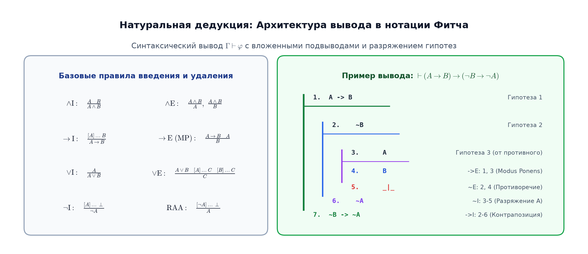

# 📝 Лекция 10: Натуральная дедукция, нотация Фитча, корректность и полнота

> [!info] ⏳ Предварительный конспект (сверен со слайдами)
> Конспект сверен с презентацией `s1-lec10-deduction.typ` из репозитория Lipen/discrete-math-course (редакция от 13 октября 2026). Он будет дополнен после очной лекции.

> [!abstract] О занятии
> - **Дисциплина:** [[Дискретная математика]] (1 семестр, 2026/27 уч. год)
> - **Дата:** 11 ноября 2026 года (11-я неделя)
> - **Лектор:** Константин Чухарев ([@Lipen](https://github.com/Lipen), Университет ИТМО)
> - **Модуль 3:** Формальная логика и дедукция
> - **Источники:** слайды `s1-lec10-deduction.typ`; глава книги `m02` («Дедукция и системы вывода», «Натуральная дедукция», «Нотация Фитча»).
> - **Ключевые темы:** $\models$ против $\vdash$, система вывода, деревья вывода, системы Гильберта (схемы K и S), теорема о дедукции, натуральная дедукция Гентцена–Яськовского, нотация Фитча, взрыв, косвенное доказательство (IP), нормализация, стратегия поиска вывода, корректность и полнота.

## 📌 Краткое резюме (TL;DR)

- $\Gamma\models\varphi$ — истинность на всех интерпретациях (семантика); $\Gamma\vdash\varphi$ — вывод по правилам (синтаксис). Корректность и полнота утверждают, что отношения совпадают.
- **Гильберт:** логика в аксиомах (схемы K, S), правило одно — MP. Вывод $A\to A$ занимает пять строк.
- **Теорема о дедукции:** $\Gamma,A\vdash B\iff\Gamma\vdash A\to B$ (Эрбран, 1930).
- **Натуральная дедукция** (Гентцен, Яськовский, 1934): аксиом нет, у каждой связки пара правил (введение/устранение), гипотезы снимаются.
- Классику даёт **IP** (косвенное доказательство): IP, снятие двойного отрицания и исключённое третье эквивалентны по силе.
- Проверка вывода механична и линейна; поиск вывода экспоненциален.

---

## 1. Правила вывода

> [!quote] Эпиграф
> «Когда возникнет спор, двум философам не понадобится дискуссия: достаточно взять перья и сказать — вычислим!» — Готфрид Лейбниц

### 1.1. Два взгляда на выводимость

Таблицы истинности отвечают на вопрос «истинно ли $\varphi$», но не показывают, *почему*.

> [!info] Семантическое следование
> $\Gamma\models\varphi$: на каждой интерпретации, где истинны все формулы $\Gamma$, истинна и $\varphi$. Проверка — перебор всех $2^n$ интерпретаций $n$ атомов.

> [!info] Синтаксическая выводимость
> $\Gamma\vdash\varphi$: $\varphi$ выводится из $\Gamma$ применением правил вывода. Интерпретаций нет — только преобразования строк формул.

> [!important]
> $\models$ живёт в семантике, $\vdash$ — в синтаксисе; вопрос об их совпадении закрывают теоремы корректности и полноты.

Табличный метод страдает изъянами: экспоненциальный перебор ($2^n$ строк), бессилие перед бесконечными областями (логика предикатов, анализ) и отсутствие объяснения причинной структуры рассуждения.

### 1.2. Система вывода

Чтобы шаг рассуждения могла проверять машина, он обязан иметь заданную форму: разрешённый переход — и только он.

> [!info] Определение
> **Правило вывода** — разрешённый переход от посылок заданной формы к заключению заданной формы. **Аксиома** — формула, принимаемая без доказательства. **Гипотеза** — допущение внутри одного вывода.

Аксиома входит в любой вывод системы без ссылок на предыдущие строки, гипотеза — только в тот вывод, где она объявлена. Проверка шага — сверка формы посылок и заключения: интерпретации не нужны, машина справляется.

> [!example] Минимальная система
> Аксиома $A\to(B\to A)$ и одно правило — modus ponens (из $A\to B$ и $A$ выводится $B$).
> 1. $A\to(B\to A)$ — аксиома.
> 2. $A$ — гипотеза.
> 3. $B\to A$ — MP по строкам 1 и 2.
>
> Каждое оправдание проверяется сверкой формы — без понимания смысла формул. Гипотеза $A$ работала только в этом выводе; аксиома доступна в любом выводе — в этом разница ролей.

### 1.3. Дерево вывода

Применение правила рисуется чертой: посылки над чертой, заключение под ней, имя правила справа:

$$\frac{A\to B\qquad A}{B}\ \ {\to}\text{E}$$

Композиция применений — дерево: листья — гипотезы, внутренние узлы — применения правил, корень — заключение. Подвывод, оканчивающийся на формулу, становится посылкой следующего применения.

**Цепочка modus ponens.** Три листа — гипотезы $A\to B$, $A$, $B\to C$. Верхнее MP берёт $A\to B$ и $A$ и даёт $B$, нижнее берёт $B$ и $B\to C$ и даёт $C$.

$$\dfrac{\dfrac{A\to B\qquad A}{B}\qquad B\to C}{C}$$

### 1.4. Системы Гильберта

Один полюс шкалы: логика спрятана в аксиомах, правило вывода одно — modus ponens. Аксиомы задаются **схемами**: шаблон, в который вместо букв подставляются любые формулы. Схема $A\to(B\to A)$ порождает аксиомы $P\to(Q\to P)$, $(P\to Q)\to(R\to(P\to Q))$ и бесконечно много других. Вывод — цепочка формул, в которой каждая строка либо экземпляр схемы, либо MP по двум предыдущим.

> [!info] Схемы аксиом для импликации
> $$K:\ A\to(B\to A)\qquad S:\ (A\to(B\to C))\to((A\to B)\to(A\to C))$$

- $K$: истинная формула следует из чего угодно — к выведенному $A$ можно приписать любые посылки.
- $S$ разрешает использовать гипотезу дважды: один раз ради $B$, второй — ради $C$. Именно эта работа понадобится в теореме о дедукции.

Вместе с MP схемы $K$ и $S$ порождают всю импликативную логику высказываний; для полной логики добавляют схемы для отрицания.

> [!example] Вывод $A\to A$ в пять строк
> 1. $A\to((A\to A)\to A)$ — схема $K$, $B:=A\to A$.
> 2. $(A\to((A\to A)\to A))\to((A\to(A\to A))\to(A\to A))$ — схема $S$.
> 3. $(A\to(A\to A))\to(A\to A)$ — MP по 1 и 2.
> 4. $A\to(A\to A)$ — схема $K$, $B:=A$.
> 5. $A\to A$ — MP по 4 и 3.
>
> Подстановки механические: буквы заменяются формулами, проверка каждой строки — сравнение с шаблоном.

> [!important] Легко проверять, трудно строить
> Дерево вывода Гильберта не ветвится. Строить вывод трудно: шаг — подстановка в абстрактную схему, далёкая от содержательного хода рассуждения. Пять строк ради тривиальной тавтологии — цена абстрактных схем.

> [!note] Зачем терпеть
> Неудобство — плата за бедность устройства: любой факт о системе разбирает всего два случая (аксиома или MP), поэтому метатеоремы о ней доказываются легко. Ядро Coq и Lean — маленький набор правил, как у Гильберта, только с зависимыми типами: маленькое ядро доверено машине, а удобные правила надстроены над ним как производные.

### 1.5. Теорема о дедукции

Мост от Гильберта к естественному рассуждению — метатеорема о переводе «предположим и выведем» в импликацию.

> [!note] Теорема о дедукции (Эрбран, 1930)
> $\Gamma,A\vdash B\iff\Gamma\vdash A\to B$.

Теорема оправдывает приём «чтобы доказать $A\to B$, предположим $A$»: натуральная дедукция делает этот приём полноправным правилом.

*Доказательство в обе стороны.*

- ($\Leftarrow$) Из $\Gamma\vdash A\to B$ применяем MP к $A\to B$ и гипотезе $A$ и получаем $B$.
- ($\Rightarrow$) Переводим вывод $B$ из $\Gamma,A$ в вывод $A\to B$ из $\Gamma$ индукцией по длине вывода.
  - Аксиому или гипотезу из $\Gamma$ схема $K$ превращает в $B\to(A\to B)$, и MP даёт $A\to B$.
  - Если $B$ — сама гипотеза $A$, работает вывод $A\to A$ из примера выше.
  - Если $B$ получена MP из $C$ и $C\to B$, то по индукции уже выведены $A\to C$ и $A\to(C\to B)$, и схема $S$ склеивает их в $A\to B$. $\blacksquare$

Перевод удлиняет вывод, но построен ровно двумя схемами: $K$ обслуживает аксиомы и гипотезы, $S$ — шаги MP.

---

## 2. Натуральная дедукция

Гентцен и Яськовский, 1934: правила повторяют то, *как рассуждают математики*. Аксиом нет вовсе: вывод начинается с гипотез. У каждой связки пара правил: **введение** строит формулу, **устранение** разбирает. Гипотезу можно снять: рассуждение, опиравшееся на неё, заканчивается заключением без неё. Снятая гипотеза помечается номером $[A]^1$, и правило ввода ссылается на этот номер. Всего десять правил: по паре на каждую из четырёх связок, плюс взрыв и косвенное доказательство.

**Снятие гипотезы (дерево).** Лист $[A\wedge B]^1$ — гипотеза под номером: она действует, пока не снята. $\wedge$E извлекает левую половину $A$, шаг ${\to}$I,1 закрывает подвывод и даёт $A\wedge B\to A$; заключение не зависит ни от одной гипотезы — перед нами теорема.

$$\dfrac{\dfrac{[A\wedge B]^1}{A}\ \wedge\text{E}}{A\wedge B\to A}\ {\to}\text{I},1$$

### 2.1. Импликация

| Введение | Устранение |
|:-:|:-:|
| $\dfrac{[A]\ \vdots\ B}{A\to B}$ | $\dfrac{A\to B\qquad A}{B}$ |

${\to}$I: допустив $A$ и выведя $B$, заключаем $A\to B$ — гипотеза снимается. ${\to}$E — modus ponens.

> [!example] $P\to Q,\ P\vdash Q$
> | № | Формула | Правило |
> |:-:|:--|:--|
> | 1 | $P\to Q$ | посылка |
> | 2 | $P$ | посылка |
> | 3 | $Q$ | ${\to}$E 1, 2 |

Дерево для $A\to(B\to A)$: шаг ${\to}$I,2 снимает $[B]^2$, шаг ${\to}$I,1 даёт теорему.

$$\dfrac{\dfrac{\dfrac{[A]^1}{A}}{B\to A}\ {\to}\text{I},2}{A\to(B\to A)}\ {\to}\text{I},1$$

> [!important] Снятие гипотезы
> В Гильберте снятия гипотез нет: ту же работу делает подстановка в схему.

### 2.2. Конъюнкция

| Введение | Устранение |
|:-:|:-:|
| $\dfrac{A\qquad B}{A\wedge B}$ | $\dfrac{A\wedge B}{A}\qquad\dfrac{A\wedge B}{B}$ |

$\wedge$I собирает две формулы, $\wedge$E извлекает любую половину. Устранение ничего нового не приносит: его ценность в том, что половины становятся доступны дальнейшим правилам.

**Коммутативность** $A\wedge B\to B\wedge A$: один лист $A\wedge B$ и два применения $\wedge$E (левая ветвь берёт $B$, правая — $A$), шаг $\wedge$I собирает половины в обратном порядке. Обе ветви ссылаются на одну гипотезу — лист дерева не обязан быть единственным. Дерево и колонка Фитча — две записи одного вывода: дерево нагляднее, колонка экономнее.

### 2.3. Дизъюнкция

Ввод тривиален: к истинной формуле можно приписать любой второй член. Устранение — разбор случаев: дизъюнкция обещает «истинно одно из двух», и доказательство обязано покрыть оба случая.

| Введение | Устранение |
|:-:|:-:|
| $\dfrac{A}{A\vee B}\qquad\dfrac{B}{A\vee B}$ | $\dfrac{A\vee B\qquad[A]\vdash C\qquad[B]\vdash C}{C}$ |

$\vee$E опирается на три посылки: дизъюнкцию и два поддоказательства — по одному на каждый случай. Обе ветви обязаны привести к одному заключению, и правило снимает обе гипотезы.

> [!example] Дизъюнктивный силлогизм: $P\vee Q,\ \neg P\vdash Q$
> | № | Формула | Правило |
> |:-:|:--|:--|
> | 1 | $P\vee Q$ | посылка |
> | 2 | $\neg P$ | посылка |
> | 3 | $\quad P$ | гипотеза (случай 1) |
> | 4 | $\quad\bot$ | $\neg$E 2, 3 |
> | 5 | $\quad Q$ | X 4 (взрыв) |
> | 6 | $\quad Q$ | гипотеза (случай 2) |
> | 7 | $\quad Q$ | R 6 (реитерация) |
> | 8 | $Q$ | $\vee$E 1, 3–5, 6–7 |
>
> Ветвь $P$ противоречит посылке $\neg P$: из $\bot$ взрыв выводит $Q$. Ветвь $Q$ заканчивается повторением, и разбор случаев собирает результат.

### 2.4. Отрицание и противоречие

Противоречие $\bot$ — формула, ложная всегда: в системе она служит маркером невозможности.

| Введение | Устранение |
|:-:|:-:|
| $\dfrac{[A]\vdash\bot}{\neg A}$ | $\dfrac{A\qquad\neg A}{\bot}$ |

$\neg$E: формула и её отрицание дают противоречие. $\neg$I: если из $A$ выведено $\bot$, принимаем $\neg A$, гипотеза снимается. В паре есть асимметрия: $\neg$I лишь *вводит* отрицание, а до положительной формулы его снимает классическое правило косвенного доказательства.

> [!example] Закон непротиворечия $\vdash\neg(A\wedge\neg A)$
> | № | Формула | Правило |
> |:-:|:--|:--|
> | 1 | $\quad A\wedge\neg A$ | гипотеза |
> | 2 | $\quad A$ | $\wedge$E 1 |
> | 3 | $\quad\neg A$ | $\wedge$E 1 |
> | 4 | $\quad\bot$ | $\neg$E 2, 3 |
> | 5 | $\neg(A\wedge\neg A)$ | $\neg$I 1–4 |
>
> Гипотез в заключении не осталось — это теорема.

### 2.5. Взрыв

Из противоречия следует всё — *ex falso quodlibet*:

$$\dfrac{\bot}{A}\quad\text{(X)}$$

Правило закрывает невозможные ветви рассуждения: если допущение привело к $\bot$, ветвь описывает невозможный случай, и из неё выводится нужное заключение.

> [!note] Граница классики
> Взрыв интуиционистски корректен: посылка $\bot$ никогда не истинна. Классической логику делает правило косвенного доказательства.

### 2.6. Косвенное доказательство (IP)

Классика добавляет правило, выводящее положительную формулу из провала её отрицания:

$$\dfrac{[\neg A]\vdash\bot}{A}\quad\text{(IP)}$$

Правило не говорит, *почему* $A$ истинно: оно исключает последнюю возможность «$A$ ложно». IP, двойное отрицание и исключённое третье эквивалентны по силе; без IP исключённое третье не выводимо.

> [!example] Снятие двойного отрицания: $\neg\neg A\vdash A$
> | № | Формула | Правило |
> |:-:|:--|:--|
> | 1 | $\neg\neg A$ | посылка |
> | 2 | $\quad\neg A$ | гипотеза |
> | 3 | $\quad\bot$ | $\neg$E 1, 2 |
> | 4 | $A$ | IP 2–3 |

> [!example] Исключённое третье $\vdash A\vee\neg A$
> Прямого вывода нет: дизъюнкция вводится из готовой половины, а заранее не готова ни одна.
>
> | № | Формула | Правило |
> |:-:|:--|:--|
> | 1 | $\quad\neg(A\vee\neg A)$ | гипотеза |
> | 2 | $\quad\quad A$ | гипотеза |
> | 3 | $\quad\quad A\vee\neg A$ | $\vee$I 2 |
> | 4 | $\quad\quad\bot$ | $\neg$E 1, 3 |
> | 5 | $\quad\neg A$ | $\neg$I 2–4 |
> | 6 | $\quad A\vee\neg A$ | $\vee$I 5 |
> | 7 | $\quad\bot$ | $\neg$E 1, 6 |
> | 8 | $A\vee\neg A$ | IP 1–7 |
>
> Внутреннее поддоказательство даёт $\neg A$, дизъюнкция с ним снова упирается в гипотезу. IP снимает допущение $\neg(A\vee\neg A)$.

### 2.6а. Производные правила

Частые ходы оформляются как сокращения — каждое разворачивается в базовые шаги.

| Правило | Схема |
|:--|:--|
| Modus tollens | $A\to B,\ \neg B\vdash\neg A$ |
| Дизъюнктивный силлогизм | $A\vee B,\ \neg A\vdash B$ |
| Гипотетический силлогизм | $A\to B,\ B\to C\vdash A\to C$ |
| Контрапозиция | $A\to B\vdash\neg B\to\neg A$ |
| Де Морган | $\neg(A\wedge B)\leftrightarrow\neg A\vee\neg B$ |

Modus tollens строится без классических шагов, одно направление де Моргана требует IP. Производное правило — свёртка вывода: верификатор при желании развернёт его в базовые шаги.

### 2.7. Нотация Фитча

Линейная запись тех же деревьев: колонка пронумерованных строк. Временное допущение открывает поддоказательство — отступ с вертикальной чертой. Завершение поддоказательства снимает его гипотезу: извне на неё ссылаться нельзя. Правило R (реитерация) повторяет формулу из внешнего поддоказательства — лист дерева становится ссылкой на номер строки.

> [!warning] Типичная ошибка
> Ссылка на строку закрытого поддоказательства: гипотеза уже снята, и такой вывод неверен.

> [!example] Теорема $A\to(B\to A)$ — два вложенных допущения
> | № | Формула | Правило |
> |:-:|:--|:--|
> | 1 | $\quad A$ | гипотеза |
> | 2 | $\quad\quad B$ | гипотеза |
> | 3 | $\quad\quad A$ | R 1 |
> | 4 | $\quad B\to A$ | ${\to}$I 2–3 |
> | 5 | $A\to(B\to A)$ | ${\to}$I 1–4 |
>
> Цель — импликация, поэтому строка 1 открывает поддоказательство с $A$; внутренняя цель — снова импликация: строка 2 допускает $B$. Строка 3 повторяет гипотезу строки 1 (она доступна во вложенном поддоказательстве). Строка 4 снимает $B$, строка 5 — $A$.

### 2.8. Почему у связки ровно пара правил?

Так пару правил читал Гентцен: введение задаёт смысл связки, перечисляя способы доказать формулу с ней. Устранение — обратный ход: оно извлекает из формулы ровно то, что ввод принял как условия. Конъюнкция вводится из двух готовых половин, поэтому её устранение вправе требовать ровно эти половины и ничего сверх.

> [!note] Принцип инверсии (Прауиц)
> Устранение оправдано, если оно восстанавливает то, на что опирался ввод. Число правил существенно: без устранения связку нельзя применить, а лишнее устранение доказывало бы больше, чем допускает заданный вводом смысл.

### 2.9. Нормализация

В аккуратном выводе ввод и устранение одной связки не дублируют друг друга. Обходной путь — **локальный максимум**: формула вводится и тут же устраняется той же связкой.

> [!example] Локальный максимум
> | № | Формула | Правило |
> |:-:|:--|:--|
> | 1 | $A$ | посылка |
> | 2 | $B$ | посылка |
> | 3 | $A\wedge B$ | $\wedge$I 1, 2 |
> | 4 | $A$ | $\wedge$E 3 |
>
> Строка 3 вводит конъюнкцию, строка 4 тут же её устраняет — весь вывод сводится к строке 1.

Удаление всех локальных максимумов даёт **нормальный** вывод. Нормальный вывод составной формулы оканчивается введением её главной связки. **Свойство подформул:** каждая формула нормального вывода — подформула заключения или открытой гипотезы.

> [!important] Непротиворечивость
> Из свойства подформул следует непротиворечивость: $\bot$ не вводится никаким правилом введения и не является гипотезой, поэтому в нормальном выводе из пустых гипотез он появиться не может.

> [!note]
> В классической логике нормализация проходит не так гладко: локальный максимум с косвенным доказательством не всегда устраняется. Это различие отделяет интуиционистскую логику от классической.

### 2.10. Стратегия: от цели к посылкам

Поиск вывода — работа с формой, не перебор вслепую.

1. Смотрим на главную связку **цели**: правило её введения — почти всегда следующий шаг. Цель $A\to B$ — допускаем $A$ и доказываем $B$.
2. Цель — конъюнкция — доказываем обе части по отдельности.
3. Посылки уже есть — смотрим на их главные связки и применяем **устранения**.

Введение работает на цель, устранение — на посылки: это два направления одного поиска.

**Поиск с возвратом.** Дерево поиска ветвится: правила применимы к разным формулам в разном порядке. Перебор устроен как *backtracking*: решатель применяет к цели правило, спускается к подцелям, а в тупике снимает последний ход и пробует другой. Такой поиск полон.

> [!important] Проверка и поиск
> Проверка вывода — механическая процедура, линейная по размеру вывода. Поиск экспоненциален: перебор всех возможных выводов растёт на каждом шаге.

Тот же каркас перебора с возвратом лежит в основе **DPLL** (Davis–Putnam–Logemann–Loveland) — алгоритма SAT-решателей. Стратегия «от цели к посылкам» — рабочий поиск доказательства в интерактивных пруф-ассистентах: цель $A\to B$ машина сама превращает в подцель $B$ при гипотезе $A$.

> [!example] Контрапозиция $A\to B\vdash\neg B\to\neg A$
> Цель — импликация: допускаем $\neg B$, доказываем $\neg A$. Новая цель — отрицание: допускаем $A$ и ищем противоречие.
>
> | № | Формула | Правило |
> |:-:|:--|:--|
> | 1 | $A\to B$ | посылка |
> | 2 | $\quad\neg B$ | гипотеза |
> | 3 | $\quad\quad A$ | гипотеза |
> | 4 | $\quad\quad B$ | ${\to}$E 1, 3 |
> | 5 | $\quad\quad\bot$ | $\neg$E 2, 4 |
> | 6 | $\quad\neg A$ | $\neg$I 3–5 |
> | 7 | $\neg B\to\neg A$ | ${\to}$I 2–6 |
>
> Каждый ход продиктован главной связкой текущей цели: два вложенных ввода — импликации и отрицания — отвечают двум уровням цели. Это же — эталонный вывод закона контрапозиции $\vdash(A\to B)\to(\neg B\to\neg A)$ (добавить последний шаг ${\to}$I).

> [!example] Закон Пирса $((P\to Q)\to P)\to P$
> Классическая тавтология. Прямых ходов нет: для modus ponens нужен $P\to Q$ — добываем его косвенным доказательством, допустив $\neg P$.
>
> | № | Формула | Правило |
> |:-:|:--|:--|
> | 1 | $\quad(P\to Q)\to P$ | гипотеза |
> | 2 | $\quad\quad\neg P$ | гипотеза |
> | 3 | $\quad\quad\quad P$ | гипотеза |
> | 4 | $\quad\quad\quad\bot$ | $\neg$E 2, 3 |
> | 5 | $\quad\quad\quad Q$ | X 4 |
> | 6 | $\quad\quad P\to Q$ | ${\to}$I 3–5 |
> | 7 | $\quad\quad P$ | ${\to}$E 1, 6 |
> | 8 | $\quad\quad\bot$ | $\neg$E 2, 7 |
> | 9 | $\quad P$ | IP 2–8 |
> | 10 | $((P\to Q)\to P)\to P$ | ${\to}$I 1–9 |
>
> Строка 5 — взрыв, строка 6 собирает $P\to Q$, строка 9 — IP: без него Пирс не выводим.

---

## 3. Корректность и полнота

> [!quote] Эпиграф
> «Существовать — значит быть построенным.» — Л. Э. Я. Брауэр

### 3.1. Корректность

Корректность — вывод не обманывает, полнота — вывод не упускает.

> [!note] Теорема (корректность)
> Если $\Gamma\vdash\varphi$, то $\Gamma\models\varphi$: всё выводимое — логическое следствие.

*Доказательство индукцией по дереву вывода.*

- **База.** Гипотеза из $\Gamma$ следует из $\Gamma$ по определению следования.
- **Шаг.** Каждое правило сохраняет следование: modus ponens при истинных $A\to B$ и $A$ даёт истинное $B$ по таблице импликации. Введение импликации: внутри подвывода из гипотезы $A$ выведена $B$, значит, при истинном $A$ истинна и $B$, а тогда истинна и их импликация. Остальные правила проверяются по таблицам связок, IP корректен в классической семантике: провал $\neg A$ означает истинность $A$. $\blacksquare$

### 3.2. Полнота

> [!note] Теорема (полнота, Гёдель)
> Если $\Gamma\models\varphi$, то $\Gamma\vdash\varphi$: всё истинное — выводимо.

*Доказательство контрапозицией.* Строим интерпретацию, где всё $\Gamma$ истинно, а $\varphi$ ложно. Множество $\Gamma\cup\{\neg\varphi\}$ расширяется до максимального непротиворечивого $\Delta$ — лемма Линденбаума. Объявим истинными ровно атомы из $\Delta$: по индукции формула истинна ровно тогда, когда она в $\Delta$. Шаг держится на максимальности $\Delta$: из $\psi,\neg\psi$ в нём ровно одна. Тогда все формулы $\Gamma$ истинны, а $\varphi$ ложна — контрапозиция даёт полноту. $\blacksquare$

Доказательство неконструктивно: вывод существует, способа его найти нет.

### 3.3. Что дают теоремы вместе?

> [!important] Тождество синтаксиса и семантики
> $$\Gamma\vdash\varphi\iff\Gamma\models\varphi.$$
> Два независимых определения задают одно и то же отношение.

| Хотим узнать | Как |
|:--|:--|
| Следует ли $\psi$ из $\Gamma$ | искать вывод — конечный объект для проверки |
| Не следует ли | искать контрпример-интерпретацию |

Проверить вывод просто, найти — трудно. Логика даёт гарантию: правота доказывается поиском вывода, и трудность живёт именно там.

### 3.4. Границы полноты

Для логики высказываний и логики первого порядка полнота и корректность выполняются. Арифметика — другое дело: теоремы Гёделя о неполноте (1931) показывают, что в достаточно богатой теории есть истинные, но невыводимые утверждения.

> [!note] Исчисление против теории
> Полнота — свойство *исчисления*, неполнота — свойство *теории* вместе с её арифметикой.

---

## 4. Дополнения (вне слайдов)

### 4.1. Исчисление секвенций и устранение сечений

Наряду с натуральной дедукцией Генцен разработал исчисление секвенций ($\mathbf{LK}$ — классическое, $\mathbf{LJ}$ — интуиционистское). Секвенция $\Gamma\vdash\Delta$ читается как $(\varphi_1\wedge\dots\wedge\varphi_n)\to(\psi_1\vee\dots\vee\psi_m)$.

> [!note] Hauptsatz (Генцен, 1935)
> Всякое доказательство с правилом сечения (Cut) можно конструктивно перестроить в доказательство без сечения. В такой форме все промежуточные формулы — подформулы заключения (свойство подформульности), что делает поиск доказательств алгоритмически управляемым.

### 4.2. Изоморфизм Карри—Говарда

| Логика | Программирование |
|:--|:--|
| Высказывание | Тип |
| Доказательство | Программа (терм) |
| Введение связки | Конструктор типа |
| Устранение связки | Деструктор / pattern matching |
| Устранение сечений | $\beta$-редукция |

| Связка | Тип в языке программирования |
|:--|:--|
| $A\wedge B$ | кортеж `(A, B)` |
| $A\vee B$ | размеченное объединение `Either A B` / `Result<A, B>` |
| $A\to B$ | функция `fn(A) -> B` |
| $\bot$ | пустой тип (`Void`, `!`) |
| $\neg A\equiv A\to\bot$ | функция `fn(A) -> !` |

Modus ponens — вызов функции: из значения типа $A\to B$ и значения типа $A$ получаем значение типа $B$. Lean 4, Coq, Agda работают ровно по этому принципу: компилятор проверяет типизацию кода и тем самым доказывает теорему.

---

## 5. Что мы поняли?

Пройден путь от двух определений выводимости до тождества синтаксиса и семантики. Рабочий инструмент — нотация Фитча: линейная запись деревьев вывода. DPLL, секвенции и верификаторы — развёртки тех же правил вывода.

- $\models$ проверяет истинность перебором интерпретаций, $\vdash$ — выводом по правилам.
- У каждой связки ровно два правила: введение строит формулу, устранение использует.
- Снятие гипотезы превращает допущение в посылку импликации.
- Дерево вывода и нотация Фитча — две записи одной системы.
- Классика добавляет IP: косвенное доказательство, двойное отрицание и исключённое третье — одной силы.
- Корректность: всё выводимое истинно. Полнота: всё истинное выводимо — для логики высказываний и первого порядка.

## ❓ Вопросы для самопроверки к коллоквиуму / экзамену

- [ ] Выведите $P\to P$ в нотации Фитча. Какие гипотезы и где снимаются?
  > [!note] Решение
  > 1. $P$ — гипотеза; 2. $P$ — R 1; 3. $P\to P$ — ${\to}$I 1–2. Гипотеза строки 1 снимается на шаге 3.
- [ ] Докажите $P\wedge Q\to Q$ правилами введения и устранения.
  > [!note] Решение
  > 1. $P\wedge Q$ — гипотеза; 2. $Q$ — $\wedge$E 1; 3. $P\wedge Q\to Q$ — ${\to}$I 1–2.
- [ ] Выведите $Q$ из $P\to Q$ и $\neg P$ — законно ли это? Обоснуйте.
  > [!note] Решение
  > Незаконно: при $P=\mathrm{Л}$, $Q=\mathrm{Л}$ обе посылки истинны, а $Q$ ложно, значит, $\not\models$, и по корректности вывода нет.
- [ ] Постройте вывод $\neg P$ из $P\to\bot$. Какие правила понадобились?
  > [!note] Решение
  > 1. $P\to\bot$ — посылка; 2. $P$ — гипотеза; 3. $\bot$ — ${\to}$E 1, 2; 4. $\neg P$ — $\neg$I 2–3.
- [ ] Чем косвенное доказательство отличается от введения отрицания?
  > [!note] Решение
  > $\neg$I из $[A]\vdash\bot$ даёт $\neg A$ (интуиционистски корректно); IP из $[\neg A]\vdash\bot$ даёт положительную $A$ — это классическое правило.
- [ ] Сформулируйте корректность и полноту. Почему нужны обе?
- [ ] Почему проверка вывода — механическая процедура, а поиск — нет?
- [ ] Докажите $(A\wedge B)\to(B\wedge A)$ правилами натуральной дедукции.
- [ ] Почему в нотации Фитча запрещено ссылаться на строки закрытого подвывода?

## 📚 Что почитать (книга курса)

- `m02` — «Дедукция и системы вывода», разделы «Натуральная дедукция» и «Нотация Фитча».

## 🔗 Связанные материалы

- [[Дискретная математика]] — главная страница дисциплины
- [[09. Лекция - Логика высказываний, тавтологии, КНФ, ДНФ и метод резолюций (2026-11-04)]]
- [[11. Лекция - Логика первого порядка FOL, сигнатуры, термы, модели и силлогистика (2026-11-18)]]
- [[Теорминимум 2 - Булева алгебра, логика высказываний, предикаты и коды (2026-12-23)]]
