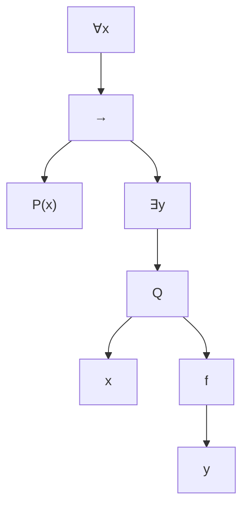

# 📝 Лекция 11: Логика первого порядка (FOL)

> [!info] ⏳ Предварительный конспект (сверен со слайдами)
> Конспект сверен с презентацией `s1-lec11-fol.typ` из репозитория Lipen/discrete-math-course (редакция от 13 октября 2026). В слайдах разделы «Нормальные формы», «Границы метода» и «Силлогизмы Аристотеля» помечены звёздочкой (\*) — это материал для углубления. Конспект будет дополнен после очной лекции.

> [!abstract] О занятии
> - **Дисциплина:** [[Дискретная математика]] (1 семестр, 2026/27 уч. год)
> - **Дата:** 18 ноября 2026 года (12-я неделя)
> - **Лектор:** Константин Чухарев ([@Lipen](https://github.com/Lipen), Университет ИТМО)
> - **Модуль 3:** Формальная логика и дедукция
> - **Источники:** слайды `s1-lec11-fol.typ`; глава книги `m03` («Термы и формулы», «Семантика: модели и истинность», «Полнота и компактность», «\* Сколемизация», «Силлогистика Аристотеля»).
> - **Ключевые темы:** сигнатура, термы, формулы, свободные и связанные переменные, подстановка и захват, правила для кванторов, интерпретация и оценка, выполнимость и общезначимость, теорема Чёрча, законы кванторов, ПНФ, сколемизация, компактность, Лёвенгейм–Сколем, силлогистика.

## 📌 Краткое резюме (TL;DR)

- FOL заглядывает внутрь атома: **термы** называют объекты, **формулы** утверждают.
- Формула — дерево; свободные вхождения делают её шаблоном, **замкнутая** формула — предложение.
- Подстановка $\varphi[t/x]$ меняет только свободные вхождения; при конфликте связанные переменные переименовывают (иначе **захват**).
- **Интерпретация** $I$ (носитель $D$, значения символов) + **оценка** $\nu$ (значения переменных) задают истинность по индукции.
- Общезначимость FOL **неразрешима** (Чёрч, Тьюринг, 1936), но полуразрешима.
- $\neg\forall\equiv\exists\neg$, порядок кванторов существенен; $\forall$ распределяется по $\wedge$, $\exists$ — по $\vee$.
- Полнота + компактность + Лёвенгейм–Сколем ⇒ нестандартные модели: первый порядок не выделяет $\mathbb{N}$.

---

## 1. Синтаксис и семантика

> [!quote] Эпиграф
> «Всякий хороший математик хотя бы наполовину философ, и всякий хороший философ хотя бы наполовину математик.» — Готлоб Фреге

### 1.1. Внутрь атома

Логика высказываний видит «Сократ смертен» как атом $P$ — внутреннее устройство ей недоступно. Утверждение «каждое число либо чётно, либо нечётно» в ней можно записать только бесконечной конъюнкцией. Нужен язык, который видит внутри утверждения: объекты и их свойства, отношения между объектами, слова «все» и «существует». Для силлогизма «Все люди смертны; Сократ — человек; значит, Сократ смертен» запись $P_1\wedge P_2\to Q$ не тавтология — логика высказываний слепа к устройству атомов.

### 1.2. Сигнатура

> [!info] Определение
> **Сигнатура** — набор символов языка, каждому указана *арность*:
> - константы — имена отдельных объектов, арность $0$;
> - функциональные символы — операции над объектами, арность $n\ge1$;
> - предикатные символы — свойства и отношения, арность $n\ge1$.

> [!example]
> Сигнатура арифметики: константа $0$, функция $+$ арности $2$, предикат $\le$ арности $2$. Сигнатура графа: константа $a$ и предикат $E$ арности $2$; $E(x,y)$ читается «из $x$ ведёт ребро в $y$».

> [!warning] Функция — не предикат
> $f(x)$ — терм: имя объекта, построенное из $x$. $P(x)$ — формула: утверждение об объекте. Запись $P(f(x))$ законна, а $f(P(x))$ — нет: функция не принимает формулу.

Сигнатура — словарь под задачу: таблица базы данных «студент сдал предмет» — предикат арности $2$.

### 1.3. Термы

> [!info] Определение
> **Термы:** (1) каждая переменная — терм; (2) каждая константа — терм; (3) если $t_1,\dots,t_n$ — термы, $f$ — функция арности $n$, то $f(t_1,\dots,t_n)$ — терм. Ничто другое термом не является.

Терм называет объект и ничего не утверждает — он не бывает истинным или ложным.

> [!example] Построение
> В сигнатуре арифметики: $x$ — терм по первому правилу, $1$ — по второму; функция $+$ собирает $+(x,1)$, затем $+(+(x,1),y)$. Школьная запись $(x+1)+y$ — тот же терм со скобками по приоритетам. Терм — дерево: в листьях переменные и константы, в узлах функции; скобки — условность записи.

### 1.4. Формулы

> [!info] Определение
> 1. $P(t_1,\dots,t_n)$ — **атомарная формула** ($P$ — предикат арности $n$, $t_i$ — термы).
> 2. Если $\varphi,\psi$ — формулы, то $\neg\varphi$, $\varphi\wedge\psi$, $\varphi\vee\psi$, $\varphi\to\psi$ — формулы.
> 3. Если $\varphi$ — формула, $x$ — переменная, то $\forall x.\,\varphi$ и $\exists x.\,\varphi$ — формулы.
>
> Ничто другое формулой не является.

> [!example]
> $P(x)$, $Q(c,f(x,c))$, $\forall x.\,P(f(x,x))$ — формулы. $Q(x)$ — нет (арность $Q$ равна двум). $P(Q(x,y))$ — нет (на месте терма оказалась формула).

**Сборка по шагам.** $\varphi=\forall x.\,(P(x)\to\exists y.\,Q(x,f(y)))$ в сигнатуре с $P$ арности 1, $Q$ арности 2 и $f$ арности 1:

1. термы $x$ и $y$ — переменные;
2. терм $f(y)$ — правило функции;
3. атомы $P(x)$ и $Q(x,f(y))$ — правило предиката;
4. формула $\exists y.\,Q(x,f(y))$ — правило квантора;
5. формула $P(x)\to\exists y.\,Q(x,f(y))$ — правило импликации;
6. формула $\varphi$ — внешний квантор.

Перестановка шагов ломает сборку: квантор не навешивается на терм, предикат не принимает формулу. Формула законна ровно тогда, когда сборка доходит до конца без остатка.

> [!warning] Две разные ошибки
> $Q(x)$ при арности $2$ — ошибка **арности**: аргументов меньше, чем мест. $P(Q(x,y))$ — ошибка **категории**: на место терма подставлена формула.

**Дерево разбора.** Каждая формула — дерево: в корне последнее применённое правило, в листьях переменные и константы. Для $\varphi$ корень — $\forall x$, его поддерево — вся формула; поддерево $\exists y$ — атом $Q(x,f(y))$, в нём $x$ осталась свободной и ждёт связывания выше. Атом стоит над своими термами: предикат получает термы.



Дерево разбора — то, что хранит компилятор после синтаксического анализа; и семантика, и подстановка читаются по дереву.

### 1.5. Свободные и связанные переменные

> [!info] Определение
> Вхождение переменной $x$ **связано**, если лежит в области действия квантора по $x$. Иначе оно **свободно**. Переменная свободна в формуле, если у неё есть хотя бы одно свободное вхождение.

> [!example] Три формулы
> - $\exists x.\,(P(x)\wedge Q(y))$: вхождение $x$ связано, $y$ свободно.
> - $P(x)\wedge\forall x.\,Q(x)$: первое вхождение $x$ свободно, второе связано — одна переменная в двух ролях.
> - $\forall x\exists y.\,R(x,y)$: свободных вхождений нет — формула замкнута.

**Вложенные кванторы.** В $\forall x.\,(\forall x.\,P(x)\vee Q(x))$ вхождение $x$ в $P(x)$ связано *внутренним* квантором, а в $Q(x)$ — внешним: квантор связывает вхождения из ближайшей области действия, как самая внутренняя переменная цикла. Переименование связанных переменных смысла не меняет. Область действия квантора — поддерево под ним; где кончается поддерево, там кончается связывание.

> [!info] Замкнутая формула
> Формула без свободных переменных — **замкнутая** (предложение). Примеры: $\forall x\exists y.\,L(x,y)$ — замкнута; $\exists x.\,(P(x)\wedge Q(y))$ — нет ($y$ свободна); $P(c)$ — замкнута (константа называет объект).

Спрашивать «истинна ли формула» имеет смысл о замкнутой; формула со свободной $y$ — шаблон, ждущий значения. Семантика назначает истину предложениям напрямую, а открытым формулам — относительно оценки переменных.

### 1.6. Подстановка и захват

> [!info] Определение
> $\varphi[t/x]$ получается заменой каждого **свободного** вхождения $x$ в $\varphi$ термом $t$. Связанные вхождения подстановка не трогает — у них свой квантор. Подстановка обязана быть **свободной** — без захвата.

> [!example] Шаги свободной подстановки
> $\varphi=\forall y.\,(x<y)$, подставляем $x:=y+1$.
> 1. Наивная замена даёт $\forall y.\,(y+1<y)$ — формула стала ложной везде.
> 2. Исходный смысл («любой $y$ больше $x$») потерян.
> 3. Переименовываем связанную переменную: $\varphi'=\forall z.\,(x<z)$.
> 4. Теперь подстановка свободна: $\varphi'[y+1/x]=\forall z.\,(y+1<z)$.
>
> Смысл восстановлен; цена — одна переименованная буква.

> [!warning] Захват переменной
> Квантор $\forall y$ «поймал» свободную $y$ из терма. Захваченная переменная меняет значение формулы. Правило: сначала переименовать конфликтующие связанные переменные, затем подставлять. Кванторные правила вывода работают только при свободной подстановке.

### 1.7. Правила для кванторов

| Квантор | Введение | Устранение |
|:-:|:-:|:-:|
| $\forall$ | $\dfrac{\varphi(a)}{\forall x.\,\varphi(x)}$ | $\dfrac{\forall x.\,\varphi(x)}{\varphi(t)}$ |
| $\exists$ | $\dfrac{\varphi(t)}{\exists x.\,\varphi(x)}$ | $\dfrac{\exists x.\,\varphi(x)\qquad\varphi(a)\vdash C}{C}$ |

Терм $t$ подставляется свободно, а имя $a$ — **свежее**: оно не встречается ни в открытых гипотезах, ни в заключении $C$. Правила обозначаются $\forall$I, $\forall$E, $\exists$I, $\exists$E.

> [!warning] Несвежее имя
> С гипотезой $x>0$ обобщение до $\forall x.\,x>0$ незаконно: $\forall$I ждёт свежее имя, а вывод опирается на конкретное значение $x$. У $\exists$E то же требование: из $\exists x.\,P(x)$ и $Q(a)$ не следует $P(a)$ — свидетель может оказаться другим объектом.

> [!example] Кванторный вывод
> Посылки: «каждый студент курса сдал экзамен» и «Марла учится на курсе». Вывод: Марла сдала экзамен.
>
> | № | Формула | Правило |
> |:-:|:--|:--|
> | 1 | $\forall x.\,(S(x)\to P(x))$ | посылка |
> | 2 | $S(\text{Марла})$ | посылка |
> | 3 | $S(\text{Марла})\to P(\text{Марла})$ | $\forall$E 1 |
> | 4 | $P(\text{Марла})$ | ${\to}$E 3, 2 |

### 1.8. Интерпретация и оценка

> [!info] Интерпретация
> **Интерпретация** $I$ назначает значения символам сигнатуры:
> - непустое множество $D$ — **носитель**;
> - каждой константе $c$ — элемент $c^I\in D$;
> - каждой функции $f$ арности $n$ — функция $f^I:D^n\to D$;
> - каждому предикату $P$ арности $n$ — отношение $P^I\subseteq D^n$.

Интерпретацию называют также структурой или моделью языка. Сигнатура — знаки, интерпретация — смысл.

> [!info] Оценка
> **Оценка** $\nu:\mathrm{Var}\to D$ назначает элементы носителя переменным. Пара $(I,\nu)$ даёт значение и открытым формулам: константы и функции читает $I$, переменные — $\nu$.

> [!example] Структура-граф
> Сигнатура: константа $a$, предикат $E$ арности $2$. Носитель $D=\{a,b,c\}$, $a^I=a$, $E^I=\{(a,b),(b,c)\}$ — граф из трёх вершин с рёбрами $a\to b$ и $b\to c$.

**Значения термов** вычисляются по дереву: константа даёт $c^I$, переменная — $\nu(x)$, узел $f$ — результат $f^I$ на значениях поддеревьев. Например, для $\mathbb{N}$ со сложением и $\nu(x)=5$, $\nu(y)=2$: терм $+(x,1)$ равен $6$, терм $+(+(x,1),y)$ равен $8$. Оценка — окружение интерпретатора; квантор связывает переменную, локально расширяя окружение на один элемент носителя — как вызов функции с новым параметром.

**Истинность** определяется индукцией по построению:

- атом $P(t_1,\dots,t_n)$ истинен, если кортеж значений термов принадлежит $P^I$;
- связки — как в логике высказываний;
- $\forall x.\,\varphi$ истинна, если $\varphi$ истинна для *каждого* элемента носителя;
- $\exists x.\,\varphi$ истинна, если $\varphi$ истинна для *хотя бы одного*.

Значение целого вычисляется из значений частей — композициональность переносится с таблиц на модели. Кванторные пункты — перебор: $\forall$ — конъюнкция по элементам носителя, $\exists$ — дизъюнкция. На бесконечном носителе это определение истинности, алгоритмом оно становится лишь на конечном.

### 1.9. Вычисляем формулы в модели

Структура-граф: $D=\{a,b,c\}$, $E^I=\{(a,b),(b,c)\}$; из $c$ рёбер нет.

> [!example] Первый разбор: $\varphi_1=\forall x\exists y.\,E(x,y)$
> «У каждой вершины есть исходящее ребро». $x=a$: свидетель $b$; $x=b$: свидетель $c$; $x=c$: ни одного ребра из $c$ — свидетель не найден. $\varphi_1$ **ложна**.

> [!example] Второй разбор: $\varphi_2=\forall x.\,(x=a\vee\exists y.\,E(y,x))$
> «Каждая вершина — корень $a$ или имеет входящее ребро». $x=a$: спасает $a=a$; $x=b$: свидетель $a$; $x=c$: свидетель $b$. $\varphi_2$ **истинна**.

**Открытая формула как таблица.** $\exists y.\,E(x,y)$ со свободной $x$ — свойство вершин:

| $\nu(x)$ | значение $\exists y.\,E(x,y)$ |
|:-:|:--|
| $a$ | истинна: ребро в $b$ |
| $b$ | истинна: ребро в $c$ |
| $c$ | ложна: рёбер из $c$ нет |

Конъюнкция трёх строк даёт $\forall x\exists y.\,E(x,y)$ (ложна), а дизъюнкция — $\exists x\exists y.\,E(x,y)$ («в графе есть хоть одно ребро»). Открытая формула — таблица значений по оценкам, замкнутая — одна ячейка; свободная переменная — незакрытый параметр, как аргумент функции до вызова.

> [!example] Одна формула, две модели
> Сигнатура: константа $0$, функция $+$, предикат $\le$. Модель 1: носитель $\mathbb{Z}$. Модель 2: носитель $\mathbb{N}$.
>
> | Формула | $\mathbb{Z}$ | $\mathbb{N}$ |
> |:--|:-:|:-:|
> | $\exists x\forall y.\,x\le y$ | ложна | истинна |
> | $\forall x\exists y.\,x\le y$ | истинна | истинна |
>
> На целых нет наименьшего, на натуральных есть $0$. Истинность — свойство пары «формула и интерпретация», а не формулы самой по себе.

### 1.10. Выполнимость и общезначимость

> [!info] Определение
> Формула **выполнима**, если существует интерпретация, в которой она истинна. Формула **общезначима** ($\models A$), если истинна в каждой интерпретации.

> [!example]
> - $\forall x.\,P(x)\to\exists x.\,P(x)$ — общезначима: носитель непуст.
> - $\forall x.\,P(x)$ — выполнима, но не общезначима.
> - $\forall x.\,(P(x)\wedge\neg P(x))$ — невыполнима.

На одноэлементном носителе $\{a\}$ формула $\forall x.\,P(x)$ сводится к $P(a)$: при $P^I=\{a\}$ истинна (выполнима), при $P^I=\varnothing$ ложна (не общезначима). Двойственность знакома: $A$ общезначима $\iff$ $\neg A$ невыполнима.

**Связь с тавтологиями.** Без кванторов общезначимость — знакомая тавтология: $P(c)\to(Q(c)\to P(c))$ — подстановка в $p\to(q\to p)$, значения $P(c)$ и $Q(c)$ — два булевых значения, и таблица закрывает вопрос. С кванторами носитель бывает бесконечным, и таблица на нём не кончается: та же архитектура, новый масштаб.

> [!note] Теорема Чёрча (1936, Чёрч и Тьюринг независимо)
> Множество общезначимых формул первого порядка **неразрешимо**: алгоритма, который на каждом входе останавливается с верным ответом «общезначима»/«нет», не существует.

Полнота исчисления даёт **полуразрешимость**: если формула общезначима, перебор выводов рано или поздно найдёт доказательство; если нет — перебор работает вечно.

> [!warning] Конечная модель — не доказательство
> Проверка на фиксированном конечном носителе отвечает только о моделях этого размера. $\exists x\forall y.\,x=y$ истинна на одноэлементном носителе и ложна на любом другом. «Истинна в найденной модели» и «общезначима» — разные ответы.

### 1.11. Законы кванторов

> [!note] Теорема (отрицание кванторов)
> $\neg\forall x.\,P(x)\equiv\exists x.\,\neg P(x)$; $\ \neg\exists x.\,P(x)\equiv\forall x.\,\neg P(x)$.

> [!example] «Не все» и «все не»
> $\neg\forall x.\,\text{сдал}(x)$ — сдал не каждый: хотя бы один провалился. $\forall x.\,\neg\text{сдал}(x)$ — не сдал никто.

*Доказательство разбором истинности.* Фиксируем $I$ с носителем $D$. $\neg\forall x.\,P(x)$ истинна $\iff$ $P^I\ne D$ $\iff$ в $D$ есть элемент $d\notin P^I$, то есть $\neg P$ истинно на $d$ — это определение истинности $\exists x.\,\neg P(x)$. Обратно: свидетель $\exists x.\,\neg P(x)$ лежит вне $P^I$, поэтому $\forall x.\,P(x)$ ложна. Второй закон — первый, применённый к $\neg P$, с учётом двойного отрицания. $\blacksquare$

Достаточно одного квантора: $\exists x.\,\varphi\equiv\neg\forall x.\,\neg\varphi$.

**Порядок кванторов.** $\forall x\exists y.\,L(x,y)$ разрешает $y$ зависеть от $x$, $\exists y\forall x.\,L(x,y)$ требует один $y$ на всех.

> [!example] Матери и дети
> $M(x,y)$ — «$y$ — мать $x$». $\forall x\exists y.\,M(x,y)$ — у каждого есть мать (истинна). $\exists y\forall x.\,M(x,y)$ — существует мать всех, включая её саму (ложна).

> [!example] Тот же эффект в графе
> В цикле $a\to b\to c\to a$ формула $\forall x\exists y.\,E(y,x)$ истинна (у каждой вершины есть предшественник), а $\exists y\forall x.\,E(y,x)$ требует вершину с рёбрами ко всем, включая себя, — её нет.

Вложенные кванторы — вложенные циклы: внешний выбор — один раз, внутренний — заново на каждой итерации. $\exists y\forall x$ — предвычисленная константа, $\forall x\exists y$ — вызов с параметром.

> [!question] Задачи на порядок кванторов
> 1. Придумайте структуру, где $\forall x\exists y.\,R(x,y)$ истинна, а $\exists y\forall x.\,R(x,y)$ ложна.
> 2. Может ли $\exists y\forall x.\,R(x,y)$ быть ложной, когда $\forall x\exists y.\,R(x,y)$ истинна и носитель одноэлементен? *(Нет: при одном элементе обе формулы равносильны.)*
> 3. Запишите «у каждого студента есть научный руководитель» обеими перестановками и объясните разницу.

**Распределение кванторов.** Кванторы распределяются по связкам только по «своим»: $\forall$ с $\wedge$ и $\exists$ с $\vee$.

> [!note] Теорема
> 1. $\forall x.\,(\varphi\wedge\psi)\equiv\forall x.\,\varphi\wedge\forall x.\,\psi$.
> 2. $\exists x.\,(\varphi\vee\psi)\equiv\exists x.\,\varphi\vee\exists x.\,\psi$.
>
> Если $x$ не свободна в $\psi$:
> 3. $\forall x.\,(\varphi\vee\psi)\equiv\forall x.\,\varphi\vee\psi$.
> 4. $\exists x.\,(\varphi\wedge\psi)\equiv\exists x.\,\varphi\wedge\psi$.

*Доказательство.* $\forall\wedge$: $\forall x.\,(\varphi\wedge\psi)$ истинна $\iff$ $\varphi^I\cap\psi^I=D$ $\iff$ $\varphi^I=D$ и $\psi^I=D$. $\exists\vee$: свидетель левой части удовлетворяет $\varphi$ или $\psi$, значит, он свидетель одной из правых частей; обратно аналогично. Перенос $\forall$ через $\vee$: если $\psi$ истинно — обе части истинны; если ложно — левая часть это $\forall x.\,\varphi$, правая — $\forall x.\,\varphi\vee\bot$, то же. Второй перенос — симметрично. $\blacksquare$

> [!note] Квантор через импликацию
> При $x$ не свободной в $\psi$: $\forall x.\,(\varphi(x)\to\psi)\equiv\exists x.\,\varphi(x)\to\psi$ и $\exists x.\,(\varphi(x)\to\psi)\equiv\forall x.\,\varphi(x)\to\psi$. Причина: $\varphi\to\psi$ — это $\neg\varphi\vee\psi$, а $\neg$ меняет квантор.

> [!example] Контрпримеры к зеркальным законам
> $D=\{0,1\}$, $P^I=\{0\}$, $Q^I=\{1\}$.
> - $\forall x.\,(P\vee Q)$ истинна, а $\forall x.\,P\vee\forall x.\,Q$ ложна.
> - $\exists x.\,(P\wedge Q)$ ложна, а $\exists x.\,P\wedge\exists x.\,Q$ истинна (свидетели разные).

| Формула | $D=\{0,1\}$ | Закон |
|:--|:-:|:-:|
| $\forall x.(P\vee Q)\to\forall x.P\vee\forall x.Q$ | ложна | неверен |
| $\exists x.(P\wedge Q)\to\exists x.P\wedge\exists x.Q$ | истинна | верен |
| $\forall x.P\vee\forall x.Q\to\forall x.(P\vee Q)$ | истинна | верен |
| $\exists x.P\wedge\exists x.Q\to\exists x.(P\wedge Q)$ | ложна | неверен |

> [!tip] Замечание о сводке (расхождение со слайдом)
> «Верен» означает, что импликация общезначима, «неверен» — что в этой структуре найден контрпример. Строка 2 ($\exists(P\wedge Q)\to\exists P\wedge\exists Q$) на слайде помечена «ложна / неверен», но в структуре $P^I=\{0\}$, $Q^I=\{1\}$ посылка ложна, поэтому импликация истинна; она и вообще общезначима (свидетель обеих частей даёт оба существования). Контрпример к зеркальному закону — строка 4 ($\exists P\wedge\exists Q\to\exists(P\wedge Q)$). Здесь строка исправлена.

> [!warning] Одноэлементный носитель
> На одноэлементном носителе все четыре формулы равносильны: там $\forall$ и $\exists$ — одна и та же проверка. Интуиция «какая разница, как распределять» выживает до первой структуры из двух элементов.

**Ограниченные кванторы.**
- $\forall x\in A.\,P(x)$ — сокращение для $\forall x.\,(x\in A\to P(x))$.
- $\exists x\in A.\,P(x)$ — сокращение для $\exists x.\,(x\in A\wedge P(x))$.

Проверка на домене $\{1,2,3\}$, $A=\{1,2\}$, $P$ — «положительно», $Q$ — «отрицательно»:

| Верная запись | Ошибочная запись |
|:--|:--|
| $\forall x.(x\in A\to P(x))$ — истинна: вне $A$ импликация молчит | $\forall x.(x\in A\wedge P(x))$ — ложна: падает на $3\notin A$ |
| $\exists x.(x\in A\wedge Q(x))$ — ложна: в $A$ отрицательных нет | $\exists x.(x\in A\to Q(x))$ — истинна: спасает $3\notin A$ |

Импликация молчит вне $A$, поэтому честно выражает «все внутри $A$»; конъюнкция ищет свидетеля внутри $A$, поэтому честно выражает «хотя бы один внутри $A$».

---

## 2. Нормальные формы (\*)

> [!quote] Эпиграф
> «Когда возникнет спор, философам не нужно будет спорить — достаточно взять перья и сказать: вычислим.» — Лейбниц

### 2.1. Предварённая нормальная форма

> [!info] Определение
> Формула в **предварённой нормальной форме** (ПНФ) имеет вид $Q_1x_1.\,\dots\,Q_kx_k.\,\psi$, где $Q_i$ — квантор, а $\psi$ (*матрица*) не содержит кванторов.

Алгоритм приведения — четыре шага равносильных преобразований:

1. заменить импликации связками $\neg$ и $\vee$;
2. протащить $\neg$ внутрь: де Морган и отрицание кванторов;
3. переименовать связанные переменные, чтобы у каждого квантора была своя;
4. вынести кванторы в начало законами распределения и переноса.

> [!example] Полный разбор
> $\varphi=\neg\forall x.\,(P(x)\to\exists y.\,Q(x,y))$.
> 1. Импликация внутрь: $\neg\forall x.\,(\neg P(x)\vee\exists y.\,Q(x,y))$.
> 2. Отрицание через $\forall$: $\exists x.\,\neg(\neg P(x)\vee\exists y.\,Q(x,y))$.
> 3. Де Морган: $\exists x.\,(P(x)\wedge\neg\exists y.\,Q(x,y))$.
> 4. Отрицание через $\exists$: $\exists x.\,(P(x)\wedge\forall y.\,\neg Q(x,y))$.
>
> ПНФ: $\exists x\forall y.\,(P(x)\wedge\neg Q(x,y))$.

> [!warning] Склейка без переименования
> $\forall x.\,P(x)\wedge\exists x.\,Q(x)$ — две разные $x$. Наивная склейка $\forall x.\,(P(x)\wedge Q(x))$ неверна: на $D=\{0,1\}$, $P^I=D$, $Q^I=\{0\}$ оригинал истинен, склейка ложна. Правильно: переименовать — $\forall x.\,P(x)\wedge\exists z.\,Q(z)$ — и распределить: $\forall x\exists z.\,(P(x)\wedge Q(z))$.

> [!question] Задачи
> 1. Приведите к ПНФ $\forall x.\,P(x)\to\exists y.\,Q(y)$ и проверьте на структуре, где $P$ пуст, а $Q$ нет.
> 2. Зачем переименование стоит *до* выноса кванторов?
> 3. ПНФ единственна? Приведите $\exists x.\,P(x)\vee\exists y.\,P(y)$ двумя способами.

### 2.2. Сколемизация

> [!info] Определение
> **Сколемизация** — замена каждого квантора $\exists$ новой *сколемовской функцией* от всех стоящих левее переменных под $\forall$, а при их отсутствии — новой константой.

> [!example]
> - $\forall x\exists y.\,L(x,y)$ → $\forall x.\,L(x,f(x))$ (свидетель зависит от $x$).
> - $\exists y\forall x.\,L(x,y)$ → $\forall x.\,L(x,c)$ (свидетель один на всех).
> - $\forall x\exists y\forall z\exists w.\,R(x,y,z,w)$ → $\forall x\forall z.\,R(x,f(x),z,g(x,z))$.
>
> Для ПНФ $\exists x\forall y.\,(P(x)\wedge\neg Q(x,y))$: $\exists x$ не лежит под $\forall$, получаем $\forall y.\,(P(c)\wedge\neg Q(c,y))$.

Равносильности нет ($\exists y.\,L(y)$ и $L(c)$ не равносильны), но модели появляются одновременно — для выполнимости этого достаточно. Дальше матрицу раскладывают в КНФ и включают резолюцию.

---

## 3. Границы метода (\*)

> [!quote] Эпиграф
> «Мы должны знать, мы будем знать.» — Давид Гильберт, Кёнигсберг, 1930

### 3.1. Полнота и компактность

> [!note] Теорема Гёделя о полноте (1929–1930)
> $\Gamma\models\varphi\iff\Gamma\vdash\varphi$ в исчислении первого порядка.

Ключ доказательства — конечность вывода: доказательство — конечная последовательность формул. Отсюда вырастают компактность и Лёвенгейм–Сколем.

> [!note] Теорема компактности
> Множество предложений первого порядка выполнимо $\iff$ выполнимо каждое его конечное подмножество.

*Доказательство контрапозицией.* Пусть $\Gamma$ невыполнимо. Тогда $\Gamma\models\bot$ вакуумно; по полноте $\Gamma\vdash\bot$. Вывод конечен, поэтому опирается на конечное $\Gamma_0\subseteq\Gamma$. По корректности из $\Gamma_0$ тоже следует $\bot$ — конечное подмножество без модели найдено. $\blacksquare$

> [!example] Бесконечный элемент
> Сигнатура: константы $0$, $c$, функция $S$, предикат $>$. $T=\{c>0,\ c>S(0),\ c>S(S(0)),\dots\}$. Каждое конечное подмножество имеет модель ($\mathbb{N}$, где $c$ больше всех упомянутых). По компактности модель есть у всей $T$, и в ней $c$ больше *каждого* натурального числа — нестандартная модель арифметики.

*Следствие:* в FOL нельзя выразить «быть конечным» или, например, «граф связен».

### 3.2. Лёвенгейм–Сколем

> [!note] Теорема
> Пусть теория $T$ в счётном языке имеет бесконечную модель.
> - **Нисходящая часть:** у $T$ есть счётная модель.
> - **Восходящая часть:** для каждой бесконечной мощности $\kappa$ у $T$ есть модель мощности $\kappa$.
>
> Л. Лёвенгейм (1915), Т. Сколем (1920), восходящая часть — А. Мальцев (1936).

Нисходящая часть — наследство доказательства полноты: модель строится из термов языка, а их в счётном языке счётно много. Восходящая — работа компактности: добавляем новые константы $c_\alpha$ с аксиомами $c_\alpha\ne c_\beta$; каждое конечное подмножество размещает конечный набор констант в бесконечной модели.

> [!example] Парадокс Сколема
> Теория множеств доказывает существование несчётных множеств, но по нисходящей части у неё есть счётная модель. Внутри модели «несчётное» множество не пересчитывается — биекции-пересчёта в модели нет. Снаружи носитель счётен — пересчёт существует, но язык модели его не видит.

### 3.3. Почему первый порядок не ловит $\mathbb{N}$?

Аксиома индукции второго порядка $\forall P.\,((P(0)\wedge\forall x.\,(P(x)\to P(S(x))))\to\forall x.\,P(x))$ пробегает *все* свойства.

> [!info] Категоричность
> Теория **категорична**, если все её модели изоморфны. Аксиомы Пеано с индукцией второго порядка категоричны: любая модель изоморфна $\mathbb{N}$ (Дедекинд, 1888).

> [!note] Некатегоричность
> Никакая теория первого порядка с бесконечной моделью не выделяет свою модель с точностью до изоморфизма. *Доказательство:* по восходящей части Л–С у теории есть модели всех бесконечных мощностей, а модели разных мощностей не изоморфны.

> [!example] Где ломается индукция
> В первом порядке индукция — *схема*: аксиома для каждого *выразимого* предиката $P$. Присоединим $c>0$, $c>S(0)$, … для новой константы $c$. Каждое конечное подмножество совместимо со схемой — по компактности совместим весь набор, и модель с «бесконечным» $c$ существует; по Л–С таких моделей хватает во всех мощностях.

Разница — в силе квантора по предикатам: второй порядок пробегает все свойства, первый — только выразимые.

### 3.4. Формула как данные: интерпретатор

Правила истинности — алгоритм, если носитель конечен.

```python
D = ["a", "b", "c"]
E = {("a", "b"), ("b", "c"), ("c", "a")}  # цикл

def val(t, s):
    return s[t] if t in s else t

def ev(f, s):
    match f:
        case ("E", x, y):   return (val(x, s), val(y, s)) in E
        case ("=", x, y):   return val(x, s) == val(y, s)
        case ("and", p, q): return ev(p, s) and ev(q, s)
        case ("exists", x, p):
            return any(ev(p, s | {x: d}) for d in D)
        case ("forall", x, p):
            return all(ev(p, s | {x: d}) for d in D)

# в цикле a -> b -> c -> a у каждой вершины есть исходящее ребро
print(ev(("forall", "x", ("exists", "y", ("E", "x", "y"))), {}))  # True
print(ev(("exists", "y", ("forall", "x", ("E", "x", "y"))), {}))  # False
```

$\exists$ — это $\mathrm{any}$ с локальным расширением оценки, $\forall$ — $\mathrm{all}$; порядок вложенности формулы превращается в порядок вложенности генераторов. Интерпретатор отвечает на вопросы о *выбранной* структуре; общезначимость требует всех структур и неразрешима. На этом стыке живут SMT-решатели и модельные проверки.

---

## 4. Силлогизмы Аристотеля (\*)

> [!quote] Эпиграф
> «Логика до сих пор не могла сделать ни шага вперёд и, судя по всему, кажется наукой вполне законченной и завершённой.» — Иммануил Кант

### 4.1. Первая система рассуждений

Аристотель, «Органон», IV век до н. э. — первая формальная теория вывода. **Силлогизм** — вывод из двух суждений о трёх терминах: субъект $S$, предикат $P$ и средний термин $M$, связывающий посылки. Классика: «Все люди смертны; Сократ — человек; значит, Сократ смертен». Системой пользовались две тысячи лет — Фреге заменил её логикой предикатов в 1879 году.

### 4.2. Четыре типа суждений

| Тип | Форма | Имя | Современная запись |
|:-:|:--|:--|:--|
| $A$ | Все $S$ суть $P$ | общеутвердительное | $\forall x.\,(S(x)\to P(x))$ |
| $E$ | Ни одно $S$ не есть $P$ | общеотрицательное | $\forall x.\,(S(x)\to\neg P(x))$ |
| $I$ | Некоторые $S$ суть $P$ | частноутвердительное | $\exists x.\,(S(x)\wedge P(x))$ |
| $O$ | Некоторые $S$ не суть $P$ | частноотрицательное | $\exists x.\,(S(x)\wedge\neg P(x))$ |

$A$ и $E$ — *общие* суждения, $I$ и $O$ — *частные*. **Круги Эйлера:** $A$ — $S$ целиком внутри $P$; $E$ — круги не пересекаются; $I$ и $O$ — пересечение с точкой в нужной области.

### 4.3. Логический квадрат

- **Противоречие** ($A$–$O$, $E$–$I$): ровно одно истинно.
- **Противоположность** ($A$–$E$): оба истинны быть не могут, оба ложны — могут.
- **Частичная совместимость** ($I$–$O$): оба ложны быть не могут.
- **Подчинение** ($A$ к $I$, $E$ к $O$): из общего следует частное.

Проверим квадрат при пустом $S$:

| Суждение | Запись | При $S=\varnothing$ |
|:-:|:--|:--|
| $A$ | $\forall x.(S\to P)$ | истинно: посылка ложна всегда |
| $E$ | $\forall x.(S\to\neg P)$ | истинно: та же причина |
| $I$ | $\exists x.(S\wedge P)$ | ложно: свидетеля нет |
| $O$ | $\exists x.(S\wedge\neg P)$ | ложно: свидетеля нет |

Противоречие выживает (законы отрицания кванторов); три боковых отношения держатся на непустоте $S$ — это **экзистенциальное допущение**.

### 4.4. Фигуры и модусы

Фигура — положение среднего термина $M$ в посылках.

| Фигура | Большая посылка | Меньшая посылка |
|:-:|:-:|:-:|
| I | $M$–$P$ | $S$–$M$ |
| II | $P$–$M$ | $S$–$M$ |
| III | $M$–$P$ | $M$–$S$ |
| IV | $P$–$M$ | $M$–$S$ |

Комбинация фигуры и типов суждений — **модус**: правильных модусов из $256$ возможных — $24$. В Средние века их запоминали именами: *Barbara*, *Celarent*, *Darii* — по гласным типов.

| Модус | Вывод | Современная запись |
|:--|:--|:--|
| **Barbara** (I, $AAA$) | Все $M$ суть $P$; все $S$ суть $M$ ⟹ все $S$ суть $P$ | транзитивность включения |
| **Celarent** (I, $EAE$) | Ни одно $M$ не есть $P$; все $S$ суть $M$ ⟹ ни одно $S$ не есть $P$ | $M$ отделено от $P$, $S$ внутри $M$ |
| **Darii** (I, $AII$) | Все $M$ суть $P$; некоторые $S$ суть $M$ ⟹ некоторые $S$ суть $P$ | точка в $S\cap M$ попадает в $S\cap P$ |

В Darii кванторы работают в полную силу: $\exists x.\,(S(x)\wedge M(x))$ даёт свидетеля, которого нельзя терять.

### 4.5. Экзистенциальное допущение

В традиционной логике общее суждение предполагает непустоту субъекта: из $A$ следует $I$. В современной записи из $\forall x.\,(S\to P)$ *не следует* $\exists x.\,(S\wedge P)$: при пустом $S$ первая истинна вакуумно, вторая ложна.

> [!example] Единороги
> «Все единороги магические» — в современной логике истинно (контрпримеров нет); «некоторые единороги магические» — ложно. Аристотелевский ход $A$ к $I$ дал бы противоречие.

Отказ от экзистенциального допущения отделил форму утверждения от вопроса о существовании; силлогистика сохранилась как частный случай современной логики.

---

## 5. Что мы поняли?

- Логика первого порядка заглядывает внутрь атома: сигнатура задаёт словарь, термы называют объекты, формулы утверждают.
- Формула — дерево построения; свободные вхождения делают её шаблоном, замкнутая формула — предложение.
- Подстановка $\varphi[t/x]$ меняет только свободные вхождения — при конфликте связанные переменные переименовывают.
- Интерпретация назначает смысл знакам, оценка — переменным, истинность считается по дереву формулы от носителя.
- Отрицание проходит сквозь квантор, меняя его тип; порядок кванторов — кто выбирает свидетеля; распределение — только по «своим» связкам.
- ПНФ собирает кванторы в префикс, сколемизация убирает $\exists$ ценой равносильности, сохраняя выполнимость.
- Полнота Гёделя, компактность и Лёвенгейм–Сколем дают нестандартные модели: первый порядок не выделяет $\mathbb{N}$.
- Силлогистика Аристотеля — первая система вывода, включённая современной логикой как частный случай.

## ❓ Вопросы для самопроверки к коллоквиуму / экзамену

- [ ] Запишите сигнатуру и формулу: «каждый студент знает хотя бы один язык программирования».
  > [!note] Решение
  > Предикаты $S(x)$ — студент, $L(y)$ — язык, $K(x,y)$ — «$x$ знает $y$»: $\forall x.\,(S(x)\to\exists y.\,(L(y)\wedge K(x,y)))$.
- [ ] Какие из выражений термы, а какие формулы: $f(c)$, $P(x,y)$, $P(f(x))$, $f(P(x))$?
  > [!note] Решение
  > Термы: $f(c)$. Формулы: $P(x,y)$, $P(f(x))$. $f(P(x))$ — не выражение языка (ошибка категории).
- [ ] Почему в $\exists x.\,(S(x)\wedge P(x))$ конъюнкция, а в $\forall x.\,(S(x)\to P(x))$ импликация?
- [ ] Запишите «у каждого студента есть научный руководитель» двумя порядками кванторов. Есть ли разница?
- [ ] За что отвечает интерпретация, за что — оценка? Что такое носитель?
- [ ] Подставьте $y:=x$ в $\forall x.\,(P(x)\vee Q(y))$ — что нужно сделать сначала и почему?
  > [!note] Решение
  > Переименовать связанную $x$ в $z$: $\forall z.\,(P(z)\vee Q(y))$, затем подставить: $\forall z.\,(P(z)\vee Q(x))$. Иначе $x$ захватывается квантором.
- [ ] Может ли теория первого порядка иметь ровно одну бесконечную модель с точностью до изоморфизма? Обоснуйте ссылкой на теорему.
  > [!note] Решение
  > Нет: по восходящей теореме Лёвенгейма–Сколема модели есть во всех бесконечных мощностях, а модели разных мощностей не изоморфны.
- [ ] Приведите к ПНФ $\neg\exists x.\,(P(x)\wedge\forall y.\,R(x,y))$ и сколемизуйте результат.
  > [!note] Решение
  > $\forall x.\,(\neg P(x)\vee\exists y.\,\neg R(x,y))\equiv\forall x\exists y.\,(\neg P(x)\vee\neg R(x,y))$; сколемизация: $\forall x.\,(\neg P(x)\vee\neg R(x,f(x)))$.
- [ ] Изобразите кругами Эйлера суждения $E$ и $O$. В чём разница с $I$?
- [ ] Почему логика первого порядка не может выразить «граф связен»? (Подсказка: компактность.)
- [ ] Чем отличается теорема Гёделя о полноте FOL от теорем о неполноте арифметики?

## 📚 Что почитать (книга курса)

- `m03` — «Термы и формулы», «Семантика: модели и истинность», «Полнота и компактность», «\* Сколемизация», «Силлогистика Аристотеля».

## 💻 Связь с Computer Science

- **SQL и реляционная алгебра:** запрос `SELECT * FROM Users WHERE age > 18` — предикатная формула $\{u\in\text{Users}\mid\text{age}(u)>18\}$; теорема Кодда: реляционная алгебра эквивалентна безопасному фрагменту FOL.
- **SMT-солверы** (Z3, CVC5) решают выполнимость формул первого порядка над теориями (линейная арифметика, неинтерпретируемые функции, битовые векторы, массивы).

## 🔗 Связанные материалы

- [[Дискретная математика]] — главная страница дисциплины
- [[02. Лекция - Предикаты, кванторы, методы доказательств, индукция и инварианты программ (2026-09-16)]]
- [[10. Лекция - Натуральная дедукция, правила вывода, нотация Фитча, корректность и полнота (2026-11-11)]]
- [[12. Лекция - Булевы функции, совершенные формы, задача SAT, алгоритмы DPLL и CDCL (2026-11-25)]]
- [[Теорминимум 2 - Булева алгебра, логика высказываний, предикаты и коды (2026-12-23)]]
