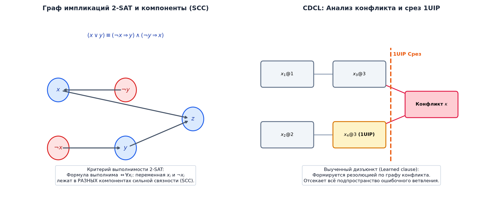

# 📝 Лекция 12: Булевы функции и SAT

> [!info] ⏳ Предварительный конспект (сверен со слайдами)
> Конспект сверен с презентацией `s1-lec12-boolean-sat.typ` из репозитория Lipen/discrete-math-course (редакция от 13 октября 2026, неделя 24–25 ноября). Раздел про CDCL и кодирование раскраски дополняет слайды. Конспект будет дополнен после очной лекции.

> [!abstract] О занятии
> - **Дисциплина:** [[Дискретная математика]] (1 семестр, 2026/27 уч. год)
> - **Дата:** 25 ноября 2026 года (13-я неделя)
> - **Лектор:** Константин Чухарев ([@Lipen](https://github.com/Lipen), Университет ИТМО)
> - **Модуль 4:** Булева алгебра, схемы и теория кодирования
> - **Источники:** слайды `s1-lec12-boolean-sat.typ`; главы книги `m10` («Булевы функции», «ДНФ и КНФ», «СДНФ, АНФ и смена базиса»), `m14` («Задача SAT», «Алгоритм для 2-SAT», «От DPLL к CDCL», «Кодирование задач в SAT»).
> - **Ключевые темы:** булевы функции и их число $2^{2^n}$, минтермы и макстермы, СДНФ/СКНФ, задача SAT, КНФ, взрыв при приведении, 2-SAT и граф импликаций, DPLL, теорема Кука–Левина, резолюция, преобразование Цейтина, CDCL.

## 📌 Краткое резюме (TL;DR)

- Булева функция $f:\{0,1\}^n\to\{0,1\}$ задаётся таблицей из $2^n$ строк; всего функций $2^{2^n}$.
- Минтерм — детектор единичной строки, макстерм — детектор нулевой; СДНФ и СКНФ единственны, но избыточны.
- **SAT**: есть ли у КНФ модель. Дизъюнкт длины $k$ запрещает $2^{n-k}$ наборов из $2^n$.
- Приведение к КНФ дистрибутивностью взрывается как $2^k$; **Цейтин** даёт линейную *равновыполнимую* КНФ.
- **2-SAT** линеен: невыполнима $\iff$ $x,\overline{x}$ в одной КСС графа импликаций; 3-SAT уже NP-полна.
- DPLL: ветвление + единичное распространение + чистые литералы. CDCL добавляет обучение на конфликтах.
- **Кук–Левин:** SAT NP-полна; $\mathrm{SAT}\in\mathrm P\iff\mathrm P=\mathrm{NP}$.

---

## 1. Булевы функции

> [!quote] Эпиграф
> «Логика — алгебра высказываний.» — Джордж Буль

### 1.1. От логики к железу

Джордж Буль в 1854 году алгебраизировал логику: конъюнкция стала умножением, дизъюнкция — сложением, отрицание — дополнением. В 1937 году Клод Шеннон показал, что та же алгебра описывает поведение реле: замкнутая цепь — истина, разомкнутая — ложь. Два реле подряд проводят ток, только если замкнуты оба, — конъюнкция; два параллельных проводят, если замкнуто хотя бы одно, — дизъюнкция.

> [!important]
> Логика XIX века стала железом XX века: каждая булева формула — цепь переключателей.

### 1.2. Булева функция

> [!info] Определение
> **Булева функция** — $f:\{0,1\}^n\to\{0,1\}$. Аргументы и значение — биты. Функция полностью задаётся таблицей истинности из $2^n$ строк.

Знакомые связки — частные случаи: каждая берёт пару бит и выдаёт бит. «Задать функцию» и «заполнить таблицу» — одно и то же: другого описания произвольной булевой функции нет.

> [!example]
> | $x$ | $y$ | $x\wedge y$ |
> |:-:|:-:|:-:|
> | 0 | 0 | 0 |
> | 0 | 1 | 0 |
> | 1 | 0 | 0 |
> | 1 | 1 | 1 |

Таблица — полное, но громоздкое описание ($2^n$ строк); формула и схема — компактные описания для функций со структурой. Вектор значений длины $2^n$ можно понимать и как вершину $2^n$-мерного куба.

### 1.3. Сколько существует булевых функций?

> [!note] Теорема (подсчёт)
> Различных булевых функций от $n$ переменных ровно $2^{2^n}$.

*Доказательство подсчётом таблиц.* В таблице $2^n$ строк, выход в каждой выбирается независимо: 0 или 1. Таблиц $2^{2^n}$, и две разные таблицы задают разные функции. $\blacksquare$

| $n$ | Наборов $2^n$ | Функций $2^{2^n}$ | Комментарий |
|:-:|:-:|:-:|:--|
| 0 | 1 | $2$ | константы 0 и 1 |
| 1 | 2 | $4$ | $0,1,x,\neg x$ |
| 2 | 4 | $16$ | все классические вентили |
| 3 | 8 | $256$ | умещается в байт |
| 4 | 16 | $65\,536$ | карты Карно |
| 5 | 32 | $2^{32}>4{,}29\cdot10^9$ | больше 4 миллиардов |
| 10 | 1024 | $2^{1024}$ | больше, чем атомов в наблюдаемой вселенной |

Рост $2^{2^n}$ быстрее любой экспоненты.

**Существенные и фиктивные переменные.** Переменная $x_i$ *существенна*, если найдётся набор остальных переменных, при котором смена $x_i$ меняет значение функции; иначе — *фиктивна* (её можно удалить без изменения семантики). Число функций от $n$ переменных, существенно зависящих от всех, равно $\sum_{k}(-1)^{n-k}\binom nk 2^{2^k}$; для $n=4$ это $65536-4\cdot256+6\cdot16-4\cdot4+2=64\,594$.

### 1.4. Бинарных функций шестнадцать

При $n=2$ у каждой из шестнадцати функций есть имя. Основные:

| Имя | Формула | Смысл |
|:--|:-:|:--|
| Конъюнкция | $x\wedge y$ | AND |
| Дизъюнкция | $x\vee y$ | OR |
| Отрицание импликации | $\neg(x\to y)$ | антиимпликация |
| Обратная импликация | $y\to x$ | обратная |
| XOR | $x\oplus y$ | входы различны |
| Эквивалентность | $x\equiv y$ | входы совпадают |
| Штрих Шеффера | $x\uparrow y$ | NAND |
| Стрелка Пирса | $x\downarrow y$ | NOR |

Остальные восемь — импликация $x\to y$, отрицание обратной импликации, две проекции, их отрицания и константы $0$, $1$.

### 1.5. Нормальные формы, минтермы и макстермы

Формула — проект схемы, а нормальная форма — стандартизованная укладка вентилей и проводов. Одну функцию записывают по-разному, и сравнивать формулы напрямую трудно; нормальная форма приводит их к общему виду. Каждая конъюнкция литералов — *терм*, каждая дизъюнкция литералов — *дизъюнкт*.

> [!info] Минтерм
> **Минтерм** — конъюнкция литералов, в которую каждая переменная входит ровно один раз: $m_\alpha=\bigwedge_i x_i^{\alpha_i}$, где $x^1=x$, $x^0=\neg x$.

> [!info] Макстерм
> **Макстерм** — дизъюнкция литералов, в которую каждая переменная входит ровно один раз: $M_\alpha=\bigvee_i x_i^{1-\alpha_i}$.

Конъюнкция истинна лишь когда истинны все её литералы: минтерм равен 1 ровно на одной строке таблицы и 0 на всех остальных. Дизъюнкция ложна лишь когда ложны все её литералы: макстерм равен 0 ровно на одной строке. Дуальная пара: минтерм — детектор единичной строки, макстерм — детектор нулевой.

> [!example] Детекторы при $n=3$
> Минтерм $x\wedge\overline y\wedge z$ истинен только на наборе $(1,0,1)$. Макстерм $x\vee\overline y\vee z$ ложен только на наборе $(0,1,0)$. Минтермов и макстермов ровно $2^n$ — по одному на каждую строку таблицы. Эта нумерация лежит в основе сборки совершенных форм.

> [!note] Рецепт
> **СДНФ** собирается из минтермов единичных строк: $f=\bigvee_{f(\alpha)=1}m_\alpha$ (для $f\not\equiv0$). **СКНФ** — из макстермов нулевых строк: $f=\bigwedge_{f(\beta)=0}M_\beta$ (для $f\not\equiv1$). Обе формы единственны — канонический портрет функции.

> [!example] XOR
> $x\oplus y$ истинна на $(0,1)$ и $(1,0)$, ложна на $(0,0)$ и $(1,1)$.
> СДНФ: $(\overline x\wedge y)\vee(x\wedge\overline y)$. СКНФ: $(x\vee y)\wedge(\overline x\vee\overline y)$. У $x\oplus y$ обе формы по два терма: функция симметрична, экономить не на чем.

> [!example] Совершенная форма избыточна
> Импликация $x\to y$ истинна на трёх наборах из четырёх: $(\overline x\wedge\overline y)\vee(\overline x\wedge y)\vee(x\wedge y)$ — шесть литералов. Алгебраическое упрощение даёт $\overline x\vee y$ — два литерала.

СДНФ единственна, но избыточна: каждый лишний литерал — лишний вентиль. Найти самую короткую равносильную ДНФ — задача минимизации (следующие лекции).

---

## 2. Задача SAT

> [!quote] Эпиграф
> «Нет царского пути в геометрию.» — Евклид

### 2.1. Постановка

> [!info] Выполнимость
> Формула в КНФ **выполнима** (*satisfiable*), если существует набор значений переменных, при котором она истинна. **Задача SAT:** по данной КНФ узнать, выполнима ли она.

> [!example]
> $\varphi=(x\vee\overline y)\wedge(\overline x\vee y\vee z)\wedge\overline z$. Набор $x=1,y=1,z=0$ выполняет её: каждый дизъюнкт — через свой литерал.

**Модель** — набор значений, при котором формула истинна; запись $\sigma\models\varphi$ читается «набор $\sigma$ выполняет $\varphi$». Модель — сертификат выполнимости: предъявленный набор проверяется за линейное время. Каждая из $n$ переменных независимо выбирает 0 или 1, поэтому наборов ровно $2^n$.

| $x$ | $y$ | $x\vee y$ | $\overline x\vee y$ | $\psi$ |
|:-:|:-:|:-:|:-:|:-:|
| 0 | 0 | 0 | 1 | 0 |
| 0 | 1 | 1 | 1 | 1 |
| 1 | 0 | 1 | 0 | 0 |
| 1 | 1 | 1 | 1 | 1 |

Столбец $\psi=(x\vee y)\wedge(\overline x\vee y)$ повторяет столбец $y$: модели $(0,1)$ и $(1,1)$.

### 2.2. Сколько наборов запрещает дизъюнкт?

> [!note]
> Дизъюнкт из $k$ литералов запрещает ровно $2^{n-k}$ наборов: он ложен лишь при одном значении своих $k$ переменных, а остальные $n-k$ свободны. При $n=10$ один трёхлитеральный дизъюнкт убивает $2^7=128$ наборов из $1024$.

> [!example]
> Для $\varphi=(x\vee\overline y)\wedge(\overline x\vee y\vee z)\wedge\overline z$:
> - $\overline z$ ложен при $z=1$ и запрещает $2^{3-1}=4$ набора;
> - $x\vee\overline y$ ложен при $x=0,y=1$ — запрещены $(0,1,0)$ и $(0,1,1)$;
> - $\overline x\vee y\vee z$ ложен только на $(1,0,0)$.
>
> Перекрытие одно: $(0,1,1)$ запрещён и первым, и вторым — итого $4+2+1-1=6$ запрещённых наборов из $8$; остаются модели $(0,0,0)$ и $(1,1,0)$.

### 2.3. Выполнимость и общезначимость

Выполнимость — не общезначимость: $x$ выполнима при $x=1$, но тавтологией не является. Связь точная: $\varphi$ выполнима $\iff$ $\neg\varphi$ — не тавтология. $x\wedge\overline x$ — простейшая невыполнимая формула. Для SAT естественна КНФ: решатели работают с конъюнкцией дизъюнктов; любую формулу можно привести к КНФ, а схема — это уже почти КНФ.

### 2.4. КНФ: литералы и дизъюнкты

- **Литерал** — переменная $x$ или её отрицание $\overline x$.
- **Дизъюнкт** — дизъюнкция литералов $C=(l_1\vee\dots\vee l_k)$. От макстерма отличается свободой: переменная может входить сколько угодно раз или не входить вовсе.
- **КНФ** — конъюнкция дизъюнктов $\varphi=C_1\wedge\dots\wedge C_m$.

> [!example]
> $\overline x\vee\overline y\vee z$ — дизъюнкт из трёх литералов, ложный ровно при $x=y=1,z=0$: детектор одной нулевой строки, которому разрешили забыть часть переменных. Формула $(x\vee\overline y)\wedge(\overline x\vee y\vee z)\wedge\overline z$ — КНФ из дизъюнктов длины $2,3,1$. Однолитеральный дизъюнкт — **единичный** (*unit*): $\overline z$ принуждает $z=0$ в любой модели.

### 2.5. Приведение к КНФ и его цена

> [!info] ДНФ
> **ДНФ** — дизъюнкция конъюнкций литералов.

КНФ и ДНФ — два стандартных каркаса; формуле их придают три шага:

1. Убрать $\to$ и $\equiv$ по определениям.
2. Протянуть $\neg$ внутрь по де Моргану до литералов.
3. Дистрибутировать $\vee$ по $\wedge$: $P\vee(Q\wedge R)=(P\vee Q)\wedge(P\vee R)$.

Первые два шага сохраняют равносильность даром, только дистрибуция платит размером.

> [!example]
> $\varphi=(x\to y)\to z$. Шаги 1–2: $\overline{\overline x\vee y}\vee z=(x\wedge\overline y)\vee z$. Шаг 3: $(x\vee z)\wedge(\overline y\vee z)$ — КНФ из двух дизъюнктов.

Для SAT естественна именно КНФ: в ДНФ выполнимость читается по первому истинному терму, и задача исчезает.

> [!note] Теорема (взрыв размера)
> КНФ формулы $(a_1\wedge b_1)\vee\dots\vee(a_k\wedge b_k)$ содержит ровно $2^k$ дизъюнктов, каждый длины $k$.

*Доказательство индукцией по $k$.* **База:** $k=1$ — формула $a_1\wedge b_1$ уже КНФ из двух единичных дизъюнктов, $2^1$. **Шаг:** дистрибуция $(C_1\wedge\dots\wedge C_s)\vee X=(C_1\vee X)\wedge\dots\wedge(C_s\vee X)$ превращает КНФ $F_{k-1}$ с $2^{k-1}$ дизъюнктами длины $k-1$ в пару $(F_{k-1}\vee a_k)$ и $(F_{k-1}\vee b_k)$: каждый старый дизъюнкт даёт двух наследников — с $a_k$ и с $b_k$, итого $2\cdot2^{k-1}=2^k$ дизъюнктов длины $k$. $\blacksquare$

> [!example] Взрыв на числах
> При $k=3$ восемь дизъюнктов: $(a_1\vee a_2\vee a_3)$, $(a_1\vee a_2\vee b_3)$, …, $(b_1\vee b_2\vee b_3)$ — каждый выбирает по одному литералу из каждой пары. При $k=300$ дизъюнктов $2^{300}\approx2\cdot10^{90}$ — на десять порядков больше, чем атомов во вселенной.

> [!warning] Ловушка
> «Любую формулу можно привести к КНФ без роста размера» — неверно. Формула из теоремы — не патология, а норма. Спасение другое: решателю не нужна равносильность, достаточно *равновыполнимости* — так работает преобразование Цейтина.

### 2.6. Перебор экспоненциален

Простейший алгоритм — перебрать все наборы: $n$ переменных → $2^n$ наборов. $n=20$: около миллиона — мгновенно; $n=40$: около триллиона — часы; $n=300$: наборов больше, чем атомов во вселенной. Перебор можно ужать отсечениями, но экспонента в худшем случае остаётся. Вопрос «можно ли быстрее?» — центральный вопрос теории сложности.

### 2.7. 2-SAT и граф импликаций

$k$-SAT отличается от SAT тем, что каждый дизъюнкт содержит ровно $k$ литералов. При $k=2$ у формулы появляется структура, которую видит теория графов.

> [!info] Граф импликаций
> Вершины — все литералы $x_1,\overline{x_1},\dots,x_n,\overline{x_n}$. Каждый дизъюнкт $(l_1\vee l_2)$ даёт два ребра: $\overline{l_1}\to l_2$ и $\overline{l_2}\to l_1$.

Дизъюнкт ложен только когда ложны оба литерала, поэтому из ложности $l_1$ следует истинность $l_2$ — первое ребро. Второе — контрапозиция, тот же дизъюнкт с другого конца; терять его нельзя: на урезанном графе компоненты сильной связности (КСС) меняются, а с ними и ответ.

> [!note] Критерий 2-SAT
> Формула 2-SAT невыполнима $\iff$ пара $x,\overline x$ лежит в одной КСС графа импликаций.

*Доказательство.* Пусть $x$ и $\overline x$ в одной КСС: есть путь из $x$ в $\overline x$ и обратный, а всякая модель удовлетворяет каждому ребру. При $x=1$ путь даёт $\overline x=1$, при $x=0$ обратный путь даёт $x=1$: модели нет. Обратно: если пары разнесены, сожмём граф в конденсацию и объявим истинными литералы, чьи компоненты идут позже компонент их отрицаний. Вдоль пути компоненты не убывают, поэтому истинный литерал тянет истинного соседа: все дизъюнкты выполнены. $\blacksquare$

**Алгоритм:** построить граф, найти КСС (Косарайю или Тарьян), назначить истину по конденсации — линейно, $O(n+m)$.

> [!example] Полный проход для $\psi=(x\vee y)\wedge(\overline x\vee y)$
> 1. $(x\vee y)$ даёт рёбра $\overline x\to y$, $\overline y\to x$; $(\overline x\vee y)$ — рёбра $x\to y$, $\overline y\to\overline x$.
> 2. Цикла через $x$ и $\overline x$ нет: все КСС одноэлементны, формула выполнима.
> 3. В конденсации $\overline y$ — источник, $y$ — сток; истину назначаем от стоков: $y=1$.
> 4. $x$ и $\overline x$ не сравнимы — $x$ свободен, модели $(0,1)$, $(1,1)$ совпадают с таблицей.

**2-SAT против 3-SAT.** Третий литерал рушит конструкцию: из ложности $l_1$ дизъюнкт $(l_1\vee l_2\vee l_3)$ требует лишь $l_2\vee l_3$ — дизъюнкт, а не литерал. Графа на литералах и КСС нет. Граница проходит здесь: 2-SAT линейна, 3-SAT NP-полна. Разбивка длинного дизъюнкта свежей переменной не спасает: части $(l_1\vee l_2\vee y)$ и $(\overline y\vee l_3\vee l_4)$ снова трёхлитеральные.

---

## 3. Решатели

> [!quote] Эпиграф
> «Давайте вычислим!» — Готфрид Лейбниц

### 3.1. DPLL

Алгоритм DPLL (Дэвис, Патнэм, Логеман, Лавленд, 1962) — поиск с возвратом плюс два приёма, которые срезают ветви до перебора.

- **Ветвление:** выбрать неразобранную переменную и развести случаи $x=0$ и $x=1$.
- **Распространение единичного дизъюнкта (BCP):** если все литералы дизъюнкта, кроме одного, ложны, оставшийся принуждён — иначе дизъюнкт ложен целиком. Значения разлетаются каскадом без выбора.
- **Чистые литералы:** переменная, встречающаяся только с одной полярностью, безопасно получает выполняющее значение.

Оба приёма сохраняют выполнимость.

> [!example] Каскад без ветвления
> $F=(x)\wedge(\overline x\vee y)\wedge(\overline y\vee z)\wedge(\overline z)$. $(x)$ принуждает $x=1$; в $(\overline x\vee y)$ литерал $\overline x$ ложен — $y=1$; из $(\overline y\vee z)$ — $z=1$. Теперь единичный $(\overline z)$ ложен целиком — конфликт. Формула невыполнима, и ни одного ветвления не понадобилось.

На практике распространение — самая дорогая часть решателя: по измерениям авторов Chaff свыше $90\%$ времени.

> [!example] Чистый литерал
> В $(x\vee y)\wedge(\overline x\vee z)$ переменные $y$ и $z$ встречаются только положительно. $y=1,z=1$ выполняет оба дизъюнкта при любом $x$ — перебор по $x$ отменяется.

Отсечения ужимают перебор в разы, но в худшем случае DPLL экспоненциален.

### 3.2. Теорема Кука–Левина

> [!note] Теорема (Кук, Левин, 1971)
> SAT NP-полна: выполнимость проверяется за полиномиальное время по сертификату, и всякая задача класса NP полиномиально сводится к SAT.

*Набросок.* Сертификат — выполняющий набор: подстановка в КНФ стоит $O(\vert\varphi\vert)$. Трудная половина — сводимость: недетерминированная машина работает $p(n)$ шагов, её вычисление разворачивается в таблицу $p(n)\times p(n)$. Переменные кодируют символ ячейки, состояние и позицию головки на каждом шаге, а переход локален: окно $2\times3$ даёт константное число дизъюнктов. Дизъюнктов $O(p(n)^2)$, построение полиномиально, и формула выполнима $\iff$ машина принимает вход. $\blacksquare$

> [!important] Цена вопроса
> Полиномиальный алгоритм для SAT дал бы полиномиальные алгоритмы для всех задач из NP: свести — и запустить. Поэтому $\mathrm{SAT}\in\mathrm P$ — это в точности вопрос $\mathrm P=\mathrm{NP}$ (одна из семи задач тысячелетия Института Клэя).

NP-полнота — не вердикт «не решать», а карта: через SAT проходит любая задача с быстрой проверкой ответа. Один хороший решатель — общий движок для расписаний, верификации схем, планирования и головоломок. Карп в 1972 году свёл SAT к двум десяткам задач (раскраска графа, покрытие множества…); сегодня счёт идёт на тысячи.

> [!warning] Полнота против конкретного экземпляра
> NP-полнота описывает худший случай, а не конкретный экземпляр. Решатель может выдать модель за миллисекунды — для индустриальных формул это норма. У судоку $9\times9$ наивно $9^{81}\approx2\cdot10^{77}$ заполнений, решатель не трогает и ничтожной доли: дизъюнкты-ограничения отсекают целые ветви.

### 3.3. Резолюция

Когда модели нет, невыполнимость тоже надо доказать, и ведёт это доказательство правило резолюции.

> [!info] Правило резолюции
> Из дизъюнктов $C_1\vee x$ и $C_2\vee\overline x$ выводится **резольвента** $C_1\vee C_2$. Пару $x,\overline x$ называют *контрарной*.

> [!example] Один шаг
> Из $(x\vee y)$ и $(\overline x\vee z)$ по $x$ выходит $(y\vee z)$: при $x=1$ второй дизъюнкт требует $z=1$, при $x=0$ первый требует $y=1$ — резольвента истинна в обоих случаях.

Выученный дизъюнкт CDCL — та же резольвента, отобранная по конфликту.

**Вывод пустого дизъюнкта.** Дизъюнкты выводятся, пока не получится *пустой дизъюнкт* $\square$ — дизъюнкция без литералов; он ложен при любом наборе, и его появление — доказательство невыполнимости.

> [!example] Три шага до противоречия
> $\varphi=(x\vee y)\wedge(\overline x\vee z)\wedge(\overline y\vee z)\wedge(\overline z)$.
> 1. $(x\vee y)$ и $(\overline x\vee z)$ по $x$ дают $(y\vee z)$.
> 2. $(y\vee z)$ и $(\overline y\vee z)$ по $y$ дают $(z)$.
> 3. $(z)$ и $(\overline z)$ по $z$ дают $\square$.

> [!note] Полнота резолюции
> КНФ невыполнима $\iff$ из неё выводится $\square$.

*Набросок (индукция по числу переменных).* Подстановки $x=0$ и $x=1$ в невыполнимую формулу невыполнимы, и по индукции каждая выводит $\square$. Тот же вывод переносится на исходную формулу: шаг остаётся шагом, а резольвента меняется лишним литералом $x$ или $\overline x$. Поэтому из формулы выводится либо $\square$, либо единичные $x$ и $\overline x$, а один шаг склеивает их в $\square$. $\blacksquare$

**Худший случай против практики.**

> [!example] Принцип Дирихле как КНФ
> Голубей $n+1$, ячеек $n$: $p_{i,j}$ — «голубь $i$ в ячейке $j$». Дизъюнкты: каждый голубь где-то сидит ($n+1$ штук), никакие два не делят ячейку ($\binom{n+1}{2}\cdot n$ штук) — полиномиально много. Невыполнимость очевидна человеку, но всякий резолюционный вывод $\square$ содержит $2^{\Omega(n)}$ дизъюнктов.

Дизъюнктов в формуле полиномиально много — экспоненциальна только длина доказательства: размер записи и краткость вывода — разные ресурсы.

Случайный 3-SAT имеет фазовый переход по отношению дизъюнктов к переменным около $m/n\approx4{,}267$: ниже порога почти наверняка SAT, выше — UNSAT; на самом пороге экземпляры труднее всего. Индустриальные формулы структурированы: сообщества переменных, малая ширина дерева зависимостей; CDCL находит эту структуру выученными дизъюнктами и решает формулы с миллионами переменных за секунды.

### 3.4. CDCL (дополнение к слайдам)

| Характеристика | DPLL (1962) | CDCL (1996+) |
|:--|:--|:--|
| Основа | поиск с возвратом | DPLL-каркас + динамический граф импликаций |
| Упрощение | BCP + чистые литералы | BCP с двумя наблюдаемыми литералами (two-watched literals) |
| Откат при тупике | хронологический (на 1 шаг) | нехронологический (backjump) через 1-UIP |
| Обучение | нет | обучение дизъюнктам (clause learning) |
| Выбор ветвления | статические правила / случайный | динамические эвристики (VSIDS) |
| Рестарты | нет | периодические (Luby / геометрические) |

CDCL: граф импликаций отслеживает, какие решения привели к конфликту; сечение 1-UIP синтезирует выученный дизъюнкт-блокиратор (это резольвента), который навсегда закрывает аналогичную тупиковую область; backjump перепрыгивает через десятки уровней в точку, где выученный дизъюнкт становится единичным.

### 3.5. Кодирование в SAT

1. Выбрать булевы переменные, описывающие решение.
2. Записать ограничения задачи дизъюнктами.
3. Запустить SAT-решатель.
4. Модель декодировать в решение, UNSAT — решения нет.

Ответ UNSAT — часто самое ценное: он доказывает несуществование решения, чего не даст ни один тест. Хорошая кодировка наследует структуру задачи, плохая раздувает формулу.

> [!example] Раскраска графа в $k$ цветов
> Переменные $x_{v,c}$ — «вершина $v$ окрашена в цвет $c$».
> 1. Каждая вершина имеет цвет: $\bigvee_{c=1}^{k}x_{v,c}$ для всех $v$.
> 2. Не более одного цвета: $(\neg x_{v,c_1}\vee\neg x_{v,c_2})$ для $c_1<c_2$.
> 3. Смежные вершины различны: $(\neg x_{u,c}\vee\neg x_{v,c})$ для $(u,v)\in E$ и всех $c$.

### 3.6. Преобразование Цейтина

> [!info] Определение
> **Преобразование Цейтина** переводит формулу или схему в равновыполнимую КНФ: каждый выход вентиля получает свежую переменную, а связь с входами фиксируется константным числом дизъюнктов. Модели КНФ на исходных переменных — в точности модели исходной формулы.

| Вентиль | Функция | Дизъюнкты |
|:-:|:-:|:--|
| NOT | $y=\overline a$ | $(y\vee a)$, $(\overline y\vee\overline a)$ |
| AND | $y=a\wedge b$ | $(\overline y\vee a)$, $(\overline y\vee b)$, $(y\vee\overline a\vee\overline b)$ |
| OR | $y=a\vee b$ | $(y\vee\overline a)$, $(y\vee\overline b)$, $(\overline y\vee a\vee b)$ |

> [!example] Один вентиль целиком
> Схема $y=\overline a\wedge b$ плюс головной единичный дизъюнкт:
> $$(\overline y\vee\overline a)\wedge(\overline y\vee b)\wedge(y\vee a\vee\overline b)\wedge(y).$$
> Единичный даёт $y=1$, распространение — $a=0$ и $b=1$: модель совпала с единственным набором, на котором вентиль выдаёт единицу.

Дизъюнкты Цейтина разрешают ровно те комбинации $(a,b,y)$, при которых $y=\overline a\wedge b$, — связь двусторонняя.

> [!note] Теорема (линейность)
> Преобразование Цейтина даёт КНФ размера $O(\vert\varphi\vert)$ — не более одной свежей переменной и трёх дизъюнктов на каждый вентиль.

*Доказательство подсчётом.* Листья формулы — переменные, уже литералы; каждая внутренняя вершина — один вентиль. На вентиль заводится одна переменная и не более трёх дизъюнктов константной длины, на головную вершину — единичный. Переменных не больше $n+t$, дизъюнктов не больше $3t+1$, где $t$ — число вентилей. $\blacksquare$

> [!warning] Равновыполнимость, не равносильность
> КНФ Цейтина не равносильна исходной формуле: вспомогательные переменные делают формулы разными объектами. Подставлять её, например, под отрицание нельзя: при неверных значениях вспомогательных переменных КНФ ложна даже там, где исходная формула истинна. Равносильность нужна при встраивании в большее выражение, решателю SAT достаточно выполнимости.

---

## 4. Что мы поняли?

- Булевых функций от $n$ переменных ровно $2^{2^n}$, таблица — единственный способ задать произвольную. Минтермы и макстермы собирают совершенные формы — единственные, но избыточные.
- SAT — вопрос о существовании модели: наборов $2^n$, дизъюнкт длины $k$ запрещает $2^{n-k}$. Эквивалентное приведение к КНФ взрывается как $2^k$, и его обходит Цейтин — ценой отказа от равносильности.
- 2-SAT решается за линейное время: дизъюнкт — пара импликаций, невыполнимость — пара $x,\overline x$ в одной КСС. Третий литерал рушит структуру, 3-SAT уже NP-полна.
- DPLL срезает перебор распространением единичных дизъюнктов и чистыми литералами, но в худшем случае экспоненциален. Невыполнимость доказывает резолюция: $\square$ выводится в точности из невыполнимых КНФ.
- Кук–Левин ставит SAT во главу NP, а индустрия решает его на миллионах переменных — структур худшего случая в живых задачах нет.

## ❓ Вопросы для самопроверки к коллоквиуму / экзамену

- [ ] Постройте СДНФ и СКНФ для $f(x,y)=x\to y$. Совпадает ли минимальная ДНФ с одной из совершенных форм?
  > [!note] Решение
  > СДНФ $(\overline x\wedge\overline y)\vee(\overline x\wedge y)\vee(x\wedge y)$; СКНФ $\overline x\vee y$ (единственная нулевая строка $(1,0)$). Минимальная ДНФ $\overline x\vee y$ совпадает с СКНФ (она же однодизъюнктная КНФ).
- [ ] Закодируйте в КНФ «ровно одна из переменных $x,y,z$ истинна».
  > [!note] Решение
  > $(x\vee y\vee z)\wedge(\overline x\vee\overline y)\wedge(\overline x\vee\overline z)\wedge(\overline y\vee\overline z)$.
- [ ] Почему КНФ Цейтина лишь равновыполнима с исходной формулой? Что сломается при подстановке её результата под отрицание?
- [ ] Почему дизъюнкт $(l_1\vee l_2)$ обязан породить в графе импликаций оба ребра? Что изменится, если оставить одно?
- [ ] Как по КСС графа импликаций построить выполняющий набор?
- [ ] Назовите два приёма DPLL до ветвления и объясните, почему каждый безопасен.
- [ ] Выведите пустой дизъюнкт из $(x\vee y)\wedge(\overline x\vee y)\wedge(\overline y)$.
  > [!note] Решение
  > $(x\vee y)$ и $(\overline x\vee y)$ по $x$ дают $(y)$; $(y)$ и $(\overline y)$ дают $\square$.
- [ ] Сколько различных булевых функций существует от $n=4$ переменных? Сколько из них существенно зависят от всех 4?
  > [!note] Решение
  > $2^{16}=65\,536$; существенно зависящих от всех четырёх — $64\,594$ (включение–исключение).
- [ ] В чём принципиальная разница между 2-SAT и 3-SAT?
- [ ] Сформулируйте критерий выполнимости 2-SAT через сильную связность графа импликаций.

## 📚 Что почитать (книга курса)

- `m10` — «Булевы функции», «ДНФ и КНФ», «СДНФ, АНФ и смена базиса».
- `m14` — «Задача SAT», «Алгоритм для 2-SAT», «От DPLL к CDCL», «Кодирование задач в SAT».

## 🔗 Связанные материалы

- [[Дискретная математика]] — главная страница дисциплины
- [[09. Лекция - Логика высказываний, тавтологии, КНФ, ДНФ и метод резолюций (2026-11-04)]]
- [[11. Лекция - Логика первого порядка FOL, сигнатуры, термы, модели и силлогистика (2026-11-18)]]
- [[13. Лекция - Минимизация булевых функций, карты Карно, полиномы Жегалкина и критерий Поста (2026-12-02)]]
- [[Теорминимум 2 - Булева алгебра, логика высказываний, предикаты и коды (2026-12-23)]]
