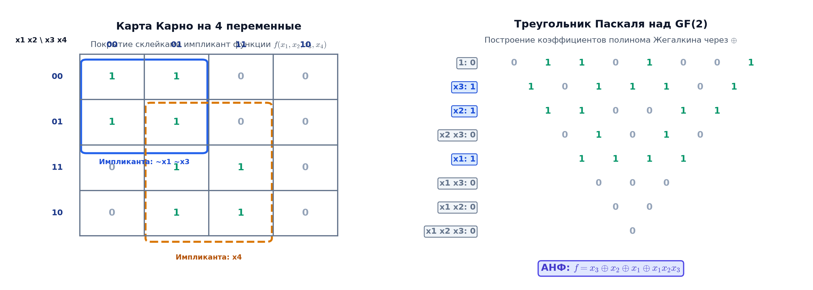

# 📝 Лекция 13: Минимизация и полином Жегалкина

> [!info] ⏳ Предварительный конспект (сверен со слайдами)
> Конспект сверен с презентацией `s1-lec13-zhegalkin.typ` из репозитория Lipen/discrete-math-course (редакция от 13 октября 2026, неделя 1–2 декабря). Разделы со звёздочкой (\*) — материал для углубления. Конспект будет дополнен после очной лекции.

> [!abstract] О занятии
> - **Дисциплина:** [[Дискретная математика]] (1 семестр, 2026/27 уч. год)
> - **Дата:** 2 декабря 2026 года (14-я неделя)
> - **Лектор:** Константин Чухарев ([@Lipen](https://github.com/Lipen), Университет ИТМО)
> - **Модуль 4:** Булева алгебра, схемы и теория кодирования
> - **Источники:** слайды `s1-lec13-zhegalkin.typ`; главы книги `m10` («Минимизация», «Полином Жегалкина»), `m11` («Логические вентили и схемы», «Сумматоры», «Код Грея»).
> - **Ключевые темы:** цена избыточности, склейка и простые импликанты, карты Карно, Квайн–МакКласки, АНФ над $\mathrm{GF}(2)$, тождества перехода, единственность, формула Мёбиуса, треугольник Паскаля, линейные функции, коды Рида–Маллера, паритет, BDD/ROBDD, клоны, пять классов Поста.

## 📌 Краткое резюме (TL;DR)

- Совершенная форма — отправная точка; минимизация ищет ДНФ с наименьшим числом литералов (каждый литерал — вентиль).
- Склейка $Ax\vee A\overline x=A$; **карта Карно** — таблица в коде Грея: группа из $2^k$ соседних единиц снимает $k$ литералов.
- **Квайн–МакКласки** = склейка + таблица покрытия простых импликант (покрытие NP-трудно).
- **Полином Жегалкина** (АНФ): $f=\bigoplus_S a_S\prod_{i\in S}x_i$ — существует и единствен ($x\oplus x=0$).
- Два пути к АНФ: тождества $\overline x=x\oplus1$, $x\vee y=x\oplus y\oplus xy$ и **треугольник Паскаля** (формула Мёбиуса).
- Линейные функции сбалансированы ⇒ код $\mathrm{RM}(1,n)$ с расстоянием $2^{n-1}$.
- **Критерий Поста:** $F$ полно $\iff$ $F\not\subseteq T_0,T_1,S,M,L$.

---

## 1. Минимизация

> [!quote] Эпиграф
> «Преждевременная оптимизация — корень всех зол.» — Дональд Кнут

### 1.1. Зачем минимизировать?

Каждый литерал формулы в железе — провод и вход вентиля. Цена избыточности прямая: больше вентилей, длиннее задержка, выше энергопотребление (площадь кристалла и TDP). Совершенная форма — отправная точка, а не результат. **Цель минимизации** — равносильная формула с наименьшим числом литералов.

### 1.2. Сколько существует булевых функций?

> [!note] Теорема (двойная экспонента)
> От $n$ переменных существует ровно $2^{2^n}$ различных булевых функций.

*Доказательство подсчётом независимых выходов.* Таблица имеет $2^n$ строк; каждая строка выбирает выход независимо: 0 или 1. $\blacksquare$

| $n$ | Строк $2^n$ | Функций $2^{2^n}$ |
|:-:|:-:|:-:|
| 1 | 2 | 4 |
| 2 | 4 | 16 |
| 3 | 8 | 256 |
| 4 | 16 | 65 536 |

Рост дважды экспоненциальный: перебор невозможен, работают компактные представления. Уже при $n=6$ функций около $1{,}8\cdot10^{19}$ — больше, чем песчинок на Земле.

### 1.3. Функция большинства

$f(x,y,z)=1$ при двух и более единицах на входах. СДНФ из четырёх минтермов по три литерала:
$$f=\overline x yz\vee x\overline y z\vee xy\overline z\vee xyz.$$
Склейки сжимают её до трёх термов: $f=xy\vee xz\vee yz$. Двенадцать литералов — против шести.

### 1.4. Склейка минтермов и простые импликанты

Минтермы, отличающиеся ровно в одной переменной, склеиваются: $xyz\vee xy\overline z=xy(z\vee\overline z)=xy$.

> [!info] Простая импликанта
> Конъюнкция литералов — **простая импликанта** (*prime implicant*) функции $f$, если она истинна только при истинной $f$ (импликанта) и перестаёт быть такой при вычёркивании любого литерала. Импликанта **существенна**, если покрывает единицу, не покрытую другими простыми импликантами.

Минимальная ДНФ — покрытие всех единиц таблицы простыми импликантами; ядро — все существенные.

### 1.5. Карта Карно

> [!info] Определение
> **Карта Карно** — таблица истинности, у которой строки и столбцы идут в коде Грея. Соседние клетки отличаются ровно в одной переменной.

Прямоугольная группа из $2^k$ соседних единиц — конъюнкция из $n-k$ литералов. Карта замкнута в тор: крайние строки и столбцы тоже соседние, группа может переходить через край (угловые клетки $4\times4$ склеиваются в блок).



> [!example] Группа из четырёх клеток
> $f(x,y,z)=x$ равна 1 на четырёх наборах $x\overline y\overline z,\ x\overline yz,\ xy\overline z,\ xyz$ — они образуют на карте прямоугольник $2^2$. Правило групп оставляет $n-k=1$ литерал: сам $x$.

> [!example] Карта большинства
> Три пары единиц — три простые импликанты $xy$, $xz$, $yz$; каждая существенна (у каждой есть единица, покрытая только ею). Минимальная ДНФ $xy\vee xz\vee yz$.

**Алгоритм по карте:**

1. Выделить максимальные группы из $2^k$ соседних единиц.
2. Взять существенные импликанты (без каждой какая-то единица остаётся непокрытой).
3. Покрыть оставшиеся единицы минимальным числом групп.
4. Неопределённые значения ($\times$) присоединять к группам, если это их укрупняет.

Ручной метод жив при $n\le4$; дальше нужны алгоритмы.

**Неопределённые значения.** Бывает, что на части наборов функция не определена: значение там безразлично.

> [!example] Единица вместо безразличия
> Функция равна 1 на $001$ и 0 на всех остальных, кроме $011$ — там безразлично. Объявим безразличное значение единицей: клетки $001$ и $011$ складываются в пару с термом $\overline xz$ (два литерала вместо трёх у $\overline x\overline yz$).

Безразличное значение — ресурс, а не пропуск; брать его не обязательно — только когда группа от этого растёт.

### 1.6. Квайн–МакКласки

**Фаза склеивания.**

1. Выписать минтермы в двоичном виде (удобно группировать по числу единиц — весу Хэмминга: склеиваются только соседние группы).
2. Склеивать пары, отличающиеся ровно в одном бите: различающийся бит заменяется прочерком.
3. Повторять, пока склеивания возможны.
4. Несклеенные термы — простые импликанты.

> [!example]
> Минтермы $010$ и $011$ дают $01-$ (бит $z$ вычеркнут); $101$ и $111$ — $1-1$; $110$ и $111$ — $11-$. Термы с прочерками тоже склеиваются, если различаются ровно одним битом.

**Фаза покрытия.** Таблица: строки — простые импликанты, столбцы — исходные минтермы; выбрать минимальное число строк, покрывающих все столбцы. Столбцы с единственной меткой — существенные импликанты, включаются безусловно. Фаза покрытия в общем случае NP-трудна (set cover); на практике — эвристики.

> [!example] Лишняя простая импликанта
> $f=1$ на $000,001,011,111$; склейка даёт три простые импликанты.
>
> | Импликанта | $000$ | $001$ | $011$ | $111$ |
> |:-:|:-:|:-:|:-:|:-:|
> | $\overline x\overline y$ | × | × | | |
> | $\overline xz$ | | × | × | |
> | $yz$ | | | × | × |
>
> Наборы $000$ и $111$ — собственные: каждый покрыт единственной импликантой, обе входят в ответ. Импликанта $\overline xz$ теряется (её наборы уже покрыты): минимальная ДНФ $\overline x\overline y\vee yz$.

---

## 2. Полином Жегалкина

### 2.1. Функции как векторы над $\mathrm{GF}(2)$

Таблица истинности — вектор длины $2^n$ над полем $\mathrm{GF}(2)=\{0,1\}$ со сложением $\oplus$ и умножением $\wedge$. Поточечный $\oplus$ превращает функции в векторное пространство размерности $2^n$.

> [!example] Два базиса одного пространства
> $x\vee y$ — вектор $(0,1,1,1)$ по наборам $(0,0),(0,1),(1,0),(1,1)$. Минтермы $\overline x\overline y,\overline xy,x\overline y,xy$ — базис-индикаторы строк; разложение по ним — СДНФ. Мономы $1,x,y,xy$ — другой базис; разложение по нему — полином Жегалкина: $x\oplus y\oplus xy$.

> [!info] Полином Жегалкина (АНФ)
> $$f(x_1,\dots,x_n)=\bigoplus_{S\subseteq\{1,\dots,n\}}a_S\prod_{i\in S}x_i,\quad a_S\in\{0,1\}.$$
> Мономы — произведения подмножеств переменных, без отрицаний; при $S=\varnothing$ моном равен $1$.

Моном включается, когда все его переменные равны 1, поэтому $x\oplus y\oplus xy$ даёт единицы на $(0,1),(1,0),(1,1)$ — это в точности дизъюнкция. Переменные входят только в первой степени: $x^2=x$.

### 2.2. Тождества перехода и существование

> [!note] Теорема (NOT и OR через XOR)
> $\overline x=x\oplus1$, $\quad x\vee y=x\oplus y\oplus xy$.

*Доказательство проверкой наборов.* Для отрицания: $0\oplus1=1$, $1\oplus1=0$. Для дизъюнкции при $x=1$ выходит $1\oplus y\oplus y=1$ при любом $y$; при $x=y=0$ обе части нулевые; случай $y=1$ симметричен. Конъюнкция уже записана через $\wedge$. $\blacksquare$

> [!note] Теорема (существование)
> Всякая булева функция представима полиномом Жегалкина.

*Построение из СДНФ.* Заменим отрицания на $x\oplus1$, дизъюнкции — на $x\oplus y\oplus xy$. Скобки раскрываются дистрибутивностью $\wedge$ относительно $\oplus$, повторы гасятся правилом $x\oplus x=0$ — остаются мономы и $\oplus$. $\blacksquare$

> [!warning] Базис $\{\wedge,\oplus\}$ без константы
> Тождества дают полноту набора $\{\wedge,\oplus,1\}$, и константа в нём не украшение: обе операции $\{\wedge,\oplus\}$ сохраняют нуль, поэтому без $1$ невыразимы ни константа, ни отрицание. С $1$ появляется $\overline x=x\oplus1$. Константу нельзя собрать из самих операций.

### 2.3. Единственность АНФ

> [!note] Теорема (единственность)
> Всякая булева функция имеет ровно один полином Жегалкина.

*Подсчёт.* Функций $2^{2^n}$, мономов $2^n$; каждый входит в полином или нет, поэтому полиномов тоже $2^{2^n}$. Существование даёт сюръекцию, а на равных конечных множествах она биективна. $\blacksquare$ На языке линейной алгебры: $2^n$ мономов — базис, коэффициенты в базисе однозначны.

> [!important] Почему XOR?
> СДНФ канонична среди ДНФ, АНФ — единственная без оговорок. Причина — выбор сложения: $x\oplus x=0$, повтор сам себя убирает. Дизъюнкция идемпотентна: $x\vee x=x$, повтор слагаемого ничего не меняет, поэтому равносильных ДНФ много. Единственность АНФ — свойство поля $\mathrm{GF}(2)$, а не формы.

### 2.4. Формула Мёбиуса

> [!note] Теорема (инверсия по подмножествам)
> $a_S=\bigoplus_{T\subseteq S}f(T)$, где $f(T)$ — значение $f$ на входе с единицами ровно на $T$.

*Доказательство.* Моном по $U$ равен 1 на входе $T$ ровно при $U\subseteq T$, поэтому $f(T)=\bigoplus_{U\subseteq T}a_U$. Подставим в двойную сумму: слагаемое $a_U$ войдёт $N_U=2^{\vert S\vert-\vert U\vert}$ раз — по одному на каждое $T$ с $U\subseteq T\subseteq S$. При $U\ne S$ это чётное число, копии гасятся, остаётся $a_S$. $\blacksquare$

### 2.5. АНФ стандартных вентилей

| Вентиль | АНФ | Ст. |
|:--|:--|:-:|
| NOT, $\overline x$ | $x\oplus1$ | 1 |
| AND, $x\wedge y$ | $xy$ | 2 |
| OR, $x\vee y$ | $x\oplus y\oplus xy$ | 2 |
| XOR | $x\oplus y$ | 1 |
| NAND | $xy\oplus1$ | 2 |
| NOR | $x\oplus y\oplus xy\oplus1$ | 2 |
| Эквивалентность | $x\oplus y\oplus1$ | 1 |
| Импликация | $1\oplus x\oplus xy$ | 2 |

«Ст.» — степень АНФ, наибольшее число переменных в мономе. NAND, NOR и эквивалентность получаются из AND, OR и XOR добавлением $\oplus1$: отрицание в мире XOR — константа.

> [!example] Вывод $x\vee y$ де Морганом
> $x\vee y=\overline{\overline x\wedge\overline y}=(x\oplus1)(y\oplus1)\oplus1=x\oplus y\oplus xy$.

> [!example] АНФ импликации
> $x\to y=\overline x\vee y=(x\oplus1)\oplus y\oplus(x\oplus1)y=x\oplus1\oplus y\oplus xy\oplus y=1\oplus x\oplus xy$. Проверка на $(1,0)$: $1\oplus1\oplus0=0$ — импликация ложна, как положено.

### 2.6. Треугольник Паскаля

1. Выписать значения $f$ по всем наборам от $(0,\dots,0)$ до $(1,\dots,1)$.
2. Каждая следующая строка — попарный $\oplus$ соседей предыдущей.
3. Повторять, пока не останется один элемент.
4. Первые элементы строк — коэффициенты полинома.

Корректность — формула Мёбиуса: первый элемент $k$-й строки суммирует значения по подмножествам $k$-го набора.

> [!example] $x\to y$
> Значения по $(0,0),(0,1),(1,0),(1,1)$: $1,1,0,1$.
>
> | | | | |
> |:-:|:-:|:-:|:-:|
> | **1** | 1 | 0 | 1 |
> | **0** | 1 | 1 | |
> | **1** | 0 | | |
> | **1** | | | |
>
> Коэффициенты при $1,y,x,xy$: $(1,0,1,1)$ ⇒ $x\to y=1\oplus x\oplus xy$.

> [!example] Функция большинства
> Значения по восьми наборам: $0,0,0,1,0,1,1,1$. Первые элементы строк (коэффициенты при $1,z,y,yz,x,xz,xy,xyz$): $(0,0,0,1,0,1,1,0)$ ⇒ $f=xy\oplus xz\oplus yz$. Проверка на $(1,0,1)$: $0\oplus1\oplus0=1$; на $(1,1,1)$: $1\oplus1\oplus1=1$. Совпадение со слагаемыми МДНФ — не общее правило: два из трёх мономов одновременно истинны только на $(1,1,1)$, где нечётность XOR сохраняет единицу.

```python
def anf(table):
    a = list(table)
    h = 1
    while h < len(a):
        for i in range(0, len(a), 2 * h):
            for j in range(i, i + h):
                a[j + h] ^= a[j]
        h *= 2
    return a
# majority(x, y, z): индекс m — битовая маска монома
print(anf([0, 0, 0, 1, 0, 1, 1, 1]))  # коэффициенты АНФ, + означает xor
```

Индекс $m$ — битовая маска монома, $n$ проходов «бабочки» дают $O(n\cdot2^n)$ сложений.

### 2.7. Линейные функции и коды Рида–Маллера

> [!info] Линейная функция
> Функция **линейна** (аффинна), если степень её АНФ не выше 1: $f=a_0\oplus a_1x_1\oplus\dots\oplus a_nx_n$.

> [!note] Теорема (подсчёт)
> Линейных функций от $n$ переменных ровно $2^{n+1}$.

*Доказательство.* У линейной функции $n+1$ коэффициентов, каждый 0 или 1 — всего $2^{n+1}$ полиномов; разные полиномы дают разные функции: при $a_i\ne a_i'$ различие видно на наборе с одним $x_i=1$. $\blacksquare$

> [!note] Теорема (баланс)
> Неконстантная линейная функция равна 1 ровно на $2^{n-1}$ наборах — на половине.

*Доказательство спариванием.* Пусть $a_j=1$; сопоставим набору $u$ соседа $u'$, отличающегося только $j$-м битом. Тогда $f(u')=f(u)\oplus a_j=f(u)\oplus1$ — в каждой из $2^{n-1}$ пар ровно одна единица. $\blacksquare$

Композиция линейных функций линейна — класс $L$ Поста: из одних XOR и констант не собрать даже конъюнкцию.

> [!info] Код Рида–Маллера
> $\mathrm{RM}(r,n)$ — слова длины $2^n$: таблицы функций со степенью АНФ не выше $r$.

> [!note] Теорема (параметры $\mathrm{RM}(1,n)$)
> Код содержит $2^{n+1}$ слов и имеет минимальное расстояние $2^{n-1}$.

*Доказательство.* Слов столько, сколько линейных функций, — $2^{n+1}$. Расстояние между $f$ и $g$ — число единиц разности $f\oplus g$; разность различных линейных функций сбалансирована: $2^{n-1}$ единиц. $\blacksquare$

> [!example] $\mathrm{RM}(1,3)$
> Слова длины $8$, всего $16$ слов — все аффинные функции трёх переменных. Расстояние $4$, исправляется $t=\lfloor(4-1)/2\rfloor=1$ ошибка. Слово — коэффициенты $a_0,a_1,a_2,a_3$ функции $a_0\oplus a_1x\oplus a_2y\oplus a_3z$: четыре бита превращаются в восемь.

Аппарат «Маринер-9» (1971) передавал фотографии Марса кодом $\mathrm{RM}(1,5)$: слова длины 32, расстояние 16, исправление до 7 ошибок. Декодирование — быстрым преобразованием Адамара.

### 2.8. Паритет: где ДНФ взрывается

> [!note] Теорема
> Минимальная ДНФ функции $x_1\oplus\dots\oplus x_n$ состоит из $2^{n-1}$ минтермов по $n$ литералов.

*Оценка импликантов.* Пусть конъюнкция — импликант чётности, но переменной $x_i$ в ней нет. Тогда она истинна при обоих значениях $x_i$, а чётность на них противоположна. Значит, каждый терм — полный минтерм, а единиц у чётности ровно $2^{n-1}$. $\blacksquare$

АНФ чётности — сама сумма $x_1\oplus\dots\oplus x_n$: $n-1$ вентиль XOR. ДНФ при $n=20$ — $\approx10^7$ литералов против 19 вентилей АНФ.

| Цена | $x\to y$ | Большинство | Чётность, $n$ переменных |
|:--|:-:|:-:|:-:|
| Базис AND/OR/NOT | 2 вентиля | 5 вентилей | $n\cdot2^{n-1}$ литералов |
| Базис AND/XOR | 3 вентиля | 5 вентилей | $n-1$ вентилей |

Моном из $k$ переменных — $k-1$ вентиль AND, $m$ мономов — ещё $m-1$ XOR. XOR-вентиль в КМОП дороже AND и OR — базис AND/XOR выгоден только при XOR-структуре. Главная ценность АНФ — каноничность: схемы эквивалентны равенством полиномов.

### 2.9. АНФ в криптоанализе

Степень АНФ измеряет нелинейность функции. Симметричные шифры собирают из линейных операций ($\oplus$, сдвиги) и нелинейных S-блоков. Если АНФ S-блока низкой степени, шифр сводится к системе уравнений над $\mathrm{GF}(2)$ — алгебраическая атака (базисы Грёбнера, F4, F5, XL). S-блоки проектируют с высокой степенью: у координат S-блока AES степень 7 из 8 переменных.

---

## 3. Диаграммы решений (\*)

СДНФ и АНФ экспоненциальны в худшем случае: функция большинства от $n$ переменных требует экспоненциального размера в обеих формах.

> [!info] BDD
> **Диаграмма решений** (*Binary Decision Diagram*) для $f(x_1,\dots,x_n)$ — ориентированный ациклический граф: единственный корень; внутренняя вершина помечена переменной $x_i$ и имеет два ребра (пунктирное при $x_i=0$, сплошное при $x_i=1$); листья помечены 0 или 1. Путь от корня кодирует входной набор, значение функции — константа в листе.

> [!note] Разложение Шеннона
> $f=(\overline{x_i}\wedge f[0/x_i])\vee(x_i\wedge f[1/x_i])$.

*Разбор значений $x_i$:* при $x_i=0$ работает левая скобка, правая гасится нулём; при $x_i=1$ — наоборот. В BDD пунктирное ребро ведёт к подграфу для $f[0/x_i]$, сплошное — к $f[1/x_i]$.

> [!example] BDD для $x\oplus y$
> По $x$: $f[0/x]=y$, $f[1/x]=\overline y$ — подграфы вычисляют противоположные функции; листья общие: дерево из семи узлов сжалось в пять. Вход $(1,0)$ проходит по сплошному ребру и пунктиру к листу 1.

> [!info] ROBDD
> BDD не каноничен, поэтому **ROBDD** (*Reduced Ordered BDD*) добавляет: *упорядоченность* (переменные на любом пути в фиксированном порядке $x_1<\dots<x_n$) и *редуцированность* (нет вершин с одинаковыми потомками обоих рёбер, изоморфные подграфы склеены).

> [!note] Каноничность
> Для фиксированного порядка переменных каждая булева функция имеет ровно один ROBDD.

Канонических представителей у функции два: полином Жегалкина и ROBDD — равенство функций проверяется равенством диаграмм без таблиц. ROBDD суммы двух $n$-битных чисел при чередующемся порядке битов линеен (ДНФ экспоненциальна); ROBDD произведения экспоненциален при любом порядке. Дополняющие рёбра делают отрицание бесплатным. ROBDD — рабочая структура символьной верификации (Брайант, 1986).

---

## 4. Клоны и критерий Поста (\*)

> [!info] Замыкание и клон
> **Замыкание** $[F]$ — наименьшее множество, содержащее $F$, все проекции и замкнутое относительно композиции. **Клон** — множество функций, содержащее все проекции и замкнутое относительно композиции.

> [!example] Замыкание базиса Жегалкина
> Обе функции $\{\wedge,\oplus\}$ сохраняют нуль, а $T_0$ — клон, поэтому $[\wedge,\oplus]\subseteq T_0$. Полином без свободного члена задаёт в точности $T_0$ и собирается из $\{\wedge,\oplus\}$, поэтому $[\wedge,\oplus]=T_0$.

> [!info] Классы Поста
> - $T_0$ — *сохраняющие 0*: $f(0,\dots,0)=0$.
> - $T_1$ — *сохраняющие 1*: $f(1,\dots,1)=1$.
> - $S$ — *самодвойственные*: $\neg f(\neg x_1,\dots,\neg x_n)=f(x_1,\dots,x_n)$.
> - $M$ — *монотонные*: замена 0 на 1 на входе никогда не уменьшает выход.
> - $L$ — *линейные*: $f=a_0\oplus a_1x_1\oplus\dots\oplus a_nx_n$.

Каждый класс фиксирует дефект: ограничение, внутри которого целые семейства функций невыразимы. Все пять классов — клоны (максимальные среди собственных).

> [!note] Критерий Поста
> Множество $F$ функционально полно $\iff$ $F$ не содержится целиком ни в одном из классов $T_0$, $T_1$, $S$, $M$, $L$.

На практике для каждого класса достаточно предъявить одну функцию набора вне него — пять свидетельств дают полноту.

| Функция | $T_0$ | $T_1$ | $S$ | $M$ | $L$ | Полная система? |
|:--|:-:|:-:|:-:|:-:|:-:|:--|
| $\neg x$ | ✗ | ✗ | ✓ | ✗ | ✓ | нет (линейна и самодвойственна) |
| $x\wedge y$ | ✓ | ✓ | ✗ | ✓ | ✗ | нет (сохраняет 0 и 1, монотонна) |
| $x\vee y$ | ✓ | ✓ | ✗ | ✓ | ✗ | нет |
| $x\oplus y$ | ✓ | ✗ | ✗ | ✗ | ✓ | нет (линейна) |
| $x\to y$ | ✗ | ✓ | ✗ | ✗ | ✗ | нет (сохраняет 1) |
| NAND | ✗ | ✗ | ✗ | ✗ | ✗ | **да** (базис Шеффера) |
| NOR | ✗ | ✗ | ✗ | ✗ | ✗ | **да** (базис Пирса) |
| $\{\neg,\wedge\}$ | — | — | — | — | — | **да** |
| $\{\oplus,\wedge,1\}$ | — | — | — | — | — | **да** (базис Жегалкина) |

> [!example] И-НЕ по всем пяти
> - $T_0,T_1$: $x\uparrow y(0,0)=1$, $x\uparrow y(1,1)=0$ — ни 0, ни 1 не сохраняет.
> - $S$: на $(0,1)$ и $(1,0)$ значения равны, а должны быть противоположны.
> - $M$: $x\uparrow y(0,1)=1>0=x\uparrow y(1,1)$.
> - $L$: $x\uparrow y=xy\oplus1$ — есть моном $xy$.

*Доказательство критерия.* **Необходимость.** Каждый класс замкнут относительно композиции, но не исчерпывает все функции ($\overline x$ не сохраняет ни 0, ни 1 и не монотонна; $xy$ не самодвойственна и не линейна). Набор, целиком лежащий в замкнутом собственном классе, не выразит функцию вне класса.

**Достаточность (свидетели).** Пусть в $F$ есть $f_0\notin T_0$, $f_1\notin T_1$, $f_S\notin S$, $f_M\notin M$, $f_L\notin L$.

1. Подстановка $x$ на все входы в $f_0$ и $f_1$ даёт константы $0$, $1$ или $\overline x$.
2. Если есть константы, а отрицания нет, его даёт $f_M$: на паре $a\le b$ с $f_M(a)=1$, $f_M(b)=0$ константы на совпадающих позициях и $x$ на различающихся дают $\overline x$.
3. Если есть только $\overline x$, константу строит $f_S$: на входе $a$ с $f_S(a)=f_S(\overline a)$ подстановка $x$ на нули $a$ и $\overline x$ на единицы даёт константу.
4. Нелинейная $f_L$ содержит моном $x_ix_j$: фиксировав остальные переменные и заменив $x_i\mapsto x_i\oplus b$, $x_j\mapsto x_j\oplus a$, получаем $x_ix_j$ с точностью до константы.
5. Константы, отрицание и конъюнкция дают дизъюнкцию по де Моргану — система полна. $\blacksquare$

---

## 5. Что мы поняли?

Три формы: избыточная СДНФ, минимальная ДНФ и каноничный полином. Между ними работают склейки, тождества перехода и треугольник Паскаля.

- Избыточность СДНФ стоит денег: каждый лишний литерал становится вентилем.
- Карта Карно — код Грея: группа из $2^k$ соседних единиц снимает $k$ переменных.
- Квайн–МакКласки — та же склейка алгоритмом, с таблицей покрытия простых импликант.
- Полином Жегалкина — каноническая запись: существование построением, единственность подсчётом.
- Два пути к АНФ: тождества перехода или треугольник Паскаля (он же формула Мёбиуса).
- Чётность: АНФ — $n-1$ вентиль XOR, минимальная ДНФ — $2^{n-1}$ минтермов.
- Линейные функции — слова кода $\mathrm{RM}(1,n)$ с расстоянием $2^{n-1}$.

## ❓ Вопросы для самопроверки к коллоквиуму / экзамену

- [ ] Минимизируйте по карте Карно $f=\overline x\overline yz\vee\overline xyz\vee xy\overline z\vee x\overline y\overline z$.
  > [!note] Решение
  > Минтермы $001,011,110,100$. Пара $001,011$ → $\overline xz$; пара $110,100$ → $x\overline z$. МДНФ: $\overline xz\vee x\overline z$ (это $x\oplus z$).
- [ ] Что даёт склейка минтермов $xyz$ и $x\overline yz$? Какая переменная исчезает?
  > [!note] Решение
  > $xz$; исчезает $y$.
- [ ] Постройте полином Жегалкина для $x\to y$ двумя способами: тождествами и треугольником.
- [ ] Почему АНФ единственна, а минимальная ДНФ — нет?
- [ ] Какое наибольшее число мономов может входить в АНФ функции от $n$ переменных? Приведите функцию, у которой мономов именно столько.
  > [!note] Решение
  > $2^n$ (по одному на подмножество переменных). Пример: $f=\overline{x_1}\wedge\dots\wedge\overline{x_n}=\prod_i(x_i\oplus1)$ — при раскрытии скобок получаются все $2^n$ мономов с коэффициентом 1 (для $n=1$: $1\oplus x$).
- [ ] Функция трёх переменных равна 1 при чётном числе единиц на входе. Найдите её АНФ. Линейна ли она?
  > [!note] Решение
  > $f=1\oplus x\oplus y\oplus z$ — линейна.
- [ ] Сколько линейных функций от четырёх переменных? Чему равно расстояние кода $\mathrm{RM}(1,4)$?
  > [!note] Решение
  > $2^{5}=32$; расстояние $2^{3}=8$.
- [ ] Почему любой импликант чётности обязан содержать все $n$ переменных?
- [ ] Проверьте по критерию Поста: полна ли система $\{x\oplus y\oplus z,\ \overline x\}$?
  > [!note] Решение
  > Обе функции линейны, система лежит в $L$ — неполна.
- [ ] Найдите АНФ $f=(x\vee y)\oplus z$.
  > [!note] Решение
  > $x\oplus y\oplus xy\oplus z$; нелинейна из-за $xy$.
- [ ] Минимизируйте $f(x,y,z,w)=\sum(0,1,2,4,5,6,8,9,10)$.
  > [!note] Решение
  > Группы $\{0,1,4,5\}\to\overline x\overline z$, $\{0,1,8,9\}\to\overline y\overline z$, $\{0,2,4,6\}\to\overline x\overline w$, $\{0,2,8,10\}\to\overline y\overline w$. $f=(\overline x\vee\overline y)(\overline z\vee\overline w)$.

## 📚 Что почитать (книга курса)

- `m10` — «Минимизация» (карты Карно, Квайн–МакКласки), «Полином Жегалкина».
- `m11` — «Логические вентили и схемы», «Сумматоры», «Код Грея».

## 🔗 Связанные материалы

- [[Дискретная математика]] — главная страница дисциплины
- [[12. Лекция - Булевы функции, совершенные формы, задача SAT, алгоритмы DPLL и CDCL (2026-11-25)]]
- [[14. Лекция - Логические схемы, функциональные элементы, сумматоры и схемная сложность (2026-12-09)]]
- [[15. Лекция - Теория кодирования, расстояние Хэмминга, код Хэмминга и линейные коды (2026-12-16)]]
- [[Теорминимум 2 - Булева алгебра, схемы, SAT и коды (2026-12-26)]]
