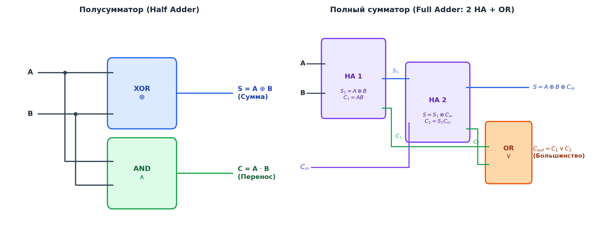
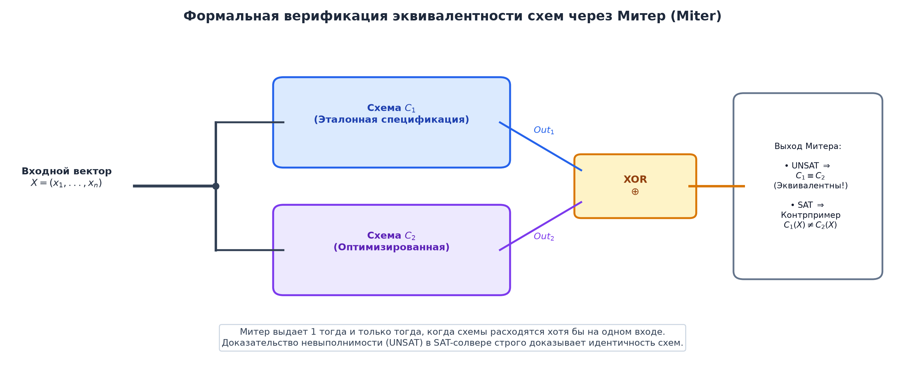

# 📝 Лекция 14: Схемы и верификация

> [!info] ⏳ Предварительный конспект (сверен со слайдами)
> Конспект сверен с презентацией `s1-lec14-circuits.typ` из репозитория Lipen/discrete-math-course (редакция от 13 октября 2026, неделя 8–9 декабря). Разделы со звёздочкой (\*) — углубление. Конспект будет дополнен после очной лекции.

> [!abstract] О занятии
> - **Дисциплина:** [[Дискретная математика]] (1 семестр, 2026/27 уч. год)
> - **Дата:** 9 декабря 2026 года (15-я неделя)
> - **Лектор:** Константин Чухарев ([@Lipen](https://github.com/Lipen), Университет ИТМО)
> - **Модуль 4:** Булева алгебра, схемы и теория кодирования
> - **Источники:** слайды `s1-lec14-circuits.typ`; главы книги `m11` («Логические вентили и схемы», «Сумматоры», «Код Грея»), `m14` («CDCL-солверы», «SAT и NP»).
> - **Ключевые темы:** вентили, из таблицы в схему, функциональная полнота, NAND/NOR, размер и глубина, полусумматор и полный сумматор, ripple-carry и CLA, код Грея, митер, 2-SAT, Хорн-SAT, DPLL и CDCL, кодирование в SAT, NP-полнота.

## 📌 Краткое резюме (TL;DR)

- Схема — ориентированный ациклический граф; **размер** — число вентилей (площадь), **глубина** — критический путь (задержка).
- Любая таблица переводится в схему: минтермы ⇒ СДНФ, склейки её сжимают (реле: 17 вентилей → 3).
- Сами по себе функционально полны только **NAND** и **NOR**.
- Полный сумматор: $S=A\oplus B\oplus C_{in}$, перенос — **функция большинства**; каскад: размер $5n$, глубина $2n+1$.
- **Код Грея** меняет один бит за шаг; перевод через XOR.
- **Митер** сводит эквивалентность схем к SAT: UNSAT — эквивалентны, SAT — контрпример.
- 2-SAT линеен (граф импликаций), Хорн-SAT линеен (наименьшая модель), DPLL → CDCL; SAT NP-полна, но структурные формулы решаются.

---

## 1. Логические схемы

> [!quote] Эпиграф
> «Что я не могу создать, я не понимаю.» — Ричард Фейнман

### 1.1. Вентили

Вентиль — физический исполнитель булевой операции: два уровня напряжения на входах, один на выходе.

| Вентиль | Функция | Смысл |
|:--|:-:|:--|
| NOT | $\overline x$ | инвертирует |
| AND | $x\wedge y$ | оба входа — 1 |
| OR | $x\vee y$ | хотя бы один — 1 |
| XOR | $x\oplus y$ | входы различны |
| NAND | $\overline{x\wedge y}$ | отрицание AND |
| NOR | $\overline{x\vee y}$ | отрицание OR |

| $x$ | $y$ | AND | OR | XOR | NAND | NOR |
|:-:|:-:|:-:|:-:|:-:|:-:|:-:|
| 0 | 0 | 0 | 0 | 0 | 1 | 1 |
| 0 | 1 | 0 | 1 | 1 | 1 | 0 |
| 1 | 0 | 0 | 1 | 1 | 1 | 0 |
| 1 | 1 | 1 | 1 | 0 | 0 | 0 |

NOT — единственный одновходовый вентиль: $\overline0=1$, $\overline1=0$.

> [!warning] Ловушка
> OR и XOR совпадают в трёх строках из четырёх и расходятся только при $x=y=1$. Русское «или» бывает исключающим («чай или кофе»), вентиль OR — никогда.

У вентиля с $n$ входами $2^n$ входных наборов; $n$-арных функций $2^{2^n}$ (при $n=2$ — 16). Таблица растёт экспоненциально, схема может быть компактной.

### 1.2. Из таблицы в формулу: аварийное реле

Реле аварии в серверной стойке: $x$ — перегрев, $y$ — вентилятор, $z$ — кнопка теста.

| $x$ | $y$ | $z$ | $f$ |
|:-:|:-:|:-:|:-:|
| 0 | 0 | 0 | 0 |
| 0 | 0 | 1 | 1 |
| 0 | 1 | 0 | 0 |
| 0 | 1 | 1 | 1 |
| 1 | 0 | 0 | 1 |
| 1 | 0 | 1 | 1 |
| 1 | 1 | 0 | 0 |
| 1 | 1 | 1 | 1 |

Проверяем нули: строка $(1,1,0)$ — стойка греется, но вентилятор работает, и реле молчит. Чтение по строкам: кнопка теста $z$ звонит в любом режиме, а без теста реле срабатывает только от перегрева при выключенном вентиляторе.

**Минтермы.** Выписываем минтермы всех пяти единичных строк: $\overline x\overline yz,\ \overline xyz,\ x\overline y\overline z,\ x\overline yz,\ xyz$. Каждый — детектор своей строки; их дизъюнкция — СДНФ.

**Склеивания.** Пара минтермов, различающихся ровно в одной переменной, склеивается:
$$\overline x\overline yz\vee\overline xyz=\overline xz,\qquad x\overline y\overline z\vee x\overline yz=x\overline y.$$
Ещё: $xyz\vee x\overline yz=xz$, затем $\overline xz\vee xz=z$. Итог: $f=z\vee x\overline y$. Склеивание работает только на соседних строках; карта Карно — та же операция, разложенная на клетках.

**Из формулы в схему.** $f=z\vee x\overline y$ — цепочка из трёх вентилей: NOT ($\overline y$, уровень 1), AND ($x\wedge\overline y$, уровень 2), OR (уровень 3). Схема из СДНФ до склеиваний: 3 NOT + 10 AND + 4 OR — 17 вентилей; минимизация сократила её до 3 вентилей — размер упал почти в шесть раз. Проверка на входе $(1,0,0)$: $\overline y=1$, $x\wedge\overline y=1$ — реле срабатывает при перегреве и выключенном вентиляторе.

### 1.3. Функциональная полнота

> [!info] Определение
> Набор вентилей **функционально полон**, если из него собирается схема для любой булевой функции.

Каждый выброшенный из базиса вентиль — минус один тип ячейки в библиотеке стандартных элементов.

> [!note] Теорема (полнота NOT, AND, OR)
> Набор NOT, AND, OR функционально полон.

*Доказательство построением по таблице.* Для каждой строки с $f=1$ выписываем минтерм, вентилями AND собираем конъюнкции, вентилями OR соединяем их; отрицания дают вентили NOT, по одному на переменную. Дизъюнкция минтермов равна 1 ровно на единичных строках. $\blacksquare$

**Шестнадцать функций двух входов** кодируются словами из значений на наборах $00,01,10,11$: слово $0110$ даёт единицы на $01$ и $10$ — это XOR.

| Слово | Функция | Имя |
|:-:|:-:|:--|
| $0000$ | $0$ | константа 0 |
| $0001$ | $x\wedge y$ | конъюнкция |
| $0010$ | $x\overline y$ | запрет $y$ |
| $0011$ | $x$ | проекция $x$ |
| $0100$ | $\overline xy$ | запрет $x$ |
| $0101$ | $y$ | проекция $y$ |
| $0110$ | $x\oplus y$ | XOR |
| $0111$ | $x\vee y$ | дизъюнкция |
| $1000$ | $\overline{x\vee y}$ | NOR — **полон** |
| $1001$ | $x\equiv y$ | эквивалентность |
| $1010$ | $\overline y$ | NOT $y$ |
| $1011$ | $y\to x$ | обратная импликация |
| $1100$ | $\overline x$ | NOT $x$ |
| $1101$ | $x\to y$ | импликация |
| $1110$ | $\overline{x\wedge y}$ | NAND — **полон** |
| $1111$ | $1$ | константа 1 |

> [!note] Теорема (штрих Шеффера)
> Один NAND позволяет собрать NOT, AND, OR:
> $$\overline x=x\uparrow x,\qquad x\wedge y=(x\uparrow y)\uparrow(x\uparrow y),\qquad x\vee y=(x\uparrow x)\uparrow(y\uparrow y).$$

*Доказательство.* Дизъюнкция по де Моргану: $(x\uparrow x)\uparrow(y\uparrow y)=\overline{\overline x\,\overline y}=x\vee y$. Конъюнкция — двойное отрицание над NAND. На битах: при $x=y=1$ имеем $1\uparrow1=0$, и $(1\uparrow1)\uparrow(1\uparrow1)=0\uparrow0=1$. Тройка NOT, AND, OR полна, и каждая её операция выражена через NAND — полнота наследуется. $\blacksquare$

Поодиночке из шестнадцати функций полны ровно две — NAND и NOR. Остальные проваливают критерий Поста: константы и проекции тривиальны, AND монотонен, XOR линеен, импликация сохраняет единицу. В КМОП NAND собирается из четырёх транзисторов, а AND — из шести (инвертор на выходе), поэтому промышленные библиотеки строятся вокруг NAND.

### 1.4. Схема как граф. Размер и глубина

> [!info] Определение
> **Схема** — ориентированный ациклический граф: истоки — входы, внутренние узлы — вентили, стоки — выходы. Схема вычисляет композицию булевых функций. Ацикличность — комбинационная логика: результат зависит только от текущих входов (цикл сделал бы значение неопределённым: выход ждал бы сам себя).

> [!info] Размер и глубина
> **Размер** — число вентилей (площадь, стоимость). **Глубина** — длина самого длинного пути от входа к выходу (задержка).

У реле: размер 3, глубина 3. Размер и глубина — базовый инженерный компромисс: схема с малой глубиной собирается из большего числа вентилей, компактная работает медленнее.

**Задержка и такт.** Модель: каждый вентиль переключается за время $\tau$, провода мгновенны. Задержка сигнала — глубина $\times\tau$, самый длинный путь — *критический*. Такт процессора не короче худшего комбинационного пути.

> [!example] Схема для XOR
> $x\oplus y=(x\vee y)\wedge\overline{x\wedge y}$: AND ловит «оба — единицы», NOT даёт «не оба», OR — «хотя бы один», финальный AND требует обоих. Вентилей четыре (размер 4); самый длинный путь AND → NOT → AND даёт глубину 3. При $x=y=1$: $\overline{x\wedge y}=0$, выход 0; при $x=1,y=0$ запрет снят, выход 1. Задержку задаёт критический путь, а не сумма всех вентилей — параллельные ветви считаются одновременно.

**\* Цена СДНФ.** Функция от $n$ переменных, равная единице на $k$ наборах, вычисляется схемой размера не более $n+(n-1)k+(k-1)$ (отрицаний не больше $n$, конъюнкций $(n-1)k$, дизъюнкций $k-1$). При $k=2^n$ это $(n+1)2^n$ — экспонента. Для реле: $n=3$, $k=5$, $3+2\cdot5+4=17$.

**\* Чётность: экспонента против цепочки.** Единичных наборов половина — $2^{n-1}$, любые два различаются минимум в двух битах, склеивать нечего: минимальная ДНФ чётности — её СДНФ, порядка $n\cdot2^{n-1}$ вентилей против цепочки из $n-1$ XOR (при $n=32$: $6{,}9\cdot10^{10}$ против 31). Цена функции зависит и от самой функции, и от базиса.

**\* Семейства схем.** Схема имеет фиксированное число входов. *Семейство схем* — последовательность $C_1,C_2,\dots$, где $C_n$ имеет $n$ входов; оно *равномерно*, если существует алгоритм, строящий $C_n$ по $n$. Чётность: $C_n$ — цепочка из $n-1$ XOR. Равномерные полиномиальные семейства — схемный взгляд на эффективные вычисления.

---

## 2. Арифметика

### 2.1. Полусумматор

> [!info] Определение
> **Полусумматор** (*half adder*) складывает два бита: $S=A\oplus B$, $C=A\wedge B$.

$S$ — младший разряд (сумма по модулю 2), $C$ — старший: равен 1 только при $A=B=1$ (сумма переливается через разряд).

| $A$ | $B$ | $S$ | $C$ |
|:-:|:-:|:-:|:-:|
| 0 | 0 | 0 | 0 |
| 0 | 1 | 1 | 0 |
| 1 | 0 | 1 | 0 |
| 1 | 1 | 0 | 1 |

Нижняя строка — вся механика переноса: $1+1=10_2$. «Полу-» — честно: столбик складывает три бита, а эта схема — только два (входящего переноса нет). Размер 2 вентиля, глубина 1.

### 2.2. Полный сумматор

> [!info] Определение
> **Полный сумматор** (*full adder*) складывает $A$, $B$ и входящий перенос $C_{in}$:
> $$S=A\oplus B\oplus C_{in},\qquad C_{out}=(A\wedge B)\vee(C_{in}\wedge(A\oplus B)).$$



**Чтение схемы:** $u=A\oplus B$, $v=A\wedge B$ (уровень 1); $w=C_{in}\wedge u$ (уровень 2); $C_{out}=v\vee w$ (уровень 3). Проверка на $(A,B,C_{in})=(0,1,1)$: $u=1$, $v=0$, $w=1$, перенос 1 — как при $0+1+1=10_2$. Схема и формула — два представления одной функции, оба обратимы: СДНФ переводит таблицу в схему, чтение по проводам — схему в формулу. Полный сумматор строится из двух полусумматоров и одного OR (пять вентилей: два XOR для суммы, два AND и OR для переноса).

> [!important] Перенос — функция большинства
> $C_{out}=1$ тогда и только тогда, когда хотя бы два из трёх входов равны 1:
> $$(A\wedge B)\vee(C_{in}\wedge(A\oplus B))=(A\wedge B)\vee(C_{in}\wedge A)\vee(C_{in}\wedge B)=\mathrm{Maj}(A,B,C_{in}).$$

Совпадение проверяется раскрытием $\oplus$ и поглощением. На битах: при $(0,1,1)$ единственная полная пара даёт $C_{in}\wedge B=1$ — перенос горит; при $(0,1,0)$ не собрана ни одна пара — перенос погас. Формулы полусумматора и полного сумматора — минимизированные ДНФ.

### 2.3. Каскады сумматоров

**Ripple-carry:** цепочка из $n$ полных сумматоров, перенос каждого подаётся на вход следующего. Размер $O(n)$, глубина $O(n)$.

> [!example] $0111+0001$
> Разряд 0: $1+1+0=10_2$ — бит 0, перенос 1. Разряды 1 и 2: $1+0+1=10_2$ — бит 0, перенос идёт дальше. Разряд 3: $0+0+1=01_2$ — бит 1, перенос 0, волна гаснет. Результат $1000$ — перенос прошёл все четыре разряда, и каждый ждал соседа.

**Точный счёт.** Полный сумматор — 5 вентилей; внутри одного разряда перенос проходит AND и OR — две задержки. Первый перенос готов за 3 задержки, каждый следующий — ещё за 2, финальный — за $2n+1$. Итог: размер $5n$, глубина $2n+1$. 4 бита — 20 вентилей и глубина 9; 64 бита — 320 вентилей и глубина 129. Каждое удвоение разрядности удваивает и площадь, и задержку.

**Carry-lookahead (CLA).** Опережающий перенос считает переносы группами. Бит *генерации* $G_i=A_i\wedge B_i$ (разряд безусловно рождает перенос), бит *распространения* $P_i=A_i\oplus B_i$ (разряд передаёт перенос дальше):
$$C_1=G_0\vee(P_0C_0),\quad C_2=G_1\vee P_1G_0\vee P_1P_0C_0,\quad C_3=G_2\vee P_2G_1\vee P_2P_1G_0\vee P_2P_1P_0C_0.$$
Древовидная параллельная схема (Брент–Кунг, Коггс–Стоун) снижает глубину до $O(\log n)$ ценой роста размера до $O(n\log n)$.

Вычитание тоже каскад: $A-B=A+\overline B+1$ в дополнительном коде. Вся арифметика процессора — вариации одного сумматора.

**Работа и глубина.** *Работа* — суммарное число вентильных операций (у схемы — размер: площадь, энергия); *глубина* — параллельное время. Каскад: работа $5n$ при глубине $2n+1$ — минимум кремния, максимум ожидания. Дерево переноса: глубина $O(\log n)$, работа растёт. Цепочка экономит площадь, дерево покупает время — и то и другое сразу не выходит (тот же выбор, что между циклом и разделяй-и-властвуй под пул потоков).

```python
# Нетлист реле: f = z or (x and not y). Уровни проводов.
gates = [("not", "y"), ("and", "x", "g1"), ("or", "z", "g2")]
d = {v: 0 for v in "xyz"}  # входы — уровень 0
for i, (_, *ins) in enumerate(gates):
    d[f"g{i + 1}"] = 1 + max(d[w] for w in ins)
print(d["g3"])  # 3
```

Уровень вентиля — максимум уровней его входов плюс один; тот же проход делают симуляторы схем, а для SAT нетлист переводится в КНФ.

**\* АЛУ.** Однобитный срез: блоки AND, OR, сложения, вычитания считают на одних и тех же $A,B$, а мультиплексор по адресу $S_1S_0=10$ выводит на $Y$ выбранный $D_2$. Мультиплексор «из $2^k$ в 1» выдаёт один из $2^k$ входов по $k$ адресным битам; $n$-битное АЛУ — $n$ срезов с цепочкой переносов.

### 2.4. Код Грея

> [!info] Определение
> **Код Грея** — упорядочение всех $2^n$ двоичных строк длины $n$, где соседние строки (включая последнюю и первую) отличаются ровно в одном бите.

$G_3$: $000,001,011,010,110,111,101,100$. Код цикличен.

> [!important] Зачем?
> При переключении нескольких битов сразу возникают ложные промежуточные состояния (гонки сигналов). Двоичный счётчик на переходе $0111\to1000$ меняет все четыре бита, и энкодер успевает прочитать $0101$ или $1111$ — значения, которых не было. Код Грея меняет один бит за шаг — энкодеры угла и позиции читаются безошибочно. Код Грея уже работал в карте Карно.

> [!note] Рекурсивное построение
> $G_1=[0,1]$, $\ G_{n+1}=[0G_n,\ 1G_n^R]$, где $G_n^R$ — $G_n$ в обратном порядке.

Из $G_1$: $0G_1=[00,01]$, $1G_1^R=[11,10]$ ⇒ $G_2=[00,01,11,10]$. Стык половин отличается только первым битом — обращение второй половины даёт цикличность.

> [!note] Перевод через XOR
> Двоичный → Грей: $g_i=b_i\oplus b_{i+1}$ (старший бит сохраняется). Обратно: $b_i=g_i\oplus b_{i+1}$ — накопительный $\oplus$ от старшего бита.

Пример: $b=1011$ ⇒ $g=1110$; обратно: $b_3=1$, $b_2=1\oplus1=0$, $b_1=1\oplus0=1$, $b_0=0\oplus1=1$ — вернулись к $1011$. Оба преобразования — цепочка XOR-вентилей глубины $O(n)$.

---

## 3. Верификация через SAT

> [!quote] Эпиграф
> «Тестирование программы может убедительно продемонстрировать наличие ошибок, но безнадёжно несостоятельно для демонстрации их отсутствия.» — Эдсгер Дейкстра

### 3.1. Митер

Схема спроектирована, затем оптимизирована — нужно доказать, что поведение не изменилось. Перебор всех входов невозможен: $2^n$ наборов. Обе схемы переводят в КНФ (преобразование Цейтина: переменная на выход вентиля и дизъюнкты таблицы вентиля), размер растёт линейно.

> [!info] Митер
> Соединим входы схем $C_1$ и $C_2$ попарно, на каждую пару выходов поставим XOR, а выходы всех XOR соберём одним OR.



Митер выдаёт 1 ровно на тех входах, где схемы различаются.

> [!note] Теорема (эквивалентность через невыполнимость)
> $C_1\equiv C_2$ $\iff$ митер невыполним.

> [!example]
> $f_1=x\vee y$ и $f_2=x\oplus y$. На $(1,1)$: $f_1=1$, $f_2=0$ — XOR выходов даёт 1, митер срабатывает (SAT, контрпример $x=y=1$). На $(1,0)$ обе выдают 1 — расхождения нет. А схема $(x\vee y)\wedge\overline{x\wedge y}$ эквивалентна вентилю XOR: митер невыполним, и решатель доказал бы это без проверки наборов. У промышленных схем тысячи входов: UNSAT — доказательство на всех входах сразу.

### 3.2. Единичное распространение и граф импликаций

**Unit propagation.** Если в дизъюнкте все литералы, кроме одного, ложны, оставшийся обязан быть истинным. Пример: $(x)\wedge(\overline x\vee y)\wedge(\overline y\vee z)\wedge\overline z$: $x=1$ ⇒ $y=1$ ⇒ $z=1$ ⇒ последний дизъюнкт ложен — противоречие без единого ветвления.

**Дизъюнкт как импликация.** $l_1\vee l_2\equiv(\overline{l_1}\to l_2)\wedge(\overline{l_2}\to l_1)$. Вторая импликация — контрапозиция первой; потерять её — потерять половину рёбер графа. Тройку литералов так разложить нельзя — граница между лёгким и трудным SAT.

> [!info] Граф импликаций
> Вершины — все литералы ($x$ и $\overline x$ для каждой переменной); рёбра — обе импликации каждого дизъюнкта. Выполнимость превращается в вопрос о достижимости: путь — цепочка принуждений, а конфликтом грозит цикл, собирающий пару $x,\overline x$.

> [!note] Критерий 2-SAT
> Формула 2-SAT невыполнима $\iff$ $x$ и $\overline x$ в одной КСС графа импликаций.

*Доказательство.* Если $x$ и $\overline x$ взаимно достижимы, импликации дают $x\to\overline x$ и $\overline x\to x$ — противоречие при любом значении $x$. Если пары разнесены, присваивание по обратному топологическому порядку компонент делает каждую импликацию истинной. $\blacksquare$ КСС находятся обходом в глубину за $O(n+m)$.

**Построение выполняющего набора:** (1) найти КСС и топологический порядок конденсации; (2) обрабатывать компоненты в обратном порядке — от стоков к истокам; (3) переменная получает 1, если её компонента идёт позже компоненты отрицания, иначе 0. Обратный порядок гарантирует совместимость; по пути в графе значение не убывает (ложь перед истиной), поэтому каждая импликация истинна.

> [!example] $(x\vee y)\wedge(\overline x\vee y)$
> $(x\vee y)$ даёт $\overline x\to y$, $(\overline x\vee y)$ даёт $x\to y$: оба требования сходятся в $y$. Пары в разных компонентах — формула выполнима, значение $y=1$ видно из графа.

> [!example] Полный экземпляр: три дизъюнкта, шесть рёбер
> $\varphi=(x\vee y)\wedge(\overline x\vee z)\wedge(\overline y\vee\overline z)$. Рёбра: $\overline x\to y$, $\overline y\to x$, $x\to z$, $\overline z\to\overline x$, $y\to\overline z$, $z\to\overline y$. Две компоненты: $\{\overline x,y,\overline z\}$ и $\{x,z,\overline y\}$ — ни одна не содержит пары $x,\overline x$. Модель: $x=1,z=1,y=0$. Проверка: $(1\vee0)=1$, $(0\vee1)=1$, $(1\vee0)=1$.

**2-SAT против 3-SAT.** 2-SAT решается за линейное время; 3-SAT NP-полна. Причина структурная: пара литералов распадается на импликации, тройка — нет. Длинный дизъюнкт режут на тройки свежими переменными, но в 2-SAT формула от этого проще не становится. Промышленные решатели берут общий SAT методом CDCL (MiniSat, z3).

### 3.3. Хорновские дизъюнкты

> [!info] Определение
> **Хорновский дизъюнкт** — дизъюнкт с не более чем одним положительным литералом: $\overline{p_1}\vee\dots\vee\overline{p_k}\vee q\equiv p_1\wedge\dots\wedge p_k\to q$.

Три роли: правило («если, то»), факт ($k=0$, просто $q$), цель (нет положительных литералов — запрос). Примеры: $(\overline x\vee\overline y\vee z)$ — правило $x\wedge y\to z$; $(x)$ — факт; $(\overline x\vee\overline y)$ — цель «не оба сразу». На хорновских формулах стоит логическое программирование; вывод типов — решение хорновской системы ограничений.

> [!note] Хорн-SAT линеен
> Выполнимость хорновской формулы решается за время, линейное по суммарной длине дизъюнктов.

1. Все факты пометить истинными и положить в очередь.
2. Правило с истинными посылками порождает вывод: пометить и в очередь.
3. Опустевшая цель — пустой дизъюнкт: невыполнимость.

Модель, истинная ровно на принуждённых литералах, — **наименьшая модель** (у выполнимой хорновской формулы одна); на ней строится семантика Пролога.

> [!example] Прогон
> $\varphi=(x)\wedge(\overline x\vee y)\wedge(\overline z\vee w)$. Факт $x$ принуждает $y$; $z,w$ никем не принуждаются: $x=y=1$, $z=w=0$. Добавьте цель $(\overline x\vee\overline y)$ — после $x=y=1$ она пустеет: UNSAT.

### 3.4. DPLL и CDCL

**DPLL.** Два правила, оба сохраняют выполнимость:

- *единичное распространение* — присваиваем единственный оставшийся литерал, повторяем до неподвижной точки или конфликта;
- *чистый литерал* (его отрицание не встречается) — ему можно дать единицу, его дизъюнкты вычёркиваются.

Когда правила исчерпаны, а дизъюнкты остались, — ветвление: выбирается неприсвоенная переменная, оба значения опробуются по очереди; конфликт (пустой дизъюнкт) закрывает ветвь, и поиск возвращается к последнему выбору. Исчерпание всех ветвей — честное доказательство невыполнимости.

> [!example] Прогон $\varphi=(x\vee y)\wedge(\overline x\vee y)\wedge(x\vee\overline y)\wedge(y\vee z)$
> Единичных дизъюнктов нет, зато $z$ — чистый литерал. Ветвь $x=0$ сжимает дизъюнкты до единичных $(y)$ и $(\overline y)$ — unit $y=1$ упирается в $(\overline y)$, конфликт. Ветвь $x=1$: unit $y=1$ выполняет всё, $z$ остаётся свободным.

```python
def step(clauses, lit):
    return [[l for l in c if l != -lit] for c in clauses if lit not in c]

def dpll(clauses, model):
    while True:  # единичное распространение
        unit = next((c[0] for c in clauses if len(c) == 1), None)
        if unit is None: break
        model[abs(unit)] = unit > 0
        clauses = step(clauses, unit)
        if [] in clauses:
            return None  # конфликт
    if not clauses: return model
    lit = clauses[0][0]
    for val in (False, True):  # ветвление
        r = dpll(step(clauses, lit if val else -lit), {**model, abs(lit): val})
        if r is not None: return r
    return None

dpll([[1, 2], [-1, 2], [1, -2], [2, 3]], {})  # (x y)(-x y)(x -y)(y z)
```

Литерал — целое со знаком: $1$ — это $x$, $-1$ — это $\overline x$.

**CDCL** (*Conflict-Driven Clause Learning*) — DPLL плюс обучение на конфликтах: (1) решение — эвристика VSIDS (приоритет частым участникам недавних конфликтов); (2) анализ конфликта — извлекается выученный дизъюнкт; (3) нехронологический возврат и периодические перезапуски. DPLL при конфликте просто отступает, CDCL запоминает его причину — и не ходит туда второй раз.

> [!example] Выученный дизъюнкт
> Решения дали $x_4=1$, $x_5=1$. Дизъюнкты $(\overline{x_4}\vee\overline{x_5}\vee x_6)$ и $(\overline{x_4}\vee\overline{x_5}\vee\overline{x_6})$ ложны независимо от $x_6$ — конфликт. Резолюция по $x_6$ даёт выученный дизъюнкт $\overline{x_4}\vee\overline{x_5}$: комбинация $x_4=x_5=1$ запрещена до конца поиска.

Выученные дизъюнкты — шаги резолюции; каждый отсекает целое подпространство перебора. **Сертификат невыполнимости:** решатель сохраняет цепочку резолюций, приведшую к пустому дизъюнкту (форматы DRAT/DRUP); независимая программа воспроизводит её за доли секунды. Верить решателю не нужно: для митера доказательством эквивалентности служит невыполнимость формулы различий.

### 3.5. Кодирование в SAT

> [!info] $k$-раскраска
> $k$-раскраска графа $G=(V,E)$ — функция $V\to\{1,\dots,k\}$, переводящая смежные вершины в разные цвета.

Переменные $x_{v,c}=1$, если вершина $v$ получает цвет $c$. Ограничения: у каждой вершины есть цвет $\bigvee_{c=1}^kx_{v,c}$; не более одного цвета $\overline{x_{v,c}}\vee\overline{x_{v,d}}$ ($c<d$); смежные различаются $\overline{x_{u,c}}\vee\overline{x_{v,c}}$. Всего $O(\vert V\vert k^2+\vert E\vert k)$ дизъюнктов.

> [!example] Треугольник в два цвета
> Вершины $a,b,c$ попарно смежны, $k=2$. Дизъюнкты цвета: $(x_{a,1}\vee x_{a,2})\wedge(x_{b,1}\vee x_{b,2})\wedge(x_{c,1}\vee x_{c,2})$. Дизъюнкты рёбер — по одному на цвет: $(\overline{x_{a,1}}\vee\overline{x_{b,1}})$, $(\overline{x_{a,1}}\vee\overline{x_{c,1}})$, $(\overline{x_{b,1}}\vee\overline{x_{c,1}})$ и то же для цвета 2. Цветов два, вершин три: какие-то две вершины получили один цвет, они смежны, и рёберный дизъюнкт запрещает совпадение. Формула невыполнима — треугольник нельзя раскрасить в два цвета.

Ответ UNSAT — доказательство несуществования, SAT — готовая раскраска. **Судоку:** $x_{r,c,d}$ — «в клетке $(r,c)$ цифра $d$»: $9^3=729$ переменных и около девяти тысяч дизъюнктов. **$N$ ферзей:** $x_{i,j}$ — при $N=8$ порядка семисот дизъюнктов. Решатель не знает правил игры: хорошая кодировка делает структуру задачи частью дизъюнктов.

### 3.6. SAT и NP

> [!info] NP-полнота
> **NP** — задачи, чей ответ «да» проверяется за полиномиальное время по сертификату. Задача **NP-полна**, если она в NP и к ней полиномиально сводится любая задача из NP.

Для SAT сертификат — выполняющий набор: подставить и проверить. Проверить легко, найти — перебор.

> [!note] Теорема Кука–Левина (1971)
> SAT NP-полна.

Конструкция кодирует таблицу вычисления машины Тьюринга в КНФ: формула выполнима $\iff$ машина принимает вход. Полиномиальный алгоритм для SAT существовал бы только при $\mathrm P=\mathrm{NP}$.

> [!important] Практика против худшего случая
> NP-полнота — свойство худшего случая. Индустриальные формулы структурны, и CDCL решает формулы с миллионами переменных; эквивалентность схем с миллионами вентилей — стандартный шаг потока проектирования процессоров.

---

## 4. Что мы поняли?

- Схема — булева функция в железе: размер — площадь, глубина — задержка.
- Любая таблица переводится в схему: минтермы дают СДНФ, склеивания её сжимают.
- Полны сами по себе только NAND и NOR, остальные отсеивает критерий Поста.
- Полный сумматор: сумма — $\oplus$ трёх битов, перенос — функция большинства; каскад — $5n$ вентилей и глубина $2n+1$, дерево переноса снижает глубину до $O(\log n)$.
- Код Грея меняет один бит за шаг — энкодеры и карта Карно живут на нём.
- Митер сводит эквивалентность схем к SAT: UNSAT — эквивалентны, SAT — контрпример.
- 2-SAT линеен на графе импликаций, Хорн — на распространении фактов, DPLL — на единичных и чистых литералах.
- SAT NP-полна, но CDCL на структурных формулах решает миллионы переменных.

## ❓ Вопросы для самопроверки к коллоквиуму / экзамену

- [ ] Постройте схему для $\overline{x\wedge y}\vee z$ и посчитайте её размер и глубину.
  > [!note] Решение
  > AND (ур. 1) → NOT (ур. 2) → OR с $z$ (ур. 3): размер 3, глубина 3 (либо один NAND + OR: размер 2, глубина 2).
- [ ] Запишите формулы полусумматора и полного сумматора.
- [ ] Почему глубина каскада сумматоров ограничивает тактовую частоту?
- [ ] Постройте $G_4$ из $G_3$ рекурсивно.
  > [!note] Решение
  > $0G_3$: 0000, 0001, 0011, 0010, 0110, 0111, 0101, 0100; затем $1G_3^R$: 1100, 1101, 1111, 1110, 1010, 1011, 1001, 1000.
- [ ] Переведите $0110$ из кода Грея в двоичный.
  > [!note] Решение
  > $b_3=0$, $b_2=0\oplus1=1$, $b_1=1\oplus1=0$, $b_0=0\oplus0=0$: $0100$.
- [ ] Что выдаст SAT-решатель для митера схем $x\vee y$ и $x\oplus y$?
  > [!note] Решение
  > SAT с контрпримером $x=y=1$.
- [ ] Проверьте по графу импликаций выполнимость $(x\vee y)\wedge(\overline x\vee y)\wedge\overline y$.
  > [!note] Решение
  > Рёбра: $\overline x\to y$, $\overline y\to x$, $x\to y$, $\overline y\to\overline x$, и $y\to\overline y$ (из $\overline y\vee\overline y$). Цикл $y\to\overline y\to x\to y$: $y$ и $\overline y$ в одной КСС — невыполнима.
- [ ] Проследите DPLL на $(x\vee y)\wedge(\overline x\vee y)\wedge(x\vee\overline y)$ — где ветвление и каков ответ?
- [ ] Как в хорновской формуле распространение фактов строит наименьшую модель Пролога?
- [ ] Почему дизъюнкт из трёх литералов не разлагается в пару импликаций?
- [ ] Почему выученный дизъюнкт отсекает больше, чем простой откат?
- [ ] Выразите $x\vee y$ через одни NAND и посчитайте, сколько их ушло.
  > [!note] Решение
  > $(x\uparrow x)\uparrow(y\uparrow y)$ — три NAND.
- [ ] Почему минимальная ДНФ чётности не сжимается склеиваниями?
- [ ] Постройте схему чётности $n$ бит: минимальные размер и глубина на двухвходовых XOR?
  > [!note] Решение
  > Размер $n-1$; глубина сбалансированного дерева $\lceil\log_2n\rceil$.
- [ ] Переведите двоичное `10110` в код Грея и обратно.
  > [!note] Решение
  > Прямо: `11101`; обратно накопительным XOR: `10110`.

## 📚 Что почитать (книга курса)

- `m11` — «Логические вентили и схемы», «Сумматоры», «Код Грея».
- `m14` — «CDCL-солверы», «SAT и NP».

## 🔗 Связанные материалы

- [[Дискретная математика]] — главная страница дисциплины
- [[12. Лекция - Булевы функции, совершенные формы, задача SAT, алгоритмы DPLL и CDCL (2026-11-25)]]
- [[13. Лекция - Минимизация булевых функций, карты Карно, полиномы Жегалкина и критерий Поста (2026-12-02)]]
- [[15. Лекция - Теория кодирования, расстояние Хэмминга, код Хэмминга и линейные коды (2026-12-16)]]
- [[Теорминимум 2 - Булева алгебра, логика высказываний, предикаты и коды (2026-12-23)]]
