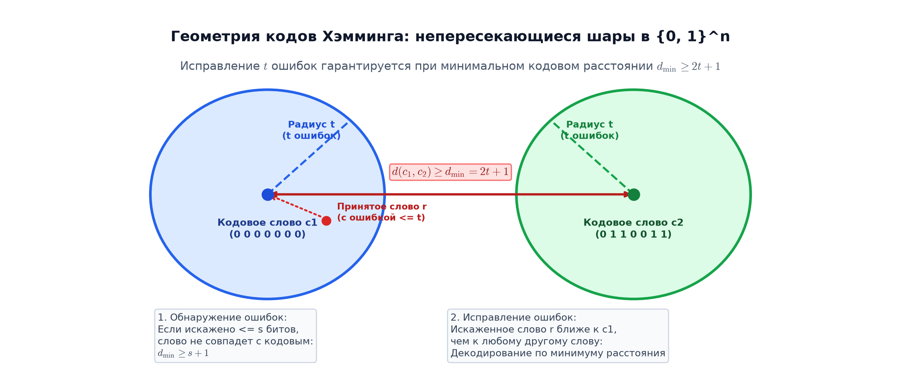

# 📝 Лекция 15: Коды, исправляющие ошибки

> [!info] ⏳ Предварительный конспект (сверен со слайдами)
> Конспект сверен с презентацией `s1-lec15-codes.typ` из репозитория Lipen/discrete-math-course (редакция от 13 октября 2026, неделя 15–16 декабря). Конспект будет дополнен после очной лекции.

> [!abstract] О занятии
> - **Дисциплина:** [[Дискретная математика]] (1 семестр, 2026/27 уч. год)
> - **Дата:** 16 декабря 2026 года (16-я неделя)
> - **Лектор:** Константин Чухарев ([@Lipen](https://github.com/Lipen), Университет ИТМО)
> - **Модуль 5:** Теория кодирования
> - **Источники:** слайды `s1-lec15-codes.typ`; глава книги `m13` («Расстояние Хэмминга и геометрия кода», «Код Хэмминга», «Линейные коды и $\mathrm{GF}(2)$»).
> - **Ключевые темы:** защита и сжатие, алфавит/слово/код/кодирование, чётность и повторение, расстояние и вес Хэмминга, кодовое расстояние, скорость, шары и способность кода, код Хэмминга $(7,4)$, синдром, проверочная матрица, расширенный код $(8,4,4)$ (SECDED), границы Хэмминга и Синглтона, MDS, линейные коды, порождающая матрица, CRC.

## 📌 Краткое резюме (TL;DR)

- **Защита** добавляет избыточность, **сжатие** убирает её; цена защиты — скорость $R=k/n$.
- Расстояние Хэмминга — метрика; $d(x,y)=\mathrm{wt}(x\oplus y)$.
- Код с кодовым расстоянием $d$ обнаруживает $d-1$ ошибок и исправляет $t=\lfloor(d-1)/2\rfloor$ (не $\lfloor d/2\rfloor$!).
- **Код Хэмминга $(7,4,3)$:** проверочные биты на позициях $1,2,4$; **синдром** в двоичной записи = номер искажённой позиции.
- Расширенный $(8,4,4)$ отличает две ошибки от одной (SECDED).
- **Граница Хэмминга:** $\vert C\vert\le2^n/\sum_{i\le t}\binom ni$; код Хэмминга совершенный. **Граница Синглтона:** $k\le n-d+1$.
- Линейный код — подпространство $\mathrm{GF}(2)^n$: $\vert C\vert=2^k$, $c=mG$, $d$ = минимальный вес ненулевого слова.

---

## 1. Коды, исправляющие ошибки

> [!quote] Эпиграф
> «Цель вычислений — проникновение в суть, а не числа.» — Ричард Хэмминг

### 1.1. Канал шумит

Канал передачи данных искажает биты. Провод, радиоволна, дорожка диска — всё это каналы, и все они ошибаются; запись на диск — тоже передача, только из прошлого в будущее. В памяти бит может перевернуться от космической частицы; царапина на диске портит дорожку не по одному биту, а целым участком.

> [!important] Защита и сжатие
> - **Защита:** добавить избыточность, чтобы исправить ошибки.
> - **Сжатие:** убрать избыточность, чтобы уменьшить размер.

Коды, исправляющие ошибки, работают в QR-кодах, на дисках и в спутниковой связи; сжатие без потерь живёт в zip и PNG. Плата за защиту — полезная скорость: чем больше избыточности, тем меньше данных проходит через канал за единицу времени.

### 1.2. Алфавит, слова, код, кодирование

- **Алфавит** — конечное непустое множество символов (двоичный $\{0,1\}$; ДНК $\{A,C,G,T\}$).
- **Слово** над $\Sigma$ — конечная последовательность символов, число символов — *длина*. Слово $10110$ имеет длину 5; двоичных слов длины $n$ ровно $2^n$.
- **Код** — непустое множество слов (*кодовых слов*).
- **Кодирование** — инъективная функция $E:M\to C$ из сообщений в код; *декодирование* возвращает сообщение: $D(E(m))=m$. Из инъективности $\vert M\vert\le\vert C\vert$.

> [!warning] Кодирование без инъекции
> $E(A)=0$, $E(B)=1$, $E(C)=0$: принятое слово $0$ могло быть $A$ или $C$ — различие стёрто ещё до канала, и хитрый декодер это не чинит.

**Цепочки сообщений.** Поток передаётся кусками, и приёмник должен разрезать его обратно. Пусть $E(x)=0$, $E(y)=1$, $E(z)=01$: слово $01$ читается как $z$ и как пара $x,y$. Инъективности на отдельных сообщениях мало: нужна однозначность разбиения потока — её дают *префиксные коды*.

### 1.3. Чётность и повторение

> [!example] Чётность
> К двум битам данных добавим их XOR: $00\mapsto000$, $01\mapsto011$, $10\mapsto101$, $11\mapsto110$. Передали $00$, канал перевернул второй бит: принято $010$, единиц одна — чётность нарушена, ошибку видно. Но какой бит испорчен, не узнать: три кодовых слова отличаются от принятого ровно одним битом. Две ошибки дают слово с чётным числом единиц: из $00$ выходит $110$ — кодовое слово, код молчит.

Код чётности с $d=2$ обнаруживает одну ошибку и не исправляет ни одной.

> [!example] Код-повторение
> Каждый бит трижды: слова $000$, $111$. Принято $011$: единиц две против одного нуля — голосование по большинству возвращает $1$. Одна ошибка исправляется, но две трети канала потрачены на защиту.

Защита оплачивается скоростью: повторение сжигает две трети канала, чтобы исправить один бит.

### 1.4. Расстояние и вес Хэмминга

> [!info] Определение
> **Расстояние Хэмминга** — число позиций, в которых строки различаются: $d(x,y)=\vert\{i\mid x_i\ne y_i\}\vert$.

Примеры: $d(10110,10001)=3$ (позиции 3, 4, 5); $d(0000,1111)=4$; $d(x,x)=0$.

Метрика: неотрицательность и равенство нулю только для совпадающих строк; симметрия; неравенство треугольника $d(x,z)\le d(x,y)+d(y,z)$. Чтобы превратить $x$ в $y$, нужно перевернуть ровно $d(x,y)$ битов; неравенство треугольника гарантирует, что ошибки канала не сблизят два кодовых слова.

> [!info] Вес
> **Вес** слова $x$ — число его единичных позиций, $\mathrm{wt}(x)$. $\mathrm{wt}(10110)=3$, $\mathrm{wt}(111)=3$, $\mathrm{wt}(000)=0$.

Связь: $d(x,y)=\mathrm{wt}(x+y)$, где $+$ — побитовый XOR (разошедшиеся позиции — единицы суммы).

> [!example] Полный расчёт
> | $i$ | 1 | 2 | 3 | 4 | 5 | 6 | 7 | 8 |
> |:-:|:-:|:-:|:-:|:-:|:-:|:-:|:-:|:-:|
> | $x$ | 1 | 0 | 1 | 1 | 0 | 1 | 0 | 0 |
> | $y$ | 1 | 0 | 0 | 1 | 1 | 1 | 1 | 0 |
> | $x+y$ | 0 | 0 | 1 | 0 | 1 | 0 | 1 | 0 |
>
> Разошлись позиции 3, 5, 7: $d(x,y)=\mathrm{wt}(x+y)=3$.

### 1.5. Кодовое расстояние, параметры, скорость

> [!info] Кодовое расстояние
> $d=\min\{d(x,y)\mid x,y\in C,\ x\ne y\}$.

Код-повторение $\{000,111\}$: $d=3$. Код чётности $\{000,011,101,110\}$: $d=2$.

**Параметры** — тройка $(n,\vert C\vert,d)$; для линейных $(n,k,d)$ с $\vert C\vert=2^k$. Код Хэмминга — $(7,4,3)$, повторение — $(3,1,3)$.

> [!info] Скорость и избыточность
> **Скорость** $R=k/n$ — доля информационных битов; **избыточность** $1-R$.

| Код | Скорость | Исправляет |
|:--|:-:|:-:|
| Повторение $(3,1)$ | $1/3\approx0{,}33$ | 1 бит |
| Хэмминг $(7,4)$ | $4/7\approx0{,}57$ | 1 бит |

При одинаковой надёжности код Хэмминга передаёт в $12/7\approx1{,}7$ раза больше данных, чем повторение.

### 1.6. Шары и способность кода

Кодовые слова — точки в пространстве всех двоичных строк длины $n$. Декодер заменяет принятую строку ближайшим кодовым словом — как редактор исправляет опечатку. Каждое слово окружено шаром радиуса $t$: все строки внутри шара декодируются в его центр.



> [!note] Теорема (способность кода)
> Если $d\ge s+1$, код обнаруживает до $s$ ошибок. Если $d\ge2t+1$, код исправляет до $t$ ошибок: $t=\lfloor(d-1)/2\rfloor$.

Код с $d=3$ исправляет одну ошибку; с $d=4$ — по-прежнему одну, зато отличает двойную от одиночной.

**Декодирование по ближайшему:** принятое $r$ декодируется в кодовое слово $c$ с минимальным $d(r,c)$. Пока ошибок не больше $t$, ближайшее слово единственно и правильно; при большем числе ошибок гарантии нет.

*Доказательство.* **Обнаружение.** Пусть $d\ge s+1$ и принятое слово отличается от переданного не более чем в $s$ позициях. Оно отстоит от переданного меньше, чем на $d$, поэтому не может совпасть с другим кодовым словом — ошибка обнаружена. **Исправление.** Пусть $d\ge2t+1$. Шары радиуса $t$ вокруг кодовых слов не пересекаются: если бы точка $z$ лежала в двух шарах с центрами $x,y$, то $d(x,y)\le d(x,z)+d(z,y)\le2t$ — противоречие. Принятое слово с не более чем $t$ ошибками попадает ровно в один шар и декодируется в его центр. $\blacksquare$

> [!warning] Почему не $\lfloor d/2\rfloor$?
> Код $\{0000,1111\}$ имеет $d=4$, формула $\lfloor d/2\rfloor$ обещает $t=2$. Но $0011$ отстоит от обоих слов ровно на 2: декодеру нечего выбрать. Верно: $t=\lfloor(d-1)/2\rfloor=1$.

---

## 2. Код Хэмминга $(7,4)$

> [!info] Определение
> $n=7$, $k=4$, $d=3$. Проверочные биты на позициях $1,2,4$ (степени двойки), данные — на $3,5,6,7$:
> $$p_1,\ p_2,\ d_1,\ p_4,\ d_2,\ d_3,\ d_4.$$

Хэмминг придумал код от раздражения: машина с перфокартами останавливалась на каждой ошибке чтения, и вычисления пропадали впустую; статья 1950 года дала первый явный код, исправляющий одну ошибку.

### 2.1. Контрольные группы

Проверочный бит — XOR данных своей группы:

- $p_1$ контролирует $d_1,d_2,d_4$ (позиции $1,3,5,7$): $p_1=d_1\oplus d_2\oplus d_4$;
- $p_2$ контролирует $d_1,d_3,d_4$ (позиции $2,3,6,7$): $p_2=d_1\oplus d_3\oplus d_4$;
- $p_4$ контролирует $d_2,d_3,d_4$ (позиции $4,5,6,7$): $p_4=d_2\oplus d_3\oplus d_4$.

> [!important] Почему такие группы?
> Бит $p_i$ контролирует позиции, в двоичной записи которых $i$-й бит равен $1$. Позиция $3=011$ входит в первые две группы, $7=111$ — во все три. Три проверки — три вопроса «да–нет»: каждая делит позиции пополам и отдаёт один бит номера позиции.

> [!example] Кодирование
> Данные $d_1=1,d_2=0,d_3=1,d_4=1$: $p_1=1\oplus0\oplus1=0$, $p_2=1\oplus1\oplus1=1$, $p_4=0\oplus1\oplus1=0$. Кодовое слово $(0,1,1,0,0,1,1)$; каждая контрольная группа даёт нулевой XOR.

### 2.2. Синдром

При приёме каждый бит синдрома — XOR своей контрольной группы:
$$s_1=r_1\oplus r_3\oplus r_5\oplus r_7,\quad s_2=r_2\oplus r_3\oplus r_6\oplus r_7,\quad s_4=r_4\oplus r_5\oplus r_6\oplus r_7.$$
Нулевой синдром — ошибок нет.

> [!important]
> Ненулевой синдром читается как двоичное число $(s_4s_2s_1)_2$ — это **номер искажённой позиции**: достаточно перевернуть этот бит.

| $s_1$ | $s_2$ | $s_4$ | $(s_4s_2s_1)_2$ | Позиция |
|:-:|:-:|:-:|:-:|:-:|
| 1 | 0 | 0 | 1 | 1 |
| 0 | 1 | 0 | 2 | 2 |
| 1 | 1 | 0 | 3 | 3 |
| 0 | 0 | 1 | 4 | 4 |
| 1 | 0 | 1 | 5 | 5 |
| 0 | 1 | 1 | 6 | 6 |
| 1 | 1 | 1 | 7 | 7 |

Совпадение синдрома с номером позиции — следствие выбора контрольных групп: столбцы проверочной матрицы — двоичные записи чисел от $1$ до $7$, поэтому синдром складывает столбцы искажённых позиций.

> [!example] Исправление
> Передано $(0,1,1,0,0,1,1)$, ошибка в позиции 5: принято $(0,1,1,0,1,1,1)$. $s_1=0\oplus1\oplus1\oplus1=1$, $s_2=1\oplus1\oplus1\oplus1=0$, $s_4=0\oplus1\oplus1\oplus1=1$. Синдром $(1,0,1)=5$: переворачиваем пятый бит — данные $(1,0,1,1)$ вернулись.

Кодирование и декодирование зеркальны: те же три группы, тот же XOR.

### 2.3. Проверочная матрица

$$H=\begin{pmatrix}1&0&1&0&1&0&1\\0&1&1&0&0&1&1\\0&0&0&1&1&1&1\end{pmatrix}.$$
Слово кодовое, если $Hx^T=0$ над $\mathrm{GF}(2)$. Для $(0,1,1,0,0,1,1)$: $Hx^T=(0,0,0)^T$; для принятого слова синдром — это $Hr$. Для длины $2^l-1$ берут все ненулевые столбцы высоты $l$: нулевой столбец пропустил бы ошибку в своей позиции.

### 2.4. Две и три ошибки

> [!example] Две ошибки
> Передано $(0,1,1,0,0,1,1)$, ошибки в позициях 4 и 6: принято $(0,1,1,1,0,0,1)$. Синдром $(0,1,0)=2$ — декодер переворачивает бит 2, неиспорченную позицию. Две ошибки маскируются под одну: код с $d=3$ их замечает, но исправить не может.

> [!example] Три ошибки
> Ошибки в позициях 1, 2, 3: вектор ошибок $(1,1,1,0,0,0,0)$ сам кодовое слово; принято $(1,0,0,0,0,1,1)$ — снова кодовое слово. Синдром нулевой: «ошибок нет», хотя данные испорчены.

За пределами $t=\lfloor(d-1)/2\rfloor$ код за результат не отвечает.

### 2.5. Расширенный код $(8,4,4)$ — SECDED

К базовому коду добавляется общий бит чётности всего слова $p_8=\bigoplus_{i=1}^7c_i$. Расстояние вырастает до 4: слова базового кода различаются минимум в трёх позициях, и если различий ровно три, их нечётность делает разными биты чётности — это четвёртая позиция. Код по-прежнему исправляет одну ошибку, но отличает двойную от одиночной: двойная сохраняет чётность слова, одиночная — нет.

| Синдром | Чётность | Что делать |
|:-:|:-:|:--|
| $0$ | сошлась | ошибок нет |
| $0$ | не сошлась | испорчен бит чётности — исправляем |
| $\ne0$ | не сошлась | одна ошибка — исправляем |
| $\ne0$ | сошлась | две ошибки — не трогаем |

При подозрении на две ошибки декодер сообщает о повреждении данных, вместо того чтобы исправлять не тот бит. Режим **SECDED** (*Single Error Correction, Double Error Detection*) — стандарт серверной памяти ECC.

> [!example] Две ошибки в расширенном коде
> Передано $(0,1,1,0,0,1,1,0)$, данные $(1,0,1,1)$; ошибки в позициях 4 и 6: принято $(0,1,1,1,0,0,1,0)$. Синдром первых семи бит $(0,1,0)=2$, чётность всего слова сошлась (единиц четыре) — бит 2 не трогаем, слово объявляется повреждённым.

---

## 3. Границы

### 3.1. Граница Хэмминга

> [!note] Теорема
> Двоичный код длины $n$, исправляющий $t$ ошибок, содержит не более $\vert C\vert\le\dfrac{2^n}{\sum_{i=0}^t\binom ni}$ слов.

*Доказательство подсчётом точек.* Код исправляет $t$ ошибок, поэтому $d\ge2t+1$ и шары радиуса $t$ попарно не пересекаются. На расстоянии ровно $i$ от слова лежит $\binom ni$ строк, значит, шар вмещает $\sum_{i=0}^t\binom ni$ строк. Непересекающиеся шары лежат в пространстве из $2^n$ строк: $\vert C\vert\sum_{i\le t}\binom ni\le2^n$. $\blacksquare$

> [!example] В числах
> $n=7$, $t=1$: шар вмещает $1+7=8$ строк, $\vert C\vert\le128/8=16$. Код $(7,5,3)$ из 32 слов запрещён: $2^5\cdot8=256>128$.

> [!info] Совершенный код
> Код **совершенный**, если шары радиуса $t$ вокруг его слов покрывают всё пространство без пересечений и дыр — граница Хэмминга обращается в равенство.

Код Хэмминга $(7,4)$: $2^4\cdot(1+\binom71)=16\cdot8=128=2^7$ — восемь значений синдрома: семь позиций ошибок и чистый приём. Код-повторение $(3,1,3)$ совершенный: $2\cdot(1+3)=8=2^3$.

### 3.2. Граница Синглтона и MDS

> [!note] Теорема (Синглтон)
> Код длины $n$ с $2^k$ словами и расстоянием $d$ удовлетворяет $k\le n-d+1$.

*Доказательство вычёркиванием.* Удалим из каждого слова одни и те же $d-1$ позиций. Укороченные слова все различны: два совпавших исходных слова расходились бы не более чем в $d-1$ позициях, а кодовые слова отстоят минимум на $d$. Строк длины $n-d+1$ ровно $2^{n-d+1}$, поэтому $2^k\le2^{n-d+1}$. $\blacksquare$

> [!info] MDS
> Код **MDS** (*maximum distance separable*) достигает границы: $d=n-k+1$.

| Код | $(n,k,d)$ | $n-k+1$ | MDS? |
|:--|:-:|:-:|:-:|
| Повторение | $(3,1,3)$ | 3 | да |
| Чётность | $(n,n-1,2)$ | 2 | да |
| Хэмминг | $(7,4,3)$ | 4 | нет |
| Расширенный Хэмминг | $(8,4,4)$ | 5 | нет |

Оба кода Хэмминга отстают от границы на одну позицию расстояния. Над $\mathrm{GF}(2)$ границу Синглтона достигают только простые коды — повторение и чётность; над большими алфавитами её держат коды Рида–Соломона (QR-коды, компакт-диски).

---

## 4. Линейные коды

> [!info] Линейный код
> $C\subseteq\mathrm{GF}(2)^n$ **линеен**, если содержит нулевое слово и замкнут относительно покоординатного XOR. Сумма двух кодовых слов — снова кодовое слово.

Все двоичные строки длины $n$ — векторное пространство $\mathrm{GF}(2)^n$ (XOR — сложение, AND — умножение). Базис из $k$ строк порождает ровно $2^k$ слов, поэтому $\vert C\vert=2^k$ и параметры пишутся $(n,k,d)$.

> [!info] Порождающая матрица
> Матрица $G$ размера $k\times n$, строки которой — базис кода. Кодирование $m\in\mathrm{GF}(2)^k$: $c=mG$.

> [!example] Код Хэмминга
> $$G=\begin{pmatrix}1&1&1&0&0&0&0\\1&0&0&1&1&0&0\\0&1&0&1&0&1&0\\1&1&0&1&0&0&1\end{pmatrix}.$$
> Сообщение $(1,0,1,1)$: складываем строки 1, 3, 4 — получаем $(0,1,1,0,0,1,1)$.

> [!note] Теорема (расстояние линейного кода)
> $d=\min\{\mathrm{wt}(c)\mid c\in C,\ c\ne0\}$.

*Доказательство двумя неравенствами.* Пусть $c$ — ненулевое слово наименьшего веса; нулевое слово принадлежит коду, пара $c$ и $0$ даёт $d\le\mathrm{wt}(c)$. Обратно, для любых разных $x,y\in C$ сумма $x+y$ — ненулевое кодовое слово и $\mathrm{wt}(x+y)=d(x,y)$, поэтому $d$ не меньше веса наименьшего ненулевого слова. $\blacksquare$ Перебор сокращается с $\binom{16}2=120$ пар до $15$ ненулевых слов.

> [!note] Теорема
> Кодовое расстояние кода Хэмминга $(7,4)$ равно 3.

*Доказательство минимальным весом.* Решения $Hx^T=0$ образуют линейный код. Вес 1 невозможен: единица в позиции $i$ оставляет в $Hx^T$ столбец $i$, а все семь столбцов ненулевые. Вес 2 невозможен: столбцы $H$ попарно различны, сумма двух разных ненулевая. Вес 3 достижим: $(1,0,0)+(0,1,0)+(1,1,0)=0$, значит, слово $1110000$ кодовое. $\blacksquare$

**Систематический вид.** Если $G=[I_k\mid P]$, то $H=[P^T\mid I_{n-k}]$; синдром принятого $r$: $s^T=Hr^T$.

### Код Хэмминга на Python

```python
H = [
    [1, 0, 1, 0, 1, 0, 1],
    [0, 1, 1, 0, 0, 1, 1],
    [0, 0, 0, 1, 1, 1, 1],
]
PARITY = (0, 1, 3)  # проверочные позиции 1, 2, 4

def encode(data):
    x = [0] * 7
    x[2], x[4], x[5], x[6] = data  # данные на позициях 3, 5, 6, 7
    for i, row in zip(PARITY, H):  # строка H обслуживает свою позицию
        x[i] = sum(x[j] for j in range(7) if row[j] and j != i) % 2
    return x

def decode(r):
    s = [sum(H[i][j] * r[j] for j in range(7)) % 2 for i in range(3)]
    if any(s):
        pos = s[0] + 2 * s[1] + 4 * s[2]  # синдром называет позицию
        print("синдром", s, "ошибка в позиции", pos)
        r[pos - 1] ^= 1
    return r[2], r[4], r[5], r[6]

x = encode([1, 0, 1, 1])
x[4] ^= 1  # канал перевернул пятый бит
print(decode(x))
# синдром [1, 0, 1] ошибка в позиции 5
# (1, 0, 1, 1)
```

Синдром $(1,0,1)$ прочитался как число 5, перевёрнутый бит встал на место — данные вернулись.

### CRC и контрольные суммы

- Контрольная сумма пакета складывает его слова: несовпадение сигнализирует о порче.
- CRC делит пакет на порождающий полином: нулевой остаток означает целостность.
- Ни тот, ни другой не знает позицию ошибки, поэтому исправить её не может.

Обнаружение требует $d\ge s+1$, исправление — $d\ge2t+1$: коррекция вдвое дороже. Поэтому в сети ставят CRC и просят повторную передачу, а коды Хэмминга живут в памяти, где переспроса нет.

---

## 5. Что мы поняли?

- Кодирование — инъекция: два сообщения с одним словом декодер не различит.
- Расстояние Хэмминга — метрика, а кодовое расстояние $d$ обнаруживает до $d-1$ и исправляет до $\lfloor(d-1)/2\rfloor$ ошибок.
- Код Хэмминга $(7,4)$: проверочная матрица собирает группы, синдром называет позицию ошибки, а $16\cdot8=2^7$ — код совершенный.
- Граница Хэмминга считает шары, граница Синглтона $k\le n-d+1$ отделяет MDS-коды: над $\mathrm{GF}(2)$ это чётность и повторение.
- За пределами гарантий две ошибки маскируются под одну, три проходят незаметно.
- Линейный код — подпространство в $\mathrm{GF}(2)^n$: порождающая матрица кодирует, расстояние равно минимальному весу.

## ❓ Вопросы для самопроверки к коллоквиуму / экзамену

- [ ] Вычислите $d(110010,010101)$.
  > [!note] Решение
  > Различия в позициях 1, 4, 5, 6: $d=4$ (и $\mathrm{wt}(110010\oplus010101)=\mathrm{wt}(100111)=4$).
- [ ] Почему код чётности не исправляет ни одной ошибки, хотя обнаруживает одну?
- [ ] Закодируйте $(0,1,1,0)$, внесите одиночную ошибку и исправьте её по синдрому.
  > [!note] Решение
  > $d_1=0,d_2=1,d_3=1,d_4=0$: $p_1=0\oplus1\oplus0=1$, $p_2=0\oplus1\oplus0=1$, $p_4=1\oplus1\oplus0=0$. Слово $(1,1,0,0,1,1,0)$. Пусть ошибка в позиции 6: $r=(1,1,0,0,1,0,0)$; $s_1=1\oplus0\oplus1\oplus0=0$, $s_2=1\oplus0\oplus0\oplus0=1$, $s_4=0\oplus1\oplus0\oplus0=1$; синдром $(1,1,0)_2=6$ — переворачиваем бит 6.
- [ ] Почему линейному коду достаточно минимального веса ненулевого слова?
- [ ] Код чётности $(n,n-1,2)$ достигает границы Синглтона. Как это проверить?
  > [!note] Решение
  > $n-k+1=n-(n-1)+1=2=d$.
- [ ] Функция кодирования отправляет сообщения $A$ и $B$ в одно слово. Что нарушено и чем это грозит?
- [ ] Дан код $\{000,111\}$. Найдите параметры $(n,\vert C\vert,d)$, скорость, проверьте границу Хэмминга.
  > [!note] Решение
  > $(3,2,3)$ в обозначении $(n,\vert C\vert,d)$; $k=1$, $R=1/3$; $t=1$: $2\le8/(1+3)=2$ — равенство, код совершенный.
- [ ] Код имеет $d=6$. Сколько ошибок он обнаруживает и сколько исправляет?
  > [!note] Решение
  > Обнаруживает $5$, исправляет $\lfloor5/2\rfloor=2$.
- [ ] При приёме кода Хэмминга получено $r=(1,1,0,0,0,1,1)$. Найдите синдром и номер ошибочного бита.
  > [!note] Решение
  > $s_1=1\oplus0\oplus0\oplus1=0$, $s_2=1\oplus0\oplus1\oplus1=1$, $s_4=0\oplus0\oplus1\oplus1=0$ — синдром $(0,1,0)_2=2$: ошибка в позиции 2 ($p_2$).
- [ ] Объясните четыре исхода декодера расширенного кода $(8,4,4)$.

## 📚 Что почитать (книга курса)

- `m13` — «Расстояние Хэмминга и геометрия кода», «Код Хэмминга», «Линейные коды и $\mathrm{GF}(2)$».

## 🔗 Связанные материалы

- [[Дискретная математика]] — главная страница дисциплины
- [[13. Лекция - Минимизация булевых функций, карты Карно, полиномы Жегалкина и критерий Поста (2026-12-02)]]
- [[14. Лекция - Логические схемы, функциональные элементы, сумматоры и схемная сложность (2026-12-09)]]
- [[16. Лекция - Сжатие данных, код Хаффмана, циклические коды и коды Рида-Соломона (2026-12-23)]]
- [[Теорминимум 2 - Булева алгебра, логика высказываний, предикаты и коды (2026-12-23)]]
