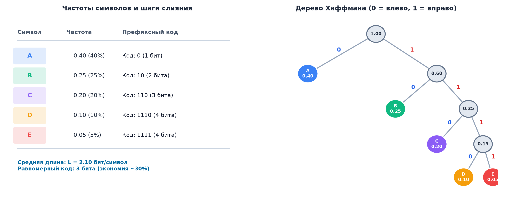
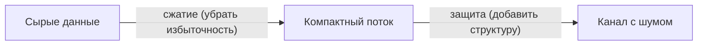
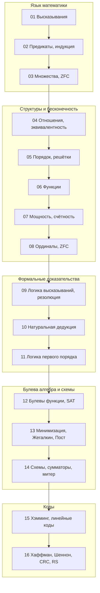

# 📝 Лекция 16: Сжатие и границы

> [!info] ⏳ Предварительный конспект (сверен со слайдами)
> Конспект сверен с презентацией `s1-lec16-compression.typ` из репозитория Lipen/discrete-math-course (редакция от 13 октября 2026, неделя 22–23 декабря). Конспект будет дополнен после очной лекции.

> [!abstract] О занятии
> - **Дисциплина:** [[Дискретная математика]] (1 семестр, 2026/27 уч. год)
> - **Дата:** 23 декабря 2026 года (17-я неделя)
> - **Лектор:** Константин Чухарев ([@Lipen](https://github.com/Lipen), Университет ИТМО)
> - **Модуль 5:** Теория кодирования
> - **Источники:** слайды `s1-lec16-compression.typ`; глава книги `m13` («Код Хаффмана», «Словарное сжатие: LZ77 и LZ78», «Граница Шеннона», «Циклические коды», «Коды Рида–Соломона»).
> - **Ключевые темы:** префиксные коды, неравенство Крафта, алгоритм и оптимальность Хаффмана, LZ77/LZ78/LZW, арифметическое кодирование, несжимаемость, граница Хэмминга, энтропия, теорема Шеннона, циклические коды и CRC, коды Рида–Соломона.

## 📌 Краткое резюме (TL;DR)

- **Сжатие без потерь** убирает избыточность: частым символам — короткие слова, редким — длинные.
- **Префиксный код** (мгновенный): никакое слово не начало другого; для длин выполнено **Крафт** $\sum2^{-l_i}\le1$ (и обратно).
- **Хаффман** жадно строит дерево, сливая два самых лёгких узла; оптимален среди префиксных кодов.
- Предел частотного сжатия: $H\le L<H+1$. Арифметическое кодирование округляет один раз на всё сообщение.
- Словарное сжатие (LZ77/LZ78/LZW) убирает повторы; DEFLATE = LZ77 + Хаффман.
- Почти все строки несжимаемы; «архиватор всего» невозможен.
- **Граница Хэмминга** и совершенные коды; **теорема Шеннона**: $R<C$ — надёжно, $R>C$ — невозможно.
- **CRC** — деление на $g(x)$; **Рид–Соломон** — многочлен над $\mathrm{GF}(2^8)$, MDS, чинит пакетные ошибки символами.

---

## 1. Код Хаффмана и сжатие

> [!quote] Эпиграф
> «Основная задача связи состоит в точном или приближённом воспроизведении в некотором месте сообщения, выбранного для передачи в другом месте.» — Клод Шеннон

### 1.1. Защита и сжатие

Код Хэмминга защищает от ошибок, добавляя избыточность; код Хаффмана решает обратную задачу — сжать данные до минимального размера без потерь. Частым символам — короткие кодовые слова, редким — длинные. Азбука Морзе делает то же: буква E — одна точка, Q — четыре знака. Сжатие здесь *без потерь*: распакованный файл совпадает с исходным бит в бит (с потерями живут картинки и звук).

### 1.2. Префиксный код

Слова разной длины полезны, только если поток читается без пауз и возвратов.

> [!info] Определение
> Код **префиксный**, если ни одно кодовое слово не является началом другого.

> [!example]
> $\{0,10,11\}$ — префиксный. $\{0,01,011\}$ — нет: слово $0$ может продолжиться как $01$ или как $011$, декодер не знает, кончилось ли слово. На дереве кода: кодовые слова — листья, и ни одно не стоит на пути к другому.

**Декодирование без задержки.** Слова $A=0$, $B=10$, $C=110$, $D=1110$, $E=1111$. Поток `1101111` читается слева направо: `110` — $C$, сразу за ним `1111` — $E$; другого разбиения нет. Префиксные коды называют *мгновенными* (*instantaneous*): символ опознаётся сразу по прочтении слова, задержка ограничена длиной слова.

### 1.3. Неравенство Крафта

Не всякий набор длин годится: слово длины $1$ занимает половину кодового пространства.

> [!note] Неравенство Крафта
> Если бинарный префиксный код состоит из слов с длинами $l_1,\dots,l_n$, то $\sum_{i=1}^n2^{-l_i}\le1$.

*Доказательство подсчётом строк.* Возьмём $L=\max l_i$. Каждое слово продолжается до $2^{L-l_i}$ строк длины $L$; из-за префиксности продолжения разных слов не пересекаются. Все они среди $2^L$ строк, значит, $\sum_i2^{L-l_i}\le2^L$; деление на $2^L$ даёт неравенство. $\blacksquare$

> [!example]
> Код Хаффмана пяти символов ($A=0,\dots,E=1111$): $1/2+1/4+1/8+1/16+1/16=1$ — равенство, кодовое дерево заполнено без дыр.

> [!warning] Сумма не делает код префиксным
> $\{0,01,011\}$ проходит по сумме: $1/2+1/4+1/8=7/8\le1$, но слово $0$ — префикс слова $01$. Обратная теорема гарантирует лишь *существование* другого префиксного кода с теми же длинами, например $\{0,10,110\}$.

> [!note] Обратная теорема Крафта
> Если $\sum2^{-l_i}\le1$, то префиксный код с длинами $l_1,\dots,l_n$ существует.

*Построение.* Упорядочим длины по возрастанию и возьмём словом $i$ первые $l_i$ битов двоичной записи суммы $s_i=\sum_{k<i}2^{-l_k}$. Слову из $l_i$ битов отвечает отрезок $[s_i,s_i+2^{-l_i})$; отрезки идут слева направо без наложений. Вложенных отрезков нет — иначе одно слово было бы началом другого. $\blacksquare$

> [!example] Суммы: полная и с дырой
> Длины $(1,2,3,3)$: $s_1=0\to0$; $s_2=\tfrac12=0.1_2\to10$; $s_3=\tfrac34=0.11_2\to110$; $s_4=\tfrac78=0.111_2\to111$ — код $\{0,10,110,111\}$ (тот же, что строит Хаффман для $\tfrac12,\tfrac14,\tfrac18,\tfrac18$). Длины $(1,2)$: сумма $3/4<1$ — код $\{0,10\}$ не заполняет дерево, слово $1$ остаётся свободным.

Теорема Макмиллана усиливает неравенство: ему подчиняется любой однозначно декодируемый код, даже не префиксный. Префиксность «бесплатна»: класс кодов уже, а лучшие длины те же.

### 1.4. Алгоритм Хаффмана

Жадный алгоритм, строит дерево снизу вверх: (1) лес из листьев с частотами; (2) слить два дерева наименьшего веса в узел с суммой; ребро к левому потомку — $0$, к правому — $1$; (3) повторять, пока не останется один корень весом $1$; (4) слово символа — путь от корня к листу. Реализация — очередь с минимальным весом: два извлечения, одно слияние, одна вставка, всего $n-1$ шаг. Тяжёлые символы сливаются последними и остаются у корня — потому и получают короткие слова.



> [!example] Пять символов
> $A=0{,}40$, $B=0{,}25$, $C=0{,}20$, $D=0{,}10$, $E=0{,}05$.
> 1. $D+E$ → узел $0{,}15$.
> 2. $C+\mathrm{DE}$ → $0{,}35$.
> 3. $B+\mathrm{CDE}$ → $0{,}60$.
> 4. $A+\mathrm{BCDE}$ → корень $1{,}00$.
>
> Слова: $A=0$, $B=10$, $C=110$, $D=1110$, $E=1111$.

**Средняя длина** $L=\sum_if_il_i$. Для примера: $L=0{,}40\cdot1+0{,}25\cdot2+0{,}20\cdot3+0{,}10\cdot4+0{,}05\cdot4=2{,}10$ бита на символ против $\lceil\log_25\rceil=3$ у равномерного кода (экономия $30\%$). При равных частотах и $n$ — степени двойки код Хаффмана вырождается в равномерный: сжимать нечего. Выигрыш — только при неравных частотах.

> [!note] Обмен без ухудшения
> Среди оптимальных деревьев найдётся такое, где два редчайших символа — соседние листья максимальной глубины.

*Доказательство двумя обменами.* Пусть $a,b$ — редчайшие символы, $x,y$ — соседние листья максимальной глубины оптимального дерева. Обмен $a$ и $x$ меняет вклад пары на $(f_a-f_x)(l_x-l_a)\le0$: редчайший уходит глубже, длина не растёт. Тем же обменом ставим $b$ на место $y$, и пара $a,b$ — соседняя. $\blacksquare$

> [!note] Оптимальность Хаффмана
> Для заданных частот код Хаффмана имеет минимальную среднюю длину среди всех префиксных кодов.

*Индукция по числу символов $n$.* **База:** $n=1$, $L=0$ — короче невозможно. **Шаг:** по обмену есть оптимальное дерево, где редчайшие $a,b$ — соседи максимальной глубины. Склейка их в лист веса $f_a+f_b$ уменьшает $L$ ровно на $f_a+f_b$. По индукции алгоритм оптимален для $n-1$ символов, а разворачивание листа прибавляет те же $f_a+f_b$ любому коду — дерево оптимально и для $n$. $\blacksquare$

> [!example] Шесть символов
> Частоты $A=0{,}30$, $B=0{,}25$, $C=0{,}15$, $D=0{,}12$, $E=0{,}10$, $F=0{,}08$.
>
> | Шаг | Слияние | Вес узла | Лес после шага |
> |:-:|:-:|:-:|:--|
> | 1 | $F+E$ | $0{,}18$ | $0{,}12;\ 0{,}15;\ 0{,}18;\ 0{,}25;\ 0{,}30$ |
> | 2 | $D+C$ | $0{,}27$ | $0{,}18;\ 0{,}25;\ 0{,}27;\ 0{,}30$ |
> | 3 | $\mathrm{FE}+B$ | $0{,}43$ | $0{,}27;\ 0{,}30;\ 0{,}43$ |
> | 4 | $\mathrm{DC}+A$ | $0{,}57$ | $0{,}43;\ 0{,}57$ |
> | 5 | $\mathrm{FEB}+\mathrm{DCA}$ | $1{,}00$ | корень |
>
> | Символ | Частота | Код | Длина |
> |:-:|:-:|:-:|:-:|
> | $A$ | 0,30 | `11` | 2 |
> | $B$ | 0,25 | `01` | 2 |
> | $C$ | 0,15 | `101` | 3 |
> | $D$ | 0,12 | `100` | 3 |
> | $E$ | 0,10 | `001` | 3 |
> | $F$ | 0,08 | `000` | 3 |
>
> $L=0{,}30\cdot2+0{,}25\cdot2+0{,}45\cdot3=2{,}45$ бита против 3 у равномерного (экономия $18\%$). Короче нельзя.

```python
import heapq
from collections import Counter

def huffman(freq):
    heap = [[w, [ch, ""]] for ch, w in sorted(freq.items())]
    heapq.heapify(heap)
    while len(heap) > 1:
        lo, hi = heapq.heappop(heap), heapq.heappop(heap)
        for p in lo[1:]: p[1] = "0" + p[1]
        for p in hi[1:]: p[1] = "1" + p[1]
        heapq.heappush(heap, [lo[0] + hi[0]] + lo[1:] + hi[1:])
    return dict(heap[0][1:])

text = "ABRACADABRA"
freq = Counter(text)
code = huffman(freq)
for ch in sorted(freq, key=freq.get, reverse=True):
    print(ch, freq[ch], code[ch])
print("total:", sum(freq[ch] * len(code[ch]) for ch in freq), "bits vs", 8 * len(text))
```

Вывод: `A 5 0`, `B 2 110`, `R 2 10`, `C 1 1110`, `D 1 1111`, `total: 23 bits vs 88`. Сумма длин $5\cdot1+2\cdot3+2\cdot2+1\cdot4+1\cdot4=23$. Коды могут не совпасть с ручной таблицей (нули и единицы на рёбрах свободны), длины те же. В файл дерево не пишут: хранят таблицу длин, а слова восстанавливают каноническим правилом.

### 1.5. Словарное сжатие: LZ77, LZ78, LZW

Хаффман видит только частоты, а главный резерв реальных данных — повторения. Словарное сжатие заменяет повтор ссылкой.

> [!info] LZ77
> Кодер ищет совпадения в *скользящем окне* — уже закодированном хвосте входа. Повтор кодируется тройкой $(o,l,a)$: смещение назад, длина совпадения, первый несовпавший символ.

LZ78 копит *словарь фраз*: выход — пары (номер фразы, новый символ). **DEFLATE** (gzip, zip, PNG) = LZ77 + код Хаффмана: LZ выучивает повторения, Хаффман ужимает остаток.

> [!example] LZ77 на «ABRACADABRA»
> | Тройка | Совпало | Свежий символ |
> |:-:|:-:|:-:|
> | $(0,0,A)$ | — | $A$ |
> | $(0,0,B)$ | — | $B$ |
> | $(0,0,R)$ | — | $R$ |
> | $(3,1,C)$ | $A$ | $C$ |
> | $(2,1,D)$ | $A$ | $D$ |
> | $(7,4)$ | $\mathrm{ABRA}$ | конец входа |
>
> Семь символов назад лежит точная копия хвоста: финальная пара кодирует четыре буквы двумя числами. При 3 битах на смещение, 3 на длину, 8 на символ: $5\cdot14+6=76$ бит против $88$ у ASCII.

> [!example] LZ78
> | Пара | Выдало | Новая фраза |
> |:-:|:-:|:--|
> | $(0,A)$ | $A$ | $1=\mathrm A$ |
> | $(0,B)$ | $B$ | $2=\mathrm B$ |
> | $(0,R)$ | $R$ | $3=\mathrm R$ |
> | $(1,C)$ | $\mathrm{AC}$ | $4=\mathrm{AC}$ |
> | $(1,D)$ | $\mathrm{AD}$ | $5=\mathrm{AD}$ |
> | $(1,B)$ | $\mathrm{AB}$ | $6=\mathrm{AB}$ |
> | $(3,A)$ | $\mathrm{RA}$ | $7=\mathrm{RA}$ |
>
> Семь пар покрывают одиннадцать букв; декодер строит словарь синхронно с кодером ($7\cdot(3+8)=77$ бит).

LZW — LZ78 с алфавитом в стартовом словаре: пара вырождается в чистый номер фразы. На «ABRACADABRA» — девять номеров по 4 бита — $36$ бит против $88$. LZW жил в GIF и Unix-утилите `compress`, пока LZ77+Хаффман не стал стандартом DEFLATE.

### 1.6. Арифметическое кодирование

Хаффман округляет длину каждого символа до целого числа битов; арифметическое кодирование округляет один раз на всё сообщение.

> [!info] Определение
> Всё сообщение кодируется одним числом — точкой отрезка $[0,1)$. Символ с вероятностью $p_i$ сжимает текущий отрезок в $p_i$ раз, после $n$ символов длина отрезка $W=p_1p_2\cdots p_n$. Достаточно любой двоичной дроби внутри отрезка — не более $\lceil-\log_2W\rceil$ битов.

Число битов на символ сходится к энтропии. Для «ABRACADABRA»: $p_A=5/11$, $p_B=p_R=2/11$, $p_C=p_D=1/11$; $W=(5/11)^5(2/11)^4(1/11)^2$, $-\log_2W\approx22{,}4$ бита ($=nH$); кодер выдаёт 23 бита, как и Хаффман. На кривой монете $(0{,}9;0{,}1)$ Хаффман застревает на целом бите, и только арифметика спускается к $0{,}47$. Арифметический кодер — блочный код Хаффмана с блоком, выросшим до всего сообщения; бинарный вариант CABAC работает в видеокодеках H.264 и H.265.

> [!example] Шесть методов на одном слове (88 бит исходно)
> | Метод | Биты | Доля | Что использует |
> |:--|:-:|:-:|:--|
> | ASCII | 88 | 100% | ничего |
> | Хаффман | 23 | 26% | неравные частоты |
> | Арифметическое | 23 | 26% | частоты без округления |
> | LZ77 | 76 | 86% | ссылки в окно |
> | LZ78 | 77 | 88% | словарь фраз |
> | LZW | 36 | 41% | только номера фраз |

### 1.7. Сжимаемость строк

> [!note] Почти все строки несжимаемы
> Доля строк длины $n$, сжимаемых хотя бы на $k$ битов, не превосходит $2^{1-k}$ при $k\le n$.

*Подсчёт.* Распаковщик взаимно однозначен. Сжимаемые строки — образы строк длины до $n-k$, а таких строк $2^{n-k+1}-1$. Доля не превышает $(2^{n-k+1}-1)/2^n<2^{1-k}$. $\blacksquare$ При $k=10$ сжимается меньше $2^{-9}\approx0{,}2\%$ строк — один файл из пятисот.

> [!warning] Архиватор всего
> Программа, сжимающая любой файл хотя бы на бит без потерь, невозможна по принципу Дирихле: строк длины меньше $n$ всего $2^n-1$, на все $2^n$ строк их не хватает. На случайных данных честный архиватор лишь растит файл. Реальные данные сжимаемы, потому что люди порождают крошечную долю всех строк; хорошо сжатый файл выглядит как случайные биты — структура исчерпана.

---

## 2. Границы

### 2.1. Граница Хэмминга и совершенные коды

> [!note] Теорема
> Если код исправляет $t$ ошибок, то $\vert C\vert\cdot\sum_{i=0}^t\binom ni\le2^n$.

*Доказательство подсчётом.* Шар радиуса $t$ вокруг слова — $\sum_{i\le t}\binom ni$ строк. Шары вокруг разных кодовых слов не пересекаются (общая строка дала бы $d\le2t$, а исправление $t$ ошибок требует $d\ge2t+1$). Все шары лежат в кубе из $2^n$ строк. $\blacksquare$

Код, достигающий границы, — **совершенный**. Код Хэмминга $(7,4)$: $16\cdot8=128=2^7$ — шары покрывают всё пространство без зазоров. Нетривиальных совершенных кодов мало: коды Хэмминга и бинарный код Голея $(23,12,7)$.

### 2.2. Энтропия и теорема о кодировании источника

> [!info] Энтропия
> $H=-\sum_ip_i\log_2p_i$.

> [!example]
> Равновероятная пара: $H=1$ бит. Достоверный символ: $\log_21=0$ — сообщать не о чем. Пять символов из примера: $H\approx2{,}04$ бита (код с $L=2{,}10$ отстаёт на шесть сотых). Кривая монета: $H=-0{,}9\log_20{,}9-0{,}1\log_20{,}1\approx0{,}469$ бита.

> [!example] Код на парах символов
> Пары источника $(0{,}9;0{,}1)$ имеют частоты $0{,}81;0{,}09;0{,}09;0{,}01$. Хаффман: $00\to1$, $10\to00$, $01\to011$, $11\to010$. $L=0{,}81\cdot1+0{,}09\cdot2+0{,}09\cdot3+0{,}01\cdot3=1{,}29$ бита на пару — $0{,}645$ на символ. Одиночный код тратит бит вместо $0{,}47$: блоки помогают, но таблица растёт как $2^n$.

> [!note] Теорема о кодировании источника
> Для любого префиксного кода $H\le L<H+1$ (верхняя оценка — для оптимального/Хаффмана).

*Нижняя.* Для $q_i=2^{-l_i}$ разность $L-H=\sum_ip_i\log_2(p_i/q_i)\ge\log_2(1/\sum q_i)\ge0$, так как $\sum q_i\le1$ — это Крафт. *Верхняя.* Код с $l_i=\lceil-\log_2p_i\rceil$ префиксен ($2^{-l_i}\le p_i$) и $l_i<-\log_2p_i+1$, поэтому $L<H+1$; Хаффман не хуже. $\blacksquare$

Для таблицы шести символов $H\approx2{,}42\le L=2{,}45<3{,}42$. Равенство $L=H$ возможно, только когда все $p_i$ — степени $1/2$. На блоках длины $n$: $H\le L<H+1/n$ — зазор тает; поэтому блочные коды и арифметическое сжатие приближаются к энтропии сколь угодно близко.

### 2.3. Пропускная способность и теорема Шеннона

Двоичный симметричный канал: каждый бит независимо переворачивается с вероятностью $p$.

> [!info] Пропускная способность
> $C=1-H(p)=1+p\log_2p+(1-p)\log_2(1-p)$.

| $p$ | $C$ | Канал |
|:-:|:-:|:--|
| $0$ | $1$ | без ошибок |
| $0{,}1$ | $0{,}53$ | умеренный шум |
| $0{,}2$ | $0{,}28$ | шум заметен |
| $0{,}5$ | $0$ | бесполезен |

При $p=0{,}5$ принятый бит не зависит от переданного — канал ничего не несёт.

> [!note] Теорема Шеннона о кодировании (1948)
> При любой скорости $R<C$ существуют коды с вероятностью ошибки, стремящейся к нулю. При $R>C$ надёжная передача невозможна.

Доказательство неконструктивно: случайный код большой длины хорош с высокой вероятностью, но из доказательства не извлечь сам код. Построение явных кодов у границы — программа на семь десятилетий: Рид–Соломон, турбо-коды, LDPC, полярные коды.

### 2.4. Сжать, потом защитить

Защита и сжатие двигают одну величину — долю полезного в переданном. Данные сжимают (Хаффман, DEFLATE), затем защищают (Хэмминг, RS, LDPC): сжатие убирает лишнюю избыточность, канальный код добавляет её назад — дозированно и там, где её ждёт декодер.



> [!warning] Порядок важен
> Если первым поставить код Хэмминга, он вставит проверочные биты в несжатый текст, и сжимать придётся уже перемешанные с избыточностью данные — выигрыша не будет.

---

## 3. Циклические коды и CRC

> [!info] Циклический код
> Линейный код, замкнутый относительно циклического сдвига $(c_0,\dots,c_{n-1})\to(c_{n-1},c_0,\dots,c_{n-2})$.

Слово — многочлен $c(x)=c_0+c_1x+\dots+c_{n-1}x^{n-1}$ в кольце $\mathbb{F}_2[x]/(x^n-1)$, сдвиг — умножение на $x$ по модулю $x^n-1$. Кодовые слова — в точности кратные **порождающего многочлена** $g(x)$ степени $r=n-k$, который делит $x^n-1$.

> [!example] Код $(7,4)$
> $g(x)=1+x+x^3$. Над $\mathrm{GF}(2)$: $x^7-1=(1+x+x^3)(1+x+x^2+x^4)$. Проверка: $(1+x+x^3)(1+x+x^2+x^4)=1+x^7$, так как все промежуточные члены попарно сокращаются ($x^i+x^i=0$).

**Кодирование:** $c(x)=x^{n-k}m(x)-r(x)$, где $r(x)$ — остаток от деления на $g(x)$. Декодирование — то же деление: ненулевой остаток — сигнал об ошибке.

**CRC:**

1. К сообщению $m(x)$ приписывается $r$ нулевых бит: $m(x)x^r$.
2. Отправитель вычисляет остаток $r(x)$ от деления на $g(x)$ и дописывает его в конец: $c(x)=m(x)x^r\oplus r(x)$.
3. Получатель делит принятое на $g(x)$: ненулевой остаток — ошибка.

CRC-32 живёт в Ethernet, Wi-Fi, USB, SATA, PNG и gzip. CRC обнаруживает, но не исправляет: повреждённый пакет отбрасывается, доставку берёт на себя транспортный уровень. CRC-32 ловит любую пакетную ошибку длиной до 32 битов; более длинные тоже почти всегда видны — мимо проходит лишь доля $2^{-32}$.

---

## 4. Коды Рида–Соломона

Классические битовые коды неэффективны против *пакетных ошибок*: царапина на диске или пропадание сигнала портят биты подряд. В 1960 году Рид и Соломон разработали коды над символами поля Галуа $\mathrm{GF}(2^m)$ (чаще байтами над $\mathrm{GF}(2^8)$).

> [!info] Код Рида–Соломона
> Сообщение $(m_0,\dots,m_{k-1})$ — многочлен $M(x)$ степени меньше $k$. Кодовое слово — значения $M$ в $n\le2^m-1$ различных точках поля (степенях примитивного элемента $\alpha$): $c=(M(\alpha_1),\dots,M(\alpha_n))$.

Многочлен степени меньше $k$ однозначно восстанавливается по любым $k$ значениям — интерполяция. Порождающий многочлен $g(x)=(x-\alpha)(x-\alpha^2)\cdots(x-\alpha^{2s})$ делит $x^n-1$: RS-код — циклический с $2s=n-k$ проверочными символами.

**Расстояние.** Два разных многочлена степени $<k$ совпадают не более чем в $k-1$ точках, поэтому $d=n-(k-1)=n-k+1$ — граница Синглтона достигнута: RS-коды — **MDS**. Исправляют до $t=\lfloor(n-k)/2\rfloor$ символьных ошибок.

> [!example] $\mathrm{RS}(7,3,5)$ над $\mathrm{GF}(8)$
> Три символа кодируются семью, $d=7-3+1=5$, исправляется до $(7-3)/2=2$ символьных ошибок, хотя каждый символ — 3 бита (до 6 испорченных битов одной операцией над символами).

> [!important] Пакетные ошибки
> Код Рида–Соломона считает ошибки *символами*: байт испорчен целиком или нет, и до $(n-k)/2$ испорченных символов исправляются. $\mathrm{RS}(255,239)$: скорость $239/255\approx0{,}94$, избыточность $6\%$, до 8 байтовых ошибок. $\mathrm{RS}(255,223)$ исправляет до 16 байтов, то есть до 128 подряд повреждённых бит.

**На практике:** QR-коды — RS над $\mathrm{GF}(256)$, уровни коррекции L (7%), M (15%), Q (25%), H (30% повреждённой площади). CD и DVD — каскад CIRC, два слоя RS с перемежением против царапин и пыли. Цифровое ТВ DVB — $\mathrm{RS}(204,188)$, до 8 байтовых ошибок на блок. RAID 6 — два проверочных диска, данные выживают при отказе двух дисков. Глубокий космос — Voyager, Cassini, Mars Curiosity.

---

## 5. Итоги

**Сжатие.** Линия идёт от запрета на префиксы до теоремы о кодировании источника. Частотный резерв забирает Хаффман, повторения — словарь LZ, остаток округления — арифметический код. Пределы названы точно: Крафт для длин, энтропия для частот.

- Код Хаффмана строит оптимальный префиксный код: частым символам — короткие слова.
- Префиксность даёт декодирование без задержки, неравенство Крафта — допустимые длины.
- Граница $H\le L<H+1$ — предел частотного сжатия, счётный аргумент — несжимаемость большинства строк.
- Словарь LZ заменяет повторения ссылками, DEFLATE — LZ77 плюс Хаффман.

**Защита от ошибок.** Граница Хэмминга говорит, сколько слов можно упаковать, теорема Шеннона — какая скорость надёжна; многочлены дают конструкции.

- Граница Хэмминга ограничивает коды упаковкой шаров, $(7,4)$ — совершенный.
- Энтропия — минимум битов на символ, теорема Шеннона делит скорости на возможные и невозможные.
- Циклические коды — алгебра многочленов: CRC ищет ошибки делением на $g(x)$.
- Рид–Соломон чинит пакетные ошибки символами: QR-коды, диски, RAID.

## 🧭 Семестр 1: что мы прошли?

Семестр шёл от языка описания к границам вычислимого и передаваемого: логика и множества дали язык, отношения, порядок, функции и мощность — словарь структур и первую встречу с бесконечностью; формальная логика добавила вывод и семантику, булева алгебра и схемы повели от формул к железу; коды превратили избыточность в математику.



Во втором семестре — графы, автоматы, машины Тьюринга и комбинаторика. Чтение к экзамену — `m13`: «Код Хаффмана», «Словарное сжатие: LZ77 и LZ78», «Граница Шеннона», «Циклические коды», «Коды Рида–Соломона». Экзамен за семестр 1 — в зимнюю сессию (январь); даты задаёт расписание вуза.

## ❓ Вопросы для самопроверки к коллоквиуму / экзамену

- [ ] Постройте код Хаффмана для $(0{,}4;0{,}3;0{,}2;0{,}1)$ и посчитайте среднюю длину.
  > [!note] Решение
  > $0{,}1+0{,}2=0{,}3$; затем $0{,}3+0{,}3=0{,}6$; затем $0{,}4+0{,}6$. Длины $1,2,3,3$: $L=0{,}4+0{,}6+0{,}6+0{,}3=1{,}9$ бита.
- [ ] Почему код $\{0,10,110,111\}$ префиксный, а $\{0,01,011\}$ — нет?
- [ ] Проверьте неравенство Крафта для $(1,2,3,3,3)$ и постройте код для $(2,2,3,3)$.
  > [!note] Решение
  > $\tfrac12+\tfrac14+\tfrac38=\tfrac98>1$ — префиксного кода с такими длинами нет. Для $(2,2,3,3)$: сумма $\tfrac34\le1$; код $\{00,01,100,101\}$.
- [ ] Для источника $(0{,}9;0{,}1)$ код Хаффмана тратит бит при энтропии $0{,}47$ — почему?
  > [!note] Решение
  > Длина слова целая (минимум 1 бит на символ); округление до целого бита — цена Хаффмана; блоки и арифметическое кодирование убирают её.
- [ ] Сожмите «ABRACADABRA» тройками LZ77: какая тройка кодирует финальное «ABRA»?
  > [!note] Решение
  > Финальная пара $(7,4)$: смещение 7, длина 4.
- [ ] Какую долю строк можно сжать на 10 битов и почему gzip этому не противоречит?
  > [!note] Решение
  > Меньше $2^{-9}\approx0{,}2\%$; реальные данные — крошечное структурированное меньшинство строк.
- [ ] Посчитайте энтропию распределения $(1/2,1/4,1/4)$.
  > [!note] Решение
  > $H=\tfrac12\cdot1+\tfrac14\cdot2+\tfrac14\cdot2=1{,}5$ бита.
- [ ] Оцените границей Хэмминга число слов кода длины 9, исправляющего две ошибки.
  > [!note] Решение
  > $V=1+9+36=46$; $\vert C\vert\le512/46\approx11{,}1$, то есть не более 11.
- [ ] Проверьте, что $g(x)=1+x+x^3$ делит $x^7-1$ над $\mathrm{GF}(2)$.
  > [!note] Решение
  > $(1+x+x^3)(1+x+x^2+x^4)=1+x^7$ над $\mathrm{GF}(2)$.
- [ ] Сколько байтовых ошибок исправляет $\mathrm{RS}(255,239)$ и почему он хорош против царапины на диске?
  > [!note] Решение
  > $\lfloor16/2\rfloor=8$ байтов; царапина портит биты подряд, а RS считает ошибки целыми символами — серия из 8 битов это одна символьная ошибка.
- [ ] Постройте код Хаффмана для $p=(0{,}7;0{,}2;0{,}1)$: $L$ и $H$.
  > [!note] Решение
  > $A=0$, $B=10$, $C=11$; $L=1{,}3$; $H\approx1{,}157$; $H\le L<H+1$ выполнено.
- [ ] Может ли код длины $n=5$ с $d=3$ быть совершенным?
  > [!note] Решение
  > $V_5(1)=6$; $\vert C\vert\cdot6=32$ — $\vert C\vert=5{,}33\ldots$ не целое, нет.
- [ ] В чём ключевое различие между CRC и кодом, исправляющим ошибки?

## 📚 Что почитать (книга курса)

- `m13` — «Код Хаффмана», «Словарное сжатие: LZ77 и LZ78», «Граница Шеннона», «Циклические коды», «Коды Рида–Соломона».

## 🔗 Связанные материалы

- [[Дискретная математика]] — главная страница дисциплины
- [[14. Лекция - Логические схемы, функциональные элементы, сумматоры и схемная сложность (2026-12-09)]]
- [[15. Лекция - Теория кодирования, расстояние Хэмминга, код Хэмминга и линейные коды (2026-12-16)]]
- [[Теорминимум 2 - Булева алгебра, логика высказываний, предикаты и коды (2026-12-23)]]
