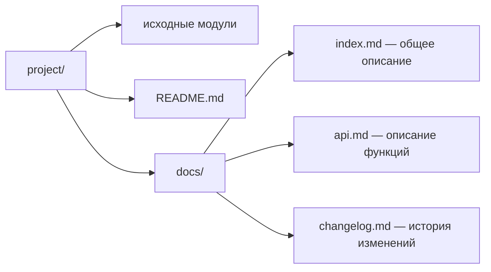

# 🛠️ Практика 4: Документирование проекта, комментарии к функциям и Markdown-документация

> [!abstract] О занятии
> - **Дисциплина:** [[Инструментальные средства разработки ПО]] (1 семестр, ФИТиП ИТМО)
> - **Преподаватель:** Кирилюк Д.А.
> - **Дата и время:** `2026-09-30` (нечетная неделя 5, среда, `08:10 — 09:40`, ауд. 2240)
> - **Направление:** Software Engineering (Поток 2)
> - **Источник:** задание «Документирование. Лабораторная работа №2» из публичного репозитория [RuslanKoynov/SDT_practice](https://github.com/RuslanKoynov/SDT_practice). По плану курса это 2-я практика («Git → Документирование → Работа с плагинами → Тестирование → CI/CD»). Сопоставление с датой сделано по порядку программы: фото или записей с самого занятия нет.
> - **Ключевые концепции:** документация как часть продукта, документирующие комментарии (docstring в Python, Doxygen в C/C++), каталог `docs/` в нотации Markdown, описание функций с примерами вызова, история изменений с хешами коммитов.

> [!warning] Политика репозитория
> Здесь только **условие и теория**, нужные для лабораторной. Готового решения (документации к функциям учебного проекта) в конспекте нет и не будет: см. правила антиплагиата в регламенте репозитория.

---

## 📌 Краткое резюме (TL;DR)

1. Лабораторная №2 продолжает проект из **лабораторной №1 по Git** (библиотека `geometric_lib`).
2. Нужно задокументировать проект **одним из двух способов**:
   - **Вариант 1:** перед каждым объявлением функции — блок комментария с описанием функции и **примером её вызова**;
   - **Вариант 2:** каталог `docs/` с документацией в **Markdown**, в которой есть общее описание решения, описание каждой функции с примерами вызова и **история изменений с хешами коммитов** (кроме последней записи).
3. **Защита:** показать преподавателю проект с созданными артефактами.
4. Теоретическая основа — [[05. Лекция - Системы управления знаниями, языки разметки и трекинг задач (2026-10-09)|лекция о системах управления знаниями и языках разметки]].

---

## 1. Условие лабораторной работы (пересказ)

| Пункт | Содержание |
|:---|:---|
| **Исходный проект** | Проект из лабораторной №1 (учебная Python-библиотека `geometric_lib` с модулями фигур) |
| **Цель** | Обогатить проект документацией: отдельной и встроенной в исходный код |
| **Вариант 1** | Каждое объявление функции начинается с блока комментария: описание функции + пример вызова |
| **Вариант 2** | Каталог `docs/` с Markdown-документацией: общее описание; описание каждой функции с примерами вызова; история изменений с хешами коммитов (кроме последней записи) |
| **Сдача** | Демонстрация проекта с артефактами преподавателю |

> [!tip] Почему «кроме последней записи»
> Хеш коммита вычисляется от его содержимого. Если вписать в файл хеш коммита, который этот же файл и добавляет, хеш изменится: в файле нельзя сослаться на коммит, который его самого создаёт. Поэтому последняя запись истории остаётся без хеша.

---

## 2. Зачем документировать код

- **Документация — часть продукта.** Без неё библиотекой нельзя пользоваться, не читая исходники.
- **Документация — явное знание** (см. модель SECI в [[05. Лекция - Системы управления знаниями, языки разметки и трекинг задач (2026-10-09)|лекции 5]]): то, что автор держал в голове, становится доступным команде.
- **Документация рядом с кодом** (docs as code) версионируется в Git вместе с кодом и реже устаревает.

| Вид документации | Для кого | Где живёт |
|:---|:---|:---|
| Комментарии в коде | Тот, кто читает и меняет код | Исходные файлы |
| Документирующие комментарии (API) | Пользователь функции или класса | Исходные файлы → генерируемый справочник |
| `README.md` | Тот, кто впервые открыл репозиторий | Корень репозитория |
| `docs/` | Пользователи и разработчики | Каталог в репозитории или сайт |
| `CHANGELOG.md` | Все, кто обновляет версию | Корень репозитория |

---

## 3. Вариант 1: документирующие комментарии

### 3.1. Python: docstring

В Python документирующий комментарий — **строка документации (docstring)**: строковый литерал первой строкой тела функции, модуля или класса. Он доступен во время выполнения через `help(func)` и `func.__doc__`, а также используется IDE и генераторами документации (Sphinx, pdoc).

Пример на функции, **не входящей** в учебный проект:

```python
def clamp(value: float, low: float, high: float) -> float:
    """Ограничивает значение отрезком [low, high].

    Args:
        value: Исходное число.
        low: Нижняя граница.
        high: Верхняя граница, должна быть не меньше low.

    Returns:
        low, если value < low; high, если value > high; иначе value.

    Raises:
        ValueError: Если low > high.

    Example:
        >>> clamp(15, 0, 10)
        10
        >>> clamp(-3, 0, 10)
        0
    """
    if low > high:
        raise ValueError("low must not exceed high")
    return max(low, min(value, high))
```

| Стиль docstring | Пример раздела | Где принят |
|:---|:---|:---|
| **Google style** | `Args:` / `Returns:` / `Raises:` | Google, многие open source проекты |
| **NumPy style** | `Parameters` с подчёркиванием `----------` | NumPy, SciPy, pandas |
| **reStructuredText (Sphinx)** | `:param value:` / `:return:` | Классическая документация Sphinx |

> [!tip] Пример вызова, который сам себя проверяет
> Строки `>>>` в docstring — это **doctest**: модуль `doctest` выполняет их и сравнивает вывод с ожидаемым. Запуск: `python -m doctest -v module.py`. Так пример вызова из документации служит одновременно и тестом (ср. с лабораторной №4 «Unit-тесты»).

### 3.2. C/C++: Doxygen

Для C/C++ стандарт — **Doxygen**: комментарии `/** ... */` или `///` с тегами `@brief`, `@param`, `@return`, `@code`.

```cpp
/**
 * @brief Ограничивает значение отрезком [low, high].
 *
 * @param value Исходное число.
 * @param low   Нижняя граница.
 * @param high  Верхняя граница (high >= low).
 * @return low, если value < low; high, если value > high; иначе value.
 *
 * @code
 * double x = clamp(15.0, 0.0, 10.0); // x == 10.0
 * @endcode
 */
[[nodiscard]] constexpr double clamp(double value, double low, double high) noexcept {
    return value < low ? low : (value > high ? high : value);
}
```

Команда `doxygen -g` создаёт конфигурационный файл `Doxyfile`, а `doxygen Doxyfile` генерирует HTML-справочник по всем таким комментариям.

---

## 4. Вариант 2: каталог `docs/` в Markdown

### 4.1. Структура



Все три обязательных раздела можно держать и в одном `docs/README.md`. Разбиение на файлы удобнее, когда документации много.

### 4.2. Шаблон описания функции

Пример на той же функции `clamp`:

````markdown
## `clamp(value, low, high)`

Ограничивает значение отрезком `[low, high]`.

| Параметр | Тип | Описание |
|---|---|---|
| `value` | `float` | Исходное число |
| `low` | `float` | Нижняя граница |
| `high` | `float` | Верхняя граница, `high >= low` |

**Возвращает:** `float` — значение, приведённое к отрезку.

**Пример:**

```python
>>> clamp(15, 0, 10)
10
```
````

### 4.3. История изменений с хешами коммитов

Хеши и сообщения коммитов берутся из Git:

```bash
git log --oneline
```

```bash
git log --pretty=format:"%h | %ad | %s" --date=short
```

Здесь `%h` — короткий хеш, `%ad` — дата, `%s` — заголовок коммита. Получившиеся строки оформляются таблицей:

```markdown
| Хеш | Дата | Изменение |
|---|---|---|
| a1b2c3d | 2026-09-28 | Добавлен модуль с новой фигурой |
| e4f5a6b | 2026-09-29 | Исправлена формула периметра |
| — | 2026-09-30 | Добавлена документация (текущий коммит) |
```

> [!info] Соглашение Keep a Changelog
> В реальных проектах `CHANGELOG.md` ведут по соглашению [Keep a Changelog](https://keepachangelog.com/): записи группируются по версиям и разделам `Added`, `Changed`, `Fixed`, `Removed`, а сверху лежит раздел `Unreleased`.

---

## 5. Минимум Markdown для документации

| Элемент | Синтаксис |
|:---|:---|
| Заголовки | `#`, `##`, `###` |
| Жирный / курсив | `**текст**`, `*текст*` |
| Код в строке | `` `код` `` |
| Блок кода с подсветкой | три обратных апострофа и имя языка |
| Списки | `- пункт`, `1. пункт` |
| Таблица | строки с `\|`, вторая строка `\|---\|---\|` |
| Ссылка | `[текст](url)` |
| Изображение | `` |
| Диаграмма | блок кода с языком `mermaid` |

---

## 6. Чек-лист перед защитой

> [!important] Проверь себя
> - [ ] Работа ведётся в проекте из лабораторной №1, изменения закоммичены.
> - [ ] **Вариант 1:** у каждой функции есть комментарий с описанием и примером вызова.
> - [ ] **Вариант 2:** есть каталог `docs/` с общим описанием, описанием каждой функции с примерами и историей изменений с хешами (кроме последней записи).
> - [ ] Примеры вызова действительно работают (удобно проверить через doctest).
> - [ ] Markdown корректно отображается на GitHub.

> [!warning] Типичные ошибки
> 1. Комментарий пересказывает код («умножаем a на b»), вместо того чтобы описывать **контракт**: что функция принимает, возвращает и когда бросает исключение.
> 2. Пример вызова не совпадает с реальным поведением функции.
> 3. Хеши в истории выдуманы или не соответствуют `git log`.

---

## ❓ Вопросы для самопроверки

- [ ] Чем документирующий комментарий отличается от обычного?
- [ ] Что такое docstring и как его прочитать во время выполнения программы?
- [ ] Сравните стили docstring Google, NumPy и reStructuredText.
- [ ] Как оформить документирующий комментарий для Doxygen?
- [ ] Что такое doctest и как он связывает документацию с тестированием?
- [ ] Какие разделы обязательны в каталоге `docs/` по условию лабораторной?
- [ ] Как получить список коммитов с короткими хешами и датами?
- [ ] Почему в истории изменений нельзя указать хеш последнего коммита?

---

## 🔗 Связанные материалы

- [[Инструментальные средства разработки ПО]] — главный хаб дисциплины
- [[05. Лекция - Системы управления знаниями, языки разметки и трекинг задач (2026-10-09)]] — теория: управление знаниями и языки разметки
- [[01. Лекция - Системы контроля версий, архитектура Git и модель GitFlow (2026-09-11)]] — Git, история коммитов
- [[06. Практика - Плагины IDE, установка и разработка расширений (2026-10-14)]] — следующая лабораторная
