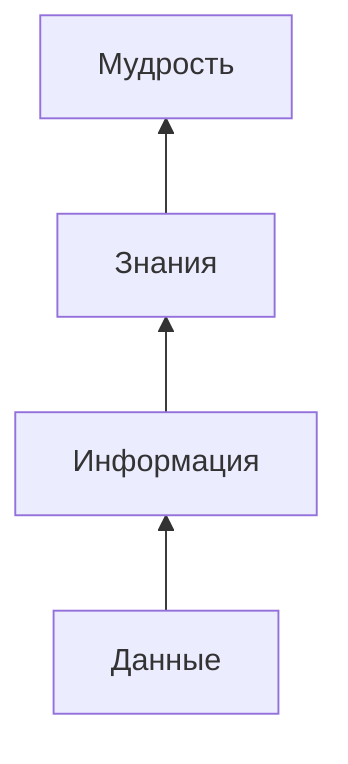
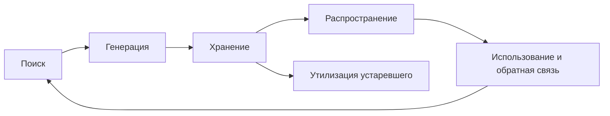
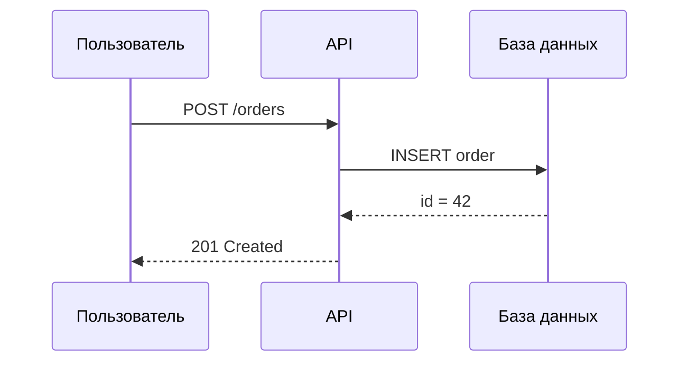
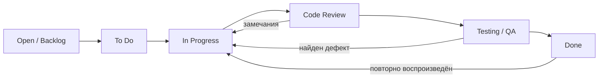

# 🛠️ Лекция 5: Системы управления знаниями, языки разметки и трекинг задач

> [!abstract] О занятии
> - **Дисциплина:** [[Инструментальные средства разработки ПО]] (1 семестр, ФИТиП ИТМО)
> - **Преподаватель:** Койнов Руслан Васильевич
> - **Дата и время:** `2026-10-09` (четная неделя 6, пятница, `15:30 — 17:00`, ауд. 2342)
> - **Направление:** Software Engineering (Поток 2)
> - **Источник:** слайды лекции «Системы управления знаниями и трекинга задач» из публичного репозитория преподавателя [RuslanKoynov/SDT_lectures](https://github.com/RuslanKoynov/SDT_lectures) (13 слайдов). Это **3-я лекция** по плану курса («Git → Методологии → Система управления знаниями → Тестирование → CI/CD → Лицензии на ПО»).
> - **Ключевые концепции:** пирамида DIKW, определение и задачи системы управления знаниями (СУЗ), жизненный цикл знания (поиск, генерация, хранение, распространение), неявное и явное знание, модель SECI, инструменты (Confluence, Notion, MadCap Flare, DokuWiki), языки разметки (HTML, XML/XHTML, Markdown, PlantUML/Mermaid, AsciiDoc, MediaWiki, LaTeX), системы трекинга задач.

> [!info] Как устроен конспект
> Слайды лекции в основном состоят из заголовков разделов («Как искать знания?», «Как хранить знания?», «Инструментарий», «Системы трекинга задач»). Определения, задачи СУЗ, перечни инструментов и языков разметки взяты **со слайдов**. Раскрытие разделов-вопросов, модель SECI, примеры синтаксиса и устройство трекеров **дополнены по стандартной литературе** и помечены значком 📎.

---

## 📌 Краткое резюме (TL;DR)

1. **Пирамида DIKW:** данные → информация → знания → мудрость. Каждый уровень получается из предыдущего добавлением **контекста**.
2. **Система управления знаниями (СУЗ)** — совокупность технологических и организационных инструментов, методов и решений для **генерации, поиска, отбора, систематизации и распространения** знаний в организации.
3. **Шесть задач СУЗ:** генерация новых знаний, поиск и мониторинг их эволюции, идентификация/систематизация/хранение, целенаправленное распространение, создание инфраструктуры, утилизация устаревших знаний.
4. **Инструменты:** Confluence, Notion, MadCap Flare, DokuWiki.
5. **Языки разметки:** HTML, XML/XHTML, **Markdown** (с диаграммами **PlantUML** и **Mermaid**), AsciiDoc, MediaWiki, LaTeX.
6. **Системы трекинга задач** (Jira, YouTrack, GitHub Issues и др.) фиксируют работу как набор задач с жизненным циклом и связывают её с кодом и документацией.

---

## 1. Пирамида DIKW: от данных к мудрости

На слайде изображена пирамида из четырёх уровней, вдоль которой отложена ось **«Контекст»**: чем выше уровень, тем больше контекста нужно, чтобы его получить.



| Уровень | Что это | Пример из разработки 📎 |
|:---|:---|:---|
| **Данные** | Сырые факты без интерпретации | `500`, `12:03:41`, `/api/orders` в логе сервера |
| **Информация** | Данные + контекст: что, где, когда | «В 12:03 эндпоинт `/api/orders` вернул ошибку 500» |
| **Знания** | Информация + понимание причин и связей: как и почему | «Ошибка 500 возникает при пустой корзине: не обрабатывается `null`; чинится проверкой в сервисе заказов» |
| **Мудрость** | Знания + опыт и суждение: что и зачем делать | «Все входные данные API нужно валидировать на границе, поэтому добавим общий валидатор и правило в code review» |

> [!tip] Зачем это разработчику
> Логи, метрики и тикеты — это **данные и информация**. Ценность команды — в **знаниях**: почему система устроена так, какие решения принимались и почему от альтернатив отказались. Если знания не зафиксированы, они уходят из компании вместе с людьми.

---

## 2. Система управления знаниями (СУЗ)

> [!info] Определение (со слайда)
> **Система управления знаниями (СУЗ)** — это совокупность технологических и организационных инструментов, методов и решений, обеспечивающих процесс **генерации, поиска, отбора, систематизации и распространения** знаний в организации.

Важно, что СУЗ — это не только программа (wiki, база знаний), но и **организационные** практики: кто пишет документацию, когда её обновляют, как новичка вводят в проект.

### 2.1. Задачи системы управления знаниями (со слайда)

1. Организация и обеспечение процесса **генерации** новых знаний внутри организации.
2. **Поиск** новых знаний, а также мониторинг эволюции существующих знаний.
3. **Идентификация, систематизация и хранение** текущих знаний организации.
4. Целенаправленное **распространение** знаний внутри организации.
5. Создание **инфраструктуры**, обеспечивающей работу системы (генерация, хранение и распространение).
6. **Утилизация** знаний.

> [!warning] Утилизация — не формальность
> Устаревшая документация опаснее отсутствующей: ей доверяют, а она врёт. Поэтому у каждой страницы базы знаний должен быть владелец и дата актуализации, а неактуальное нужно архивировать или удалять. 📎

### 2.2. Жизненный цикл знания

Слайды лекции задают четыре вопроса — четыре этапа жизненного цикла знания:



#### Как искать знания? 📎
- **Внутренние источники:** wiki проекта, README, история коммитов и pull request'ов, закрытые задачи в трекере, записи встреч.
- **Внешние источники:** официальная документация, стандарты, Stack Overflow, статьи, исходный код open source.
- **Люди:** эксперты внутри компании. Часть СУЗ — справочник «кто что знает» (карта компетенций).
- **Условие:** база знаний должна быть **индексируемой и с поиском**, иначе знание формально есть, но найти его нельзя.

#### Как генерировать знания? 📎
- **Разбор инцидентов (postmortem):** что случилось, почему, как исправили, что сделать, чтобы не повторилось.
- **ADR (Architecture Decision Records):** короткие записи «контекст → решение → последствия» по каждому архитектурному решению.
- **Ретроспективы** (см. [[03. Лекция - Методологии разработки ПО, Waterfall, Agile, Scrum, Kanban и инкрементальные модели (2026-09-25)|лекцию 3]] о Scrum) — источник знаний о процессе.
- **Code review, парное программирование, исследовательские спайки.**

#### Как хранить знания? 📎
- **Структурированно:** иерархия пространств и страниц, шаблоны (страница сервиса, инструкция, ADR), теги и перекрёстные ссылки.
- **Рядом с кодом («docs as code»):** документация в Markdown в том же репозитории (`README.md`, `docs/`), версионируется в Git и проходит review вместе с кодом.
- **С историей изменений:** видно, кто, когда и что поменял.

#### Как распространять знания? 📎
- **Онбординг** новичков по чек-листу и базе знаний.
- **Внутренние доклады, митапы, демо.**
- **Рассылки об изменениях**, changelog, release notes.
- **Наставничество** и ротация задач между участниками команды.

### 2.3. Неявное и явное знание. Модель SECI 📎

- **Явное (explicit) знание** — то, что можно записать: документация, схемы, регламенты.
- **Неявное (tacit) знание** — опыт и интуиция в головах людей: «как на самом деле отлаживать этот сервис».

Модель **SECI** (Нонака и Такеучи) описывает, как знание переходит между этими формами:

| Переход | Название | Пример |
|:---|:---|:---|
| неявное → неявное | **Социализация** | парное программирование, наставничество |
| неявное → явное | **Экстернализация** | разработчик пишет инструкцию или ADR |
| явное → явное | **Комбинация** | сборка разрозненных страниц в единое руководство |
| явное → неявное | **Интернализация** | новичок читает документацию и осваивает практику |

---

## 3. Инструментарий

На слайде представлены четыре инструмента:

| Инструмент | Тип | Особенности 📎 |
|:---|:---|:---|
| **Confluence** (Atlassian) | Корпоративная wiki | Пространства и страницы, шаблоны, глубокая интеграция с Jira, права доступа; стандарт де-факто в крупных компаниях |
| **Notion** | Универсальное рабочее пространство | Страницы-блоки, встроенные базы данных и канбан-доски; популярен в стартапах и для личных баз знаний |
| **MadCap Flare** | Профессиональный инструмент технического писателя | Single-source publishing: из одного источника собирается документация в HTML, PDF, справку; повторное использование фрагментов |
| **DokuWiki** | Open source wiki | Хранит страницы в текстовых файлах без базы данных, проста в развёртывании; собственный wiki-синтаксис |

> [!tip] Российские аналоги и учебные платформы 📎
> В вузах и российских компаниях также используются Yonote (аналог Notion) и YouGile (трекер). Сам этот vault на Obsidian — пример **личной СУЗ** в формате «docs as code»: Markdown-файлы, ссылки `[[...]]`, Git.

---

## 4. Языки разметки текста

Со слайда — стандартные языки разметки:

- **HTML**
- **XML / XHTML**
- **Markdown**
  - **PlantUML и Mermaid** (диаграммы внутри Markdown)
- **AsciiDoc**
- **MediaWiki**
- **LaTeX**

### 4.1. Сравнение 📎

| Язык | Назначение | Где встречается |
|:---|:---|:---|
| **HTML** | Разметка веб-страниц | Браузер; итоговый формат почти любой онлайн-документации |
| **XML / XHTML** | Строгая структурированная разметка данных; XHTML — HTML по правилам XML | Конфигурации, DocBook, обмен данными |
| **Markdown** | Лёгкая разметка, читаемая и без рендеринга | README на GitHub, wiki, Obsidian, Notion |
| **PlantUML** | Текстовое описание UML-диаграмм | Документация архитектуры, Confluence |
| **Mermaid** | Текстовые диаграммы прямо в Markdown | GitHub, GitLab, Obsidian |
| **AsciiDoc** | Разметка для больших технических документов (таблицы, включения, перекрёстные ссылки) | Книги O'Reilly, документация Spring |
| **MediaWiki** | Wiki-синтаксис | Википедия |
| **LaTeX** | Вёрстка научных текстов и формул | Статьи, дипломы, математика |

### 4.2. Один и тот же фрагмент в разных разметках 📎

**Markdown:**
```markdown
# Установка

Выполните команду `pip install geometry` и **перезапустите** терминал.

- [Документация](https://example.com/docs)
```

**HTML:**
```html
<h1>Установка</h1>
<p>Выполните команду <code>pip install geometry</code> и <strong>перезапустите</strong> терминал.</p>
<ul><li><a href="https://example.com/docs">Документация</a></li></ul>
```

**AsciiDoc:**
```text
= Установка

Выполните команду `pip install geometry` и *перезапустите* терминал.

* https://example.com/docs[Документация]
```

**MediaWiki:**
```text
= Установка =

Выполните команду <code>pip install geometry</code> и '''перезапустите''' терминал.

* [https://example.com/docs Документация]
```

**LaTeX:**
```latex
\section{Установка}
Выполните команду \texttt{pip install geometry} и \textbf{перезапустите} терминал.
\begin{itemize}
  \item \href{https://example.com/docs}{Документация}
\end{itemize}
```

### 4.3. Диаграммы как код: PlantUML и Mermaid 📎

Диаграмма хранится в виде текста, поэтому её можно версионировать в Git, сравнивать через diff и проверять на review.

**Mermaid** (рендерится прямо в GitHub и Obsidian):


**PlantUML** (тот же сценарий):
```text
@startuml
actor Пользователь
Пользователь -> API : POST /orders
API -> "База данных" : INSERT order
"База данных" --> API : id = 42
API --> Пользователь : 201 Created
@enduml
```

---

## 5. Системы трекинга задач

Последний раздел лекции — системы трекинга задач (issue / task trackers). Последний слайд в публичной версии пустой (вероятно, там была картинка), поэтому раздел раскрыт по стандартным материалам 📎.

**Трекер задач** — система, в которой вся работа команды представлена набором **задач (issues)** с исполнителем, статусом и историей. Трекер связывает требования, код, тесты и документацию.

### 5.1. Анатомия задачи

| Поле | Назначение |
|:---|:---|
| **Ключ / ID** | Уникальный идентификатор (`PROJ-123`, `#42`); упоминается в коммитах и ветках |
| **Тип** | Epic, Story, Task, Bug, Sub-task |
| **Заголовок и описание** | Что сделать и зачем; для бага — шаги воспроизведения, ожидаемый и фактический результат |
| **Статус** | Положение в рабочем процессе (workflow) |
| **Исполнитель / автор** | Кто делает и кто поставил |
| **Приоритет** | Blocker, Critical, Major, Minor, Trivial |
| **Оценка** | Story points или часы (см. capacity в лекции 3) |
| **Связи** | blocks / is blocked by, relates to, duplicates |
| **Спринт / версия** | К какой итерации или релизу относится |

### 5.2. Жизненный цикл задачи (workflow)



### 5.3. Популярные трекеры

| Трекер | Особенности |
|:---|:---|
| **Jira** (Atlassian) | Гибкие workflow, Scrum- и Kanban-доски, интеграция с Confluence и Bitbucket; стандарт в enterprise |
| **YouTrack** (JetBrains) | Мощный язык поиска запросов, интеграция с IDE JetBrains |
| **GitHub Issues + Projects** | Задачи прямо в репозитории; закрываются из коммита (`Fixes #42`); доски Projects |
| **GitLab Issues** | Аналог GitHub, связан с merge request'ами и CI |
| **Redmine** | Open source, self-hosted |
| **YouGile, Yandex Tracker** | Российские облачные трекеры |

### 5.4. Связь трекера с Git 📎

- Имя ветки содержит ключ задачи: `feature/PROJ-123-login-form`.
- Сообщение коммита ссылается на задачу: `fix(auth): handle empty password (PROJ-123)`.
- Pull request автоматически переводит задачу в статус «Code Review», а слияние — в «Done».

Так через задачу можно найти весь связанный код, а через `git blame` по строке кода — задачу и обсуждение, т. е. **знание о том, почему код написан именно так**.

---

## 6. Сводная таблица

| Категория | Примеры | Какой этап жизненного цикла знания закрывает |
|:---|:---|:---|
| Wiki / база знаний | Confluence, Notion, DokuWiki | хранение, поиск, распространение |
| Публикация документации | MadCap Flare, генераторы сайтов из Markdown | распространение |
| Docs as code | Markdown, Mermaid, PlantUML в Git | генерация и хранение рядом с кодом |
| Трекеры задач | Jira, YouTrack, GitHub Issues | фиксация контекста решений, история работ |

---

## 7. Чек-лист и типичные ошибки

> [!warning] Типичные ошибки команд
> 1. **«Документация в голове у тимлида»:** нет экстернализации, и тимлид становится узким местом (bus factor = 1).
> 2. **Wiki-кладбище:** страницы пишутся, но не обновляются и не утилизируются.
> 3. **Документация отдельно от кода:** код меняется, а описание в wiki — нет. Помогает подход docs as code.
> 4. **Задачи без описания:** через полгода никто не помнит, зачем было сделано изменение.

> [!important] Что нужно знать к зачёту
> - Уровни пирамиды DIKW и роль контекста.
> - Определение СУЗ и её шесть задач.
> - Четыре этапа работы со знанием: поиск, генерация, хранение, распространение.
> - Инструменты СУЗ и языки разметки со слайда.
> - Назначение и основные поля систем трекинга задач.

---

## ❓ Вопросы для самопроверки

- [ ] Назовите уровни пирамиды DIKW и приведите пример каждого из практики разработки.
- [ ] Дайте определение системы управления знаниями. Почему это не только программный продукт?
- [ ] Перечислите шесть задач СУЗ. Зачем нужна утилизация знаний?
- [ ] Чем неявное знание отличается от явного? Опишите четыре перехода модели SECI.
- [ ] Сравните Confluence, Notion, MadCap Flare и DokuWiki.
- [ ] Перечислите языки разметки со слайда. Чем Markdown отличается от AsciiDoc и LaTeX?
- [ ] Зачем описывать диаграммы текстом (PlantUML, Mermaid)?
- [ ] Какие поля есть у задачи в трекере? Нарисуйте типичный workflow.
- [ ] Как связать задачи трекера с ветками и коммитами Git?

---

## 🔗 Связанные материалы

- [[Инструментальные средства разработки ПО]] — главный хаб дисциплины
- [[03. Лекция - Методологии разработки ПО, Waterfall, Agile, Scrum, Kanban и инкрементальные модели (2026-09-25)]] — Scrum, Kanban, бэклог и доски задач
- [[04. Практика - Документирование проекта, комментарии к функциям и Markdown-документация (2026-09-30)]] — лабораторная работа №2 «Документирование»
- [[01. Лекция - Системы контроля версий, архитектура Git и модель GitFlow (2026-09-11)]] — Git как хранилище истории проекта
