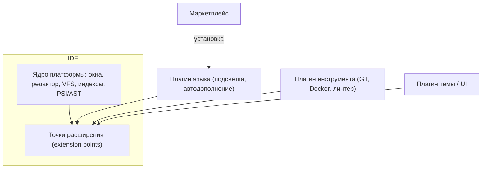
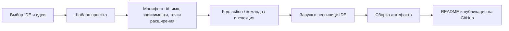

# 🛠️ Практика 6: Плагины IDE, установка и разработка расширений

> [!abstract] О занятии
> - **Дисциплина:** [[Инструментальные средства разработки ПО]] (1 семестр, ФИТиП ИТМО)
> - **Преподаватель:** Кирилюк Д.А.
> - **Дата и время:** `2026-10-14` (нечетная неделя 7, среда, `08:10 — 09:40`, ауд. 2240)
> - **Направление:** Software Engineering (Поток 2)
> - **Источник:** задания «Работа с плагинами. Лабораторная работа №3-1» и «Создание плагина. Лабораторная работа №3» из публичного репозитория [RuslanKoynov/SDT_practice](https://github.com/RuslanKoynov/SDT_practice). По плану курса это 3-я практика («Git → Документирование → Работа с плагинами → Тестирование → CI/CD»). Сопоставление с датой сделано по порядку программы: фото или записей с самого занятия нет.
> - **Ключевые концепции:** архитектура расширяемой IDE, точки расширения (extension points), манифест плагина, маркетплейсы плагинов, установка плагина (№3-1), разработка собственного плагина для IntelliJ Platform, Eclipse или VS Code (№3).

> [!warning] Политика репозитория
> Здесь только **условие и теория**. Готового плагина-решения в конспекте нет. Пример ниже — минимальный «Hello, world» из официальной документации платформ, а не решение лабораторной.

---

## 📌 Краткое резюме (TL;DR)

1. Цель лабораторных — научиться **настраивать среду разработки под себя** и понять её **архитектуру** через механизм плагинов. Выбор IDE согласуется с преподавателем.
2. **Лабораторная №3-1 (установка):** установить плагин для выбранной IDE. В отчёте — кратко описать процесс установки и показать применение на практике скриншотом.
3. **Лабораторная №3 (создание):** реализовать собственный плагин. В отчёте — кратко описать архитектуру IDE с точки зрения подключения сторонней функциональности. Исходный код — в публичном репозитории; в `README.md` — авторство, название плагина и описание всех его возможностей. Оформление — по опыту лабораторной №2.
4. Почти любая современная IDE — это **ядро + плагины**: ядро предоставляет **точки расширения**, а плагин регистрирует в них свои компоненты через **манифест**.

---

## 1. Условия лабораторных работ (пересказ)

| | Лабораторная №3-1 «Работа с плагинами» | Лабораторная №3 «Создание плагина» |
|:---|:---|:---|
| **Что сделать** | Установить плагин для выбранной IDE | Реализовать плагин для выбранной IDE |
| **Выбор IDE** | Согласовать с преподавателем | Согласовать с преподавателем |
| **Отчёт** | Кратко описать процесс установки; скриншот применения плагина | Кратко описать архитектуру IDE в разрезе подключения сторонних возможностей (как устроена разработка плагина) |
| **Код** | Не требуется | В публичном репозитории; в `README.md` — авторство, название и описание всех возможностей |
| **Рекомендованные материалы** | Каталог JetBrains Marketplace, обзоры плагинов для CLion | Документация IntelliJ Platform SDK, статья Eclipse «Your First Plug-in», видео о разработке плагина |

> [!info] Связь с другими лабораторными
> Оформление отчёта и `README.md` опирается на лабораторную №2 ([[04. Практика - Документирование проекта, комментарии к функциям и Markdown-документация (2026-09-30)|практика 4]]).

---

## 2. Архитектура расширяемой IDE

### 2.1. Ядро и плагины



- **Ядро** предоставляет общие сервисы: окна, редактор, файловую систему, индексацию, модель кода (дерево разбора).
- **Точка расширения (extension point)** — объявленный ядром или другим плагином «разъём», к которому плагины подключают свои реализации: новое действие в меню, инспекцию кода, поддержку языка, панель инструментов.
- **Манифест плагина** описывает, что плагин добавляет и от чего зависит. Ядро читает манифест при запуске и **лениво** загружает плагин, когда тот нужен.
- Многие «встроенные» возможности IDE (поддержка Git, Java, Python) сами реализованы как плагины.

### 2.2. Сравнение платформ

| | IntelliJ Platform (IDEA, CLion, PyCharm) | Eclipse | VS Code |
|:---|:---|:---|:---|
| **Язык плагина** | Java / Kotlin | Java | TypeScript / JavaScript |
| **Манифест** | `META-INF/plugin.xml` | `plugin.xml` + `MANIFEST.MF` (OSGi) | `package.json` (раздел `contributes`) |
| **Механизм расширения** | Extension points, actions, services | Extension points поверх OSGi-бандлов | Contribution points + Extension API |
| **Сборка** | Gradle + IntelliJ Platform Gradle Plugin | PDE (Plug-in Development Environment) | `npm`, генератор `yo code`, упаковка `vsce` |
| **Запуск для отладки** | Задача `runIde`: отдельный экземпляр IDE с плагином | Run As → Eclipse Application | F5: окно Extension Development Host |
| **Маркетплейс** | JetBrains Marketplace | Eclipse Marketplace | Visual Studio Marketplace / Open VSX |

---

## 3. Лабораторная №3-1: установка плагина

### 3.1. Способы установки

1. **Из маркетплейса внутри IDE:**
   - JetBrains: `Settings → Plugins → Marketplace` → поиск → `Install` → перезапуск IDE;
   - VS Code: панель Extensions (`Ctrl+Shift+X`) → поиск → `Install`.
2. **Из файла:** JetBrains — `Settings → Plugins → ⚙ → Install Plugin from Disk…` (`.zip`/`.jar`); VS Code — `Install from VSIX…`.
3. **Из командной строки** (VS Code): `code --install-extension <publisher.name>`.

### 3.2. Что обычно ставят 📎

| Категория | Примеры |
|:---|:---|
| Качество кода | линтеры и форматтеры (Clang-Tidy, Ruff, ESLint), SonarLint |
| Git | GitToolBox, GitLens |
| Продуктивность | Key Promoter X (обучение горячим клавишам), Rainbow Brackets |
| Документация | Markdown и Mermaid preview, PlantUML integration |
| Удалённая работа | WSL, Remote-SSH, Dev Containers |

> [!tip] Что показать в отчёте
> Скриншот «до/после» или результат работы плагина на собственном коде: найденные инспекцией ошибки, сгенерированный код, отображённая диаграмма.

---

## 4. Лабораторная №3: разработка плагина

### 4.1. Жизненный цикл разработки



### 4.2. Минимальный пример: IntelliJ Platform (Kotlin)

Плагин добавляет в меню **Tools** действие, которое показывает диалог. Это канонический «Hello, world» из документации IntelliJ Platform SDK.

`src/main/resources/META-INF/plugin.xml`:
```xml
<idea-plugin>
    <id>org.example.hello</id>
    <name>Hello Action</name>
    <vendor>Example</vendor>
    <depends>com.intellij.modules.platform</depends>

    <actions>
        <action id="org.example.hello.HelloAction"
                class="org.example.hello.HelloAction"
                text="Say Hello">
            <add-to-group group-id="ToolsMenu" anchor="last"/>
        </action>
    </actions>
</idea-plugin>
```

`src/main/kotlin/org/example/hello/HelloAction.kt`:
```kotlin
package org.example.hello

import com.intellij.openapi.actionSystem.AnAction
import com.intellij.openapi.actionSystem.AnActionEvent
import com.intellij.openapi.ui.Messages

class HelloAction : AnAction() {
    override fun actionPerformed(e: AnActionEvent) {
        Messages.showInfoMessage(e.project, "Hello from plugin!", "Hello")
    }
}
```

- `<depends>` объявляет зависимость от модуля платформы.
- `<action>` регистрирует класс в **группе действий** `ToolsMenu` — это и есть подключение к точке расширения.
- Запуск: Gradle-задача `runIde` открывает отдельный экземпляр IDE с плагином; сборка `buildPlugin` создаёт `.zip` для установки.

### 4.3. Минимальный пример: VS Code (TypeScript)

`package.json` (фрагмент):
```json
{
  "name": "hello-command",
  "engines": { "vscode": "^1.80.0" },
  "main": "./out/extension.js",
  "activationEvents": [],
  "contributes": {
    "commands": [{ "command": "hello.say", "title": "Say Hello" }]
  }
}
```

`src/extension.ts`:
```typescript
import * as vscode from 'vscode';

export function activate(context: vscode.ExtensionContext) {
    const cmd = vscode.commands.registerCommand('hello.say', () => {
        vscode.window.showInformationMessage('Hello from extension!');
    });
    context.subscriptions.push(cmd);
}

export function deactivate() {}
```

- Раздел `contributes.commands` — **декларативное** подключение команды к палитре команд.
- `activate` вызывается при первой активации расширения; `context.subscriptions` освобождает ресурсы при выгрузке.

### 4.4. Что должно быть в `README.md` плагина (по условию)

| Раздел | Содержание |
|:---|:---|
| Авторство | ФИО и учебная группа |
| Название | Имя плагина |
| Описание | Назначение и **все** возможности плагина |
| Дополнительно 📎 | Установка, сборка из исходников, скриншоты, совместимые версии IDE |

---

## 5. Чек-лист

> [!important] №3-1
> - [ ] IDE согласована с преподавателем.
> - [ ] Плагин установлен, в отчёте описан процесс установки.
> - [ ] Есть скриншот применения плагина.

> [!important] №3
> - [ ] В отчёте описана архитектура IDE: ядро, точки расширения, манифест, жизненный цикл плагина.
> - [ ] Код плагина лежит в публичном репозитории и собирается.
> - [ ] В `README.md` указаны авторство, название и все возможности.
> - [ ] Документ оформлен по опыту лабораторной №2.

> [!warning] Типичные ошибки
> 1. Несовместимость версий: плагин собран под одну версию платформы (`sinceBuild`/`untilBuild` в IntelliJ, `engines.vscode` в VS Code), а IDE другой версии.
> 2. Тяжёлая работа в потоке интерфейса: IDE «подвисает». Долгие операции выносят в фоновые задачи.
> 3. Действие не появляется в меню: в манифесте указан не тот `group-id` или класс.

---

## ❓ Вопросы для самопроверки

- [ ] Что такое точка расширения и как плагин к ней подключается?
- [ ] Какую роль играет манифест плагина? Как он называется в IntelliJ Platform, Eclipse и VS Code?
- [ ] Почему говорят, что современная IDE — это «ядро + плагины»?
- [ ] Какими способами можно установить плагин в IDE JetBrains и в VS Code?
- [ ] Как запустить и отладить разрабатываемый плагин, не ломая основную IDE?
- [ ] Что по условию лабораторной должно быть в `README.md` плагина?

---

## 🔗 Связанные материалы

- [[Инструментальные средства разработки ПО]] — главный хаб дисциплины
- [[04. Практика - Документирование проекта, комментарии к функциям и Markdown-документация (2026-09-30)]] — лабораторная №2: правила оформления
- [[05. Лекция - Системы управления знаниями, языки разметки и трекинг задач (2026-10-09)]] — языки разметки, README
- [[00. Практикум - Настройка окружения (VS Code, Clang, CMake, WSL, Санитайзеры) (2026-09-02)]] — настройка VS Code и расширений для C++
