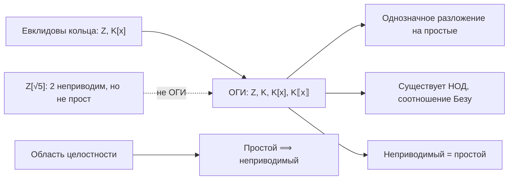

# 📐 Лекция 7: Идеалы, делимость в областях целостности, простые и неприводимые элементы, области главных идеалов

> [!abstract] О занятии
> - **Дисциплина:** [[Линейная алгебра]] (1 семестр)
> - **Дата проведения:** 15 октября 2026 года (неделя 7, нечетная, четверг, 08:10 – 09:40)
> - **Аудитория:** Orange Classroom 1229 (Кронверкский пр., д. 49, лит. А)
> - **Преподаватель (лектор):** Кумалагов Давид Заурович
> - **Поток:** **Поток 2** (Software Engineering, Университет ИТМО)
> - **Источник:** рукописный конспект лекции. Раздел 1 (примеры идеалов, порождённый идеал) — окончание предыдущей лекции, основная часть начинается с раздела 2 (на листе отмечено «15.10.26»).
> - **Ключевые темы:**
>   1. Примеры идеалов: $n\mathbb{Z}$, главные идеалы в $\mathbb{R}[x]$, $c_0 \trianglelefteq \mathrm{Conv}$, идеал функций, зануляющихся на подмножестве.
>   2. Идеал, порождённый множеством; главные идеалы; пересечение и сумма идеалов.
>   3. Делимость и ассоциированность в области целостности; критерий ассоциированности через обратимые элементы и главные идеалы.
>   4. НОД в области целостности, его единственность с точностью до ассоциированности.
>   5. Простые и неприводимые элементы; простой $\implies$ неприводимый; контрпример в $\mathbb{Z}[\sqrt{5}]$.
>   6. Области главных идеалов (ОГИ) и существование НОД в них.

> [!info] Обозначения
> - $I \trianglelefteq R$ — $I$ является идеалом кольца $R$.
> - $R^*$ — группа обратимых элементов кольца $R$.
> - $a \,\vdots\, b$ — «$a$ делится на $b$»; $b \mid a$ — «$b$ делит $a$» (то же самое).
> - **о. ц.** — область целостности (коммутативное кольцо с $1 \ne 0$ без делителей нуля).

---

## 📌 Краткое резюме (TL;DR)

1. **Идеал, порождённый $A$,** — наименьший идеал, содержащий $A$; он состоит из конечных сумм $\sum a_i r_i$. **Главный идеал** $(f) = fR$. Пересечение и сумма идеалов — идеалы, объединение — почти никогда.
2. **Ассоциированность:** $a \sim b \iff a = \varepsilon b$ с обратимым $\varepsilon \iff (a) = (b)$ (в области целостности).
3. **НОД** определён с точностью до ассоциированности.
4. **Простой** элемент: $ab \,\vdots\, p \implies a \,\vdots\, p$ или $b \,\vdots\, p$. **Неприводимый:** $p = ab \implies$ $a$ или $b$ обратим. Простой $\implies$ неприводимый; обратное неверно: $2 \in \mathbb{Z}[\sqrt{5}]$.
5. **ОГИ** — о. ц., где все идеалы главные ($\mathbb{Z}$, $K$, $K[x]$, $K\llbracket x \rrbracket$). В ОГИ есть НОД и соотношение Безу, неприводимый $=$ простой, цепочки идеалов стабилизируются, верна **основная теорема арифметики**.
6. **Евклидово кольцо** (есть деление с остатком по «норме» $\nu$) $\implies$ ОГИ.

---

## 1. Идеалы: примеры и порождённые идеалы *(окончание предыдущей лекции)*

### 1.1. Примеры идеалов

1. $n\mathbb{Z} \trianglelefteq \mathbb{Z}$. **Упражнение:** это все идеалы кольца $\mathbb{Z}$.
2. Пусть $f \in \mathbb{R}[x]$. Тогда множество кратных $f$
$$
(f) = \{\, p \cdot f \mid p \in \mathbb{R}[x] \,\} \trianglelefteq \mathbb{R}[x].
$$
3. Тривиальные идеалы: $0 \trianglelefteq R$ и $R \trianglelefteq R$.
4. $c_0 \trianglelefteq \mathrm{Conv}$: последовательности, сходящиеся к нулю, образуют идеал в кольце сходящихся последовательностей (с покомпонентными операциями). Действительно, если $x_n \to 0$, а $(y_n)$ сходится (и потому ограничена), то $x_n y_n \to 0$.
5. Пусть $X$ — множество, $Y \subseteq X$. Тогда
$$
I_Y = \{\, f : X \to \mathbb{R} \mid f\vert_Y \equiv 0 \,\} \trianglelefteq \mathbb{R}^X
$$
— функции, зануляющиеся на $Y$, образуют идеал в кольце всех функций $X \to \mathbb{R}$: сумма таких функций и произведение такой функции на любую снова равны нулю на $Y$.

> [!tip] Замечания
> 1. **Упражнение:** если $K$ — поле, то для любого $I \trianglelefteq K$ либо $I = K$, либо $I = 0$.
>    *Подсказка:* если $0 \ne a \in I$, то $1 = a^{-1} \cdot a \in I$, а значит, $x = x \cdot 1 \in I$ для всех $x \in K$.
> 2. **Вопрос:** каковы идеалы в кольце матриц $M_2(\mathbb{R})$?

### 1.2. Идеал, порождённый множеством

> [!info] Конструкция
> Пусть $A \subseteq R$ — подмножество. Положим
> $$(A) := \bigcap_{A \subseteq I \trianglelefteq R} I$$
> — **наименьший идеал, содержащий $A$**. Он называется **идеалом, порождённым множеством $A$**. (Пересечение идеалов — идеал, см. замечание ниже, поэтому определение корректно.)

> [!important] Лемма-замечание
> $$(A) = \left\{\, y \in R \;\middle|\; \exists\, a_1, \ldots, a_n \in A,\; \exists\, r_1, \ldots, r_n \in R : \; y = \sum_{i=1}^{n} a_i r_i \,\right\}.$$

*Обоснование.* Множество конечных сумм $\sum a_i r_i$ замкнуто относительно сложения и умножения на элементы $R$, т. е. является идеалом, и содержит $A$. С другой стороны, любой идеал, содержащий $A$, содержит все такие суммы. Значит, это и есть наименьший идеал.

> [!info] Определение
> Идеалы, порождённые одним элементом $f \in R$, называются **главными** и обозначаются $(f) = \{\, r f \mid r \in R \,\}$.

> [!tip] Замечания
> 1. $I, J \trianglelefteq R \implies I \cap J \trianglelefteq R$.
> 2. $I + J = \{\, i + j \mid i \in I,\; j \in J \,\} \trianglelefteq R$.

> [!example] Упражнения
> 1. В $\mathbb{Z}$: чему равны $(m) + (n)$ и $(m) \cap (n)$?
>    *Ответ:* $(m) + (n) = (\gcd(m, n))$ (по соотношению Безу), $(m) \cap (n) = (\operatorname{lcm}(m, n))$.
> 2. $I \cup J$ почти всегда **не** является идеалом. Например, $2\mathbb{Z} \cup 3\mathbb{Z}$ не замкнуто по сложению: $2 + 3 = 5 \notin 2\mathbb{Z} \cup 3\mathbb{Z}$. (Объединение — идеал, только если $I \subseteq J$ или $J \subseteq I$.)

---

## 2. Делимость в областях целостности

Всюду далее $R$ — **область целостности**.

> [!info] Определения
> 1. Пусть $a, b \in R$. Тогда $a \,\vdots\, b \iff \exists\, c \in R : a = b \cdot c$.
> 2. $a \sim b$ ($a$ и $b$ **ассоциированы**), если $a \,\vdots\, b$ и $b \,\vdots\, a$.

#### Примеры

1. $a, b \in \mathbb{Z}$: $\; a \sim b \implies a = \pm b$.
2. $K$ — поле $\implies$ любые $a \ne 0$, $b \ne 0$ из $K$ ассоциированы: $a = b \cdot (b^{-1} a)$ и $b = a \cdot (a^{-1} b)$.
3. **Гауссовы целые числа** $\mathbb{Z}[i] = \{\, a + bi \mid a, b \in \mathbb{Z},\; i^2 = -1 \,\}$.
   - $(1 + 2i) \cdot i = i + 2i^2 = i - 2$, поэтому $(i - 2) \,\vdots\, i$.
   - Делится ли $i$ на $i - 2$? Ищем $a + bi \in \mathbb{Z}[i]$ с $i = (i - 2)(a + bi)$:
   $$
   (i - 2)(a + bi) = ai + bi^2 - 2a - 2bi = (-2a - b) + (a - 2b)\, i.
   $$
   Приравниваем к $0 + 1 \cdot i$:
   $$
   \begin{cases} -2a - b = 0, \\ a - 2b = 1 \end{cases} \implies b = -2a,\; 5a = 1 \implies a = \tfrac{1}{5},\; b = -\tfrac{2}{5} \notin \mathbb{Z}.
   $$
   Решение есть только в $\mathbb{R}$ (точнее, в $\mathbb{Q}$), но не в $\mathbb{Z}$, поэтому $i \not\vdots\, (i - 2)$ и $i \not\sim i - 2$.

> [!important] Лемма (критерий ассоциированности)
> Пусть $R$ — область целостности, $a, b \in R$. Следующие условия эквивалентны:
> 1. $a \sim b$;
> 2. $a = \varepsilon \cdot b$ для некоторого $\varepsilon \in R^*$;
> 3. $(a) = (b)$.

**Доказательство.**

- $(2 \Rightarrow 1)$ $a = \varepsilon b$ даёт $a \,\vdots\, b$, а $b = \varepsilon^{-1} a$ даёт $b \,\vdots\, a$.
- $(1 \Rightarrow 2)$ Пусть $a = bc$, $b = ad$. Тогда $a = adc$. Если $a = 0$, то $b = ad = 0$ и можно взять $\varepsilon = 1$. Если $a \ne 0$, то, сокращая (в о. ц. нет делителей нуля: $a(1 - dc) = 0 \implies 1 - dc = 0$), получаем $1 = dc$, т. е. $c \in R^*$, и $a = c \cdot b$ с $\varepsilon = c$.
- $(1 \Leftrightarrow 3)$ $(a) \subseteq (b) \iff a \in (b) \iff a \,\vdots\, b$. Поэтому $(a) = (b) \iff a \,\vdots\, b$ и $b \,\vdots\, a \iff a \sim b$. $\blacksquare$

### 2.1. Наибольший общий делитель

> [!info] Определение
> Пусть $a, b \in R$. Элемент $d$ называется **НОД** $a$ и $b$, $d = \gcd(a, b)$, если
> - $d$ — делитель и $a$, и $b$;
> - для любого общего делителя $d'$ элементов $a$ и $b$ выполнено $d \,\vdots\, d'$.

> [!tip] Замечание
> Если $R$ — о. ц., то $\gcd(a, b)$ (если существует) **единственен с точностью до ассоциированности**: если $d_1, d_2$ — два НОД, то $d_1 \,\vdots\, d_2$ и $d_2 \,\vdots\, d_1$, т. е. $d_1 \sim d_2$. Например, в $\mathbb{Z}$ НОД определён с точностью до знака.

> [!warning] Пока говорим всюду про области целостности!

### 2.2. Простые и неприводимые элементы

> [!info] Определения
> Пусть $p \ne 0$, $p \notin R^*$.
> 1. $p$ — **простой**, если $\forall a, b \in R$: из $ab \,\vdots\, p$ следует, что $a \,\vdots\, p$ или $b \,\vdots\, p$.
> 2. $p$ — **неприводимый**, если из $p = a \cdot b$ следует, что $a$ или $b$ обратим.

> [!important] Утверждение
> Если $R$ — о. ц., то всякий простой элемент неприводим.

**Доказательство.** Пусть $p$ простой и $p = a \cdot b$. Тогда $p \,\vdots\, a$ и $p \,\vdots\, b$. С другой стороны, $ab = p \,\vdots\, p$, и по простоте $p$ имеем $a \,\vdots\, p$ (или $b \,\vdots\, p$ — случай симметричный, что неважно).

Итак, $a \,\vdots\, p$ и $p \,\vdots\, a$, т. е. $a \sim p$, и по лемме $a = \varepsilon p$, $\varepsilon \in R^*$. Тогда $p = \varepsilon p b$, и сокращая на $p \ne 0$, получаем $b \varepsilon = 1$, т. е. $b \in R^*$. Значит, $p$ неприводим. $\blacksquare$

> [!example] Пример: обратное неверно — кольцо $\mathbb{Z}[\sqrt{5}]$
> $$\mathbb{Z}[\sqrt{5}] = \{\, a + b\sqrt{5} \mid a, b \in \mathbb{Z} \,\}.$$
>
> **$2$ не прост.** Имеем
> $$(3 + \sqrt{5})(3 - \sqrt{5}) = 9 - 5 = 4 = 2 \cdot 2,$$
> т. е. произведение делится на $2$, но $2 \nmid (3 + \sqrt{5})$ и $2 \nmid (3 - \sqrt{5})$: частное $\frac{3}{2} \pm \frac{1}{2}\sqrt{5} \notin \mathbb{Z}[\sqrt{5}]$.
>
> **$2$ неприводим.** Пусть $2 = (a + b\sqrt{5})(c + d\sqrt{5})$. Применив сопряжение $\sqrt{5} \mapsto -\sqrt{5}$ (оно сохраняет сложение и умножение), получим также $2 = (a - b\sqrt{5})(c - d\sqrt{5})$. Перемножая два равенства:
> $$2 \cdot 2 = (a^2 - 5b^2)(c^2 - 5d^2).$$
> - **Случай 1:** $a^2 - 5b^2 = \pm 1$. Тогда $(a + b\sqrt{5}) \cdot \left(\pm (a - b\sqrt{5})\right) = 1$, т. е. $a + b\sqrt{5} \in \mathbb{Z}[\sqrt{5}]^*$. Аналогично, если $c^2 - 5d^2 = \pm 1$, то $c + d\sqrt{5} \in \mathbb{Z}[\sqrt{5}]^*$.
> - **Случай 2:** $a^2 - 5b^2 = \pm 2$. Тогда $a^2 \equiv 2 \pmod 5$ или $a^2 \equiv -2 \equiv 3 \pmod 5$. Но квадраты по модулю $5$ — это только $0, 1, 4$: **так не бывает**.
>
> Других разложений $4$ в произведение двух целых нет (если один множитель $\pm 4$, другой $\pm 1$ — случай 1). Значит, один из множителей обратим, и $2$ неприводим, но не прост.

> [!example] Упражнение
> Придумайте два элемента кольца $\mathbb{Z}[\sqrt{5}]$, у которых **нет НОД**.

---

## 3. Области главных идеалов

> [!info] Определение
> Область целостности $R$ называется **областью главных идеалов (ОГИ)**, если любой идеал $I \trianglelefteq R$ главный, т. е. $\exists\, f \in R : I = (f)$.

#### Примеры

1. **ОГИ:** $\mathbb{Z}$; любое поле $K$; кольцо многочленов $K[x]$ над полем; $K\llbracket x \rrbracket$ — кольцо формальных степенных рядов.
2. **Не ОГИ:** $\mathbb{Z}[\sqrt{5}]$ — скоро увидим.

> [!important] Лемма
> Если $R$ — ОГИ, то для любых $a, b \in R$ существует и единственен (с точностью до ассоциированности) $\gcd(a, b)$.

**Доказательство.** Рассмотрим идеал $(a, b)$. Так как $R$ — ОГИ, $(a, b) = (d)$ для некоторого $d$. Покажем, что $d = \gcd(a, b)$:
- $a, b \in (d)$, поэтому $d \mid a$, $d \mid b$;
- $d \in (a, b)$, поэтому $d = ax + by$ для некоторых $x, y \in R$ (**соотношение Безу**).

Тогда для любого $d'$ с $d' \mid a$ и $d' \mid b$ получаем $d' \mid ax + by = d$. Единственность — по замечанию из §2.1. $\blacksquare$

> [!important] Утверждение
> Если $R$ — ОГИ, то **неприводимость $=$ простота**.

**Доказательство.** Простой $\implies$ неприводимый — уже доказано для любой о. ц. Обратно, пусть $p$ неприводим и $ab \,\vdots\, p$. Рассмотрим идеал $(a, p) = (d)$. Так как $d \mid p$ и $p$ неприводим, то либо $d \sim p$, либо $d \in R^*$.

- **Если $d \sim p$:** $p \mid d$ и $d \mid a$, значит, $p \mid a$.
- **Если $d$ обратим** (можно считать $d = 1$): по Безу $ax + py = 1$ для некоторых $x, y \in R$. Умножим на $b$:
$$
\underbrace{abx}_{\vdots\, p} + \underbrace{bpy}_{\vdots\, p} = b \implies b \,\vdots\, p.
$$

В обоих случаях $a \,\vdots\, p$ или $b \,\vdots\, p$, т. е. $p$ прост. $\blacksquare$

### 3.1. Основная теорема арифметики для ОГИ

> [!important] Теорема (основная теорема арифметики для ОГИ)
> Пусть $R$ — ОГИ. Для любого $a \ne 0$ из $R$
> $$a = \varepsilon \cdot p_1 \cdots p_n, \qquad \varepsilon \in R^*,$$
> где $p_1, \ldots, p_n$ — простые ($=$ неприводимые) элементы. Такое разложение **единственно с точностью до ассоциированности** (и порядка множителей).

> [!important] Лемма (нётеровость ОГИ)
> Пусть $I_1 \subseteq I_2 \subseteq I_3 \subseteq \ldots$ — цепочка идеалов в ОГИ $R$. Тогда $\exists\, N \gg 0$ такое, что $I_N = I_{N+1} = \ldots$ (цепочка стабилизируется).

**Доказательство.** Пусть $I = \bigcup\limits_{n=1}^{\infty} I_n$. Это идеал: любые два элемента лежат в некотором общем $I_n$ (цепочка возрастает), а там сумма и кратные снова в $I_n \subseteq I$. Так как $R$ — ОГИ, $I = (d)$. Элемент $d$ лежит в некотором $I_N$, поэтому $I = (d) \subseteq I_N \subseteq I_{N+k} \subseteq I$, т. е. $I_{N+k} = I_N$ для всех $k \ge 0$. $\blacksquare$

**Доказательство теоремы. Существование.** Если $a$ обратим — берём $n = 0$; если $a$ неприводим (прост) — всё. Иначе $a = b \cdot c$, где $b, c$ необратимы. Если $b$ и $c$ раскладываются на неприводимые множители — конец. Пусть, скажем, $b$ не раскладывается на множители; в частности, $b$ не неприводим, поэтому $b = b_1 \cdot c_1$ с необратимыми $b_1, c_1$, причём хотя бы один из них (пусть $b_1$) снова не раскладывается, и т. д. Получаем
$$
b \,\vdots\, b_1 \,\vdots\, b_2 \,\vdots\, \ldots, \qquad \text{т. е.} \qquad (b) \subsetneq (b_1) \subsetneq (b_2) \subsetneq (b_3) \subsetneq \ldots
$$
Включения строгие: равенство $(b_k) = (b_{k+1})$ означало бы $b_k \sim b_{k+1}$, т. е. обратимость второго множителя. Но по лемме цепочка **стабилизируется** — противоречие.

**Единственность.** Пусть $a = \varepsilon p_1 \cdots p_n = \delta q_1 \cdots q_m$. Так как $p_1$ прост и делит произведение, $p_1 \mid q_j$ для некоторого $j$; без ограничения общности $p_1 \mid q_1$. По неприводимости $q_1$ имеем $q_1 = p_1 u$, $u \in R^*$, т. е. $p_1 \sim q_1$. Сокращаем на $p_1$ (в о. ц. можно) и продолжаем по индукции. $\blacksquare$

---

## 4. Евклидовы кольца

> [!info] Определение
> Область целостности $R$ называется **евклидовой**, если существует функция $\nu : R \setminus \{0\} \to \mathbb{N}$ такая, что для любых $a, b \in R$, $b \ne 0$:
> $$\exists\, q, r \in R : \quad a = bq + r, \quad \text{и либо } r = 0, \text{ либо } \nu(r) < \nu(b).$$

#### Примеры

1. $\mathbb{Z}$, $\nu(n) = |n|$ — обычное деление с остатком.
2. $K[x]$ ($K$ — поле), $\nu(f) = \deg f$ — степень многочлена (деление многочленов «уголком»).

> [!important] Теорема
> $R$ евклидово $\implies$ $R$ — ОГИ.

**Доказательство** *(на лекции начато, окончание дописано по стандартной схеме)*. Пусть $I \trianglelefteq R$. Если $I = 0$, то $I = (0)$. Иначе выберем $b \in I \setminus \{0\}$ с **минимальным** значением $\nu(b)$. Для любого $a \in I$ разделим с остатком: $a = bq + r$. Тогда $r = a - bq \in I$. Если бы $r \ne 0$, то $\nu(r) < \nu(b)$ — противоречие с минимальностью. Значит, $r = 0$, $a = bq \in (b)$, т. е. $I = (b)$ — главный идеал. $\blacksquare$

---

## 5. Сводная таблица

| Кольцо | О. ц. | Евклидово | ОГИ | Неприводимый $=$ простой |
|:---|:---:|:---:|:---:|:---:|
| $\mathbb{Z}$ | ✅ | ✅ ($\nu = \vert n \vert$) | ✅ | ✅ |
| поле $K$ | ✅ | ✅ | ✅ (идеалы $0$ и $K$) | ✅ (таких элементов нет) |
| $K[x]$ | ✅ | ✅ ($\nu = \deg$) | ✅ | ✅ |
| $K\llbracket x \rrbracket$ | ✅ | ✅ | ✅ | ✅ |
| $\mathbb{Z}[i]$ | ✅ | ✅ | ✅ | ✅ |
| $\mathbb{Z}[\sqrt{5}]$ | ✅ | ❌ | ❌ | ❌ ($2$ неприводим, но не прост) |

> [!note] Пометка к таблице
> Евклидовость $K\llbracket x \rrbracket$ ($\nu$ — номер младшего ненулевого коэффициента) и $\mathbb{Z}[i]$ ($\nu(a + bi) = a^2 + b^2$) на лекции не обсуждалась — это стандартные факты, приведённые для полноты.

---

## 6. Чек-лист и типичные ловушки

> [!warning] Ловушки
> 1. **Неприводимый $\ne$ простой в общем случае.** Совпадение гарантировано в ОГИ (и, шире, в факториальных кольцах).
> 2. **В определении неприводимости — «или»:** из $p = ab$ следует, что **хотя бы один** из множителей обратим (оба сразу не могут: тогда был бы обратим и $p$).
> 3. **НОД определён с точностью до ассоциированности**: в $\mathbb{Z}$ и $2$, и $-2$ — НОД чисел $4$ и $6$.
> 4. **Объединение идеалов — почти никогда не идеал**; идеалом является сумма $I + J$.
> 5. **Сокращать можно только в области целостности** — все доказательства этой лекции используют отсутствие делителей нуля.

> [!important] Что нужно уметь доказывать
> - Описание идеала $(A)$ как множества конечных сумм $\sum a_i r_i$.
> - Эквивалентность $a \sim b \iff a = \varepsilon b \iff (a) = (b)$.
> - Простой $\implies$ неприводимый; в ОГИ — обратно.
> - Что $2 \in \mathbb{Z}[\sqrt{5}]$ неприводим, но не прост.
> - Существование НОД в ОГИ, нётеровость ОГИ, основную теорему арифметики для ОГИ.
> - Евклидово $\implies$ ОГИ.

---

## ❓ Вопросы для самопроверки к коллоквиуму / экзамену

- [ ] Приведите пять примеров идеалов. Почему $c_0$ — идеал в кольце сходящихся последовательностей?
- [ ] Докажите, что в поле нет нетривиальных идеалов.
- [ ] Дайте определение идеала, порождённого множеством $A$, и опишите его элементы явно.
- [ ] Чему равны $(m) + (n)$ и $(m) \cap (n)$ в $\mathbb{Z}$? Почему $I \cup J$ обычно не идеал?
- [ ] Дайте определение ассоциированных элементов. Докажите критерий $a \sim b \iff a = \varepsilon b,\ \varepsilon \in R^* \iff (a) = (b)$.
- [ ] Покажите, что в $\mathbb{Z}[i]$ элементы $i$ и $i - 2$ не ассоциированы.
- [ ] Дайте определения простого и неприводимого элементов. Докажите, что в о. ц. простой элемент неприводим.
- [ ] Докажите, что $2$ неприводим, но не прост в $\mathbb{Z}[\sqrt{5}]$.
- [ ] Дайте определение ОГИ и приведите примеры. Докажите существование НОД в ОГИ.
- [ ] Докажите, что в ОГИ неприводимый элемент прост.
- [ ] Сформулируйте и докажите лемму о стабилизации цепочек идеалов в ОГИ.
- [ ] Докажите основную теорему арифметики для ОГИ (существование и единственность).
- [ ] Дайте определение евклидова кольца и докажите, что евклидово кольцо — ОГИ.
- [ ] *Упражнение:* найдите два элемента $\mathbb{Z}[\sqrt{5}]$ без НОД.

---

## 🔗 Связанные материалы

- [[Линейная алгебра]] — Главный навигационный хаб дисциплины
- [[02. Лекция - Арифметика в Z, деление с остатком, соотношение Безу и алгоритм Евклида (2026-09-10)]] — деление с остатком, соотношение Безу и алгоритм Евклида в $\mathbb{Z}$ (частный случай евклидова кольца)
- [[03. Лекция - Теорема Ламе, диофантовы уравнения, ОТА, КТО и группы (2026-09-17)]] — основная теорема арифметики в $\mathbb{Z}$
- [[06. Лекция - Аксиоматика вещественных чисел, полные упорядоченные поля и супремум (2026-10-08)]] — предыдущая лекция
