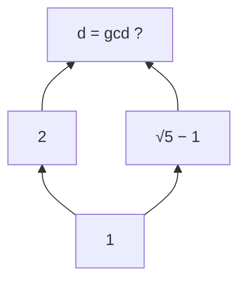
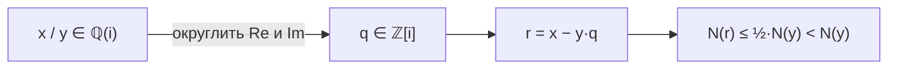
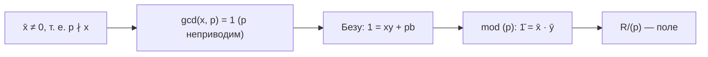
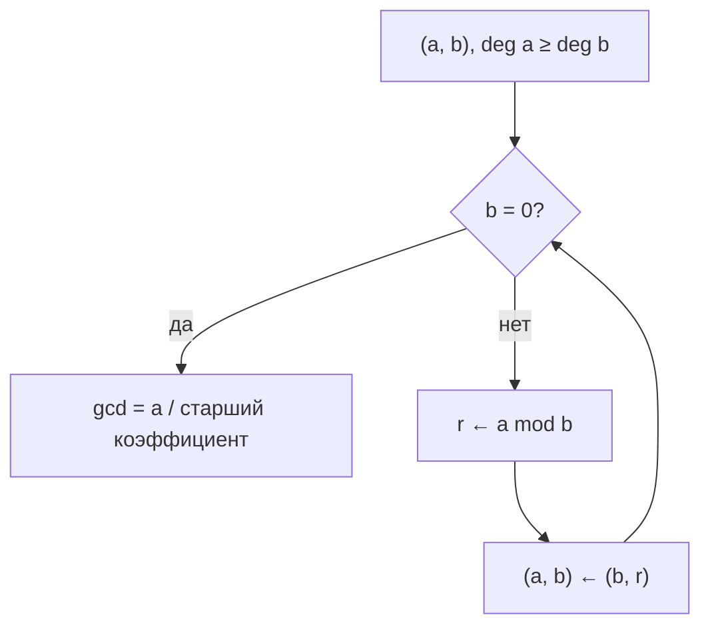

# 📝 Практика 7: Делимость и идеалы, норма, гауссовы числа, отсутствие НОД и конечные поля

> [!abstract] О занятии
> - **Дисциплина:** [[Линейная алгебра]] (1 семестр)
> - **Дата проведения:** 16 октября 2026 года (неделя 7, нечётная, пятница, две пары: 11:30 – 13:00 и 13:30 – 15:00)
> - **Аудитория:** 2133/1 (Кронверкский пр., д. 49, лит. А)
> - **Преподаватель практики:** Цветков Константин Борисович (ИТМО)
> - **Поток:** Поток 2 (Software Engineering)
> - **Источник:** фото доски (24 снимка)
> - **Связь с лекцией:** [[07. Лекция - Идеалы, делимость в областях целостности, простые и неприводимые элементы, ОГИ (2026-10-15)|лекция 7]] (идеалы, простые и неприводимые элементы, ОГИ)
> - **Ключевые темы:**
>   1. Делимость через главные идеалы: $b \mid a \iff (a) \subseteq (b)$; ассоциированные элементы.
>   2. Кольцо $\mathbb{Z}[\sqrt{5}]$: норма, обратимые элементы, неоднозначное разложение $4 = 2 \cdot 2 = (\sqrt5 - 1)(\sqrt5 + 1)$.
>   3. Отсутствие НОД у $4$ и $2(\sqrt5 - 1)$.
>   4. Гауссовы числа $\mathbb{Z}[i]$ — евклидово кольцо; кольцо Эйзенштейна.
>   5. Безу и разложение $2, 3, 5$ в $\mathbb{Z}[i]$.
>   6. $R/(p)$ — поле для неприводимого $p$ в ОГИ; $\mathbb{F}_p$, $\mathbb{C} \cong \mathbb{R}[x]/(x^2+1)$, $\mathbb{F}_4$, $\mathbb{F}_8$, $\mathbb{Z}[i]/(3) \cong \mathbb{F}_9$, $\mathbb{Z}[i]/(2+i) \cong \mathbb{F}_5$.
>   7. Алгоритм Евклида для многочленов: две задачи на НОД.

---

## 📌 Краткое резюме (TL;DR)

1. **Делимость = включение идеалов:** $b \mid a \iff (a) \subseteq (b)$; $a \sim b \iff (a) = (b) \iff a = bu$, $u \in R^{*}$.
2. **Норма** $N(a + b\sqrt{5}) = a^2 - 5b^2$ мультипликативна; $x$ обратим $\iff N(x) = \pm 1$.
3. **$\mathbb{Z}[\sqrt5]$ не факториально:** $2$, $\sqrt5 \pm 1$ неприводимы (уравнение $a^2 - 5b^2 = \pm 2$ не решается по модулю $5$), а $4$ имеет два разных разложения. У $4$ и $2(\sqrt5 - 1)$ **нет НОД**.
4. **$\mathbb{Z}[i]$ евклидово:** округляем $\frac{x}{y}$ до ближайшего узла решётки, $N(r) \le \frac12 N(y)$. Значит, в $\mathbb{Z}[i]$ есть Безу и однозначное разложение.
5. **В $\mathbb{Z}[i]$:** $2 = -i(1+i)^2$, $3$ — простой, $5 = (2+i)(2-i)$.
6. **$R$ — ОГИ, $p$ неприводим $\Rightarrow R/(p)$ — поле** (из Безу: $1 = xy + pb \Rightarrow \bar1 = \bar x \bar y$). Так строятся все конечные поля $\mathbb{F}_{p^n} = \mathbb{F}_p[x]/(f)$, $\deg f = n$.
7. **$|\mathbb{Z}[i]/(z)| = N(z)$:** $\mathbb{Z}[i]/(3) \cong \mathbb{F}_9$, $\mathbb{Z}[i]/(1+i) \cong \mathbb{F}_2$, $\mathbb{Z}[i]/(2+i) \cong \mathbb{F}_5$.
8. **НОД многочленов:** $\gcd(x^4 + x^3 - 3x^2 - 4x - 1,\, x^3 + x^2 - x - 1) = x + 1$; $\gcd(x^6 - 7x^4 + 8x^3 - 7x + 7,\, 3x^5 - 7x^3 + 3x^2 - 7) = x^3 + 1$.

---

## 1. Делимость и главные идеалы

Пусть $R$ — область целостности (коммутативное кольцо с $1 \ne 0$ без делителей нуля).

> [!info] Определение (делимость)
> $a$ **делится** на $b$ (пишут $a \,\vdots\, b$ или $b \mid a$), если $\exists\, c \in R : a = bc$.

> [!info] Определение (главный идеал)
> Главный идеал, порождённый элементом $a$:
> $$(a) = Ra = \{\, xa \mid x \in R \,\}.$$

> [!important] Утверждение (делимость на языке идеалов)
> $$b \mid a \iff (a) \subseteq (b).$$

**Доказательство.**
- $(\Rightarrow)$ Пусть $a = bc$. Любой элемент $(a)$ имеет вид $xa = x(bc) = (xc)\,b \in (b)$. Значит, $(a) \subseteq (b)$.
- $(\Leftarrow)$ Если $(a) \subseteq (b)$, то $a = 1 \cdot a \in (a) \subseteq (b)$, т. е. $a = cb$ для некоторого $c \in R$. $\blacksquare$

> [!tip] Мнемоника
> «Больше делитель — шире идеал»: чем «меньше» элемент в смысле делимости, тем **больше** его идеал. Например, в $\mathbb{Z}$: $2 \mid 6$ и $(6) = 6\mathbb{Z} \subseteq 2\mathbb{Z} = (2)$.

> [!important] Утверждение (ассоциированные элементы)
> Элементы $a, b \in R$ называются **ассоциированными** ($a \sim b$), если $a \mid b$ и $b \mid a$. Для области целостности равносильно:
> $$a \sim b \iff a \mid b \text{ и } b \mid a \iff (a) = (b) \iff a = bu \text{ для некоторого } u \in R^{*}.$$
> Здесь $R^{*}$ — группа обратимых элементов кольца.

**Доказательство последней равносильности.**
- $(\Leftarrow)$ Если $a = bu$, $u \in R^*$, то $b \mid a$ и $b = a u^{-1}$, т. е. $a \mid b$.
- $(\Rightarrow)$ Пусть $a = bc$, $b = ad$. Тогда $a = a(dc)$, т. е. $a(1 - dc) = 0$. Если $a = 0$, то и $b = ad = 0$, и $a = b \cdot 1$. Если $a \ne 0$, то в области целостности $1 - dc = 0$, т. е. $cd = 1$ и $c \in R^*$. $\blacksquare$

> [!warning] Где нужна область целостности
> Сокращение $a(1 - dc) = 0 \Rightarrow dc = 1$ использует отсутствие делителей нуля. В кольце с делителями нуля из $(a) = (b)$ не обязательно следует $a = bu$ с обратимым $u$.

---

## 2. Кольцо $\mathbb{Z}[\sqrt{5}]$: неоднозначность разложения

$$
\mathbb{Z}[\sqrt{5}] = \{\, a + b\sqrt{5} \mid a, b \in \mathbb{Z} \,\}.
$$

Это подкольцо $\mathbb{R}$, следовательно, область целостности. В нём число $4$ раскладывается двумя способами:
$$
4 = 2 \cdot 2 = (\sqrt{5} - 1)(\sqrt{5} + 1).
$$

Чтобы доказать, что эти разложения **существенно разные**, т. е. что сомножители неприводимы и не ассоциированы, нужен инструмент — норма. На доске рядом выписано также произведение $2(\sqrt{5} - 1)$: оно понадобится при обсуждении общих делителей.

### 2.1. Норма в $\mathbb{Z}[\sqrt{5}]$

> [!info] Определение (норма)
> $$N(a + b\sqrt{5}) = a^2 - 5b^2 = (a + b\sqrt{5})(a - b\sqrt{5}) \in \mathbb{Z}.$$

> [!important] Утверждение (мультипликативность нормы)
> $$N(xy) = N(x)\,N(y) \qquad \forall\, x, y \in \mathbb{Z}[\sqrt{5}].$$

**Доказательство (прямой выкладкой, как на доске).** Пусть $x = a + b\sqrt{5}$, $y = c + d\sqrt{5}$. Тогда
$$
xy = (a + b\sqrt{5})(c + d\sqrt{5}) = (ac + 5bd) + (ad + bc)\sqrt{5},
$$
$$
\begin{aligned}
N(xy) &= (ac + 5bd)^2 - 5(ad + bc)^2 \\
&= a^2c^2 + 10abcd + 25b^2d^2 - 5a^2d^2 - 10abcd - 5b^2c^2 \\
&= a^2c^2 - 5a^2d^2 - 5b^2c^2 + 25b^2d^2 \\
&= (a^2 - 5b^2)(c^2 - 5d^2) = N(x)\,N(y). \qquad \blacksquare
\end{aligned}
$$

> [!tip] Короткое доказательство через сопряжение
> Отображение $\overline{a + b\sqrt{5}} = a - b\sqrt{5}$ — автоморфизм кольца (сохраняет суммы и произведения), и $N(x) = x\bar{x}$. Тогда $N(xy) = xy\,\overline{xy} = x\bar{x}\,y\bar{y} = N(x)N(y)$.

### 2.2. Обратимые элементы

> [!important] Утверждение
> $$x \in \mathbb{Z}[\sqrt{5}]^{*} \iff N(x) = \pm 1.$$

**Доказательство.**
- $(\Rightarrow)$ Пусть $xy = 1$. Тогда
$$1 = N(1) = N(xy) = N(x)\,N(y),$$
и $N(x), N(y) \in \mathbb{Z}$. Единственные делители единицы в $\mathbb{Z}$ — это $\pm 1$, значит, $N(x) = \pm 1$.
- $(\Leftarrow)$ Если $N(x) = x\bar{x} = \pm 1$, то $x \cdot (\pm\bar{x}) = 1$, т. е. $x^{-1} = \pm\bar{x} \in \mathbb{Z}[\sqrt{5}]$. $\blacksquare$

> [!example] Пример обратимого элемента
> $N(2 + \sqrt{5}) = 4 - 5 = -1$, поэтому $2 + \sqrt{5}$ обратим: $(2 + \sqrt{5})(-2 + \sqrt{5}) = 5 - 4 = 1$. Значит, группа $\mathbb{Z}[\sqrt{5}]^{*}$ бесконечна: все степени $(2 + \sqrt{5})^n$ обратимы и различны.

Здесь норма рассматривается как отображение $N : R \to \mathbb{Z}$, где $R = \mathbb{Z}[\sqrt{5}]$, а условие обратимости для $x = a + b\sqrt{5}$ записывается как
$$
(a + b\sqrt{5})(a - b\sqrt{5}) = \pm 1.
$$

### 2.3. Неприводимость $2$

> [!example] $2$ неприводим в $\mathbb{Z}[\sqrt{5}]$
> Пусть $2 = xy$. Тогда
> $$4 = N(2) = N(x)\,N(y).$$
> Если ни $x$, ни $y$ не обратимы, то $N(x), N(y) \ne \pm 1$, и остаётся только $N(x) = \pm 2$, т. е.
> $$a^2 - 5b^2 = \pm 2.$$
> Рассмотрим это по модулю $5$: $a^2 \equiv \pm 2 \pmod 5$. Но квадраты по модулю $5$ — это только $0, 1, 4$:
>
> | $a \bmod 5$ | $0$ | $1$ | $2$ | $3$ | $4$ |
> |:---:|:---:|:---:|:---:|:---:|:---:|
> | $a^2 \bmod 5$ | $0$ | $1$ | $4$ | $4$ | $1$ |
>
> Значит, $\pm 2 \equiv 2, 3 \pmod 5$ — не квадраты, и уравнение решений не имеет. Следовательно, один из сомножителей обратим, и $2$ неприводим.

> [!example] $\sqrt{5} \pm 1$ тоже неприводимы и не ассоциированы с $2$
> - $N(\sqrt{5} \pm 1) = 1 - 5 = -4$. Если $\sqrt{5} \pm 1 = xy$ с необратимыми $x, y$, то снова $N(x) = \pm 2$, что невозможно. Значит, $\sqrt{5} \pm 1$ неприводимы.
> - $2 \not\sim \sqrt{5} - 1$: иначе $\sqrt{5} - 1 = 2u$, $u \in R^{*}$, но $\frac{\sqrt{5} - 1}{2} = -\frac12 + \frac12\sqrt{5} \notin \mathbb{Z}[\sqrt{5}]$.
>
> Итак, $4 = 2 \cdot 2 = (\sqrt{5} - 1)(\sqrt{5} + 1)$ — **два существенно разных разложения** на неприводимые, и $\mathbb{Z}[\sqrt{5}]$ **не факториально**.

---

## 3. Отсутствие НОД: $\gcd\bigl(4,\; 2(\sqrt{5} - 1)\bigr)$

Найдём общие делители элементов $4$ и $2(\sqrt{5} - 1)$:
- $2 \mid 4$ и $2 \mid 2(\sqrt{5} - 1)$;
- $(\sqrt{5} - 1) \mid 4$, так как $4 = (\sqrt{5} - 1)(\sqrt{5} + 1)$, и $(\sqrt{5} - 1) \mid 2(\sqrt{5} - 1)$.

Если бы НОД $d$ существовал, то, как наибольший общий делитель, он делился бы на оба общих делителя, и при этом сам делил бы оба числа:
$$
2 \mid d, \quad (\sqrt{5} - 1) \mid d, \qquad d \mid 4, \quad d \mid 2(\sqrt{5} - 1).
$$

На доске это изображено диаграммой делимости (снизу вверх — «делит»):



**Шаг 1: из $2 \mid d$ и $(\sqrt{5} - 1) \mid d$.** Запишем
$$
d = 2(a + b\sqrt{5}) = (\sqrt{5} - 1)(c + e\sqrt{5}).
$$
Раскроем правую часть:
$$
(\sqrt{5} - 1)(c + e\sqrt{5}) = c\sqrt{5} + 5e - c - e\sqrt{5} = (-c + 5e) + (c - e)\sqrt{5}.
$$
Сравнивая коэффициенты (числа $1, \sqrt{5}$ линейно независимы над $\mathbb{Q}$):
$$
2a = -c + 5e, \qquad 2b = c - e.
$$
Отсюда
$$
2(a + b) = 4e \implies \boxed{a + b = 2e}, \qquad 2(a + 5b) = 4c \implies \boxed{a + 5b = 2c}.
$$
В частности, $a + b$ чётно, т. е. $a \equiv b \pmod 2$. Обратно, при $a \equiv b \pmod 2$ числа $e = \frac{a+b}{2}$ и $c = \frac{a+5b}{2}$ целые. Итак, **общие кратные** $2$ и $\sqrt{5} - 1$ — это ровно элементы вида
$$
d = 2(a + b\sqrt{5}), \qquad a \equiv b \pmod 2.
$$

**Шаг 2: из $d \mid 4$ и $d \mid 2(\sqrt{5} - 1)$ — завершение через норму** *(доска на этом обрывается; ниже стандартное завершение)*.
- $N(4) = 16$, $N\bigl(2(\sqrt{5} - 1)\bigr) = N(2)\,N(\sqrt{5} - 1) = 4 \cdot (-4) = -16$. Значит, $N(d) \mid 16$.
- $2 \mid d \Rightarrow N(2) = 4 \mid N(d)$. Остаются варианты $N(d) = \pm 4$ или $N(d) = \pm 16$.
- **$N(d) = \pm 16$.** Из $4 = d t$ получаем $N(t) = \pm 1$, т. е. $t \in R^{*}$ и $d \sim 4$. Аналогично $d \sim 2(\sqrt{5} - 1)$. Тогда $4 \sim 2(\sqrt{5} - 1)$, т. е. $2 \sim \sqrt{5} - 1$, что неверно (§2.3).
- **$N(d) = \pm 4$.** Из $d = 2s$ получаем $N(s) = \pm 1$, т. е. $d \sim 2$. Тогда $(\sqrt{5} - 1) \mid d$ даёт $(\sqrt{5} - 1) \mid 2$, а равенство норм ($\lvert -4 \rvert = 4$) делает частное обратимым, т. е. $2 \sim \sqrt{5} - 1$ — снова противоречие.

> [!important] Вывод
> У элементов $4$ и $2(\sqrt{5} - 1)$ в $\mathbb{Z}[\sqrt{5}]$ **нет наибольшего общего делителя**: максимальных общих делителей два ($2$ и $\sqrt{5} - 1$), и они несравнимы по делимости. В факториальном кольце (и тем более в кольце главных идеалов) НОД всегда существует, так что $\mathbb{Z}[\sqrt{5}]$ — не ОГИ и не факториальное кольцо.

> [!tip] Обобщение: $\mathbb{Z}[\sqrt{n}]$
> Для любого целого $n$, не являющегося квадратом, в кольце $\mathbb{Z}[\sqrt{n}] = \{a + b\sqrt{n}\}$ норма задаётся формулой
> $$N(a + b\sqrt{n}) = a^2 - n b^2,$$
> и все рассуждения о мультипликативности и обратимых элементах ($N(x) = \pm 1$) переносятся дословно.

---

## 4. Гауссовы целые числа $\mathbb{Z}[i]$ — евклидово кольцо

$$
R := \mathbb{Z}[i] = \{\, a + bi \mid a, b \in \mathbb{Z} \,\}, \qquad N(a + bi) = a^2 + b^2 = |a + bi|^2.
$$

Норма мультипликативна ($|xy|^2 = |x|^2 |y|^2$) и неотрицательна, $N(x) = 0 \iff x = 0$.

Вспомогательные формулы с доски — умножение и обращение комплексных чисел:
$$
(a + bi)(c + di) = (ac - bd) + (ad + bc)\,i,
$$
$$
\frac{1}{a + bi} = \frac{a - bi}{a^2 + b^2} = \frac{a}{a^2 + b^2} - \frac{b}{a^2 + b^2}\, i.
$$
Поэтому частное $\frac{x}{y} = \frac{x\,\bar{y}}{N(y)}$ всегда лежит в $\mathbb{Q}(i) = \{p + qi \mid p, q \in \mathbb{Q}\}$, но не обязательно в $\mathbb{Z}[i]$: обратимы в $\mathbb{Z}[i]$ только элементы с $N = 1$, т. е. $\mathbb{Z}[i]^{*} = \{\pm 1, \pm i\}$.

> [!important] Теорема (деление с остатком в $\mathbb{Z}[i]$)
> $$\forall\, x, y \in \mathbb{Z}[i],\; y \ne 0 \quad \exists\, q, r \in \mathbb{Z}[i] : \quad x = yq + r, \qquad \begin{cases} r = 0, \\ \text{или } N(r) < N(y). \end{cases}$$
> Значит, $\mathbb{Z}[i]$ — **евклидово кольцо** с евклидовой нормой $N$.

**Доказательство.** Рассмотрим частное $\frac{x}{y} \in \mathbb{C}$ (точнее, $\in \mathbb{Q}(i)$). Точки $\mathbb{Z}[i]$ образуют на комплексной плоскости квадратную решётку с шагом $1$. Выберем в качестве $q$ **ближайший к $\frac{x}{y}$ узел решётки** (округлим отдельно вещественную и мнимую части). Тогда
$$
\left| \operatorname{Re}\frac{x}{y} - \operatorname{Re} q \right| \le \frac12, \qquad \left| \operatorname{Im}\frac{x}{y} - \operatorname{Im} q \right| \le \frac12.
$$
Положим $r = x - yq \in \mathbb{Z}[i]$. Тогда
$$
\frac{N(r)}{N(y)} = \frac{N(x - yq)}{N(y)} = N\!\left(\frac{x}{y} - q\right) \le \left(\frac12\right)^2 + \left(\frac12\right)^2 = \frac12 < 1.
$$
Следовательно, $N(r) < N(y)$. $\blacksquare$



> [!example] Пример деления с остатком
> Разделим $x = 7 + 3i$ на $y = 2 + i$, $N(y) = 5$:
> $$\frac{7 + 3i}{2 + i} = \frac{(7 + 3i)(2 - i)}{5} = \frac{14 - 7i + 6i + 3}{5} = \frac{17 - i}{5} = 3{,}4 - 0{,}2i.$$
> Ближайший узел: $q = 3$. Остаток $r = 7 + 3i - 3(2 + i) = 1$, $N(r) = 1 < 5$. ✓

> [!info] Следствие
> Евклидово кольцо — кольцо главных идеалов, а значит, факториально. Поэтому в $\mathbb{Z}[i]$, в отличие от $\mathbb{Z}[\sqrt{5}]$, работают алгоритм Евклида, соотношение Безу и однозначное разложение на простые.

> [!tip] Ещё одно евклидово кольцо: целые числа Эйзенштейна
> На доске упомянуто кольцо
> $$\mathbb{Z}[\omega], \qquad \omega = \frac{-1 + \sqrt{3}\, i}{2}, \quad \omega^2 + \omega + 1 = 0.$$
> Его элементы образуют на плоскости **треугольную** решётку, а норма — $N(a + b\omega) = |a + b\omega|^2 = a^2 - ab + b^2$. Тот же приём (ближайший узел решётки к $\frac{x}{y}$) даёт $N\!\left(\frac{x}{y} - q\right) \le \frac13 < 1$, так что $\mathbb{Z}[\omega]$ тоже евклидово.

---

## 5. Соотношение Безу и простые в $\mathbb{Z}[i]$

> [!important] Соотношение Безу в евклидовом кольце
> Если $R$ евклидово (в частности, $R = \mathbb{Z}[i]$) и $d = \gcd(a, b)$, то
> $$\exists\, x, y \in R : \quad ax + by = d.$$
> Доказательство то же, что в $\mathbb{Z}$: алгоритм Евклида с обратным ходом (норма остатков строго убывает, поэтому процесс конечен).

### 5.1. Разложение $2, 3, 5$ в $\mathbb{Z}[i]$

> [!example] $2 = (1 + i)(1 - i) = -i(1 + i)^2 = i(1 - i)^2$
> - $N(1 \pm i) = 2$ — простое число в $\mathbb{Z}$, поэтому $1 \pm i$ неприводимы (любое разложение $xy$ даёт $N(x)N(y) = 2$, и один из множителей имеет норму $1$, т. е. обратим).
> - $1 + i$ и $1 - i$ **ассоциированы**: $1 + i = i(1 - i)$. Проверка: $i(1 - i)^2 = i \cdot (1 - 2i + i^2) = i \cdot (-2i) = 2$. ✓
> - Итог: $2$ в $\mathbb{Z}[i]$ **не простой** — это квадрат простого с точностью до обратимого.

> [!example] $3$ — простой элемент $\mathbb{Z}[i]$
> Пусть $3 = xy$ с необратимыми $x, y$. Тогда $9 = N(x)N(y)$ и $N(x) = 3$, т. е. $a^2 + b^2 = 3$. Но суммы двух квадратов не бывают $\equiv 3 \pmod 4$ (квадраты $\equiv 0, 1 \pmod 4$). Значит, $3$ неприводим, а в евклидовом кольце неприводимые элементы простые.

> [!example] $5 = (2 + i)(2 - i)$
> $N(2 \pm i) = 5$ — простое число, значит, $2 \pm i$ неприводимы. Они **не ассоциированы**: $\frac{2 + i}{2 - i} = \frac{(2 + i)^2}{5} = \frac{3 + 4i}{5} \notin \mathbb{Z}[i]$. Итак, $5$ раскладывается в произведение двух разных простых.

> [!info] Общая картина (теорема Ферма–Эйлера о суммах двух квадратов)
> | Простое $p \in \mathbb{Z}$ | Поведение в $\mathbb{Z}[i]$ | Пример |
> |:---|:---|:---|
> | $p = 2$ | $2 = -i(1 + i)^2$ (ветвится) | $2 = (1 + i)(1 - i)$ |
> | $p \equiv 1 \pmod 4$ | $p = \pi\bar{\pi}$, $\pi \not\sim \bar{\pi}$ (распадается) | $5 = (2 + i)(2 - i)$ |
> | $p \equiv 3 \pmod 4$ | остаётся простым (инертно) | $3$, $7$, $11$ |
>
> В частности, $p$ представимо в виде $a^2 + b^2$ $\iff$ $p = 2$ или $p \equiv 1 \pmod 4$.

---

## 6. Фактор по неприводимому: построение полей

> [!important] Теорема
> Пусть $R$ — ОГИ, $p \in R$ — неприводимый элемент. Тогда фактор-кольцо
> $$R/(p) = \{\, x + (p) \mid x \in R \,\}$$
> является **полем**.

**Доказательство.** Вспомним, что в ОГИ идеал, порождённый двумя элементами, главный и порождается их НОД:
$$
(a, b) = \bigl(\gcd(a, b)\bigr).
$$
Пусть $\bar{x} = x + (p) \ne \bar{0}$, т. е. $x \notin (p)$, иначе говоря, $p \nmid x$. Так как $p$ неприводим, его делители — только обратимые элементы и ассоциированные с $p$. Ассоциированные с $p$ не делят $x$, поэтому
$$
\gcd(x, p) = 1.
$$
По соотношению Безу $\exists\, y, b \in R$:
$$
1 = xy + pb.
$$
Переходя к классам по модулю $(p)$ (слагаемое $pb \in (p)$ исчезает):
$$
\bar{1} = \bar{x} \cdot \bar{y}.
$$
Итак, каждый ненулевой класс обратим, и $R/(p)$ — поле. $\blacksquare$



### 6.1. Примеры

> [!example] Конечные поля вычетов
> $R = \mathbb{Z}$, $p$ — простое число:
> $$\mathbb{F}_p = \mathbb{Z}/p\mathbb{Z}.$$

> [!example] Фактор кольца многочленов
> $R = K[x]$ над полем $K$ — евклидово кольцо (деление многочленов с остатком), а значит, ОГИ. Если $f$ — **неприводимый многочлен**, то
> $$K[x]/(f) \text{ — поле}.$$

> [!example] Комплексные числа
> Многочлен $x^2 + 1$ неприводим над $\mathbb{R}$ (нет вещественных корней), поэтому
> $$\mathbb{C} \cong \mathbb{R}[x]/(x^2 + 1), \qquad a + bi \longleftrightarrow a + bx \pmod{x^2 + 1}.$$
> Каждый класс содержит единственный представитель степени $< 2$, а умножение согласовано: $x^2 \equiv -1$, как $i^2 = -1$.

> [!example] Конечные поля из $p^{\deg f}$ элементов
> Если $f \in \mathbb{F}_p[x]$ неприводим, то
> $$\mathbb{F}_{p^{\deg f}} := \mathbb{F}_p[x]/(f).$$
> Классы представляются многочленами степени $< \deg f$, их ровно $p^{\deg f}$. Например, $\mathbb{F}_4 = \mathbb{F}_2[x]/(x^2 + x + 1)$ (см. [[04. Практика - Порядок элемента, теорема Лагранжа, поле F4 и группы симметрий многогранников (2026-09-25)|практику 4]]).

### 6.2. Построение $\mathbb{F}_4 = \mathbb{F}_2[x]/(f)$

Возьмём $f = x^2 + x + 1 \in \mathbb{F}_2[x]$. Он неприводим: степень $2$, а корней в $\mathbb{F}_2$ нет ($f(0) = 1$, $f(1) = 1$).

Обозначим $\alpha = \bar{x}$. Тогда в фактор-кольце
$$
\bar{0} = \bar{x}^2 + \bar{x} + \bar{1} \implies \alpha^2 + \alpha + 1 = 0 \implies \alpha^2 = \alpha + 1 \quad (\text{в характеристике } 2: -1 = 1).
$$
Элементы поля — классы многочленов степени $< 2$:
$$
\mathbb{F}_4 = \{\, 0,\; 1,\; \alpha,\; \alpha + 1 \,\}.
$$

| $\cdot$ | $1$ | $\alpha$ | $\alpha + 1$ |
|:---:|:---:|:---:|:---:|
| $1$ | $1$ | $\alpha$ | $\alpha + 1$ |
| $\alpha$ | $\alpha$ | $\alpha + 1$ | $1$ |
| $\alpha + 1$ | $\alpha + 1$ | $1$ | $\alpha$ |

Например, $\alpha(\alpha + 1) = \alpha^2 + \alpha = (\alpha + 1) + \alpha = 1$, т. е. $\alpha^{-1} = \alpha + 1$. Мультипликативная группа $\mathbb{F}_4^{*} = \{1, \alpha, \alpha^2 = \alpha + 1\}$ циклическая порядка $3$.

### 6.3. Задача: два представления $\mathbb{F}_8$

> [!example] Построить изоморфизм $\mathbb{F}_2[x]/(g) \cong \mathbb{F}_2[x]/(h)$
> $$g = x^3 + x + 1, \qquad h = x^3 + x^2 + 1.$$
> Оба многочлена неприводимы над $\mathbb{F}_2$: у многочлена степени $3$ нетривиальное разложение обязательно содержит линейный множитель, а корней нет ($g(0) = h(0) = 1$, $g(1) = h(1) = 1$). Значит, обе фактор-конструкции дают поле $\mathbb{F}_8$.
>
> **Идея.** Изоморфизм $\varphi : \mathbb{F}_2[y]/(h) \to \mathbb{F}_2[x]/(g)$ задаётся образом класса $\bar{y}$: нужен **корень $h$** в поле $\mathbb{F}_2[x]/(g)$.
>
> **Решение.** Пусть $\alpha = \bar{x}$, $\alpha^3 = \alpha + 1$. Выпишем степени $\alpha$:
>
> | $k$ | $\alpha^k$ | Вычисление |
> |:---:|:---|:---|
> | $3$ | $\alpha + 1$ | из $g(\alpha) = 0$ |
> | $4$ | $\alpha^2 + \alpha$ | $\alpha \cdot \alpha^3$ |
> | $5$ | $\alpha^2 + \alpha + 1$ | $\alpha^3 + \alpha^2$ |
> | $6$ | $\alpha^2 + 1$ | $\alpha^3 + \alpha^2 + \alpha$ |
> | $7$ | $1$ | $\alpha^3 + \alpha = 1$ |
>
> Корни $h$ — обратные к корням $g$ (так как $h(x) = x^3 g(1/x)$, т. е. $h$ — взаимный многочлен). Поэтому берём
> $$\beta = \alpha^{-1} = \alpha^6 = \alpha^2 + 1.$$
> Проверка: $h(\beta) = \alpha^{18} + \alpha^{12} + 1 = \alpha^4 + \alpha^5 + 1 = (\alpha^2 + \alpha) + (\alpha^2 + \alpha + 1) + 1 = 0$. ✓
>
> **Ответ:**
> $$\varphi : \mathbb{F}_2[y]/(h) \to \mathbb{F}_2[x]/(g), \qquad \bar{y} \longmapsto \bar{x}^2 + \bar{1},$$
> т. е. $a + b\bar{y} + c\bar{y}^2 \mapsto a + b(\alpha^2 + 1) + c(\alpha^2 + 1)^2$. Это корректно определённый гомоморфизм (так как $h(\beta) = 0$), он инъективен (ядро — идеал поля, а $\varphi(1) = 1 \neq 0$) и, поскольку оба поля из $8$ элементов, биективен.

### 6.4. Фактор-кольца $\mathbb{Z}[i]$ на решётке

> [!example] $\mathbb{Z}[i]/(3) = \mathbb{F}_9$
> $3$ — простой элемент $\mathbb{Z}[i]$ (§5.1), поэтому фактор — поле. Идеал $(3) = \{3a + 3bi\}$ — это квадратная решётка с шагом $3$ (узлы $0, \pm 3, \pm 3i, \pm 3 \pm 3i, \ldots$). Фундаментальная область — квадрат $3 \times 3$, в нём ровно $9$ точек:
> $$\mathbb{Z}[i]/(3) = \{\, a + bi \mid a, b \in \{0, 1, 2\} \,\}, \qquad |\mathbb{Z}[i]/(3)| = N(3) = 9.$$
> Значит, $\mathbb{Z}[i]/(3) \cong \mathbb{F}_9 \cong \mathbb{F}_3[x]/(x^2 + 1)$ ($x^2 + 1$ неприводим над $\mathbb{F}_3$, так как $-1$ — не квадрат по модулю $3$).

> [!example] $\mathbb{Z}[i]/(1 + i) \cong \mathbb{F}_2$
> Идеал $(1 + i) = \{(1 + i)(c + di)\} = \{(c - d) + (c + d)i\}$ — это точки $a + bi$ с $a + b$ **чётным** («шахматная» решётка, повёрнутая на $45^\circ$ — диагональные прямые на доске). Классов ровно два: чётная и нечётная сумма координат, и $|\mathbb{Z}[i]/(1 + i)| = N(1 + i) = 2$. Итак, фактор — поле $\mathbb{F}_2$.

> [!example] $\mathbb{Z}[i]/(2 + i) \cong \mathbb{F}_5$
> $N(2 + i) = 5$, поэтому $2 + i$ прост, и в фактор-кольце $5$ элементов. Решётка $(2 + i)$ натянута на векторы $2 + i$ и $i(2 + i) = -1 + 2i$ — повёрнутый квадрат площади $5$ (наклонные прямые на доске).
>
> **Явный изоморфизм.** В фактор-кольце $i \equiv -2$ (так как $2 + i \equiv 0$), а $5 = (2 + i)(2 - i) \equiv 0$. Поэтому
> $$a + bi \equiv a - 2b \pmod{2 + i}, \qquad \mathbb{Z}[i]/(2 + i) \to \mathbb{F}_5, \quad a + bi \mapsto (a - 2b) \bmod 5.$$
> Проверка согласованности с $i^2 = -1$: $(-2)^2 = 4 \equiv -1 \pmod 5$. ✓

> [!tip] Общее правило
> Для $0 \ne z \in \mathbb{Z}[i]$ число элементов фактор-кольца равно норме: $|\mathbb{Z}[i]/(z)| = N(z)$ — это площадь фундаментального квадрата решётки $(z)$, построенного на векторах $z$ и $iz$.

---

## 7. Алгоритм Евклида для многочленов

В $\mathbb{Q}[x]$ (евклидово кольцо, норма — степень) НОД ищется по правилу
$$
\gcd(a, b) = \gcd(a \bmod b,\; b),
$$
и результат нормируется (делится на старший коэффициент), так как НОД определён с точностью до ассоциированности, т. е. до ненулевой константы.



**Псевдокод (CLRS):**

```text
POLY-GCD(a, b)
1  while b ≠ 0
2      r ← a mod b          ▷ деление с остатком, deg r < deg b
3      a ← b
4      b ← r
5  return a / lc(a)         ▷ нормировка: старший коэффициент = 1
```

### Задача 1

$$
\gcd\bigl(x^4 + x^3 - 3x^2 - 4x - 1,\;\; x^3 + x^2 - x - 1\bigr).
$$

**Шаг 1.** $f = x^4 + x^3 - 3x^2 - 4x - 1$ делим на $g = x^3 + x^2 - x - 1$:
$$
f - x \cdot g = (x^4 + x^3 - 3x^2 - 4x - 1) - (x^4 + x^3 - x^2 - x) = -2x^2 - 3x - 1.
$$
С точностью до константы остаток $r_1 = 2x^2 + 3x + 1$.

**Шаг 2.** $g$ делим на $r_1$:
$$
g = \left(\tfrac12 x - \tfrac14\right)(2x^2 + 3x + 1) - \tfrac34 (x + 1).
$$
Проверка:
$$
\tfrac12 x \cdot (2x^2 + 3x + 1) = x^3 + \tfrac32 x^2 + \tfrac12 x, \qquad -\tfrac14 (2x^2 + 3x + 1) = -\tfrac12 x^2 - \tfrac34 x - \tfrac14,
$$
сумма: $x^3 + x^2 - \tfrac14 x - \tfrac14$. Тогда остаток
$$
g - \left(x^3 + x^2 - \tfrac14 x - \tfrac14\right) = -\tfrac34 x - \tfrac34 = -\tfrac34 (x + 1).
$$
С точностью до константы $r_2 = x + 1$.

**Шаг 3.** $r_1 = 2x^2 + 3x + 1 = (2x + 1)(x + 1)$ делится на $x + 1$ нацело — остаток $0$.

$$
\boxed{\gcd = x + 1}
$$

> [!tip] Проверка разложением
> $g = x^3 + x^2 - x - 1 = x^2(x + 1) - (x + 1) = (x + 1)^2 (x - 1)$, а $f(-1) = 1 - 1 - 3 + 4 - 1 = 0$, но $f(1) = -6 \neq 0$ и $f'(-1) = -4 + 3 + 6 - 4 = 1 \neq 0$ ($-1$ — простой корень $f$). Значит, общий множитель ровно $x + 1$. ✓

### Задача 2

$$
\gcd\bigl(x^6 - 7x^4 + 8x^3 - 7x + 7,\;\; 3x^5 - 7x^3 + 3x^2 - 7\bigr).
$$

**Шаг 1.** $f = x^6 - 7x^4 + 8x^3 - 7x + 7$ делим на $g = 3x^5 - 7x^3 + 3x^2 - 7$:
$$
f - \tfrac{x}{3}\, g = x^6 - 7x^4 + 8x^3 - 7x + 7 - \left(x^6 - \tfrac73 x^4 + x^3 - \tfrac73 x\right) = -\tfrac{14}{3} x^4 + 7x^3 - \tfrac{14}{3} x + 7.
$$
Вынесем $-\tfrac73$: остаток с точностью до константы
$$
r_1 = 2x^4 - 3x^3 + 2x - 3 = x^3(2x - 3) + (2x - 3) = (x^3 + 1)(2x - 3).
$$

**Шаг 2.** Заметим, что $g = 3x^2(x^3 + 1) - 7(x^3 + 1) = (x^3 + 1)(3x^2 - 7)$. Делим $3x^2 - 7$ на $2x - 3$: остаток равен значению в корне $x = \tfrac32$: $3 \cdot \tfrac94 - 7 = -\tfrac14$. Поэтому
$$
g = (x^3 + 1)\bigl[(2x - 3)\,q(x) - \tfrac14\bigr] = r_1 \cdot q(x) - \tfrac14 (x^3 + 1),
$$
т. е. $g \bmod r_1 = -\tfrac14 (x^3 + 1)$, с точностью до константы $r_2 = x^3 + 1$.

**Шаг 3.** $r_1 = (x^3 + 1)(2x - 3)$ делится на $r_2$ нацело — остаток $0$.

$$
\boxed{\gcd = x^3 + 1 = (x + 1)(x^2 - x + 1)}
$$

> [!tip] Проверка разложением
> $f = (x^3 + 1)(x^3 - 7x + 7)$: действительно, $(x^3 + 1)(x^3 - 7x + 7) = x^6 - 7x^4 + 7x^3 + x^3 - 7x + 7$. ✓ Множители $x^3 - 7x + 7$ и $3x^2 - 7$ взаимно просты: корни второго $\pm\sqrt{7/3}$, а $x^3 - 7x + 7$ в них равен $7 \mp \tfrac{14}{3}\sqrt{7/3} \ne 0$.

---

## 8. Сводная таблица колец

| Кольцо | Норма | Обратимые | Евклидово | Факториально |
|:---|:---|:---|:---:|:---:|
| $\mathbb{Z}$ | $\lvert a \rvert$ | $\pm 1$ | ✅ | ✅ |
| $\mathbb{Z}[i]$ | $a^2 + b^2$ | $\pm 1, \pm i$ | ✅ | ✅ |
| $\mathbb{Z}[\omega]$, $\omega = \frac{-1 + \sqrt3 i}{2}$ | $a^2 - ab + b^2$ | $\pm 1, \pm\omega, \pm\omega^2$ | ✅ | ✅ |
| $\mathbb{Z}[\sqrt5]$ | $a^2 - 5b^2$ | $N(x) = \pm 1$, бесконечная группа | ❌ | ❌ ($4 = 2 \cdot 2 = (\sqrt5 - 1)(\sqrt5 + 1)$) |
| $K[x]$, $K$ — поле | $\deg$ | ненулевые константы | ✅ | ✅ |

| Фактор-кольцо | Число элементов | Изоморфно |
|:---|:---:|:---|
| $\mathbb{Z}/(p)$ | $p$ | $\mathbb{F}_p$ |
| $\mathbb{R}[x]/(x^2 + 1)$ | $\infty$ | $\mathbb{C}$ |
| $\mathbb{F}_2[x]/(x^2 + x + 1)$ | $4$ | $\mathbb{F}_4$ |
| $\mathbb{F}_2[x]/(x^3 + x + 1)$ | $8$ | $\mathbb{F}_8 \cong \mathbb{F}_2[x]/(x^3 + x^2 + 1)$ |
| $\mathbb{Z}[i]/(1 + i)$ | $2$ | $\mathbb{F}_2$ |
| $\mathbb{Z}[i]/(2 + i)$ | $5$ | $\mathbb{F}_5$ |
| $\mathbb{Z}[i]/(3)$ | $9$ | $\mathbb{F}_9$ |

---

## 9. Чек-лист и типичные ловушки

> [!warning] Ловушки
> - **Неприводимый $\ne$ простой** вне факториальных колец: в $\mathbb{Z}[\sqrt5]$ элемент $2$ неприводим, но не прост ($2 \mid (\sqrt5 - 1)(\sqrt5 + 1)$, но не делит ни один множитель).
> - **НОД существует не всегда:** в $\mathbb{Z}[\sqrt5]$ у $4$ и $2(\sqrt5 - 1)$ есть два несравнимых максимальных общих делителя.
> - **Норма может быть отрицательной** в $\mathbb{Z}[\sqrt{n}]$ при $n > 0$; обратимость — это $N(x) = \pm 1$, а не только $1$.
> - **Ассоциированность проверяйте делением:** $1 + i \sim 1 - i$ (частное $i$), но $2 + i \not\sim 2 - i$ (частное $\frac{3 + 4i}{5} \notin \mathbb{Z}[i]$).
> - **В характеристике $2$** $-1 = 1$, поэтому $\alpha^2 + \alpha + 1 = 0 \Rightarrow \alpha^2 = \alpha + 1$.

> [!important] Что нужно уметь
> - Доказать $b \mid a \iff (a) \subseteq (b)$ и критерий ассоциированности.
> - Доказать мультипликативность нормы и критерий обратимости через норму.
> - Проверить неприводимость через норму и сравнения.
> - Доказать евклидовость $\mathbb{Z}[i]$ (ближайший узел решётки).
> - Доказать, что $R/(p)$ — поле, через соотношение Безу.
> - Строить конечные поля $\mathbb{F}_p[x]/(f)$ и изоморфизмы между разными моделями.
> - Считать НОД многочленов алгоритмом Евклида.

---

## ❓ Вопросы для самопроверки к коллоквиуму / экзамену

- [ ] Почему $b \mid a \iff (a) \subseteq (b)$? Приведите пример в $\mathbb{Z}$.
- [ ] Докажите, что в области целостности $(a) = (b) \iff a = bu$, $u \in R^{*}$. Где используется отсутствие делителей нуля?
- [ ] Докажите мультипликативность нормы в $\mathbb{Z}[\sqrt5]$ двумя способами.
- [ ] Найдите обратимый элемент $\mathbb{Z}[\sqrt5]$, отличный от $\pm 1$. Почему группа $\mathbb{Z}[\sqrt5]^{*}$ бесконечна?
- [ ] Почему уравнение $a^2 - 5b^2 = \pm 2$ не имеет целых решений?
- [ ] Покажите, что $\mathbb{Z}[\sqrt5]$ не факториально.
- [ ] Почему у $4$ и $2(\sqrt5 - 1)$ нет НОД в $\mathbb{Z}[\sqrt5]$?
- [ ] Докажите, что $\mathbb{Z}[i]$ евклидово. Какая оценка получается для $N(r)/N(y)$?
- [ ] Разделите с остатком $7 + 3i$ на $2 + i$ в $\mathbb{Z}[i]$.
- [ ] Разложите $2$, $3$, $5$ на простые в $\mathbb{Z}[i]$. Какие простые $p \in \mathbb{Z}$ остаются простыми в $\mathbb{Z}[i]$?
- [ ] Докажите: если $R$ — ОГИ и $p$ неприводим, то $R/(p)$ — поле.
- [ ] Постройте $\mathbb{F}_4$ и выпишите его таблицу умножения.
- [ ] Постройте изоморфизм $\mathbb{F}_2[x]/(x^3 + x + 1) \cong \mathbb{F}_2[x]/(x^3 + x^2 + 1)$.
- [ ] Почему $|\mathbb{Z}[i]/(z)| = N(z)$? Найдите $\mathbb{Z}[i]/(3)$, $\mathbb{Z}[i]/(1 + i)$, $\mathbb{Z}[i]/(2 + i)$.
- [ ] Найдите $\gcd(x^4 + x^3 - 3x^2 - 4x - 1,\, x^3 + x^2 - x - 1)$ алгоритмом Евклида.

---

## 🔗 Связанные материалы

- [[Линейная алгебра]] — главный хаб предмета
- [[07. Лекция - Идеалы, делимость в областях целостности, простые и неприводимые элементы, ОГИ (2026-10-15)]] — теория к этой практике
- [[04. Практика - Порядок элемента, теорема Лагранжа, поле F4 и группы симметрий многогранников (2026-09-25)]] — первое знакомство с $\mathbb{F}_4$
- [[02. Лекция - Арифметика в Z, деление с остатком, соотношение Безу и алгоритм Евклида (2026-09-10)]] — алгоритм Евклида и Безу в $\mathbb{Z}$
