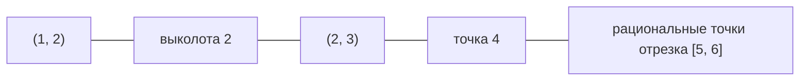

# ✏️ Практика 4: Внутренность и замыкание на прямой, строение открытых множеств в $\mathbb{R}$

> [!abstract] О занятии
> - **Дисциплина:** [[Математический анализ]] (1 семестр)
> - **Дата проведения:** 1 октября 2026 г. (неделя 5, нечетная, четверг)
> - **Время:** пара `09:50 — 11:20`
> - **Аудитория:** ауд. 2311
> - **Преподаватель (практик):** Цветков К.Б.
> - **Поток:** **Поток 2** (направление Software Engineering, ИТМО)
> - **Источник:** 3 фотографии доски
> - **Ключевые темы:**
>   1. Вычисление $\operatorname{Int}$, $\operatorname{Cl}$ и их композиций для конкретного подмножества $\mathbb{R}$.
>   2. Теорема о строении открытых множеств прямой: всякое открытое $U \subseteq \mathbb{R}$ — не более чем счётное объединение попарно непересекающихся открытых интервалов.
>   3. Максимальные интервалы и применение леммы Цорна.

> [!info] Связь с лекциями
> Определения внутренности, замыкания и границы — в [[04. Лекция - Топология метрических пространств, сходимость, полнота по Коши и теорема Больцано-Вейерштрасса (2026-09-29)|лекции 4]]. Лемма Цорна — в [[01. Практика - Обратимость, мощности, порядки и лемма Цорна (2026-09-04)|практике 1 по линейной алгебре]].

---

## 📌 Краткое резюме (TL;DR)

1. **$\operatorname{Int} A = \{\, x \in X \mid \exists\, U \ni x \text{ открытое}: U \subseteq A \,\}$** — точки, входящие в $A$ вместе с окрестностью; $\operatorname{Cl} A$ — точки, любая окрестность которых пересекает $A$.
2. Для $A = (1, 2) \cup (2, 3) \cup \{4\} \cup ([5, 6] \cap \mathbb{Q})$ все **семь** множеств $A$, $\operatorname{Int} A$, $\operatorname{Cl} A$, $\operatorname{Cl}\operatorname{Int} A$, $\operatorname{Int}\operatorname{Cl} A$, $\operatorname{Int}\operatorname{Cl}\operatorname{Int} A$, $\operatorname{Cl}\operatorname{Int}\operatorname{Cl} A$ попарно различны.
3. **Строение открытых множеств $\mathbb{R}$:** всякое открытое $U \subseteq \mathbb{R}$ — объединение не более чем счётного семейства попарно непересекающихся открытых интервалов (возможно, бесконечных: $(-\infty, a)$, $(b, +\infty)$).
4. Интервалы разложения — это **максимальные** интервалы, содержащиеся в $U$. Две различные максимальные компоненты не пересекаются, а счётность следует из того, что в каждой есть рациональная точка.

---

## 1. Задача: внутренность и замыкание конкретного множества

> [!example] Условие
> $$A = (1, 2) \cup (2, 3) \cup \{4\} \cup \big([5, 6] \cap \mathbb{Q}\big) \subseteq \mathbb{R}.$$
> Найти $\operatorname{Int} A$, $\operatorname{Cl} A$, $\operatorname{Cl}\operatorname{Int} A$, $\operatorname{Int}\operatorname{Cl} A$, $\operatorname{Int}\operatorname{Cl}\operatorname{Int} A$, $\operatorname{Cl}\operatorname{Int}\operatorname{Cl} A$.

Напоминание: $\operatorname{Int} A = \{\, x \in X \mid \exists\, U \ni x,\; U \text{ открыто},\; U \subseteq A \,\}$.

### 1.1. Внутренность $\operatorname{Int} A$

- Точки интервалов $(1, 2)$ и $(2, 3)$ — внутренние (у каждой есть интервал-окрестность внутри $A$).
- Точка $4$ изолирована: любая окрестность $(4 - r, 4 + r)$ содержит точки вне $A$.
- В любой окрестности точки из $[5, 6] \cap \mathbb{Q}$ есть иррациональные числа, не лежащие в $A$.

$$
\operatorname{Int} A = (1, 2) \cup (2, 3).
$$

### 1.2. Замыкание $\operatorname{Cl} A$

- $\operatorname{Cl}\big((1, 2) \cup (2, 3)\big) = [1, 3]$: добавляются концы $1, 3$ и выколотая точка $2$.
- Точка $\{4\}$ замкнута.
- $\mathbb{Q}$ плотно в $\mathbb{R}$, поэтому $\operatorname{Cl}\big([5, 6] \cap \mathbb{Q}\big) = [5, 6]$.

$$
\operatorname{Cl} A = [1, 3] \cup \{4\} \cup [5, 6].
$$

### 1.3. Композиции операций

| Множество | Результат | Пояснение |
|:---|:---|:---|
| $\operatorname{Int} A$ | $(1, 2) \cup (2, 3)$ | §1.1 |
| $\operatorname{Cl} A$ | $[1, 3] \cup \{4\} \cup [5, 6]$ | §1.2 |
| $\operatorname{Cl}\operatorname{Int} A$ | $[1, 3]$ | замыкание $(1, 2) \cup (2, 3)$ «заклеивает» точку $2$ |
| $\operatorname{Int}\operatorname{Cl} A$ | $(1, 3) \cup (5, 6)$ | изолированная точка $4$ и концы отрезков пропадают |
| $\operatorname{Int}\operatorname{Cl}\operatorname{Int} A$ | $(1, 3)$ | $\operatorname{Int} [1, 3]$ |
| $\operatorname{Cl}\operatorname{Int}\operatorname{Cl} A$ | $[1, 3] \cup [5, 6]$ | $\operatorname{Cl}\big((1, 3) \cup (5, 6)\big)$ |

> [!tip] Почему пример построен именно так
> Каждая «деталь» множества $A$ отвечает за своё различие:
> - выколотая точка $2$ различает $\operatorname{Int} A$ и $\operatorname{Int}\operatorname{Cl}\operatorname{Int} A$;
> - изолированная точка $4$ исчезает при взятии внутренности;
> - кусок $[5, 6] \cap \mathbb{Q}$ имеет пустую внутренность, но плотное замыкание, поэтому он пропадает в $\operatorname{Cl}\operatorname{Int} A$, но «оживает» в $\operatorname{Int}\operatorname{Cl} A$.
>
> Это пример к **задаче Куратовского**: применяя к множеству $\operatorname{Int}$, $\operatorname{Cl}$ и дополнение, можно получить не более $14$ различных множеств, а одни только $\operatorname{Int}$ и $\operatorname{Cl}$ дают не более $7$ (включая само $A$). Здесь все $7$ различны.

---

## 2. Теорема о строении открытых множеств прямой

> [!important] Теорема
> Всякое открытое множество $U \subseteq \mathbb{R}$ есть объединение **не более чем счётного** семейства **попарно непересекающихся открытых интервалов** (в том числе, возможно, лучей $(-\infty, a)$, $(b, +\infty)$ или всей прямой).

### 2.1. Открытое множество — объединение интервалов

$U$ открыто $\iff$ $\forall x \in U \;\; \exists\, r(x) > 0 : (x - r(x),\; x + r(x)) \subseteq U$. Поэтому
$$
U = \bigcup_{x \in U} \big(x - r(x),\; x + r(x)\big).
$$
Но эти интервалы, вообще говоря, пересекаются, и их несчётно много. Нужно заменить их на **максимальные** интервалы.

### 2.2. Максимальный интервал, содержащий точку

Для каждой точки $x_0 \in U$ найдём **максимальный** (по включению) открытый интервал, содержащий $x_0$ и лежащий в $U$.

Пусть $\mathcal{A}$ — множество интервалов $\subseteq U$, содержащих $x_0$, упорядоченное по включению. Оно непусто: в нём лежит $(x_0 - r(x_0), x_0 + r(x_0))$.

**Любая цепь имеет верхнюю грань.** Пусть $\mathcal{B} \subseteq \mathcal{A}$ — линейно упорядоченное подмножество, $b = (m_b, M_b)$ для $b \in \mathcal{B}$. Положим
$$
m = \inf_{b \in \mathcal{B}} m_b, \qquad M = \sup_{b \in \mathcal{B}} M_b \qquad (\text{допускаются } m = -\infty,\; M = +\infty).
$$
Покажем, что
$$
\bigcup_{b \in \mathcal{B}} b = (m, M) \subseteq U.
$$
Включение «$\subseteq (m, M)$» очевидно. Обратно, пусть $m < x < M$. По характеризации $\inf$ и $\sup$:
$$
\exists\, b_1 \in \mathcal{B} : m \le m_{b_1} < x, \qquad \exists\, b_2 \in \mathcal{B} : x < M_{b_2} \le M.
$$
Так как $\mathcal{B}$ — цепь, интервалы сравнимы; пусть, например, $b_1 \subseteq b_2$. Тогда $m_{b_2} \le m_{b_1} < x < M_{b_2}$, т. е. $x \in b_2$. (Случай $b_2 \subseteq b_1$ симметричен.) Значит, $(m, M)$ — интервал из $\mathcal{A}$, мажорирующий цепь.

**По лемме Цорна** в $\mathcal{A}$ есть максимальный элемент $I(x_0)$ — максимальный открытый интервал, $x_0 \in I(x_0) \subseteq U$.

> [!note] Замечание
> Без леммы Цорна можно обойтись: объединение **всех** интервалов из $\mathcal{A}$ — снова интервал (все они содержат общую точку $x_0$), и он, очевидно, максимален. Рассуждение с $\inf$ и $\sup$ выше — по сути то же самое.

### 2.3. Различные максимальные интервалы не пересекаются

Пусть $(a, b)$ и $(c, d)$ — два **различных** максимальных интервала в $U$, и пусть они пересекаются: $x \in (a, b) \cap (c, d)$ (на доске: $a < c < x < b < d$). Тогда их объединение — снова интервал:
$$
(a, b) \cup (c, d) = (\min(a, c),\; \max(b, d)) \subseteq U,
$$
содержащий оба. По максимальности $(a, b) = (a, b) \cup (c, d) = (c, d)$ — противоречие с различностью.

Итак, $U$ — объединение попарно непересекающихся максимальных интервалов $\{\, I(x) \mid x \in U \,\}$.

### 2.4. Счётность *(на доске не записано, стандартное завершение)*

В каждом интервале разложения выберем рациональную точку ($\mathbb{Q}$ плотно в $\mathbb{R}$). Интервалы попарно не пересекаются, поэтому разным интервалам соответствуют разные рациональные числа. Получаем инъекцию семейства интервалов в счётное множество $\mathbb{Q}$, т. е. интервалов не более чем счётно. $\blacksquare$

> [!example] Примеры разложения
> - $U = \mathbb{R} \setminus \{0\} = (-\infty, 0) \cup (0, +\infty)$ — два луча.
> - $U = \mathbb{R} \setminus \mathbb{Z} = \bigcup\limits_{n \in \mathbb{Z}} (n, n + 1)$ — счётное число интервалов.
> - $U = \operatorname{Int} A$ из §1: $(1, 2) \cup (2, 3)$ — два максимальных интервала.

> [!warning] В $\mathbb{R}^n$ при $n \ge 2$ аналог неверен
> Открытый круг нельзя представить как объединение попарно непересекающихся открытых квадратов или кругов. На прямой теорема работает, потому что связные открытые подмножества $\mathbb{R}$ — это ровно интервалы.

---

## 3. Чек-лист

> [!important] Что нужно уметь
> - Вычислять $\operatorname{Int}$, $\operatorname{Cl}$, $\operatorname{Fr}$ для множеств, составленных из интервалов, точек и пересечений с $\mathbb{Q}$.
> - Объяснять, почему $\operatorname{Int}(\text{отрезок} \cap \mathbb{Q}) = \varnothing$, а $\operatorname{Cl}(\text{отрезок} \cap \mathbb{Q}) = \text{отрезок}$.
> - Доказывать теорему о строении открытых множеств прямой: максимальные интервалы, их попарная непересекаемость, счётность через $\mathbb{Q}$.

> [!warning] Ловушки
> 1. **$\operatorname{Cl}\operatorname{Int} A$ и $\operatorname{Int}\operatorname{Cl} A$ — разные множества**, порядок операций важен.
> 2. **Изолированная точка** принадлежит замыканию, но не внутренности.
> 3. **В разложении открытого множества интервалы могут быть бесконечными**: $(-\infty, a)$ и $(b, +\infty)$.

---

## ❓ Вопросы для самопроверки

- [ ] Найдите все семь множеств из задачи §1 и объясните каждый шаг.
- [ ] Почему $\operatorname{Int}\big([5, 6] \cap \mathbb{Q}\big) = \varnothing$, а $\operatorname{Cl}\big([5, 6] \cap \mathbb{Q}\big) = [5, 6]$?
- [ ] Придумайте множество $B \subseteq \mathbb{R}$, для которого $\operatorname{Cl}\operatorname{Int} B \ne \operatorname{Int}\operatorname{Cl} B$.
- [ ] Докажите, что объединение цепи интервалов, лежащих в $U$ и содержащих $x_0$, — интервал $(m, M) \subseteq U$.
- [ ] Докажите, что два различных максимальных интервала не пересекаются.
- [ ] Почему максимальных интервалов не более чем счётно?
- [ ] Разложите на максимальные интервалы $\mathbb{R} \setminus \mathbb{Z}$ и $\mathbb{R} \setminus \{\frac{1}{n} \mid n \in \mathbb{N}\}$.

---

## 🔗 Связанные материалы

- [[Математический анализ]] — Главный навигационный хаб дисциплины
- [[04. Лекция - Топология метрических пространств, сходимость, полнота по Коши и теорема Больцано-Вейерштрасса (2026-09-29)]] — внутренность, замыкание и граница в метрическом пространстве
- [[03. Лекция - Плотность Q, корни n-й степени, принцип Кантора, метрические пространства и основы топологии (2026-09-22)]] — плотность $\mathbb{Q}$, открытые множества
- [[02. Практика - Мощности множеств, диагональный процесс Кантора, аксиоматика R и сечения Дедекинда (2026-09-17)]] — счётность $\mathbb{Q}$
