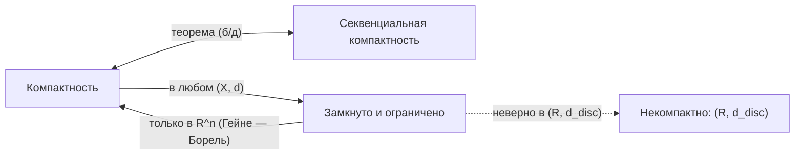

# 📐 Лекция 5: Полнота $\mathbb{R}^n$, компактность, арифметика пределов, число $e$ и частичные пределы

> [!abstract] О занятии
> - **Дисциплина:** [[Математический анализ]] (1 семестр)
> - **Дата проведения:** 6 октября 2026 г. (неделя 6, четная, вторник)
> - **Время:** две пары `09:50 — 11:20` и `11:30 — 13:00`
> - **Аудитория:** Кронверкский пр., д. 49, ауд. 1405
> - **Лектор:** Кумалагов Давид Заурович
> - **Поток:** **Поток 2** (направление Software Engineering, ИТМО)
> - **Источник:** рукописный конспект лекции (7 страниц)
> - **Ключевые темы:**
>   1. Завершение доказательства теоремы Больцано — Вейерштрасса; подпоследовательность как сужение отображения $x : \mathbb{N} \to \mathbb{R}$.
>   2. Теорема о полноте $\mathbb{R}$ и $\mathbb{R}^n$.
>   3. Полнота подпространств: подмножество полного пространства полно $\iff$ оно замкнуто.
>   4. Компактность: открытые покрытия, конечные подпокрытия, примеры и контрпримеры.
>   5. Компакт замкнут и ограничен; замкнутое подмножество компакта — компакт.
>   6. Секвенциальная компактность, теорема Гейне — Бореля (без доказательства).
>   7. Числовые последовательности: критерий Коши, арифметика пределов, предельный переход в неравенствах, теорема о двух милиционерах.
>   8. Теорема Вейерштрасса о монотонной сходимости; пределы $\sqrt[n]{a}$, $\sqrt[n]{n}$; существование числа $e$.
>   9. Частичные пределы, верхний и нижний пределы.

---

## 📌 Краткое резюме (TL;DR)

1. **$\mathbb{R}$ и $\mathbb{R}^n$ полны.** Последовательность Коши ограничена $\to$ по Больцано — Вейерштрассу есть сходящаяся подпоследовательность $\to$ вся последовательность сходится к тому же пределу. В $\mathbb{R}^n$ — покоординатно.
2. **Подпространство полного пространства полно $\iff$ оно замкнуто.** Поэтому $(0, 1)$ и $\mathbb{Q}$ не полны.
3. **Компакт** — множество, у любого открытого покрытия которого есть конечное подпокрытие. Конечные множества компактны, $(a, b)$ — нет; в $(X, d_{\text{disc}})$ компакты — это ровно конечные множества.
4. **Компакт замкнут и ограничен; замкнутое подмножество компакта компактно.** Обратное в общем случае неверно: $(\mathbb{R}, d_{\text{disc}})$ замкнуто, ограничено, но некомпактно.
5. **Компактность $\iff$ секвенциальная компактность** (б/д). **Гейне — Борель:** в $\mathbb{R}^n$ компакт $\iff$ замкнуто и ограничено.
6. **Арифметика пределов:** пределы суммы, произведения на число, произведения и частного (при $y \ne 0$) равны сумме, произведению и частному пределов.
7. **Неравенства:** $x_n \le y_n \implies \lim x_n \le \lim y_n$; теорема о двух милиционерах.
8. **Вейерштрасс:** монотонная ограниченная последовательность сходится к $\sup$ (возрастающая) или $\inf$ (убывающая). Отсюда существование $e = \lim (1 + \frac{1}{n})^n \in [2, 3]$.
9. **Верхний / нижний предел:** $\varlimsup x_n = \lim\limits_{n} \sup\limits_{k \ge n} x_k$, $\varliminf x_n = \lim\limits_{n} \inf\limits_{k \ge n} x_k$.

---

## 1. Напоминание: подпоследовательность и теорема Больцано — Вейерштрасса

Последовательность — это отображение $x : \mathbb{N} \to \mathbb{R}$, $n \mapsto x_n$. **Подпоследовательность** — это сужение $x\vert_A$ на бесконечное подмножество $A \subseteq \mathbb{N}$, элементы которого занумерованы по возрастанию:

$$
A = \{n_1 < n_2 < \ldots < n_{k-1} < n_k < \ldots\}, \qquad x_{n_k} = x\vert_A(n_k).
$$

> [!info] Схема доказательства Больцано — Вейерштрасса (подробно — в [[04. Лекция - Топология метрических пространств, сходимость, полнота по Коши и теорема Больцано-Вейерштрасса (2026-09-29)|лекции 4]])
> 1. $(x_n)$ ограничена $\implies$ существует отрезок $I_0$ конечной длины, $(x_n) \subseteq I_0$.
> 2. Делим $I_0$ пополам; через $I_1$ обозначаем ту половину, которая содержит бесконечно много элементов последовательности. Затем так же строим $I_2$, и т. д.
> 3. Получаем $I_0 \supseteq I_1 \supseteq I_2 \supseteq \ldots$, причём $|I_k| = \dfrac{|I_0|}{2^k} \to 0$.
> 4. По принципу Кантора $\exists!\, x \in \bigcap\limits_{k \ge 0} I_k$.
> 5. Из каждого $I_k$ выбираем $x_{n_k}$ (с $n_k > n_{k-1}$, это возможно, так как в $I_k$ бесконечно много членов). Тогда $|x_{n_k} - x| \le |I_k| \to 0$, т. е. $x_{n_k} \to x$. $\blacksquare$

---

## 2. Полнота $\mathbb{R}$ и $\mathbb{R}^n$

> [!important] Теорема
> Пространства $\mathbb{R}$ и $\mathbb{R}^n$ (со стандартной метрикой) **полны**: всякая последовательность Коши в них сходится.

### 2.1. Доказательство для $\mathbb{R}$

Пусть $(x_n)$ — последовательность Коши в $\mathbb{R}$.

1. По лемме из лекции 4 последовательность Коши **ограничена**.
2. Применим к $(x_n)$ лемму Больцано — Вейерштрасса: извлечём сходящуюся подпоследовательность $x_{n_k} \to x$.
3. Покажем, что вся последовательность сходится к $x$. Зафиксируем $\varepsilon > 0$:
   - по условию Коши $\exists N : \forall m, n \ge N \implies |x_m - x_n| < \varepsilon$;
   - по сходимости подпоследовательности $\exists K : \forall k \ge K \implies |x_{n_k} - x| < \varepsilon$.
4. Возьмём $k \ge K$ такое, что $n_k \ge N$ (возможно, поскольку $n_k \to \infty$). Тогда для любого $n \ge N$ по неравенству треугольника:

$$
|x_n - x| \le |x_n - x_{n_k}| + |x_{n_k} - x| < \varepsilon + \varepsilon = 2\varepsilon.
$$

Так как $\varepsilon$ произвольно, $x_n \to x$. $\blacksquare$

> [!tip] Общий принцип
> Если последовательность Коши имеет сходящуюся подпоследовательность, то она сама сходится к тому же пределу. Это верно в **любом** метрическом пространстве — доказательство дословно то же самое с заменой $|\cdot - \cdot|$ на $d(\cdot, \cdot)$.

### 2.2. Доказательство для $\mathbb{R}^n$

Пусть $(x_m)$ — последовательность Коши в $\mathbb{R}^n$, $x_m = (x_m^{(1)}, \ldots, x_m^{(n)})$.

1. Для каждой координаты $j$ выполнено $|x_m^{(j)} - x_l^{(j)}| \le d(x_m, x_l)$, поэтому **каждая координатная последовательность** $(x_m^{(j)})_m$ — последовательность Коши в $\mathbb{R}$ (в частности, она ограничена).
2. По случаю выше каждая координатная последовательность сходится: $x_m^{(j)} \to a^{(j)}$.
3. Покоординатная сходимость в $\mathbb{R}^n$ равносильна сходимости по метрике:

$$
d(x_m, a) = \sqrt{\sum_{j=1}^{n} \left(x_m^{(j)} - a^{(j)}\right)^2} \le \sum_{j=1}^{n} \left|x_m^{(j)} - a^{(j)}\right| \xrightarrow[m \to \infty]{} 0.
$$

Значит, $x_m \to a = (a^{(1)}, \ldots, a^{(n)})$. $\blacksquare$

---

## 3. Полнота подпространств

> [!warning] Замечание
> Подмножество полного пространства **не обязано** быть полным:
> - $(0, 1) \subseteq \mathbb{R}$: последовательность $\frac{1}{n}$ — Коши, но её предел $0 \notin (0, 1)$;
> - $\mathbb{Q} \subseteq \mathbb{R}$: десятичные приближения $\sqrt{2}$ — последовательность Коши в $\mathbb{Q}$ без предела в $\mathbb{Q}$.

> [!important] Лемма
> Пусть $X$ — полное метрическое пространство, $Y \subseteq X$. Тогда
> $$Y \text{ полно} \iff Y \text{ замкнуто в } X.$$

**Доказательство.**

$(\Rightarrow)$ Пусть $y_n \in Y$ и $y_n \to \alpha \in X$. Сходящаяся последовательность фундаментальна, значит, $(y_n)$ — последовательность Коши в $Y$. Так как $Y$ полно, она сходится к некоторой точке $Y$; по единственности предела эта точка равна $\alpha$, т. е. $\alpha \in Y$. Итак, $Y$ содержит пределы всех своих сходящихся последовательностей $\implies$ по секвенциальному критерию $Y$ замкнуто.

$(\Leftarrow)$ Пусть $(y_n)$ — последовательность Коши в $Y$. Она же последовательность Коши в $X$, а $X$ полно, значит, $y_n \to a \in X$. Но $Y$ замкнуто, поэтому предел последовательности из $Y$ лежит в $Y$: $a \in Y$. $\blacksquare$

---

## 4. Компактность

Всюду ниже $(X, d)$ — метрическое пространство.

### 4.1. Определение

> [!info] Определения
> - Семейство множеств $\{U_\alpha\}_{\alpha \in A}$ называется **покрытием** множества $K$, если $K \subseteq \bigcup\limits_{\alpha \in A} U_\alpha$. Покрытие **открытое**, если все $U_\alpha$ открыты.
> - Множество $K \subseteq X$ называется **компактным**, если из любого его покрытия открытыми множествами $\{U_\alpha\}_{\alpha \in A}$ можно выделить **конечное подпокрытие**, т. е.
> $$\exists\, \alpha_1, \ldots, \alpha_N \in A : \quad K \subseteq \bigcup_{i=1}^{N} U_{\alpha_i}.$$

### 4.2. Примеры

#### Пример 1: Конечное множество компактно

Пусть $K = \{k_1, \ldots, k_N\} \subseteq \mathbb{R}$ конечно, $\{U_\alpha\}$ — его открытое покрытие. Для каждой точки $k_i$ выберем $\alpha_i$ с $k_i \in U_{\alpha_i}$. Тогда $K \subseteq U_{\alpha_1} \cup \ldots \cup U_{\alpha_N}$ — конечное подпокрытие. Значит, $K$ компактно.

#### Пример 2: Интервал $(a, b)$ не компактен в $\mathbb{R}$

Рассмотрим открытое покрытие

$$
(a, b) \subseteq \bigcup_{n} \left(a + \tfrac{1}{n},\; b - \tfrac{1}{n}\right)
$$

(любая точка $x \in (a, b)$ попадает в интервал с номером $n > \max\left(\frac{1}{x - a}, \frac{1}{b - x}\right)$).

Пусть нашлось конечное подпокрытие. Интервалы вложены друг в друга с ростом $n$, поэтому конечное подсемейство с наибольшим номером $N$ покрывает ровно $\left(a + \frac{1}{N}, b - \frac{1}{N}\right)$:

$$
(a, b) \subseteq \bigcup_{n=1}^{N} \left(a + \tfrac{1}{n},\; b - \tfrac{1}{n}\right) = \left(a + \tfrac{1}{N},\; b - \tfrac{1}{N}\right).
$$

Но точка $\dfrac{a + \left(a + \frac{1}{N}\right)}{2} = a + \dfrac{1}{2N} \in (a, b)$ (при больших $N$) **не покрывается** — противоречие. Значит, $(a, b)$ не компактен.

#### Пример 3: Компакты в дискретном пространстве

В $(X, d_{\text{disc}})$: $\quad K \subseteq X$ компактно $\iff$ $K$ конечно.

- $(\Leftarrow)$ — пример 1 (рассуждение не зависит от метрики).
- $(\Rightarrow)$ В дискретной метрике $B_{1/2}(x) = \{x\}$, поэтому $\{\{x\}\}_{x \in K}$ — открытое покрытие $K$. Любое его подсемейство, покрывающее $K$, обязано содержать все одноточечные множества $\{x\}$, $x \in K$. Конечное подпокрытие существует только при конечном $K$.

### 4.3. Свойства компактов

> [!important] Утверждение
> 1. Если $K \subseteq X$ компактно, то $K$ **замкнуто и ограничено**.
> 2. Пусть $K$ компактно и $F \subseteq K$. Тогда $F$ компактно $\iff$ $F$ замкнуто в $K$.

#### Доказательство п. 1: ограниченность

Рассмотрим открытое покрытие единичными шарами $K \subseteq \bigcup\limits_{x \in K} B_1(x)$. По компактности $\exists\, x_1, \ldots, x_N$ такие, что

$$
K \subseteq \bigcup_{i=1}^{N} B_1(x_i).
$$

Пусть $y \in K$; тогда $y \in B_1(x_i)$ для некоторого $i$, и

$$
d(y, x_1) \le d(y, x_i) + d(x_i, x_1) < 1 + d(x_i, x_1).
$$

Положим $R = 1 + \max\limits_{1 \le i \le N} d(x_i, x_1)$. Тогда $K \subseteq B_R(x_1)$, т. е. $K$ ограничено.

#### Доказательство п. 1: замкнутость

Покажем, что $X \setminus K$ открыто. Пусть $y \notin K$. Для каждого $x \in K$ положим $r_x = \dfrac{d(x, y)}{3} > 0$. Тогда

$$
K \subseteq \bigcup_{x \in K} B_{r_x}(x)
$$

— открытое покрытие. Выберем из него конечное: $K \subseteq \bigcup\limits_{i=1}^{N} B_{r_{x_i}}(x_i)$.

Возьмём $r = \min\limits_{1 \le i \le N} r_{x_i} > 0$. Тогда $B_r(y) \cap K = \varnothing$. Действительно, если пересечение не пусто, пусть $z \in B_r(y) \cap K$; тогда $z \in B_{r_{x_i}}(x_i)$ для некоторого $i$, и

$$
d(x_i, y) \le d(x_i, z) + d(z, y) < r_{x_i} + r \le 2 r_{x_i} = \frac{2\, d(x_i, y)}{3}
$$

— противоречие, так как $d(x_i, y) > 0$. Итак, у каждой точки $y \notin K$ есть шар, не пересекающий $K$, т. е. $X \setminus K$ открыто, а $K$ замкнуто. $\blacksquare$

#### Доказательство п. 2

$(\Leftarrow)$ Пусть $K$ компактно, $F \subseteq K$ замкнуто в $K$. Тогда $K \setminus F$ открыто в $K$, т. е. существует открытое в $X$ множество $V$ такое, что

$$
K \setminus F = V \cap K.
$$

Пусть $F \subseteq \bigcup\limits_{\alpha} U_\alpha$ — произвольное открытое покрытие $F$. Добавим к нему множество $V$, тогда получится открытое покрытие $K$ (точки $F$ покрыты множествами $U_\alpha$, точки $K \setminus F$ покрыты $V$):

$$
K \subseteq \bigcup_{\alpha} U_\alpha \cup V.
$$

По компактности $K$ найдутся $\alpha_1, \ldots, \alpha_N$ такие, что $K \subseteq \bigcup\limits_{i=1}^{N} U_{\alpha_i} \cup V$. Поскольку $V \cap F = \varnothing$ (так как $V \cap K = K \setminus F$), получаем

$$
F \subseteq \bigcup_{i=1}^{N} U_{\alpha_i}
$$

— конечное подпокрытие. Значит, $F$ компактно. $\blacksquare$

$(\Rightarrow)$ *(на лекции явно не записывалось)* Если $F$ компактно, то по п. 1 оно замкнуто в $X$, а значит, и в $K$: $F = F \cap K$.

> [!warning] Замкнутость и ограниченность $\not\Rightarrow$ компактность
> Пространство $(\mathbb{R}, d_{\text{disc}})$ **ограничено** (все расстояния $\le 1$) и **замкнуто** (как всё пространство). Но оно **некомпактно**: покрытие $\mathbb{R} = \bigcup\limits_{r \in \mathbb{R}} \{r\}$ открытыми одноточечными множествами не имеет конечного подпокрытия (см. пример 3). Обратное к п. 1 утверждению в общем метрическом пространстве **неверно**.

---

## 5. Секвенциальная компактность

> [!info] Определение
> Множество $K \subseteq X$ называется **секвенциально компактным**, если из любой последовательности $(x_n)$, $x_n \in K$, можно выделить подпоследовательность, **сходящуюся к точке из $K$**.

#### Примеры

1. **$[a, b] \subseteq \mathbb{R}$ секвенциально компактен.** Любая последовательность в $[a, b]$ ограничена, по Больцано — Вейерштрассу имеет сходящуюся подпоследовательность $x_{n_k} \to x$, а так как $[a, b]$ замкнут, $x \in [a, b]$.
2. **$\mathbb{R}$ — нет.** Из последовательности $a_n = n$ нельзя извлечь сходящуюся подпоследовательность: любая её подпоследовательность неограничена.
3. **$(\mathbb{R}, d_{\text{disc}})$ — тоже не секвенциально компактно.** Для последовательности попарно различных точек любые два члена находятся на расстоянии $1$, поэтому никакая подпоследовательность не является даже последовательностью Коши, а значит, не сходится.

> [!important] Теорема
> Для подмножества метрического пространства: **компактность $\iff$ секвенциальная компактность.**
>
> *Без доказательства (принимается как факт).*

> [!important] Теорема (Гейне — Борель)
> $K \subseteq \mathbb{R}^n$ компактно $\iff$ $K$ замкнуто и ограничено.
>
> *Без доказательства (аналогично).*

> [!tip] Идея доказательства Гейне — Бореля через предыдущую теорему
> $(\Rightarrow)$ — п. 1 утверждения из §4.3. $(\Leftarrow)$ Если $K$ замкнуто и ограничено, то в любой последовательности из $K$ ограничены все координатные последовательности. Применяя Больцано — Вейерштрасса по очереди к каждой координате, получаем сходящуюся подпоследовательность; её предел лежит в $K$ по замкнутости. Значит, $K$ секвенциально компактно, т. е. компактно.

#### Примеры компактов

1. Все отрезки $[a, b] \subseteq \mathbb{R}$ компактны в $\mathbb{R}$.
2. Все замкнутые шары $\overline{B_R(x)} \subseteq \mathbb{R}^n$ компактны.
3. Сфера $S_R(x) = \operatorname{Fr}\left(\overline{B_R(x)}\right)$ — $(n-1)$-мерная сфера — компактна (замкнута и ограничена). Единичная сфера:
$$
S^{n-1} = \left\{(x_1, \ldots, x_n) \in \mathbb{R}^n \;\middle|\; \sum_{i=1}^{n} x_i^2 = 1\right\}.
$$

---

## 6. Числовые последовательности (последовательности в $\mathbb{R}$)

> [!info] Определение
> Пусть $(x_n)$ — последовательность в $\mathbb{R}$. Говорят, что $x_n \to x$, если
> $$\forall \varepsilon > 0 \;\; \exists N \in \mathbb{N} : \forall n \ge N \implies |x_n - x| < \varepsilon.$$
> **Обозначение:** $x = \lim\limits_{n \to \infty} x_n$.

> [!important] Теорема (критерий Коши)
> $(x_n)$ сходится $\iff$ $(x_n)$ — последовательность Коши.
>
> Это в точности **полнота $\mathbb{R}$** (§2): $(\Rightarrow)$ верно в любом метрическом пространстве, $(\Leftarrow)$ — теорема о полноте $\mathbb{R}$.

### 6.1. Арифметика пределов

> [!important] Утверждение
> Пусть $x_n \to x$, $y_n \to y$, $\lambda \in \mathbb{R}$. Тогда:
> 1. $x_n + y_n \to x + y$;
> 2. $\lambda x_n \to \lambda x$;
> 3. $x_n y_n \to x y$.

> 4. Если ещё $y \ne 0$ и $y_n \ne 0$, начиная с некоторого $n$, то $\dfrac{x_n}{y_n} \to \dfrac{x}{y}$.

**Доказательство.**

**(i)** По неравенству треугольника:
$$
|x_n + y_n - x - y| \le |x_n - x| + |y_n - y| \xrightarrow[n \to \infty]{} 0 + 0 = 0.
$$
Формально: для $\varepsilon > 0$ берём $N = \max(N_1, N_2)$, где $|x_n - x| < \frac{\varepsilon}{2}$ при $n \ge N_1$ и $|y_n - y| < \frac{\varepsilon}{2}$ при $n \ge N_2$.

**(ii)** $|\lambda x_n - \lambda x| = |\lambda| \cdot |x_n - x| \to 0$.

**(iii)** Прибавим и вычтем $x_n y$:
$$
|x_n y_n - x y| = |x_n y_n - x_n y + x_n y - x y| \le |x_n| \cdot |y_n - y| + |y| \cdot |x_n - x| \le M \cdot |y_n - y| + |y| \cdot |x_n - x| \to 0.
$$
Здесь использовано: $(x_n)$ сходится $\implies$ $(x_n)$ ограничена $\implies \exists M > 0 : |x_n| \le M$ для всех $n$.

**(iv)** Достаточно показать, что $\dfrac{1}{y_n} \to \dfrac{1}{y}$: тогда $\dfrac{x_n}{y_n} = x_n \cdot \dfrac{1}{y_n} \to \dfrac{x}{y}$ по п. (iii).

Возьмём $\varepsilon = \frac{|y|}{2}$. При $n > N_\varepsilon$ имеем $|y_n - y| < \frac{|y|}{2}$, откуда
$$
|y_n| \ge |y| - |y_n - y| > \frac{|y|}{2} > 0.
$$
Тогда
$$
\left|\frac{1}{y_n} - \frac{1}{y}\right| = \frac{|y - y_n|}{|y_n| \cdot |y|} < \frac{2}{|y|^2} \cdot |y - y_n| \to 0. \qquad \blacksquare
$$

### 6.2. Предельный переход в неравенствах

> [!important] Предложение
> 1. **(Монотонность предела.)** Пусть $x_n \le y_n$, начиная с некоторого места, и $x_n \to x$, $y_n \to y$. Тогда $\lim\limits_{n \to \infty} x_n \le \lim\limits_{n \to \infty} y_n$.
> 2. **(Теорема о двух милиционерах.)** Пусть, начиная с некоторого места, $x_n \le y_n \le z_n$, и $x_n \to A$, $z_n \to A$. Тогда и $y_n \to A$.

**Доказательство п. 1.** Пусть $\lim x_n = x$, $\lim y_n = y$, и предположим противное: $x > y$. Возьмём $\varepsilon = \dfrac{x - y}{100} > 0$. При $n \gg 0$ имеем $|x_n - x| < \varepsilon$ и $|y_n - y| < \varepsilon$, откуда
$$
x_n > x - \varepsilon > y + \varepsilon > y_n
$$
(среднее неравенство равносильно $x - y > 2\varepsilon$, что верно). То есть если $x > y$, то $x_n > y_n$ при больших $n$ — противоречие с $x_n \le y_n$. $\blacksquare$

**Доказательство п. 2.** Вычтем $A$: $x_n - A \le y_n - A \le z_n - A$. Тогда
$$
|y_n - A| \le \max\{|x_n - A|,\; |z_n - A|\} \to 0. \qquad \blacksquare
$$

> [!warning] Строгие неравенства не сохраняются
> Из $x_n < y_n$ следует лишь $\lim x_n \le \lim y_n$: например, $\frac{1}{n+1} < \frac{1}{n}$, но оба предела равны $0$.

### 6.3. Теорема Вейерштрасса о монотонной сходимости

> [!info] Определения
> - $(x_n)$ **монотонно возрастает**, если $x_n \le x_{n+1}$ для всех $n$ (обозначение $(x_n)\uparrow$).
> - $(x_n)$ **монотонно убывает**, если $x_n \ge x_{n+1}$ для всех $n$ (обозначение $(x_n)\downarrow$).

> [!important] Теорема (Вейерштрасс)
> Пусть $(x_n)$ монотонна и ограничена (возрастающая — сверху, убывающая — снизу). Тогда она сходится, причём:
> - если $(x_n)\uparrow$, то $\lim\limits_{n \to \infty} x_n = \sup\{x_n\}$;
> - если $(x_n)\downarrow$, то $\lim\limits_{n \to \infty} x_n = \inf\{x_n\}$.

**Доказательство** (для $(x_n)\uparrow$). По дедекиндовой полноте $\mathbb{R}$ существует $s = \sup\{x_n\}$. Докажем, что это и есть $\lim x_n$. По характеризации супремума $\forall \varepsilon > 0 \;\exists N \in \mathbb{N} : s - \varepsilon < x_N \le s$. Тогда в силу монотонности $\forall n \ge N$:
$$
s - \varepsilon < x_N \le x_n \le s < s + \varepsilon,
$$
т. е. $|x_n - s| < \varepsilon$ и $x_n \to s$. Для убывающей последовательности рассуждение симметрично (или применить доказанное к $(-x_n)$). $\blacksquare$

### 6.4. Примеры вычисления пределов

#### Пример 1: $\lim\limits_{n \to \infty} \sqrt[n]{a} = 1$ при $a > 0$

Пусть $a > 1$ и $x_n = \sqrt[n]{a} - 1 > 0$ (ограничена снизу нулём). По неравенству Бернулли
$$
a = \left(\sqrt[n]{a}\right)^n = (1 + x_n)^n \ge 1 + n x_n \implies 0 \le x_n \le \frac{a - 1}{n} \to 0.
$$
По теореме о двух милиционерах $x_n \to 0$, т. е. $\sqrt[n]{a} \to 1$.

При $a = 1$ всё очевидно, а при $0 < a < 1$ смотрим на $\frac{1}{a} > 1$: $\sqrt[n]{a} = \dfrac{1}{\sqrt[n]{1/a}} \to \dfrac{1}{1} = 1$ по арифметике пределов.

#### Пример 2: $\lim\limits_{n \to \infty} \sqrt[n]{n} = 1$

Пусть $x_n = \sqrt[n]{n} - 1 \ge 0$. По биному Ньютона, оставляя только слагаемое с $k = 2$ (все слагаемые неотрицательны):
$$
n = (1 + x_n)^n = \sum_{k=0}^{n} C_n^k \cdot 1^{n-k} \cdot x_n^k \ge C_n^2 x_n^2 = \frac{n(n-1)}{2} x_n^2.
$$
Отсюда при $n \ge 2$:
$$
0 \le x_n \le \sqrt{\frac{2}{n - 1}} \to 0,
$$
и по теореме о двух милиционерах $x_n \to 0$, т. е. $\sqrt[n]{n} \to 1$.

### 6.5. Число $e$

> [!info] Определение
> $$e := \lim_{n \to \infty} \left(1 + \frac{1}{n}\right)^n.$$

Докажем, что предел существует. Рассмотрим $e_n = \left(1 + \frac{1}{n}\right)^n$ и разложим по биному:
$$
e_n = \sum_{k=0}^{n} C_n^k \cdot \frac{1}{n^k} = \sum_{k=0}^{n} \frac{n!}{k!\,(n-k)!} \cdot \frac{1}{n^k} = \sum_{k=0}^{n} \frac{1}{k!} \cdot \frac{n (n-1) \cdots (n-(k-1))}{n^k} = \sum_{k=0}^{n} \frac{1}{k!} \prod_{j=0}^{k-1} \left(1 - \frac{j}{n}\right).
$$

**Монотонность: $e_{n+1} \ge e_n$.** При переходе от $n$ к $n+1$:
- каждый множитель $1 - \frac{j}{n}$ увеличивается до $1 - \frac{j}{n+1}$, поэтому каждое слагаемое растёт;
- добавляется ещё одно неотрицательное слагаемое с $k = n + 1$.

**Ограниченность: $e_n < 3$.** Все произведения $\prod (1 - \frac{j}{n}) \le 1$, а $k! \ge 2^{k-1}$ при $k \ge 1$ (каждый множитель от $2$ до $k$ не меньше $2$). Поэтому
$$
e_n \le \sum_{k=0}^{n} \frac{1}{k!} \le 1 + \sum_{k=1}^{n} \frac{1}{2^{k-1}} = 1 + 2\left(1 - \frac{1}{2^n}\right) < 3.
$$

Итак, $(e_n)$ монотонно возрастает и ограничена сверху $\implies$ по теореме Вейерштрасса **$e$ существует**, причём $2 \le e \le 3$. $\blacksquare$

---

## 7. Верхний и нижний пределы. Частичные пределы

> [!info] Определение
> Пусть $(x_n)$ — последовательность. Пределы её подпоследовательностей называются **частичными пределами** последовательности $(x_n)$.

#### Примеры

1. $x_n = (-1)^n$: $\;x_{2n} = 1 \to 1$, $\;x_{2n+1} = -1 \to -1$. Частичные пределы: $\{-1, 1\}$.
2. Последовательность $(1, 2, 3, 4, 5, 1, 2, 3, 4, 5, \ldots)$: частичные пределы — $\{1, 2, 3, 4, 5\}$. Например, $x_N \to 1$ по подпоследовательности номеров $N \equiv 1 \pmod 5$.

### 7.1. Верхний и нижний пределы

Пусть $(x_n)$ — **ограниченная** последовательность. Рассмотрим «хвостовые» супремумы и инфимумы:

$$
s_n = \sup_{k \ge n} \{x_k\}, \qquad i_n = \inf_{k \ge n} \{x_k\}.
$$

С ростом $n$ супремум и инфимум берутся по всё меньшему множеству $\{x_k : k \ge n\}$, поэтому
$$
(s_n)\downarrow, \qquad (i_n)\uparrow, \qquad i_n \le x_n \le s_n.
$$

Обе последовательности ограничены (теми же границами, что и $(x_n)$), значит, по теореме Вейерштрасса существуют пределы:

> [!info] Определение
> $$\varlimsup_{n \to \infty} x_n = \limsup_{n \to \infty} x_n := \lim_{n \to \infty} s_n = \lim_{n \to \infty} \sup_{k \ge n} x_k \quad \text{— верхний предел},$$
> $$\varliminf_{n \to \infty} x_n = \liminf_{n \to \infty} x_n := \lim_{n \to \infty} i_n = \lim_{n \to \infty} \inf_{k \ge n} x_k \quad \text{— нижний предел}.$$

> [!example] Проверка на примерах из §7
> - $x_n = (-1)^n$: $s_n = 1$, $i_n = -1$ для всех $n$, поэтому $\varlimsup x_n = 1$, $\varliminf x_n = -1$ — наибольший и наименьший частичные пределы.
> - $(1, 2, 3, 4, 5, 1, 2, \ldots)$: $s_n = 5$, $i_n = 1$, $\varlimsup x_n = 5$, $\varliminf x_n = 1$.

> [!tip] Связь с частичными пределами (будет доказано далее в курсе)
> Для ограниченной $(x_n)$ верхний и нижний пределы — это соответственно наибольший и наименьший частичные пределы, а $(x_n)$ сходится $\iff \varlimsup x_n = \varliminf x_n$.

---

## 8. Сводная таблица: свойства множеств

| Множество | Пространство | Полное | Замкнуто и ограничено | Компактно |
|:---|:---|:---:|:---:|:---:|
| $\mathbb{R}$ | $(\mathbb{R}, \vert \cdot \vert)$ | ✅ | ❌ (неограничено) | ❌ |
| $(a, b)$ | $(\mathbb{R}, \vert \cdot \vert)$ | ❌ | ❌ (не замкнут) | ❌ |
| $[a, b]$ | $(\mathbb{R}, \vert \cdot \vert)$ | ✅ | ✅ | ✅ |
| $\mathbb{Q}$ | $(\mathbb{R}, \vert \cdot \vert)$ | ❌ | ❌ | ❌ |
| $\overline{B_R(x)}$, $S^{n-1}$ | $\mathbb{R}^n$ | ✅ | ✅ | ✅ |
| конечное $K$ | любое $(X, d)$ | ✅ | ✅ | ✅ |
| $\mathbb{R}$ | $(\mathbb{R}, d_{\text{disc}})$ | ✅ | ✅ | ❌ |

---

## 9. Чек-лист и типичные ловушки

> [!warning] Ловушки
> 1. **«Замкнуто и ограничено ⟹ компактно» — только в $\mathbb{R}^n$.** В общем метрическом пространстве это неверно: $(\mathbb{R}, d_{\text{disc}})$.
> 2. **Компактность определяется через ЛЮБОЕ открытое покрытие.** Чтобы доказать некомпактность, достаточно предъявить одно покрытие без конечного подпокрытия; чтобы доказать компактность — нужно работать с произвольным.
> 3. **Подмножество полного пространства полно только если оно замкнуто:** $(0,1)$ и $\mathbb{Q}$ в $\mathbb{R}$.
> 4. **В арифметике пределов для частного нужно $y \ne 0$** — именно оно обеспечивает оценку $|y_n| > \frac{|y|}{2}$.
> 5. **Строгое неравенство в пределе становится нестрогим.**

> [!important] Что нужно уметь доказывать
> - Полноту $\mathbb{R}$ через Больцано — Вейерштрасса и полноту $\mathbb{R}^n$ покоординатно.
> - Лемму «$Y \subseteq X$ полно $\iff$ замкнуто».
> - Некомпактность $(a, b)$ и компактность конечных множеств.
> - Что компакт замкнут и ограничен (две части с покрытиями $B_1(x)$ и $B_{d(x,y)/3}(x)$).
> - Арифметику пределов, теорему о двух милиционерах, теорему Вейерштрасса, существование $e$.

---

## ❓ Вопросы для самопроверки к коллоквиуму / экзамену

- [ ] Докажите полноту $\mathbb{R}$. Где используется лемма Больцано — Вейерштрасса?
- [ ] Почему из полноты $\mathbb{R}$ следует полнота $\mathbb{R}^n$?
- [ ] Докажите: подмножество $Y$ полного пространства $X$ полно тогда и только тогда, когда оно замкнуто.
- [ ] Дайте определение компактного множества. Докажите, что интервал $(a, b)$ некомпактен.
- [ ] Опишите все компакты в дискретном метрическом пространстве.
- [ ] Докажите, что компакт замкнут и ограничен. Почему для замкнутости берётся радиус $\frac{d(x, y)}{3}$?
- [ ] Докажите, что замкнутое подмножество компакта компактно.
- [ ] Приведите пример замкнутого ограниченного, но некомпактного множества.
- [ ] Дайте определение секвенциальной компактности. Почему $\mathbb{R}$ и $(\mathbb{R}, d_{\text{disc}})$ не секвенциально компактны?
- [ ] Сформулируйте теорему Гейне — Бореля и приведите примеры компактов в $\mathbb{R}^n$.
- [ ] Докажите арифметику пределов (сумма, произведение, частное).
- [ ] Докажите монотонность предела и теорему о двух милиционерах.
- [ ] Докажите теорему Вейерштрасса о монотонной сходимости.
- [ ] Докажите, что $\sqrt[n]{a} \to 1$ и $\sqrt[n]{n} \to 1$.
- [ ] Докажите существование числа $e$ (монотонность и ограниченность $e_n$).
- [ ] Определите частичные, верхний и нижний пределы. Найдите их для $(-1)^n$.

---

## 🔗 Связанные материалы

- [[Математический анализ]] — Главный навигационный хаб дисциплины
- [[02. Лекция - Предел числовой последовательности, теорема Вейерштрасса и число e (2026-09-15)]] — первое знакомство с пределом последовательности, теоремой Вейерштрасса и числом $e$
- [[03. Лекция - Плотность Q, корни n-й степени, принцип Кантора, метрические пространства и основы топологии (2026-09-22)]] — метрические пространства, принцип вложенных отрезков Кантора
- [[04. Лекция - Топология метрических пространств, сходимость, полнота по Коши и теорема Больцано-Вейерштрасса (2026-09-29)]] — последовательности Коши, полнота, теорема Больцано — Вейерштрасса
