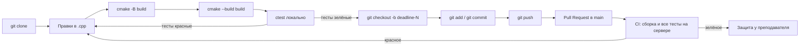

# 💻 Семинар: Полный цикл работы с лабораторной — git, CMake, CTest и CI

> [!info] Метаданные семинара
> **Дата проведения:** `2026-09-12` *(запись опубликована 13.09.2026; дата занятия определена по ближайшей субботе)*  
> **Предмет:** [[Основы программирования]] (1 семестр: C / C++)  
> **Ведущий семинара:** Загурский Кирилл (ментор курса, 3-й курс)  
> **Куратор курса:** Хвастунов Александр Павлович  
> **Видеозапись семинара:** [YouTube: Семинар "Полный цикл разработки git, build, CI"](https://www.youtube.com/watch?v=9zbmOITGMhI) *(1 ч 14 мин)*  
> **Канал курса:** [YouTube @hvastunovalexandr](https://www.youtube.com/@hvastunovalexandr)  
> **Источник конспекта:** автоматическая расшифровка видеозаписи  
> **Учебный репозиторий:** BabySteps — нулевая лабораторная курса (4 маленьких задания на основы C++)

> [!warning] Политика репозитория
> В конспекте разобран **процесс** сдачи лабораторной: git, сборка, тесты, CI. Решений задач BabySteps здесь нет; задача про переполнение описана только на уровне идеи.

---

## 📌 Краткое резюме (TL;DR)

1. **Цикл сдачи лабораторной:** `git clone` → правки в коде → `cmake` (конфигурация + сборка) → `ctest` локально → ветка `deadline-N` → `git add` / `git commit` / `git push` → **Pull Request** в `main` → CI на сервере прогоняет все тесты → преподаватель видит зелёные или красные галочки.
2. **CMake работает в два шага:** `cmake -B build` создаёт файлы конфигурации, `cmake --build build` компилирует. После **каждого** изменения `.cpp` нужно пересобирать: тесты и запуск работают с бинарником, а не с исходником.
3. **CTest:** `ctest -V --test-dir build` запускает все тесты, а `-R <имя>` — только тесты, чьё имя подходит под регулярное выражение.
4. **Работаем не в `main`, а в ветке `deadline-N`.** Имя ветки указано в описании репозитория лабораторной. Прямой push в `main` запрещён и считается некультурным.
5. **Каталог `build/` никогда не коммитится.** От случайного добавления защищает `.gitignore`.
6. **Красная галочка в PR — лабораторная не готова.** Цель — чтобы все проверки CI были зелёными.

---

## 1. Общая схема работы



---

## 2. Git: что это и зачем

**Git** — система контроля версий: проект хранится не на одном компьютере, а в общем репозитории, и несколько людей могут работать с ним одновременно, не мешая друг другу.

> [!tip] Совет ментора
> Подробно Git, его устройство и культура работы с ним разбираются на **ИСРПО** (см. [[01. Лекция - Системы контроля версий, архитектура Git и модель GitFlow (2026-09-11)|лекцию 1 по ИСРПО]]). Ментор настоятельно советует не пропускать этот предмет и прочитать хотя бы первые главы книги **Pro Git**.

### 2.1. Клонирование репозитория

1. На странице репозитория нажать зелёную кнопку **Code** → вкладка **HTTPS** → скопировать ссылку.
2. В терминале:
```bash
git clone https://github.com/<организация>/<репозиторий>.git
```
3. При первом обращении GitHub может попросить авторизоваться прямо в командной строке. Это настраивается один раз, чтобы не вводить данные повторно.
4. Открыть папку проекта в VS Code: на курсе основная среда — VS Code. Команды можно вводить во встроенном терминале, это тот же shell.

Все действия одинаковы в Linux и Windows: отличается только то, что в Windows у исполняемых файлов есть расширение `.exe`.

---

## 3. Сборка проекта с CMake

Сразу после клонирования в репозитории есть только **исходники** (например, `hello_world/bin/main.cpp`), исполняемых файлов нет. Чтобы получить программу, исходники нужно **скомпилировать**. Для этого используется **система сборки**; на курсе это **CMake**.

### 3.1. Два шага сборки

| Шаг | Команда | Что происходит |
|:---|:---|:---|
| **1. Конфигурация** | `cmake -B build` | CMake находит компилятор и создаёт в папке `build/` служебные файлы сборки. Бинарников ещё **нет** |
| **2. Сборка** | `cmake --build build` | Компилируются `.cpp`-файлы; в `build/` появляются исполняемые файлы. В выводе — прогресс до `100%` |

Ключ `-B build` означает «сконфигурируй проект в папке `build`». Команды выполняются **из корня репозитория**.

### 3.2. Запуск собранной программы

```bash
./build/hello_world/hello_world     # Linux / macOS
.\build\hello_world\hello_world.exe  # Windows
```

Путь начинается с `./`, т. е. от текущего каталога.

### 3.3. Изменил код — пересобери

> [!warning] Самая частая ошибка
> После правки `main.cpp` запуск старого бинарника покажет **старый** вывод. Конфигурировать заново не нужно, но **собрать** нужно обязательно:
> ```bash
> cmake --build build
> ```
> То же касается тестов: они проверяют **скомпилированный** файл, а не исходник. Забытая пересборка — главная причина вопроса «я всё исправил, а тест не проходит».

На семинаре это показано на заглушке задания Hello World: программа выводила `not implemented yet`. После замены текста вывода и **пересборки** программа вывела новую строку, а без пересборки вывод не менялся.

---

## 4. Тесты и CTest

### 4.1. Зачем тесты

В культуре разработки принято писать **тесты**: они автоматически проверяют, правильно ли работает программа. В BabySteps для каждого задания есть папка с тестами, например `hello_world/tests/hello_world_ut.cpp`. Суффикс `_ut` — соглашение курса, сокращение от *unit test*.

### 4.2. Запуск тестов

| Задача | Команда |
|:---|:---|
| Все тесты | `ctest -V --test-dir build` |
| Только тесты с нужным именем | `ctest -V -R HelloWorldSuite --test-dir build` |

- `-V` (verbose) — подробный вывод;
- `--test-dir build` — где лежит собранный проект;
- `-R <regex>` — запустить только тесты, имя которых подходит под регулярное выражение. Имена берутся из объявлений тестов в файле `*_ut.cpp`.

> [!important] Порядок действий
> Перед `ctest` всегда выполняйте `cmake --build build`.

### 4.3. Как читать упавший тест

На семинаре при первом запуске всех тестов упало 27 штук: заглушки ещё не реализованы. Сообщение об ошибке теста устроено так:

```text
Expected equality of these values:
  <фактическое значение>     ← что вернула ваша функция
  <ожидаемое значение>       ← что ожидал тест
```

Порядок работы:
1. Найти в выводе `ctest` строку `FAILED` и имя теста.
2. Открыть файл с тестами и найти этот тест: какие аргументы передаются и что ожидается.
3. Сравнить фактическое значение с ожидаемым, исправить функцию.
4. **Пересобрать** и запустить снова.

### 4.4. Свой тест

Тест можно добавить самому: скопировать существующий, поменять входные данные и ожидаемый результат. В лабораторных иногда придётся писать тесты самостоятельно.

> [!warning] Не подгоняйте тесты под код
> Выданные тесты менять нельзя, кроме крайней необходимости. Цель — исправить код так, чтобы проходили **исходные** тесты.

### 4.5. Пример: тест на переполнение

На семинаре разбирался упавший тест задачи о сумме двух целых чисел. Тесты на маленьких и больших числах и на границах проходили, а тест `overflow` падал.

Причина — **переполнение `int`**: сумма двух больших положительных чисел не помещается в 32-битный знаковый тип. Тест ожидает, что функция корректно обработает выход за границы диапазона и вернёт определённое граничное значение.

> [!info] Теория
> - Диапазон `int` (32 бита): от $-2^{31}$ до $2^{31}-1 = 2\,147\,483\,647$, константы `std::numeric_limits<int>::min()` и `::max()` из `<limits>`.
> - Переполнение **знакового** целого в C++ — **неопределённое поведение (UB)**. Проверять переполнение нужно **до** операции, сравнивая аргументы с границами диапазона, а не «по знаку результата» после сложения: компилятор вправе считать, что переполнения не бывает, и выбросить такую проверку.
> - Подробнее — в [[01. Лекция - Типы данных, представление чисел, операторы и функции (2026-09-05)|лекции 1]] и на семинаре [[03. Семинар - Разбор задач BabySteps, переполнение и аргументы командной строки (2026-09-18)|«Разбор задач BabySteps»]].

---

## 5. Отправка работы: ветки, коммиты, push

### 5.1. Ветка `deadline-N`

Работа ведётся **в отдельной ветке**, а не в `main`. Для лабораторных ветка называется `deadline-<номер>`; точное имя указано внизу описания репозитория.

```bash
git checkout -b deadline-0   # создать ветку и перейти в неё
# или, современный вариант:
git switch -c deadline-0
```

> [!warning] Не в `main`
> Push в `main` на курсе запрещён настройками репозитория, а коммит в `main` считается некультурным и может стоить баллов. Ментор признаётся, что сам на первом курсе постоянно забывал создать ветку — проверяйте текущую ветку перед коммитом.

### 5.2. Индекс, коммит, push

| Шаг | Команда | Смысл |
|:---|:---|:---|
| 1 | `git status` | Что изменено и что уже добавлено |
| 2 | `git add hello_world/bin/main.cpp` | Отметить файл для коммита (можно несколько раз) |
| 3 | `git commit -m "Решил Hello World, поправил тесты"` | Зафиксировать изменения **локально** с сообщением |
| 4 | `git push -u origin deadline-0` | Отправить ветку на GitHub (при первом push — с `-u`, Git сам подскажет команду) |
| 5 | `git push` | Последующие отправки той же ветки |

- После `git add` и `git commit` на сайте **ещё ничего нет**: изменения хранятся только в локальном репозитории. На сервер их отправляет `git push`.
- Удаление и переименование файла — тоже изменения: `git add <путь>` для удалённого файла фиксирует удаление.
- `git pull` — обратная к push операция: забрать изменения с сервера в уже склонированный репозиторий (`clone` делается один раз). `git fetch` загружает информацию о всех ветках удалённого репозитория, но не сливает их с локальными.

### 5.3. Никогда не коммитьте `build/`

Содержимое `build/` — служебные файлы компилятора и бинарники. Разработчикам они не нужны, и практики **ругают** за их наличие в репозитории.

Защита — файл **`.gitignore`**: обычный текстовый файл, в котором перечислены игнорируемые пути и шаблоны.

```text
build/
*.exe
```

При попытке `git add build` Git ответит, что путь игнорируется одним из файлов `.gitignore`. В репозиториях курса `.gitignore` уже лежит.

---

## 6. Pull Request и CI

### 6.1. Зачем Pull Request

Ветка нужна, чтобы работать, не меняя основной код. Когда работа готова, изменения переносят в основную ветку — **слияние (merge)**. **Pull Request (PR)** — запрос на слияние ветки `deadline-0` в `main`. На курсе PR служит **заявкой на защиту** лабораторной.

Создание PR:
- после push на странице репозитория появляется кнопка **Compare & pull request**;
- или вкладка **Pull requests** → **New pull request** → выбрать `deadline-0` → `main` → **Create pull request**.

На вкладке **Files changed** видно, какие строки изменены относительно `main`.

### 6.2. CI: проверка на сервере

В репозитории курса настроен **CI (Continuous Integration)**: при создании и обновлении PR на сервере автоматически:
1. собирается проект (проверка «сборка прошла»);
2. запускаются тесты **каждой задачи** — по отдельной проверке на задачу.

Результат виден в PR галочками. Подробности — по ссылке на проверку: там тот же вывод `ctest -V`, что и локально.

> [!important] Критерий готовности
> Все проверки должны быть **зелёными**. Если что-то красное, лабораторная не готова, и практик её не примет.

> [!tip] Локально зелёное, на сервере красное?
> Чаще всего дело в **другом компиляторе**: на серверах курса используется **Clang**. Проверяйте код и с ним.

### 6.3. Слияние и конфликты

Кнопку **Merge pull request** студенты, скорее всего, нажать не смогут, и делать этого не нужно. На семинаре слияние показали ради демонстрации: после него изменения и сообщение коммита появляются в `main`. Если одни и те же строки менялись в обеих ветках, возникает **конфликт слияния**, и его решают вручную.

---

## 7. Шпаргалка команд

| Действие | Команда |
|:---|:---|
| Склонировать | `git clone <url>` |
| Сконфигурировать | `cmake -B build` |
| Собрать | `cmake --build build` |
| Все тесты | `ctest -V --test-dir build` |
| Один набор тестов | `ctest -V -R <имя> --test-dir build` |
| Новая ветка | `git checkout -b deadline-N` |
| Состояние | `git status` |
| Добавить файл | `git add <путь>` |
| Коммит | `git commit -m "сообщение"` |
| Первый push ветки | `git push -u origin deadline-N` |
| Забрать изменения | `git pull` |

---

## ❓ Вопросы для самопроверки

- [ ] Зачем CMake нужны два шага: конфигурация и сборка? Какие команды их выполняют?
- [ ] Почему после правки исходника тест продолжает падать, если не пересобрать проект?
- [ ] Чем `ctest -V --test-dir build` отличается от `ctest -V -R <имя> --test-dir build`?
- [ ] Как читать сообщение `Expected equality of these values`?
- [ ] Почему работу нужно вести в ветке `deadline-N`, а не в `main`?
- [ ] Чем отличаются `git add`, `git commit` и `git push`? Где хранятся изменения после каждого шага?
- [ ] Зачем нужен `.gitignore` и почему нельзя коммитить `build/`?
- [ ] Что такое Pull Request и что проверяет CI курса?
- [ ] Почему переполнение знакового `int` нужно проверять до сложения?

---

## 🔗 Связанные материалы

- [[Основы программирования]] — главный хаб дисциплины
- [[01. Семинар - Работа с консолью и Linux окружение для C++ (2026-09-07)]] — предыдущий семинар: терминал и первая сборка
- [[00. Практикум - Настройка окружения (VS Code, Clang, CMake, WSL, Санитайзеры) (2026-09-02)]] — установка компилятора, CMake и VS Code
- [[03. Семинар - Разбор задач BabySteps, переполнение и аргументы командной строки (2026-09-18)]] — следующий семинар: разбор задач BabySteps
- [[01. Лекция - Системы контроля версий, архитектура Git и модель GitFlow (2026-09-11)]] — Git на ИСРПО
