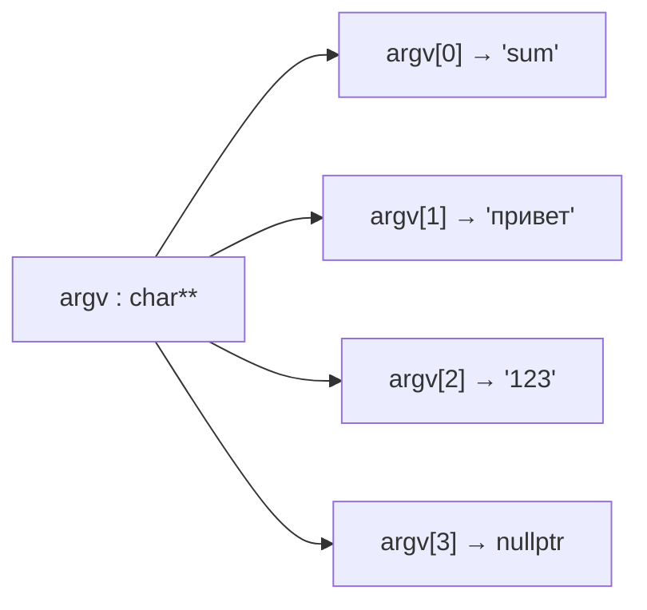

# 💻 Семинар: Разбор задач BabySteps — переполнение, аргументы командной строки, парсинг чисел

> [!info] Метаданные семинара
> **Дата:** `2026-09-18` *(дата публикации записи; занятие прошло не позже этого дня)*  
> **Предмет:** [[Основы программирования]] (1 семестр: C / C++)  
> **Ведущий семинара:** Сыщиков Константин Алексеевич (ментор курса)  
> **Куратор курса:** Хвастунов Александр Павлович  
> **Видеозапись:** [YouTube: Семинар "Разбор задач из BabySteps"](https://www.youtube.com/watch?v=t4ZeRyk37eo) *(1 ч 05 мин)*  
> **Канал курса:** [YouTube @hvastunovalexandr](https://www.youtube.com/@hvastunovalexandr)  
> **Источник конспекта:** автоматическая расшифровка видеозаписи

> [!warning] Политика репозитория
> На семинаре решались задачи нулевой лабораторной BabySteps (сумма с переполнением, парсер аргументов, калькулятор). В конспекте **только теория и приёмы**, которые для этого нужны. Готовых решений задач нет: их нужно написать самостоятельно (см. правила антиплагиата).

---

## 📌 Краткое резюме (TL;DR)

1. **`char** argv`** — указатель на массив указателей на C-строки. `argv[0]` — имя программы, поэтому для трёх пользовательских аргументов `argc == 4`.
2. **Переполнение знакового целого — UB.** Проверять его нужно **до** операции, сравнивая с границами из `std::numeric_limits<T>::max()` / `min()` (заголовок `<limits>`). Макросы вроде `INT_MAX` хуже: они привязаны к `int`, а не к нужному типу.
3. **Функции, принимающие указатели, должны проверять их на `nullptr`.** Исключение — функции, за которые отвечает вызывающая сторона (например, сравнение строк).
4. **Указатель, который не меняет данные, объявляем как `const char*`.**
5. **Вернуть «результат или ошибку»** можно структурой с полем-значением и флагом валидности. Так устроен `std::from_chars_result`.
6. **Строка → число:** накапливать `result = result * 10 + (c - '0')` в **более широком** типе (`int64_t`), отдельно обработать знак, в конце сделать `static_cast` к нужному типу.
7. **Из стандартных функций конвертации предпочтительнее `std::from_chars`** (`<charconv>`): не бросает исключений, сообщает код ошибки и позицию, где остановился разбор. `std::stoi` бросает исключения, `std::atoi` молча возвращает 0.
8. **Ссылка** — псевдоним объекта: не бывает «нулевой», обязательно инициализируется и не перепривязывается.
9. **Привыкайте читать cppreference** и не пользуйтесь сгенерированным кодом, который не понимаете («вайбкодить плохо»).

---

## 1. Аргументы командной строки и двойной указатель

### 1.1. Что такое `char**`

- **Указатель** — число, адрес памяти, по которому лежит объект.
- **Двойной указатель** `T**` — адрес памяти, где лежит **другой указатель**, который, в свою очередь, указывает на объект.

C-строка — это `char*`, указатель на первый символ последовательности, оканчивающейся `'\0'`. Массив строк — массив указателей `char*`, а указатель на его начало — `char**`.

> [!info] Почему не просто `char*`
> Арифметика указателей сдвигает адрес на размер **типа**: `int* p; p + 1` — сдвиг на `sizeof(int)` (обычно 4 байта). Для `char*` шаг — 1 байт, т. е. один **символ**, а не одна **строка**. Чтобы переходить от строки к строке, нужен указатель на элементы-указатели: `char**`, шаг которого — `sizeof(char*)`.



### 1.2. Пример: напечатать адреса аргументов

```cpp
#include <iostream>

int main(int argc, char** argv) {
    for (int i = 1; i < argc; ++i) {
        // адрес первого символа i-го аргумента и сама строка
        std::cout << static_cast<const void*>(argv[i]) << ' ' << argv[i] << '\n';
    }
}
```

Запуск `./prog привет 123 пока` выведет адреса, идущие с шагом примерно в длину предыдущей строки плюс 1 байт на `'\0'`: аргументы лежат в памяти подряд.

> [!important] `argv[0]` — имя программы
> Если программа ожидает 3 аргумента, проверка выглядит как `argc != 4`. Это частый источник ошибок «на единицу».

---

## 2. Переполнение и `std::numeric_limits`

### 2.1. Почему нельзя «просто сложить»

- Переполнение **беззнаковых** типов определено: арифметика по модулю $2^n$.
- Переполнение **знаковых** типов — **неопределённое поведение**. Программа может выдать мусор, упасть, а компилятор вправе удалить проверку, которая «ловит» переполнение постфактум.

Поэтому проверка делается **до** операции: если $a \ge 0$, то $a + b$ переполнится тогда и только тогда, когда $b > \text{MAX} - a$; если $a < 0$ — когда $b < \text{MIN} - a$. Сами выражения $\text{MAX} - a$ при $a \ge 0$ и $\text{MIN} - a$ при $a < 0$ переполниться не могут.

### 2.2. Границы типа: `<limits>`

```cpp
#include <cstdint>
#include <limits>

constexpr std::int32_t kInt32Max = std::numeric_limits<std::int32_t>::max(); //  2 147 483 647
constexpr std::int32_t kInt32Min = std::numeric_limits<std::int32_t>::min(); // -2 147 483 648
```

- `std::numeric_limits<T>` — шаблонный класс со **специализациями** для встроенных типов. Для вещественных типов он даёт ещё `epsilon()`, `infinity()` и т. п. (подробнее во втором семестре).
- Шаблоны будут разбираться в конце семестра; пока достаточно знать, что `<T>` выбирает тип.
- Макросы `INT_MAX` / `INT32_MAX` тоже существуют, но `numeric_limits` работает единообразно для **любого** типа: размер `int` или `long` зависит от платформы и компилятора.

> [!tip] Альтернатива 📎
> GCC и Clang предоставляют встроенную функцию `__builtin_add_overflow(a, b, &res)`, которая возвращает `true` при переполнении. В C++26 появились стандартные `std::add_sat` / `std::sub_sat` (заголовок `<numeric>`) с «насыщением» к границам типа.

---

## 3. Работа со строками без стандартной библиотеки

В части задач курса запрещено пользоваться готовыми функциями стандартной библиотеки, их нужно писать самостоятельно. Приёмы с семинара:

### 3.1. Константные указатели в параметрах

```cpp
bool StrEqual(const char* s1, const char* s2);
```

`const char*` — указатель **на константные данные**: сам указатель можно двигать (`++s1`), но изменить символы через него нельзя. Если функция не должна менять строку, параметр объявляется так, и компилятор защитит от случайной записи.

### 3.2. Обход C-строки

Общий шаблон прохода двух строк одновременно:
- идём, пока **ни одна** строка не закончилась (`*s1 != '\0' && *s2 != '\0'`);
- на каждом шаге сравниваем текущие символы и **сразу** выходим при расхождении: это экономит время;
- после цикла хотя бы один указатель стоит на `'\0'`. Строки равны, только если `'\0'` в **обеих** сразу.

### 3.3. Длина строки

Длина считается проходом до `'\0'`. Если строка не завершена нулём, цикл уйдёт за её границы и будет читать чужую память — это UB. Поэтому функциям, принимающим C-строку, важно получать корректные данные.

### 3.4. Проверка указателей

> [!important] Правило
> Функция, которая получает указатели от внешнего кода, проверяет их на `nullptr` до разыменования, даже если «в аргументах командной строки `nullptr` не бывает»: функцию могут вызвать не только из `main`. Низкоуровневые утилиты вроде сравнения строк могут переложить эту ответственность на вызывающего.

---

## 4. Как вернуть «результат или ошибку»

### 4.1. Структура с флагом валидности

Если функция преобразования вернёт просто `int`, то при ошибке ей нечего вернуть: любое число, например 0, — тоже допустимый результат. Решение — вернуть **структуру** из двух полей:

```cpp
#include <cstdint>

struct ParseResult {
    std::int32_t value;
    bool is_valid;
};

ParseResult r{42, true};
if (r.is_valid) { /* используем r.value */ }
```

- **Структура** хранит несколько полей последовательно в памяти; обращение к полям — через точку (`r.value`), через указатель — через стрелку (`p->value`). Подробнее — в [[03. Лекция - Структуры, объединения, выравнивание в памяти (padding) и побитовые поля (2026-09-25)|лекции 3]].
- Альтернативы: `std::optional<T>` (будет позже в курсе) или возврат `bool` + запись результата по ссылке/указателю.

### 4.2. Строка → число: общий алгоритм

| Шаг | Действие |
|:---|:---|
| 1 | Проверить указатель и что строка непустая |
| 2 | Если первый символ `'-'`, запомнить знак и сдвинуться. Строка из одного `'-'` некорректна |
| 3 | Для каждого символа: если не цифра (`c < '0' \|\| c > '9'`), разбор неуспешен |
| 4 | Иначе `acc = acc * 10 + (c - '0')`. Разность `c - '0'` даёт значение цифры, потому что цифры в таблице символов идут подряд |
| 5 | В конце `static_cast` к целевому типу с учётом знака |

> [!tip] Почему аккумулятор `int64_t`
> Диапазон `int32_t` несимметричен: $[-2^{31};\ 2^{31}-1]$. Если накапливать **модуль** числа в `int32_t`, то строка `-2147483648` переполнит его на последнем шаге, хотя итоговое число в тип помещается. Более широкий тип избавляет от этой ловушки.

### 4.3. `static_cast`

`static_cast<T>(x)` — явное преобразование типа, которое компилятор проверяет на допустимость. Неявное сужение (`int64_t` → `int32_t`) тоже скомпилируется, но явный каст показывает читателю, что преобразование **намеренное**.

---

## 5. Ссылки (краткое введение)

```cpp
int a = 10;
int& ref = a;   // ref — псевдоним a
ref = 20;       // теперь a == 20
```

| | Указатель `T*` | Ссылка `T&` |
|:---|:---|:---|
| Может быть «пустым» | да, `nullptr` | нет |
| Обязательная инициализация | нет | **да** |
| Можно перенаправить на другой объект | да | **нет**: `ref = b` присваивает **значение** `b` объекту `a` |
| Доступ к полю структуры | `p->field` | `r.field` |

Ссылки подробно разберут на лекциях; пока важно, что `std::from_chars` записывает результат **по ссылке**.

---

## 6. Стандартные функции конвертации: что выбрать

| Функция | Заголовок | Как сообщает об ошибке | Вердикт |
|:---|:---|:---|:---|
| `std::atoi` | `<cstdlib>` | Никак: возвращает 0 | ❌ Нельзя отличить ошибку от числа 0 |
| `std::strtol` | `<cstdlib>` | Через глобальную `errno` и указатель конца | ⚠️ Неудобно |
| `std::stoi` | `<string>` | **Бросает исключение** | ⚠️ Исключения пока не проходили |
| **`std::from_chars`** | `<charconv>` | Структура `from_chars_result{ptr, ec}` | ✅ Рекомендовано на семинаре |

### 6.1. `std::from_chars`

```cpp
#include <charconv>
#include <cstdint>
#include <cstring>
#include <system_error>

bool ParseInt32(const char* str, std::int32_t& out) {
    const char* end = str + std::strlen(str);
    auto [ptr, ec] = std::from_chars(str, end, out);   // база 10 по умолчанию
    // успех: нет ошибки И разобрана вся строка до конца
    return ec == std::errc{} && ptr == end;
}
```

- Аргументы: начало строки, конец строки, ссылка на переменную-результат, (необязательно) основание системы счисления.
- `ec == std::errc{}` — ошибки нет; `std::errc::invalid_argument` — не число; `std::errc::result_out_of_range` — не помещается в тип.
- `ptr` указывает на первый **неразобранный** символ. Проверка `ptr == end` отсекает строки вроде `"12abc"`, у которых разобрано только начало.

> [!tip] Читайте cppreference
> На сайте [cppreference.com](https://en.cppreference.com) у каждой функции есть сигнатура, описание параметров и возвращаемого значения и **пример** в конце страницы. Пример `std::stoi` сразу показывает `try`/`catch`, т. е. что функция бросает исключения.

---

## 7. `switch` и целочисленное деление

```cpp
switch (op) {
    case '+': std::cout << a + b << '\n'; break;
    case '-': std::cout << a - b << '\n'; break;
    case '*': std::cout << a * b << '\n'; break;
    case '/':
        if (b == 0) { std::cout << "Division by zero\n"; break; }
        std::cout << a / b << '\n';
        break;
    default: break;
}
```

- `switch` заменяет длинную цепочку `if`/`else if` при сравнении одной переменной с константами. Без `break` выполнение «проваливается» в следующий `case`.
- `/` для целых — **целочисленное** деление с отбрасыванием дробной части к нулю (не как `/` в Python). Дополнительно округлять результат не нужно.
- Деление на ноль для целых — UB, поэтому проверяется заранее.

> [!warning] Звёздочка в терминале
> При запуске `./calc 4 * 5` shell подставит вместо `*` список файлов текущей папки (glob). Символ нужно экранировать: `./calc 4 '*' 5` или `./calc 4 \* 5`.

---

## 8. Отладка: чему научил разбор

- **Если не работает, выводите промежуточные сообщения** с разными номерами (`std::cout << "1\n"` …), чтобы понять, до какой строки дошло выполнение.
- **Типичные ошибки на семинаре:** перепутанное условие (`!=` вместо `==` в проверке пустой строки) и **опечатка в выводимом сообщении** (`Invalid agrument`). Тесты сравнивают вывод посимвольно, поэтому опечатка роняет все тесты.
- Перед запуском тестов — **пересборка** (см. [[02. Семинар - Полный цикл работы с лабораторной, git, CMake, CTest и CI (2026-09-12)|предыдущий семинар]]).

---

## ❓ Вопросы для самопроверки

- [ ] Что хранится в `argv` и `argv[0]`? Почему для 3 аргументов `argc == 4`?
- [ ] Почему для перебора массива строк нужен `char**`, а не `char*`?
- [ ] Чем переполнение `unsigned` отличается от переполнения `signed` с точки зрения стандарта?
- [ ] Как проверить, что $a + b$ переполнит `int32_t`, не вызывая переполнения?
- [ ] Чем `std::numeric_limits<T>::max()` лучше `INT_MAX`?
- [ ] Зачем объявлять параметр как `const char*`?
- [ ] Как вернуть из функции одновременно значение и признак ошибки?
- [ ] Почему при разборе строки удобно накапливать число в `int64_t`?
- [ ] Чем ссылка отличается от указателя?
- [ ] Сравните `atoi`, `stoi` и `from_chars` по способу сообщать об ошибке.
- [ ] Что означают поля `ptr` и `ec` в `std::from_chars_result`?
- [ ] Почему `./calc 4 * 5` работает неправильно?

---

## 🔗 Связанные материалы

- [[Основы программирования]] — главный хаб дисциплины
- [[02. Семинар - Полный цикл работы с лабораторной, git, CMake, CTest и CI (2026-09-12)]] — git, CMake, CTest и CI на примере BabySteps
- [[01. Лекция - Типы данных, представление чисел, операторы и функции (2026-09-05)]] — целые типы и переполнение
- [[02. Лекция - Указатели, массивы, арифметика указателей, строки и константность (2026-09-18)]] — указатели и C-строки
- [[03. Лекция - Структуры, объединения, выравнивание в памяти (padding) и побитовые поля (2026-09-25)]] — структуры
